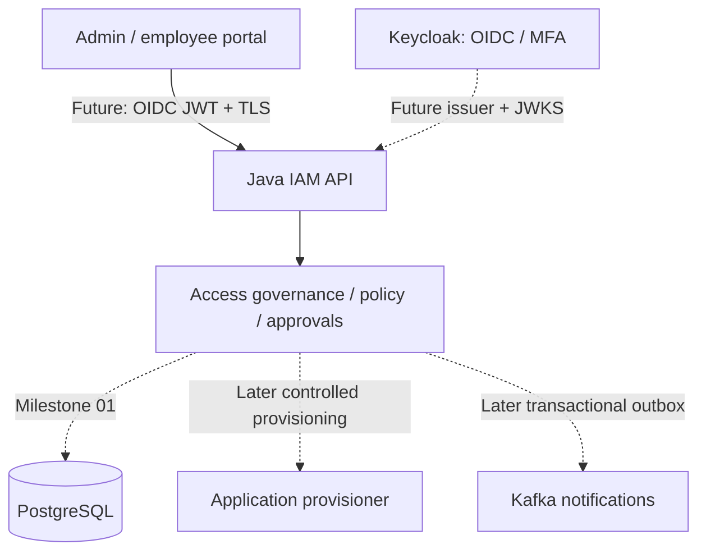

# Enterprise Identity & Access Management Platform

**Status: Milestone 00 — initial foundation, not a functional IAM product.**

A Java 25 / Spring Boot 4.1.2 educational platform for enterprise access governance: access requests, approval controls, tenant isolation, account lifecycle orchestration, evidence and safe provisioning integrations. **No real identities or applications are provisioned in this baseline.**

## Design at a glance

- **Single deployable, modular monolith initially.** Domain-oriented packages, API ↔ application ↔ domain ↔ integration boundaries. Do not split into services prematurely.
- **Keycloak is the identity provider**, introduced in a later milestone. The platform will *not* implement its own credential verification, authorization server, or cryptographic token issuance.
- **Authorization is resource-aware.** Verified JWT authentication and coarse scopes are necessary but not sufficient. A tenant and resource decision, actor/requester separation, and approval constraints are part of UC-001.
- **PostgreSQL + Flyway** enter with persisted access requests in Milestone 01. The current build intentionally contains no database connection or migration.
- **Security fails closed:** only the local Actuator health endpoint is anonymous; all other requests are denied. This is a bootstrap boundary, not production hardening.

## Architecture



Solid arrows show the intended logical application path. Dashed connections are **not implemented in Milestone 00**.

## Prerequisites

Java 25, Maven 3.9+, Git. Docker is needed only for future integration tests; no Docker service is created by Milestone 00.

```bash
java -version
mvn -version
mvn -B --no-transfer-progress clean verify
mvn spring-boot:run
# separate terminal:
curl -fsS http://127.0.0.1:8080/actuator/health
```

Only `/actuator/health` is intentionally available anonymously. There are no IAM business endpoints yet; **a successful health check must not be interpreted as UC-001 implemented**.

## Documentation map

- [UC-001: Request employee access](docs/use-cases/UC-001-application-access-request.md)
- [ADR-0001: Modular monolith](docs/adr/0001-modular-monolith.md)
- [ADR-0002: Delegate authentication to Keycloak](docs/adr/0002-identity-provider-boundary.md)
- [Architecture](docs/architecture/system-overview.md)
- [Threat model](docs/security/threat-model.md)
- [Delivery roadmap](docs/roadmap.md)
- [Engineering standards](docs/engineering-standards.md)

## GitHub deployment

To create a **public portfolio repository** under your verified `asambataiden` identity (after reviewing all files), run `bash scripts/create-github-repo.sh`. It requires explicit confirmation and rejects an existing remote. The repo is *not* created merely by downloading this archive.

## Evidence discipline

Every future acceptance claim requires a reproducible test, observed output, commit SHA and documented scope. No real user attributes, access tokens, client secrets or passwords may enter Git history. This capstone is a portfolio exercise, not an audited IAM product.
