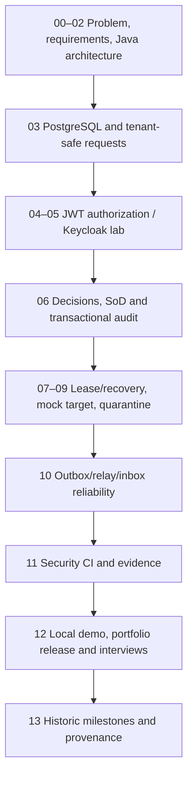

# Enterprise IAM Documentation — Start Here

This directory is the **single navigation entry point** for learning and presenting the educational Enterprise Identity & Access Platform. It separates an ordered **curriculum** from business **use cases**, architecture **views**, historical implementation **milestones**, release **evidence** and interview **practice**.

**Published implementation release:** `v0.1.0-portfolio` → `cf0e2fce324fa6c81bf5bccc4ee49dadf1925391` (immutable tag). Later documentation changes live on `main`; they are not part of that historical tag.

## API contract governance

The [OpenAPI 3.1 contract](api/README.md) defines the four real public business HTTP operations, JWT/scope requirements, request and response models, expected status codes and the limits of current documentation exposure. The [machine-readable JSON contract](api/openapi.json) is checked by the Python security-test suite; generated OpenAPI and Swagger UI are now **disabled by default**, with an explicit loopback-only `openapi-local` development profile and HTTP regression tests.

## Choose your path

| Audience / goal | Start | Then |
| --- | --- | --- |
| New learner / restart from zero | [Learning Lesson 00](learning/00-orientation-and-prerequisites.md) | [All 13 lessons](learning/README.md) in numeric order |
| Business analyst / product owner | [Use-case catalogue](use-cases/README.md) | UC-001 → UC-010 and scenario addendum |
| Software architect | [Architecture index](architecture/README.md) | Four focused diagrams and as-built overview |
| Engineer reproducing behavior | [Complete engineering guide](portfolio/complete-engineering-guide.md) | [Milestone map](learning/13-implementation-provenance-and-milestone-map.md) → source/tests |
| Senior Java / IAM / DevSecOps interview | [Technical interview workbook](portfolio/technical-interview-workbook.md) | [Concurrency case study](learning/19-concurrency-idempotency-approval-case-studies.md) |
| Release reviewer | [Release evidence](release/evidence-register.md) | [Runbook](release/local-operations-runbook.md), [capability matrix](architecture/capability-matrix.md) |

## End-to-end learning sequence

## Study standards

Every lesson contains the **business problem, concepts, actual implementation walkthrough, why each technology/design choice was made, Mermaid flow, source and migration links, tests, failure cases, interview questions and completion checklist**.

Every use-case document distinguishes **preconditions, actors, normal path, negative/retry behavior, transaction/persistence invariants, test sources and remaining limits**. Architecture docs cover context/components, data/state, security trust and failure recovery.

The original milestone notes remain as chronological records: a statement such as “not implemented” or “pending” from an early authoring date may have been superseded by later code. Never silently treat an early proposed path as current, or a lab demonstration as the currently unverified real Keycloak-issued HTTP token acceptance.

## Required release accuracy

The platform is a **tested educational modular monolith** with synthetic IAM requests/decisions, local mock target and in-process event-delivery tests. It is **not** a production identity service. There is no real entitlement provisioning, production broker/scheduler, cloud/HA/backup/SLO assessment, or successful live Keycloak token-to-API acceptance in the tagged release.

**Suggested order today:** [Lesson 00](learning/00-orientation-and-prerequisites.md) → [UC-001](use-cases/UC-001-application-access-request.md) → [Architecture 01](architecture/01-context-containers-and-modules.md) → the next lessons in order, with Testcontainers tests where relevant.
