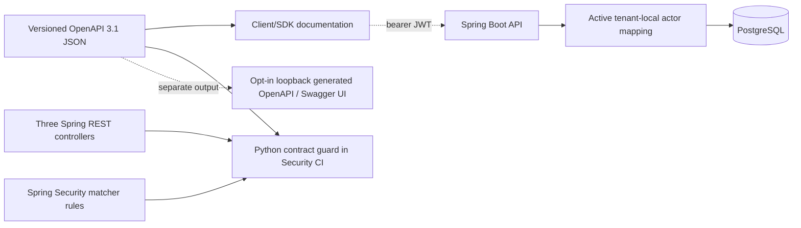

# IAM OpenAPI 3.1 contract — source and learning guide

This directory contains the **versioned public HTTP contract and development-only runtime OpenAPI integration** for the current IAM modular-monolith API:

- [`openapi.json`](openapi.json) — OpenAPI 3.1, importable into Swagger Editor/UI, Stoplight or compatible client generation tools.
- [Standard-library contract guard](../../ops/security/test_iam_openapi_contract.py) — checks that the four documented operations still match the known controller routes, permission metadata, request bodies and response shapes.

## Static contract and opt-in runtime generation

The checked-in `openapi.json` remains the reviewed, versioned **canonical business contract**. The runtime now has a second, dynamically generated OpenAPI description using **springdoc-openapi 3.2.0**, compatible with **Spring Boot 4.1.2**. It scans the three real HTTP controllers and is intentionally **disabled unless the explicit `openapi-local` Spring profile is active**.

| Context | `/v3/api-docs` | `/swagger-ui.html` | IAM API |
| --- | --- | --- | --- |
| Default profile | Disabled and default-denied | Disabled and default-denied | JWT and local permission checks unchanged |
| `openapi-local` profile | Anonymous GET on loopback only | Anonymous GET on loopback only, Try it out disabled | JWT and local permission checks unchanged |
| Production/public hosts | Do not activate the profile | Do not activate the profile | Requires separate deployment threat assessment |

Implementation: [local profile](../../src/main/resources/application-openapi-local.yml), [profile-specific security chain](../../src/main/java/dev/asambataiden/iam/bootstrap/LocalOpenApiConfiguration.java), [default-off properties](../../src/main/resources/application.yml).

The opt-in profile uses `server.address: 127.0.0.1`, and only documentation GET paths are permitted by the higher-priority development-only security chain. An operator must **not** override the bind address to `0.0.0.0` or enable this profile on a shared or production service. Other paths continue to use the existing bearer-token/default-deny security policy.

**Important contract distinction:** the static OpenAPI artifact is reviewed and guarded by the existing Python tests. Generated runtime output is controller-derived; the new HTTP integration tests enforce its exact four-operation public surface, bearer scheme and default-disabled exposure. They do not yet implement a complete semantic diff of every schema property and response against the static file.

## Run the focused runtime tests

From the repository root, with Java 25, Maven and Docker Testcontainers available:

```bash
mvn -B --no-transfer-progress \
  -Dit.test=OpenApiDisabledByDefaultIT,LocalOpenApiExposureIT \
  -DfailIfNoTests=false verify

python3 -m unittest ops.security.test_iam_openapi_contract -v
```

The two Java integration test classes use **disposable PostgreSQL 17** and exercise the Spring servlet filter chain. They check disabled-by-default docs, the opt-in UI and generated JSON, the four documented business operations, and continued protection of real IAM routes. This guide does not claim an observed PASS until CI or local execution reports it.

### Optional local browser viewing

Use a **disposable local database** configured with your own environment variables and start the API with the explicit profile; no local browser access is required for the automated tests:

```bash
# Use an existing isolated local PostgreSQL; never put real passwords in shell history or source.
# Supply DB_URL, DB_USERNAME, DB_PASSWORD securely in your terminal environment.
mvn spring-boot:run -Dspring-boot.run.profiles=openapi-local \
  -Dspring-boot.run.arguments=--server.port=8082
```

Then visit `http://127.0.0.1:8082/swagger-ui.html` or `http://127.0.0.1:8082/v3/api-docs`. These URLs are available **only while that local process/profile is running**. The browser UI is documentation-first; Try it out is disabled to avoid accidental access-request/approval mutations.

## Next API governance gates

- Review the generated schema and canonical contract side-by-side, including required fields, enums, nullability, idempotency headers and 201/409 semantics.
- Add a normalized semantic OpenAPI diff where justified; document intentional differences (such as implementation-inferred names/validation metadata) instead of blindly replacing the reviewed contract.
- If a real frontend or SDK is added, include consumer-driven API contract tests and deliberate breaking-change policy.
- Treat public documentation hosting as a **new security design**, not permission to simply enable `/v3/api-docs` for all environments.

## Public API surface and security

| Operation | Route scope | Local permission | Behavior |
| --- | --- | --- | --- |
| `POST /api/v1/access-requests` | `SCOPE_access:request` | `ACCESS_REQUEST_CREATE` | Create one tenant-local PENDING request or equivalent idempotent replay |
| `POST /api/v1/access-requests/{requestId}/decision` | `SCOPE_access:decide` | `ACCESS_REQUEST_DECIDE` | One approved/rejected decision with transactional audit |
| `GET /api/v1/provisioning/quarantine` | `SCOPE_provisioning:review` | `PROVISIONING_QUARANTINE_REVIEW` | Bounded read-only tenant-local list |
| `GET /api/v1/provisioning/quarantine/{requestId}` | `SCOPE_provisioning:review` | `PROVISIONING_QUARANTINE_REVIEW` | Read-only tenant-scoped detail |

These are the only documented business REST operations. `GET /actuator/health` remains an **anonymous infrastructure health** route and is deliberately not advertised as an IAM business resource.

**Not public:** provisioning lease/claim, target apply/readback, review-journal writes, outbox relay, inbox receipt and remediation operations. Merely creating an internal Java `@Service` does not expose an HTTP API.

## Contract architecture



The contract is **descriptive**, not an authorization policy. The API still enforces cryptographic JWT verification, route scope, local active employee permission and resource/transaction invariants.

## Step-by-step example — access request

1. Client sets `Authorization: Bearer <token>` and `Idempotency-Key: <opaque-business-key>`.
2. JSON body contains only `employeeId`, `applicationId` and `roleKey`. **Do not send `tenantId` or `requesterId` as trusted identity; the controller derives these server-side.**
3. Spring Security checks `SCOPE_access:request`; local mapping checks active `ACCESS_REQUEST_CREATE`.
4. PostgreSQL tenant-scoped unique constraint handles retries. The controller returns **201 + Location header** for both first create and equivalent replay, **409** on changed intent with the same tenant/key, and generic **404** on unavailable tenant-local resources.
5. The response includes the stored request ID, server-derived tenant/requester IDs and status. No real entitlement is granted.

**Decision example:** `{"decision":"APPROVED"}` or `{"decision":"REJECTED"}`. The server never accepts a caller-supplied approver; an approval generates work intent, not a third-party grant.

**Quarantine example:** `GET /api/v1/provisioning/quarantine?limit=20` (range 1–100). The returned snapshots are diagnostic and cannot requeue work.

## Validation

```bash
python3 -m json.tool docs/api/openapi.json >/dev/null
python3 -m unittest ops.security.test_iam_openapi_contract -v

# Existing security helper suite also discovers the contract guard:
python3 -m unittest discover -s ops/security -p 'test_*.py'
```

The validator uses only the Python standard library, checks exact documented routes, security metadata, model field names and required error/response codes, and blocks accidentally adding internal administration/provisioning paths to the public spec.

**Limitations:** the Python check is a **static source-level guard**; the separate Java runtime integration tests verify generated paths, security scheme and visibility under two profiles, but do not assert every JSON response schema/property semantically matches a live business request. The OpenAPI model captures named Java records but does not prove the API rejects unknown JSON fields. The spec does not invent an exact Spring error-response JSON schema because that body was not standardized in the implemented controllers.

## Learning and interviews

**Why OpenAPI?** It makes resource paths, input validation expectations, response codes and bearer requirements reviewable and consumable by client developers. It is part of API contract governance alongside tests; it cannot replace real authorization or runtime contract tests.

**Why not publicly enable Swagger by default?** IAM exposes security-sensitive resource metadata. A documentation endpoint must be considered a managed surface, not an automatic anonymous backdoor.

**What would justify a breaking API version?** Removing/renaming fields, changing response semantics, altering authentication expectations or changing legal state transitions can break clients; add versioned contract review and consumer tests before `/api/v2`.

Related: [Lesson 02](../learning/02-java-spring-boot-module-structure.md), [Lesson 04](../learning/04-spring-security-jwt-and-actor-mapping.md), [UC catalogue](../use-cases/README.md), [architecture index](../architecture/README.md) and [release evidence](../release/evidence-register.md).
