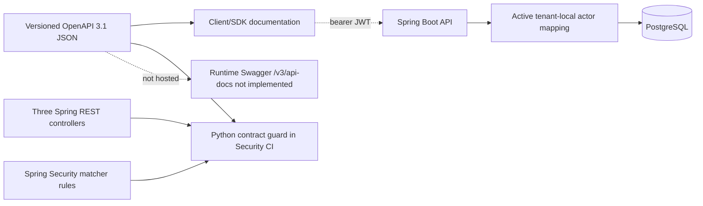

# IAM OpenAPI 3.1 contract — source and learning guide

This directory contains the **versioned machine-readable public HTTP contract** for the current IAM modular-monolith API:

- [`openapi.json`](openapi.json) — OpenAPI 3.1, importable into Swagger Editor/UI, Stoplight or compatible client generation tools.
- [Standard-library contract guard](../../ops/security/test_iam_openapi_contract.py) — checks that the four documented operations still match the known controller routes, permission metadata, request bodies and response shapes.

## Why this increment uses a checked-in specification

The existing API is **default-deny**, the local Keycloak-to-API positive token path is still unverified in the portfolio release, and runtime OpenAPI endpoints (e.g. `/v3/api-docs` and Swagger UI) would introduce **new HTTP surfaces**. The first increment therefore changes **no runtime endpoints and adds no new Maven dependencies**.

The contract file can be loaded into a locally hosted Swagger UI or a secure offline editor. **It is not currently served by the Spring Boot application**. We should introduce `springdoc-openapi-starter-webmvc-ui:3.2.0` for Spring Boot 4.1.x only in a separate reviewed increment with explicit endpoint access policy, default-disabled configuration, and HTTP integration regression tests. Upstream springdoc [Boot 4.1 support information](https://springdoc.org/) should be rechecked at implementation time.

## Public API surface and security

| Operation | Route scope | Local permission | Behavior |
| --- | --- | --- | --- |
| `POST /api/v1/access-requests` | `SCOPE_access:request` | `ACCESS_REQUEST_CREATE` | Create one tenant-local PENDING request or equivalent idempotent replay |
| `POST /api/v1/access-requests/{requestId}/decision` | `SCOPE_access:decide` | `ACCESS_REQUEST_DECIDE` | One approved/rejected decision with transactional audit |
| `GET /api/v1/provisioning/quarantine` | `SCOPE_provisioning:review` | `PROVISIONING_QUARANTINE_REVIEW` | Bounded read-only tenant-local list |
| `GET /api/v1/provisioning/quarantine/{requestId}` | `SCOPE_provisioning:review` | `PROVISIONING_QUARANTINE_REVIEW` | Read-only tenant-scoped detail |

These are the only documented business REST operations. `GET /actuator/health` remains an **anonymous infrastructure health** route and is deliberately not advertised as an IAM business resource.

**Not public:** provisioning lease/claim, target apply/readback, review-journal writes, outbox relay, inbox receipt and remediation operations. Merely creating an internal Java `@Service` does not expose an HTTP API.

## Contract architecture



The contract is **descriptive**, not an authorization policy. The API still enforces cryptographic JWT verification, route scope, local active employee permission and resource/transaction invariants.

## Step-by-step example — access request

1. Client sets `Authorization: Bearer <token>` and `Idempotency-Key: <opaque-business-key>`.
2. JSON body contains only `employeeId`, `applicationId` and `roleKey`. **Do not send `tenantId` or `requesterId` as trusted identity; the controller derives these server-side.**
3. Spring Security checks `SCOPE_access:request`; local mapping checks active `ACCESS_REQUEST_CREATE`.
4. PostgreSQL tenant-scoped unique constraint handles retries. The controller returns **201 + Location header** for both first create and equivalent replay, **409** on changed intent with the same tenant/key, and generic **404** on unavailable tenant-local resources.
5. The response includes the stored request ID, server-derived tenant/requester IDs and status. No real entitlement is granted.

**Decision example:** `{"decision":"APPROVED"}` or `{"decision":"REJECTED"}`. The server never accepts a caller-supplied approver; an approval generates work intent, not a third-party grant.

**Quarantine example:** `GET /api/v1/provisioning/quarantine?limit=20` (range 1–100). The returned snapshots are diagnostic and cannot requeue work.

## Validation

```bash
python3 -m json.tool docs/api/openapi.json >/dev/null
python3 -m unittest ops.security.test_iam_openapi_contract -v

# Existing security helper suite also discovers the contract guard:
python3 -m unittest discover -s ops/security -p 'test_*.py'
```

The validator uses only the Python standard library, checks exact documented routes, security metadata, model field names and required error/response codes, and blocks accidentally adding internal administration/provisioning paths to the public spec.

**Limitations:** this is a **static source-level guard**, not a runtime introspection or an HTTP test proving the actual JSON serialization on every path. The OpenAPI model captures named Java records but does not prove the API rejects unknown JSON fields. The spec does not invent an exact Spring error-response JSON schema because that body was not standardized in the implemented controllers.

## Recommended next implementation increment — runtime generation

After reviewing this contract, add the Spring Boot 4-compatible `springdoc-openapi` starter and:

1. Provide route and schema annotations or configuration where automatic inference is insufficient.
2. Document JWT bearer, route scope, local permissions, `Idempotency-Key`, 201/409 and approval/SoD.
3. **Disable Swagger/OpenAPI endpoints by default**, enable only under a reviewed local development profile; ensure documentation access is explicitly permitted/denied as intended without weakening the `anyRequest().denyAll()` fallback.
4. Add `MockMvc` + Testcontainers tests proving anonymous/malformed/scopeless access behavior, no exposure by default, no write endpoints from docs, and a valid generated contract when intentionally enabled.
5. Compare generated schema with this canonical contract and fail CI on relevant drift, using a maintained policy for server URLs/examples and non-semantic schema ordering.
6. Re-run the four existing CI checks plus dependency/SCA analysis; document the artifact/version and security rationale.

## Learning and interviews

**Why OpenAPI?** It makes resource paths, input validation expectations, response codes and bearer requirements reviewable and consumable by client developers. It is part of API contract governance alongside tests; it cannot replace real authorization or runtime contract tests.

**Why not publicly enable Swagger by default?** IAM exposes security-sensitive resource metadata. A documentation endpoint must be considered a managed surface, not an automatic anonymous backdoor.

**What would justify a breaking API version?** Removing/renaming fields, changing response semantics, altering authentication expectations or changing legal state transitions can break clients; add versioned contract review and consumer tests before `/api/v2`.

Related: [Lesson 02](../learning/02-java-spring-boot-module-structure.md), [Lesson 04](../learning/04-spring-security-jwt-and-actor-mapping.md), [UC catalogue](../use-cases/README.md), [architecture index](../architecture/README.md) and [release evidence](../release/evidence-register.md).
