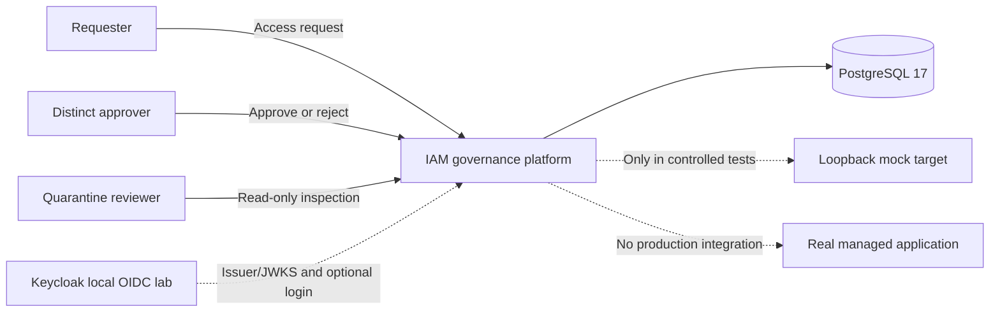
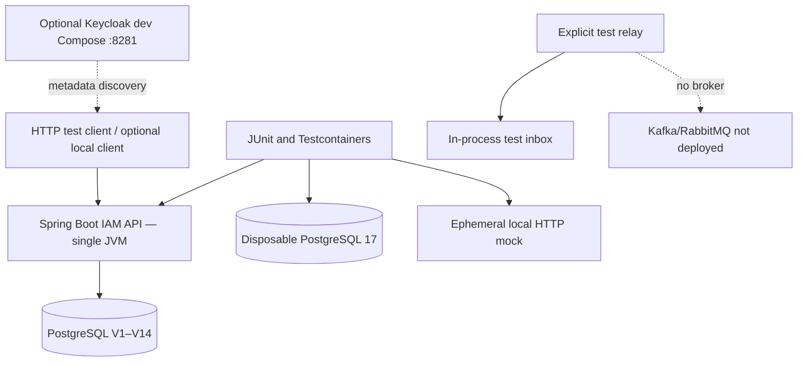
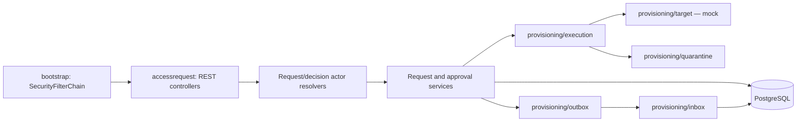

# Architecture 01 — Context, container and module boundaries

**Baseline:** `v0.1.0-portfolio`; one Java 25 / Spring Boot 4.1.2 modular monolith and PostgreSQL 17, with optional localhost Keycloak 26.8.2 lab. These diagrams are as-built **logical/test** views, not a production deployment C4 diagram. See [architecture index](README.md).

## 1. Context: why the platform exists

An authorized employee requests application access for another tenant-local employee; a separate approver makes a governance decision, generating auditable evidence and **simulated** downstream work. The platform does not store passwords, issue access tokens, create real SaaS entitlements or operate a broker.

The dotted Keycloak link indicates a configured trust relationship/local lab, **not** demonstrated successful production-issued JWT acceptance. The dotted real target is explicitly **absent**.

## 2. Container view: what actually runs

**Runtime distinction:** JUnit integration tests start their own disposable PostgreSQL; a separately started application needs its own configured local database. The mock adapter and in-process publisher are **explicitly constructed** in tests, not auto-registered background workers. A diagram must not imply continuous autonomous delivery.

## 3. Internal module/package view

| Package | Concrete examples | Responsibility / why |
|---|---|---|
| `bootstrap` | `BootstrapSecurityConfiguration` | Deny-by-default bearer filter; separate authentication boundary |
| `accessrequest` | `AccessRequestService`, `ApprovalDecisionService` | Invariants for request/decision transaction |
| `provisioning/execution` | `ProvisioningLeaseService`, `MockProvisioningOrchestrator` | Bounded work ownership and controlled simulation |
| `provisioning/target` | `ProvisioningTargetAdapter`, loopback adapter | Target contract/readback separated from business decision |
| `provisioning/quarantine` | inspector, review journal, GET controller | Diagnosis without automatic remediation |
| `provisioning/outbox` | `OutboxRelay`, `OutboxDeliveryService` | Durable event intent and lease-fenced dispatch |
| `provisioning/inbox` | `ProvisioningInboxConsumer` | Local receipt/projection transaction |

## 4. Alternatives, trade-offs and guardrails

**Why modular monolith?** It keeps local governance invariants inside PostgreSQL transactions; it avoids distributed transaction, network and deployment overhead until measured needs justify extraction.

**Why explicit JDBC?** Tenant keys, row locks and migration triggers are reviewed directly; there is no hidden ORM cascade. Trade-off: manually maintained SQL and mapping code, which warrants integration tests.

**Why not build Keycloak into the service?** Delegating credential authentication and OIDC protocols to an external IdP reduces custom security code. It requires trustworthy JWKS/issuer/audience configuration and local identity binding.

**Why not a broker yet?** The educational goal is to validate outbox/inbox invariants using a trusted in-process test bridge. Broker durability and authenticated listener are distinct future gates.

## 5. Reading and validation path

1. Read [ADR-0001](../adr/0001-modular-monolith.md) and [ADR-0002](../adr/0002-identity-provider-boundary.md).
2. Inspect `src/main/java/dev/asambataiden/iam/bootstrap/BootstrapSecurityConfiguration.java` and the five provisioning subpackages.
3. Follow [Lesson 02](../learning/02-java-spring-boot-module-structure.md), [system overview](system-overview.md), and [capability matrix](capability-matrix.md).
4. Reproduce tests from [demo runbook](../release/portfolio-demo-runbook.md), then explain what each diagram does **not** prove.
