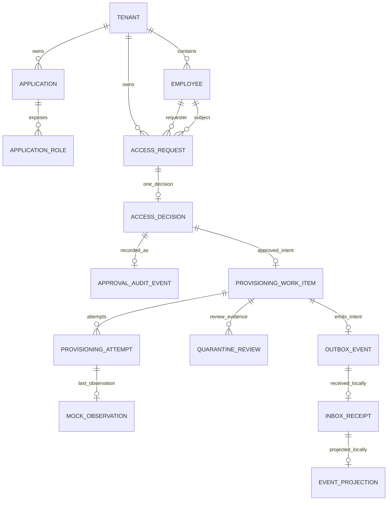
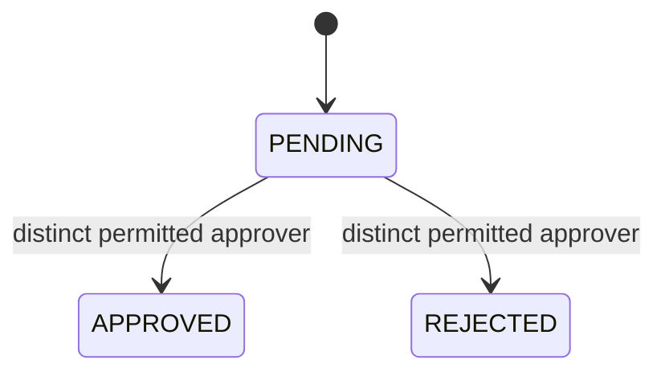
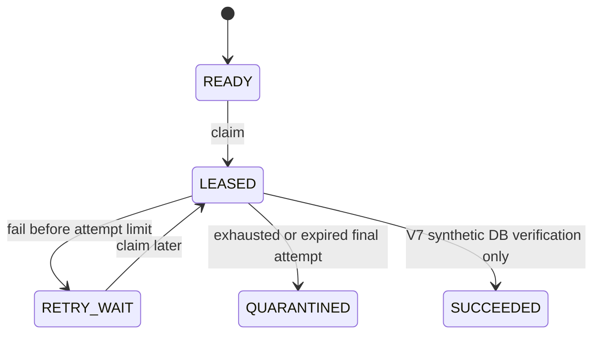

# Architecture 02 — Domain, relational data and state-machine boundaries

**As-built baseline:** PostgreSQL 17 / Flyway V1–V14; synthetic local IAM test system. The models below are conceptual summaries of the applied migration chain; inspect migrations for authoritative DDL and constraints.

## 1. Entities and ownership

Diagram relationships emphasize business ownership. Actual FK structure differs in places (e.g. outbox deliberately has **no direct FK** to work-item); do not use this diagram as a migration generator or assume every conceptual edge is a physical FK.

## 2. Migration-by-migration schema roadmap

| Migration | Capability | Integrity question answered |
|---|---|---|
| V1 | tenants, employees, apps, app roles, access requests | Can a request refer to foreign tenant entities? |
| V2 | IdP subject mapping and explicit employee permissions | Can a valid JWT map to an active locally permitted employee? |
| V3 | decisions, one-decision PK, requester-bound SoD constraint | Can an approver decide for self or decide twice? |
| V4 | approval audit trigger | Can an approved decision commit without its audit record? |
| V5 | approved provisioning work | Is work bound to an APPROVED decision? |
| V6 | leases/retry/quarantine | Can stale or competing workers mutate current work state? |
| V7 | synthetic entitlement and guarded simulated completion | Can local simulated SUCCEEDED be forged without evidence? |
| V8 | STARTED attempt evidence | Is attempt initiation durable before target interaction? |
| V9 | mock observation | Can an attempt record VERIFIED/ABSENT/UNKNOWN under its lease? |
| V10 | quarantine review | Can reviews be structured and idempotent without requeueing? |
| V11 | review permission | Does inspection require specific reviewer authorization? |
| V12 | durable transactional outbox | Can approved intent commit without durable dispatch intent? |
| V13 | event delivery leases/retries | Can stale relay acknowledge an event? |
| V14 | inbox receipt and local projection | Can duplicate event ID repeat a local effect? |

Do not edit an applied migration to “fix” it; create a new, tested Flyway migration with backward compatibility review.

## 3. Distinct state machines — do not collapse them

Request states belong to governance only. The original UC-001 mentions possible CANCELLED/ACTIVE states as *future candidates*; the released request decision state is PENDING/APPROVED/REJECTED.

Outbox has PENDING/LEASED/RETRY_WAIT/DELIVERED/DEAD_LETTER-style delivery states under V13. Inbox's RECEIVED is **not** an entitlement state. A mock-target VERIFIED observation is not a durable real-access grant.

## 4. Atomicity and concurrency decisions

- V1 `UNIQUE (tenant_id,idempotency_key)` converges retries across JVMs; repeated changed business intent conflicts.
- V1 composite foreign keys enforce tenant association of requester, employee and role.
- V3 `SELECT ... FOR UPDATE` in the service serializes competing approval decisions; decision PK and SoD constraints defend against alternate writers.
- V4 trigger writes audit in the same decision transaction; privileged database users still can bypass triggers.
- V5/V12 approved work/outbox trigger chain commits with the decision, not an external publish.
- V6/V13 `SKIP LOCKED` and current token fences prevent stale local workers from recording someone else's attempt.
- V14 receipt and projection are one transaction; it is **local** idempotent processing, not exactly-once broker transport.

## 5. Practice exercises and evidence

1. Open each migration under `src/main/resources/db/migration/`; map the table and trigger introduced by each.
2. Inspect `AccessRequestService`, `ApprovalDecisionService`, `ProvisioningLeaseService`, `OutboxDeliveryService` and `ProvisioningInboxConsumer`.
3. Locate `AccessRequestPersistenceIT`, `ApprovalDecisionServiceIT`, `ProvisioningLeaseServiceIT`, `OutboxInboxEndToEndIT`, and `ProvisioningInboxConsumerIT`.
4. For each table write, state the transaction boundary, unique/foreign-key guard, rollback trigger, and whether any remote side effect exists.
5. Read [Lessons 03, 06, 07 and 10](../learning/README.md) and the [use-case catalogue](../use-cases/README.md).

**Interview challenge:** “A request was APPROVED, the event is DELIVERED, inbox says RECEIVED, but the user cannot log into the target app.” Explain why these facts are consistent and not a bug in the stated educational scope.
