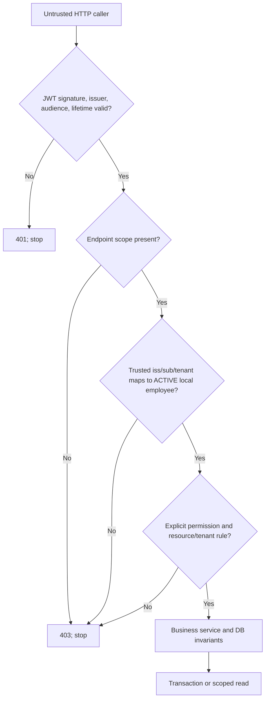
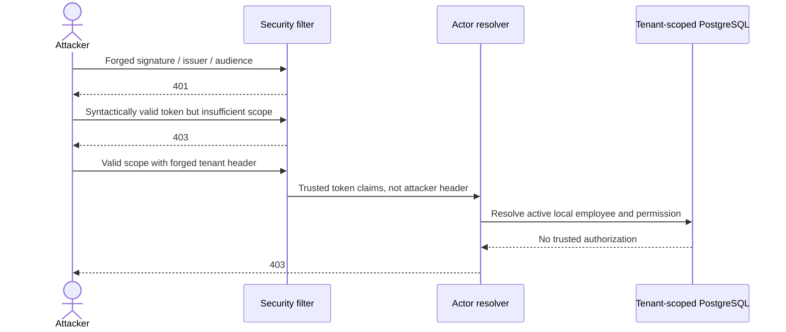

# Architecture 03 — IAM security trust boundaries and negative flows

**Scope:** educational authorization design with verified unit/HTTP/integration tests. The live Keycloak-issued token-to-API acceptance path is **unverified** in the tagged release. This is not a penetration-test report.

## 1. Layered authorization

**Why multiple checks?** Signed claims establish token authenticity; they do not establish the current lifecycle status or delegated local authority of a user for a tenant's resource. A scope is necessary but not sufficient.

## 2. Three distinct JWT test boundaries

| Layer | Mechanism | Proves | Does not prove |
|---|---|---|---|
| Mock principal HTTP | `spring-security-test jwt()` | Scope, mapping, business 403/404/no-write branches | Signature or live Keycloak compatibility |
| Offline RSA decoder | `SignedJwtTrustValidationTest` | Signature, issuer, audience, expiry validations with ephemeral RSA key | Live JWKS discovery |
| Real servlet filter, test decoder | `SignedJwtHttpFilterIT` | Signed bearer-string rejection through Spring filter chain, including 401 vs 403 | Production decoder auto-configuration or actual Keycloak token |
| Local OIDC metadata | `ops/keycloak/verify-runtime.py` | Issuer, same-origin JWKS metadata readiness | Signed real access-token acceptance |

A historically documented early PKCE lab experiment and a later blocked PR are separate observations. Do not imply the frozen portfolio release proved the currently unresolved positive live HTTP interoperability.

## 3. HTTP surface and security authority

| Endpoint | Route gate | Further local check | Access behavior |
|---|---|---|---|
| `POST /api/v1/access-requests` | `SCOPE_access:request` | Request actor with local create permission, active tenant entities | Create PENDING intent |
| `POST /api/v1/access-requests/{requestId}/decision` | `SCOPE_access:decide` | Distinct active local approver and PENDING state | Commit one decision |
| `GET /api/v1/provisioning/quarantine[/{requestId}]` | `SCOPE_provisioning:review` | Tenant-scoped active reviewer permission | Read-only diagnostics |
| `GET /actuator/health` | Anonymous | None | Health only |
| Other routes | `denyAll` | — | No public provisioning/relay/admin operations |

The application is stateless bearer-only, HTTP Basic and form login disabled. Current CSRF exclusion must be revisited before cookie/session authentication or automatic browser credentials are introduced.

## 4. Threat flows and expected protection

Other material threats: request idempotency key replay with changed intent (409), self-approval (SoD DB constraint), foreign resource existence leakage (404), stale lease writes (token fencing), event replay (inbox receipt uniqueness), malicious or ambiguous mock target redirects (loopback validation), and sensitive report content (curated CI evidence only).

## 5. Controls and residual risks

- Tenant scoping is both application policy and composite PostgreSQL FKs; neither replaces the other.
- Audit DB triggers constrain ordinary UPDATE/DELETE but are not cryptographic WORM against privileged operators.
- Current SpotBugs checks retain reviewed exclusions and nine known unresolved analysis reference names; green CI is not complete static-analysis coverage.
- The GitHub Action pin validator checks configured workflow inventory, not all possible third-party action and reusable workflow forms.
- CI JSON manifests record digests, not signed attestations, and upload-artifact retention is 14 days.
- Real IdP key rotation, secrets lifecycle, revocation race control, external entitlement reconciliation, production TLS/HA and security assessment remain outside the portfolio release.

## 6. How to verify and explain

Start with [Lesson 04](../learning/04-spring-security-jwt-and-actor-mapping.md), [threat model](../security/threat-model.md) and [UC-002](../use-cases/UC-002-identity-jwt-and-tenant-authorization.md). Inspect `BootstrapSecurityConfiguration`, the three actor resolvers and signed JWT test classes. Explain why **401 vs 403**, and why HTTP policy tests with injected JWT principals do not validate cryptography.

**Interview prompt:** “I can mint a correctly signed JWT with `access:decide`; can I approve anyone in any tenant?” No. JWT trust, local employee mapping, explicit permission, request tenant association, SoD, terminal state and DB constraints must all pass.
