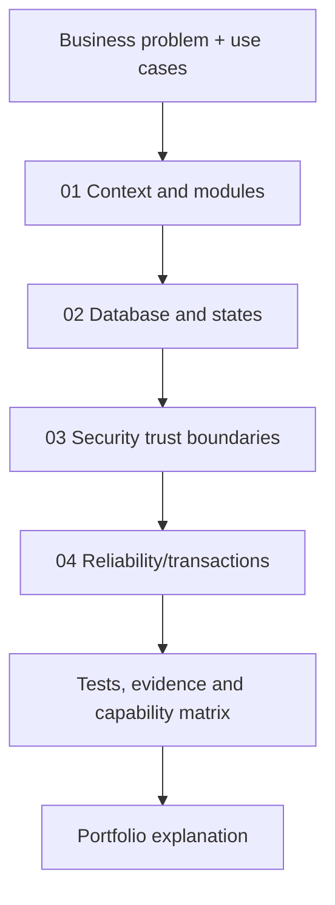

# Enterprise IAM — Architecture Documentation Index

**Scope:** source-grounded architecture of the educational IAM governance release `v0.1.0-portfolio`. These diagrams cover logical/test boundaries, not a production deployment topology. Use alongside the [learning curriculum](../learning/README.md) and [use-case catalogue](../use-cases/README.md).

## Recommended reading order

| Step | Architecture reference | Central question |
| --- | --- | --- |
| 1 | [Context, containers and modules](01-context-containers-and-modules.md) | Who interacts with IAM, what actually runs, and why one modular monolith? |
| 2 | [Domain state and relational data model](02-domain-state-and-data-model.md) | Which states/tables/migrations enforce governance and concurrency? |
| 3 | [Security trust boundaries and threat flows](03-security-trust-boundaries-and-threat-flows.md) | Where does JWT identity become resource-level authorization and how are invalid calls denied? |
| 4 | [Transactions, reliability and failure sequences](04-reliability-transactions-and-failure-sequences.md) | What happens during lost ACKs, stale workers, duplicate events and rollback? |
| 5 | [As-built system overview](system-overview.md) | What routes, packages and local event paths actually exist? |
| 6 | [Capability matrix](capability-matrix.md) | Which behaviors are implemented, simulated, pending or absent? |
| 7 | [Provisioning package refactor](provisioning-package-refactor.md) | Why split execution, target, quarantine, outbox and inbox packages? |

## Architecture map

## How to interpret diagrams

- **As-built** means classes and transaction/test flows have been inspected; it does not mean continuously running production components.
- **Logical mock** means a loopback HTTP target or in-process publisher is used only in controlled demonstrations.
- **Future or unavailable** integrations (real SaaS provisioning, production broker, HA, cloud cluster, SCIM, identity certification) are explicitly labeled **not implemented**.
- **Dotted links** represent optional/test/future paths, not confirmed deployed connectivity.
- **Database constraints/triggers** are shown conceptually; always check actual Flyway SQL, especially where conceptual relationships are not physical foreign keys.

## Architecture review checklist

- [ ] Explain ADR-0001 and ADR-0002 and alternatives.
- [ ] Trace HTTP bearer → scope → local employee/permission → service → DB.
- [ ] Explain V1–V14 purpose and distinguish request, work, event and projection states.
- [ ] Draw approval atomic transaction and competing approvers.
- [ ] Draw lease expiry and fencing token recovery.
- [ ] Draw write-ahead STARTED and mock read-before-write after a lost acknowledgment.
- [ ] Draw transactional outbox, relay, inbox receipt and local deduplication.
- [ ] List all unverified live/production integration boundaries before making maturity claims.

## Complementary references

- [Threat model](../security/threat-model.md)
- [Engineering standards](../engineering-standards.md)
- [Technical interview workbook](../portfolio/technical-interview-workbook.md)
- [Release operations runbook](../release/local-operations-runbook.md)
