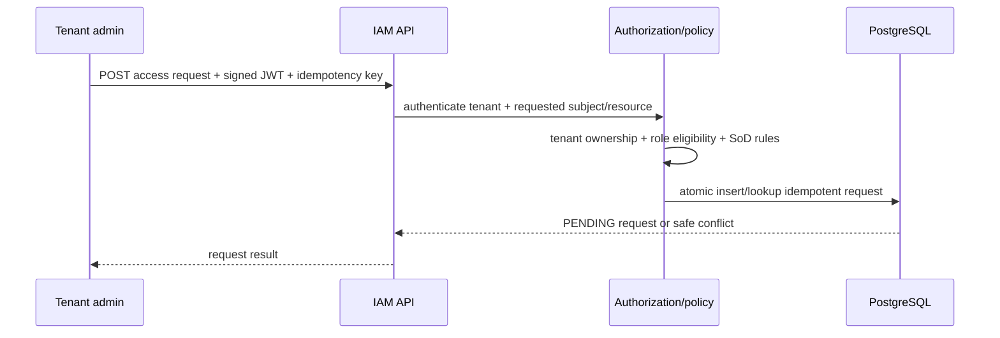

# IAM Platform — Architecture baseline

**Type:** logical target architecture. **Status:** Milestone 00; only bootstrap process, health endpoint and security deny rule are implemented.

## System context

- Admin and employee portal: future OIDC client.
- Identity provider: planned Keycloak development integration.
- Java IAM Governance Service: one deployable and future access request API.
- PostgreSQL: future transactional source of truth for access governance.
- Managed applications: future provisioning target via narrowly scoped adapters.

## Trust boundaries

1. Client → API: authenticate JWT and validate operation-specific scope; never derive tenant from untrusted form fields.
2. API → domain: resource-specific policy checks, subject state, separation of duties and tenant isolation.
3. Domain → database: DB constraints plus transactional audit/outbox, not only Java checks.
4. Governance → Keycloak/admin APIs: least-privilege service identity, retries/idempotency and bounded scopes.
5. Governance → external applications: ensure approval does not mean actual provisioning success; reconcile states.

## Runtime sequence — proposed UC-001

**This is design only:** no UC-001 endpoint or database is implemented in this milestone.
