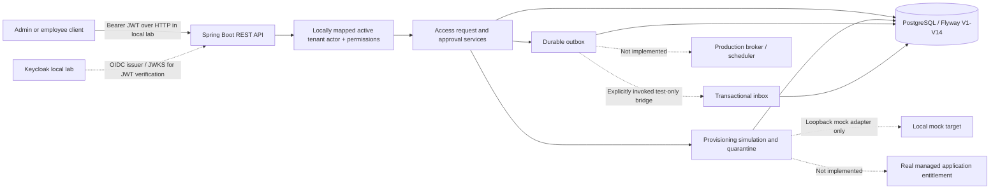

# Enterprise IAM platform — as-built architecture

**Baseline:** `3350df1` (`main`, after PR #36), 2026-11-13. **Scope:** educational modular monolith; this is not an audited production IAM deployment. See [capability matrix](capability-matrix.md), [security threat model](../security/threat-model.md), and [delivery roadmap](../roadmap.md).

## System context and trust boundaries



**Solid links:** implemented service or persistence relationships; deployment specifics depend on the selected local lab. **Dotted links:** development/test-only links or explicitly unavailable future integrations; these are labeled individually and do not imply production readiness. The in-process publisher is **not** an auto-registered Spring bean.

## HTTP surface implemented

| Route | Controller | Security gate | Further local check |
| --- | --- | --- | --- |
| `POST /api/v1/access-requests` | `AccessRequestController` | `SCOPE_access:request` | JWT actor mapping, active tenant employee and permission/target constraints; tenant/requester not accepted in body |
| `POST /api/v1/access-requests/{requestId}/decision` | `ApprovalDecisionController` | `SCOPE_access:decide` | Resolved decision actor, approval policy and state transition |
| `GET /api/v1/provisioning/quarantine[/{requestId}]` | `QuarantineInspectionController` | `SCOPE_provisioning:review` | Tenant-scoped reviewer resolution; inspection only |
| `GET /actuator/health` | Actuator | Anonymous access | Health is not an authorization or provisioning endpoint |

Other paths deny by default (aside from Spring error dispatch handling). SecurityFilterChain is stateless, bearer/JWT based, without form or HTTP Basic login. **HTTP route scopes are necessary but not sufficient for authorization.** No public operation is provided to trigger the outbox relay or grant an entitlement.

## Java package responsibilities

```text
dev.asambataiden.iam
├── bootstrap/             JWT resource-server security configuration
├── accessrequest/         intake, actor resolution, approvals, HTTP boundary
└── provisioning/
    ├── execution/        lease and simulated execution, attempt evidence
    ├── target/           target port, loopback HTTP adapter, observations
    ├── quarantine/       inspection, reviewer identity and review evidence
    ├── outbox/          relay, lease fencing, publisher and test bridge
    └── inbox/           transactional receipt and RECEIVED projection
```

These are **packages in one application**, not independently deployable services or hardened modules. A dependency rule should be introduced only after testing actual usage and allowed direction; package names alone do not enforce architectural boundaries.

## Approval-to-inbox lifecycle (local test scenario)

```mermaid
sequenceDiagram
    participant C as Authorized caller
    participant API as Approval API
    participant DB as PostgreSQL
    participant R as Explicit test relay
    participant I as Transactional inbox
    C->>API: Decision with authorized HTTP principal (mock-JWT HTTP IT)
    API->>DB: Approval + audit + provisioning work + outbox event (atomic)
    DB-->>API: Commit
    R->>DB: Claim event with lease token; commit
    R->>I: Test in-process publish with stable event ID
    I->>DB: Receipt + RECEIVED projection (atomic)
    DB-->>I: Commit or rollback
    I-->>R: Applied or duplicate
    R->>DB: Lease-fenced DELIVERED acknowledgment; commit
    Note over R,I: Crash or lost ACK may cause redelivery; inbox deduplicates local effect
```

### Transaction boundaries and operational limitations

- **Approval is not a grant.** Work items and outbox records represent approved intent and delivery intent, not access actually provisioned.
- **Claim / publish / acknowledge are separate phases.** No database transaction encompasses a remote send. Worker crash or lost acknowledgment can produce duplicate deliveries.
- **Inbox receipt and `RECEIVED` projection share one DB transaction.** This prevents repeated local projection effects for exact event retries; it does not guarantee exactly-once transport or external side effects.
- **Lease fencing** prevents an expired worker from acknowledging a successor's lease. Dead-letter states and quarantine evidence are not an autonomous remediation system.
- **Target integration remains mock-only**; no broker listener, scheduled relay, automated production provisioning, service deployment, backups, alerting or runbook qualification has been demonstrated.

## Evidence and next steps

The observed local regression for 04G-4 was **13 unit + 95 integration tests**, plus **33 Python tests**, all passing. GitHub Java CI was successful for PRs #35 and #36; the merge head of #36 is `3350df1`. This verifies the tested implementation, not production deployment or performance characteristics. For provenance and links, see [Milestone 04 closeout](../milestones/04-closeout-evidence.md).

**Later release-audit update (2026-11-14):** Security CI and offline RSA-signed HTTP JWT negative tests were added after this Milestone 04 snapshot. See the [current evidence register](../release/evidence-register.md) and [scope-frozen release gates](../release/portfolio-release-gates.md). The approval HTTP integration test uses a mocked JWT principal; separately, the signed-JWT HTTP filter suite uses test-only RSA keys and decoder. Neither proves live Keycloak interoperability. Production broker, provisioning target, deployment and SCIM remain absent.
