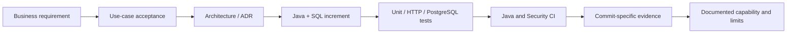
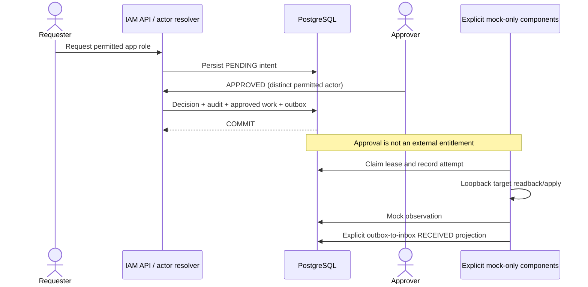

# Lesson 00 — Orientation: from business problem to running tests

**Track:** sequential IAM engineering curriculum · **Related milestone:** 00; portfolio release · **Baseline:** `v0.1.0-portfolio` (educational local/test scope). This is a learning guide, not a new implementation or fresh test execution.

## Learning outcome

Explain what IAM governance is, why this capstone exists, its non-goals, and how to reproduce an isolated baseline.

## Starting concepts

- IAM is governance over requests, decisions, and evidence; authentication is delegated and no real entitlement is granted.
- An access request is an intent, APPROVED is a decision, READY is work intent, DELIVERED is an event acknowledgement, RECEIVED is a local projection, and mock VERIFIED is synthetic evidence.
- One Spring Boot modular monolith with PostgreSQL, not a fleet of microservices. Keycloak is an optional local OIDC lab, not a required dependency for the curated test demo.

## Step-by-step implementation walkthrough

1. Read `README.md`, `docs/use-cases/UC-001-application-access-request.md` and ADR-0001/0002; write the business problem in two sentences.
2. Inspect `pom.xml`: Java 25, Spring Boot 4.1.2, Spring MVC/Security/JDBC, Flyway, Surefire/Failsafe, Testcontainers and SpotBugs.
3. Run `java -version`, `mvn -version` and `docker info` without changing the user's Docker containers.
4. Run `git rev-parse HEAD` then `bash ops/demo/run-portfolio-demo.sh` with Docker running. It creates disposable PostgreSQL test fixtures; it does not start Keycloak or a server on 8082.
5. Compare `docs/release/portfolio-demo-runbook.md` with the full regression `mvn -B --no-transfer-progress clean verify`. List what each proves.
6. Record actual exit status, SHA, and test counts. Never copy bearer tokens, passwords, or real user records into evidence.

## Why the design matters

Reproducibility and honest capability scoping should precede APIs. Starting with an operationally safe test baseline prevents a ‘demo’ from masquerading as a production identity system.

## Architecture / execution flow



The diagram summarizes the implemented or explicitly optional lab flow; it does not mean all components are continuously running together.

## Source files to open

- [`README.md`](../../README.md)
- [`docs/adr/0001-modular-monolith.md`](../../docs/adr/0001-modular-monolith.md)
- [`docs/adr/0002-identity-provider-boundary.md`](../../docs/adr/0002-identity-provider-boundary.md)
- [`docs/release/portfolio-demo-runbook.md`](../../docs/release/portfolio-demo-runbook.md)

## Verification / existing evidence

- `ops/demo/run-portfolio-demo.sh`
- `src/test/java/dev/asambataiden/iam/IamApplicationTest.java`

Use the relevant focused test where available, then run the full suite with `mvn -B --no-transfer-progress clean verify`. Python lab helpers use `python3 -m unittest discover -s ops/keycloak -p 'test_*.py'`. CI evidence is commit-specific; the recorded release results are in [release closeout](../release/evidence-register.md) and [portfolio guide](../portfolio/complete-engineering-guide.md). **Do not claim a new PASS without running it.**

## Failure modes / negative checks

- Validate missing or unauthorized actor/tenant/permission where the lesson crosses an IAM access boundary.
- Verify rollback/no unintended business write for failure paths; prove the relevant database or filter-layer invariant with an existing test.
- Do not turn a mock target, synthetic token, or local event projection into a real access-grant claim.
- Never reset a persistent database, prune Docker resources or expose lab admin credentials merely to reproduce a tutorial.

## Explain it in an interview

1. What differentiates IAM governance from login?
2. Why does an APPROVED decision not prove effective entitlement?
3. Why does a curated test suite with separate fixtures not constitute one continuous production user journey?

**Answer pattern:** state the business risk → identify class and SQL or protocol boundary → explain normal and failure paths → name test + exact scope → disclose what remains unproven.

## Practical lab 00A — Inspect the released project without modifying it

### 1. Verify which code you are reading

```bash
git status --short --branch
git rev-parse HEAD
git rev-parse 'v0.1.0-portfolio^{commit}'
git show --no-patch --format='%h %s' v0.1.0-portfolio
```

**Why:** `main` includes later learning/documentation changes; the tagged release is immutable. Never assume `main` and the release tag have the same SHA. Record both separately.

**Do not run** `git clean -fd`, `git reset --hard`, `docker system prune`, or `docker compose down -v` as part of the learning lab. Your local repository may contain untracked working scripts that should be preserved.

### 2. Build a dependency map from the actual POM

Open `pom.xml`. Locate these entries:

| Dependency or plugin | Current role | Why it matters |
| --- | --- | --- |
| Spring Boot parent 4.1.2 / Java 25 | Version and dependency governance | One reproducible Java toolchain |
| Spring WebMVC | Controllers and servlet HTTP routing | Expose scoped request, decision and read-only quarantine APIs |
| Spring Security + OAuth2 Resource Server | Authentication and route authorization | JWT trust is delegated; not a custom password store |
| Spring JDBC + PostgreSQL | Explicit relational queries and transactions | Composite tenant constraints, row locks, durable evidence |
| Flyway + PostgreSQL Flyway module | Schema migrations V1–V14 | Same schema in disposable integration databases |
| Spring Boot test / JUnit / Mockito | Application, service and mocked-boundary validation | Fast policy tests; mocked identity is not a signed token |
| Testcontainers + PostgreSQL | Disposable real database testing | Locks, FK constraints and triggers behave like PostgreSQL |
| Surefire / Failsafe | `*Test.java` vs `*IT.java` phases | Distinguish isolated unit tests and container-backed integration tests |
| SpotBugs + Find Security Bugs | Java static analysis | CI security gate; exclusions and known unresolved names are still risks |

**Exercise:** Without running any tests, classify `AccessRequestService`, `ApprovalDecisionService` and `ProvisioningInboxConsumer` as business/data components. Explain why a `@Transactional` method cannot atomically commit an unrelated third-party HTTP response.

### 3. Follow one business journey on paper



This is a **conceptual sequence of independently validated features**, not one deployed end-to-end transaction. The curated demo uses separate synthetic fixtures across test classes, not the same request ID across every stage.

Answer before continuing:

1. Who is authenticated by Keycloak, and where is resource authorization decided?
2. Which database event happens only after approval?
3. Which facts would establish a real target grant? **None in this release.**
4. Why can an outbox event be DELIVERED while real access remains unavailable?
5. What creates a valid input for a provisioning worker, and what prevents self-approval?

### 4. Execute the safe deterministic demo

```bash
java -version
mvn -version
docker info
bash -n ops/demo/run-portfolio-demo.sh
bash ops/demo/run-portfolio-demo.sh
```

**Expected prerequisites:** Java 25, Maven 3.9+, a functioning Docker engine with permission to start disposable PostgreSQL 17 containers. **Do not need:** Keycloak password, running API on port 8082, cloud account, personal IAM user or a real target.

A successful script ends in `PASS`; a failure must be investigated using terminal output and `target/surefire-reports`/`target/failsafe-reports`. **This document does not assert that your new run passed.** The historical release-head run recorded 5 unit + 46 integration executions, a subset of the full regression.

### 5. Distinguish evidence layers

| Evidence | Proves | Does not prove |
| --- | --- | --- |
| Java unit tests | Branch logic and policy invariants in isolation | Real database locks or external HTTP |
| PostgreSQL Testcontainers ITs | Real FK/uniqueness/trigger/transaction behavior in isolated fixtures | Production DB HA, backup or traffic performance |
| HTTP tests with injected principal | Route scopes and application policy responses | JWT cryptographic signature validation |
| Test RSA decoder/filter ITs | Cryptographic rejection through actual servlet filter under test config | Live Keycloak-issued JWT interoperability |
| Local Keycloak metadata smoke | Discovery issuer and JWKS metadata readiness | Successful browser login and live bearer API acceptance |
| CI Gitleaks/Trivy/SAST | Configured detectors passed for a commit | Full security certification or comprehensive analyzer coverage |

Write down **one supported claim and one unsupported claim** for every tool. This distinction is central to the project's architecture and interview framing.

### 6. Write your personal learning record

Use this template in your own notes (you do not need to add real machine usernames or passwords to Git):

```text
Lesson: 00
Git HEAD: ...
Published portfolio tag commit: ...
Java / Maven / Docker versions: ...
Demo command and actual exit status: ...
Tests executed / observed counts: ...
Business problem explained in my words: ...
Architecture boundaries I can draw: ...
One failure or uncertainty I investigated: ...
One misconception corrected: ...
Remaining question for Lesson 01: ...
```

## Example explanation to a technical interviewer

> “I started by defining an employee-access governance use case, not by deploying microservices. The application uses a modular Java/Spring Boot service with explicit PostgreSQL constraints and transactions. I can reproduce the core behavior through disposable Testcontainers fixtures and explain each authorization, approval, retry and event-processing boundary. Our portfolio release verifies those controlled scenarios but does not claim real external entitlements or live Keycloak-issued token acceptance. The documented release SHA and CI links make that distinction auditable.”

## Learning completion checklist

- [ ] I can explain the concepts without reading the implementation.
- [ ] I have opened the actual files and traced the call/transaction boundary.
- [ ] I can describe a negative scenario and its protection.
- [ ] I can identify the existing executable test and distinguish past evidence from my own run.
- [ ] I have recorded questions, mistakes and lessons learned in my own notes without adding secrets to Git.

**Next:** [Curriculum index](README.md) and the next numbered lesson.