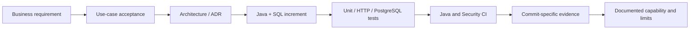

# Lesson 00 — Orientation: from business problem to running tests

**Track:** sequential IAM engineering curriculum · **Related milestone:** 00; portfolio release · **Baseline:** `v0.1.0-portfolio` (educational local/test scope). This is a learning guide, not a new implementation or fresh test execution.

## Learning outcome

Explain what IAM governance is, why this capstone exists, its non-goals, and how to reproduce an isolated baseline.

## Starting concepts

- IAM is governance over requests, decisions, and evidence; authentication is delegated and no real entitlement is granted.
- An access request is an intent, APPROVED is a decision, READY is work intent, DELIVERED is an event acknowledgement, RECEIVED is a local projection, and mock VERIFIED is synthetic evidence.
- One Spring Boot modular monolith with PostgreSQL, not a fleet of microservices. Keycloak is an optional local OIDC lab, not a required dependency for the curated test demo.

## Step-by-step implementation walkthrough

1. Read `README.md`, `docs/use-cases/UC-001-application-access-request.md` and ADR-0001/0002; write the business problem in two sentences.
2. Inspect `pom.xml`: Java 25, Spring Boot 4.1.2, Spring MVC/Security/JDBC, Flyway, Surefire/Failsafe, Testcontainers and SpotBugs.
3. Run `java -version`, `mvn -version` and `docker info` without changing the user's Docker containers.
4. Run `git rev-parse HEAD` then `bash ops/demo/run-portfolio-demo.sh` with Docker running. It creates disposable PostgreSQL test fixtures; it does not start Keycloak or a server on 8082.
5. Compare `docs/release/portfolio-demo-runbook.md` with the full regression `mvn -B --no-transfer-progress clean verify`. List what each proves.
6. Record actual exit status, SHA, and test counts. Never copy bearer tokens, passwords, or real user records into evidence.

## Why the design matters

Reproducibility and honest capability scoping should precede APIs. Starting with an operationally safe test baseline prevents a ‘demo’ from masquerading as a production identity system.

## Architecture / execution flow

The diagram summarizes the implemented or explicitly optional lab flow; it does not mean all components are continuously running together.

## Source files to open

- [`README.md`](../../README.md)
- [`docs/adr/0001-modular-monolith.md`](../../docs/adr/0001-modular-monolith.md)
- [`docs/adr/0002-identity-provider-boundary.md`](../../docs/adr/0002-identity-provider-boundary.md)
- [`docs/release/portfolio-demo-runbook.md`](../../docs/release/portfolio-demo-runbook.md)

## Verification / existing evidence

- `ops/demo/run-portfolio-demo.sh`
- `src/test/java/dev/asambataiden/iam/IamApplicationTest.java`

Use the relevant focused test where available, then run the full suite with `mvn -B --no-transfer-progress clean verify`. Python lab helpers use `python3 -m unittest discover -s ops/keycloak -p 'test_*.py'`. CI evidence is commit-specific; the recorded release results are in [release closeout](../release/evidence-register.md) and [portfolio guide](../portfolio/complete-engineering-guide.md). **Do not claim a new PASS without running it.**

## Failure modes / negative checks

- Validate missing or unauthorized actor/tenant/permission where the lesson crosses an IAM access boundary.
- Verify rollback/no unintended business write for failure paths; prove the relevant database or filter-layer invariant with an existing test.
- Do not turn a mock target, synthetic token, or local event projection into a real access-grant claim.
- Never reset a persistent database, prune Docker resources or expose lab admin credentials merely to reproduce a tutorial.

## Explain it in an interview

1. What differentiates IAM governance from login?
2. Why does an APPROVED decision not prove effective entitlement?
3. Why does a curated test suite with separate fixtures not constitute one continuous production user journey?

**Answer pattern:** state the business risk → identify class and SQL or protocol boundary → explain normal and failure paths → name test + exact scope → disclose what remains unproven.

## Learning completion checklist

- [ ] I can explain the concepts without reading the implementation.
- [ ] I have opened the actual files and traced the call/transaction boundary.
- [ ] I can describe a negative scenario and its protection.
- [ ] I can identify the existing executable test and distinguish past evidence from my own run.
- [ ] I have recorded questions, mistakes and lessons learned in my own notes without adding secrets to Git.

**Next:** [Curriculum index](README.md) and the next numbered lesson.