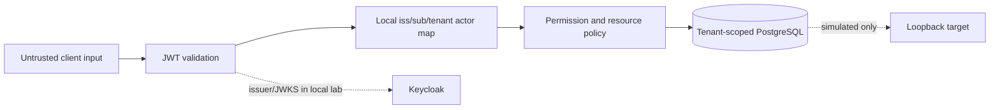

# Lesson 01 — Requirements, tenant boundaries and architectural decision records

**Track:** sequential IAM engineering curriculum · **Related milestone:** 00 / original UC-001 · **Baseline:** `v0.1.0-portfolio` (educational local/test scope). This is a learning guide, not a new implementation or fresh test execution.

## Learning outcome

Translate a business request into actors, trust boundaries, positive/negative acceptance criteria and ADRs.

## Starting concepts

- Actors: requester, subject employee, distinct approver, reviewer, Keycloak IdP and simulated target.
- Trust boundaries: client-to-JWT verifier, verified claims-to-local actor, actor-to-tenant DB, work-to-mock target, outbox-to-inbox.
- ADR-0001 chooses modular monolith to keep transactions and tests understandable. ADR-0002 delegates authentication rather than implementing password/MFA/token issuance.

## Step-by-step implementation walkthrough

1. Extract UC-001's business outcome and A01–A12 acceptance criteria; separate positive outcomes from denial/no-write cases.
2. For each actor, identify identity proof, local permission and tenant/resource constraints. Never let a tenant claim alone grant permission.
3. Draw a context diagram: browser or client → bearer API → local actor mapping → PostgreSQL; put mock target and explicit in-process relay behind separate boundaries.
4. Inspect `docs/security/threat-model.md` and list threats: cross-tenant binding, scope-only bypass, self-approval, forged requester, lost acknowledgment, stale lease and forged event.
5. Read ADR-0001 and ADR-0002 and state at least one advantage, trade-off and trigger for revisiting each.
6. Define a new scenario in Given/When/Then, point to a controller/service constraint and a corresponding test; leave unsupported future features explicitly unimplemented.

## Why the design matters

Security architecture begins at requirements. If actor/tenant rules are implicit, correct SQL and passing unit tests can still expose unauthorized state transitions.

## Architecture / execution flow

The diagram summarizes the implemented or explicitly optional lab flow; it does not mean all components are continuously running together.

## Source files to open

- [`docs/use-cases/UC-001-application-access-request.md`](../../docs/use-cases/UC-001-application-access-request.md)
- [`docs/security/threat-model.md`](../../docs/security/threat-model.md)
- [`docs/adr/0001-modular-monolith.md`](../../docs/adr/0001-modular-monolith.md)
- [`docs/adr/0002-identity-provider-boundary.md`](../../docs/adr/0002-identity-provider-boundary.md)

## Verification / existing evidence

- `src/test/java/dev/asambataiden/iam/accessrequest/AccessRequestPersistenceIT.java`
- `src/test/java/dev/asambataiden/iam/accessrequest/ApprovalDecisionHttpIT.java`

Use the relevant focused test where available, then run the full suite with `mvn -B --no-transfer-progress clean verify`. Python lab helpers use `python3 -m unittest discover -s ops/keycloak -p 'test_*.py'`. CI evidence is commit-specific; the recorded release results are in [release closeout](../release/evidence-register.md) and [portfolio guide](../portfolio/complete-engineering-guide.md). **Do not claim a new PASS without running it.**

## Failure modes / negative checks

- Validate missing or unauthorized actor/tenant/permission where the lesson crosses an IAM access boundary.
- Verify rollback/no unintended business write for failure paths; prove the relevant database or filter-layer invariant with an existing test.
- Do not turn a mock target, synthetic token, or local event projection into a real access-grant claim.
- Never reset a persistent database, prune Docker resources or expose lab admin credentials merely to reproduce a tutorial.

## Explain it in an interview

1. Which requirements are business rules, which are security boundaries, and which are non-functional controls?
2. Why can’t composite FKs substitute for JWT authorization?
3. What would justify extracting a microservice?

**Answer pattern:** state the business risk → identify class and SQL or protocol boundary → explain normal and failure paths → name test + exact scope → disclose what remains unproven.

## Learning completion checklist

- [ ] I can explain the concepts without reading the implementation.
- [ ] I have opened the actual files and traced the call/transaction boundary.
- [ ] I can describe a negative scenario and its protection.
- [ ] I can identify the existing executable test and distinguish past evidence from my own run.
- [ ] I have recorded questions, mistakes and lessons learned in my own notes without adding secrets to Git.

**Next:** [Curriculum index](README.md) and the next numbered lesson.