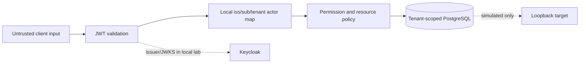
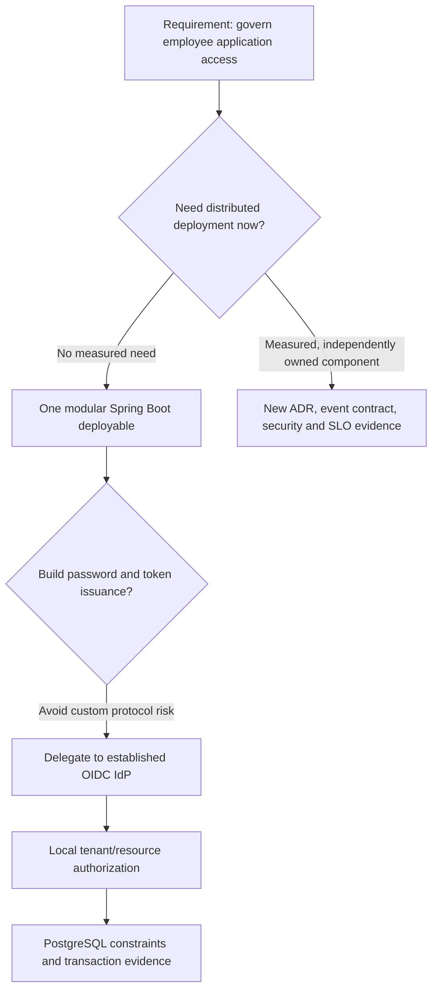

# Lesson 01 — Requirements, tenant boundaries and architectural decision records

**Track:** sequential IAM engineering curriculum · **Related milestone:** 00 / original UC-001 · **Baseline:** `v0.1.0-portfolio` (educational local/test scope). This is a learning guide, not a new implementation or fresh test execution.

## Learning outcome

Translate a business request into actors, trust boundaries, positive/negative acceptance criteria and ADRs.

## Starting concepts

- Actors: requester, subject employee, distinct approver, reviewer, Keycloak IdP and simulated target.
- Trust boundaries: client-to-JWT verifier, verified claims-to-local actor, actor-to-tenant DB, work-to-mock target, outbox-to-inbox.
- ADR-0001 chooses modular monolith to keep transactions and tests understandable. ADR-0002 delegates authentication rather than implementing password/MFA/token issuance.

## Step-by-step implementation walkthrough

1. Extract UC-001's business outcome and A01–A12 acceptance criteria; separate positive outcomes from denial/no-write cases.
2. For each actor, identify identity proof, local permission and tenant/resource constraints. Never let a tenant claim alone grant permission.
3. Draw a context diagram: browser or client → bearer API → local actor mapping → PostgreSQL; put mock target and explicit in-process relay behind separate boundaries.
4. Inspect `docs/security/threat-model.md` and list threats: cross-tenant binding, scope-only bypass, self-approval, forged requester, lost acknowledgment, stale lease and forged event.
5. Read ADR-0001 and ADR-0002 and state at least one advantage, trade-off and trigger for revisiting each.
6. Define a new scenario in Given/When/Then, point to a controller/service constraint and a corresponding test; leave unsupported future features explicitly unimplemented.

## Why the design matters

Security architecture begins at requirements. If actor/tenant rules are implicit, correct SQL and passing unit tests can still expose unauthorized state transitions.

## Architecture / execution flow



The diagram summarizes the implemented or explicitly optional lab flow; it does not mean all components are continuously running together.

## Source files to open

- [`docs/use-cases/UC-001-application-access-request.md`](../../docs/use-cases/UC-001-application-access-request.md)
- [`docs/security/threat-model.md`](../../docs/security/threat-model.md)
- [`docs/adr/0001-modular-monolith.md`](../../docs/adr/0001-modular-monolith.md)
- [`docs/adr/0002-identity-provider-boundary.md`](../../docs/adr/0002-identity-provider-boundary.md)

## Verification / existing evidence

- `src/test/java/dev/asambataiden/iam/accessrequest/AccessRequestPersistenceIT.java`
- `src/test/java/dev/asambataiden/iam/accessrequest/ApprovalDecisionHttpIT.java`

Use the relevant focused test where available, then run the full suite with `mvn -B --no-transfer-progress clean verify`. Python lab helpers use `python3 -m unittest discover -s ops/keycloak -p 'test_*.py'`. CI evidence is commit-specific; the recorded release results are in [release closeout](../release/evidence-register.md) and [portfolio guide](../portfolio/complete-engineering-guide.md). **Do not claim a new PASS without running it.**

## Failure modes / negative checks

- Validate missing or unauthorized actor/tenant/permission where the lesson crosses an IAM access boundary.
- Verify rollback/no unintended business write for failure paths; prove the relevant database or filter-layer invariant with an existing test.
- Do not turn a mock target, synthetic token, or local event projection into a real access-grant claim.
- Never reset a persistent database, prune Docker resources or expose lab admin credentials merely to reproduce a tutorial.

## Explain it in an interview

1. Which requirements are business rules, which are security boundaries, and which are non-functional controls?
2. Why can’t composite FKs substitute for JWT authorization?
3. What would justify extracting a microservice?

**Answer pattern:** state the business risk → identify class and SQL or protocol boundary → explain normal and failure paths → name test + exact scope → disclose what remains unproven.


## Practical lab 01A — Turn a business request into verifiable requirements

### Starting business story

> “A tenant administrator wants a finance application READER role for an active employee. A different authorized person must decide. Retries must not create duplicate requests. If the employee belongs to another organization, no request may be created.”

This example is synthetic; **READER** is a sample role key used in tests, not a claim about a live finance application.

**Step 1 — Separate facts from assumptions.** The requester, subject employee, approver, application, role and tenant are distinct entities. A valid signed token identifies an actor but does not automatically authorize an action on a particular tenant-local resource.

**Step 2 — State the positive path.** Authorized requester + active tenant-local subject and application/role → one PENDING request. A different authorized approver may APPROVE or REJECT, leaving a single audited decision. APPROVED creates durable **work intent**, not access.

**Step 3 — Enumerate negative and concurrent paths before coding.** Cross-tenant subject, disabled employee, forged tenant/requester, missing scope, self-approval, opposing approvers, changed-intent replay and failed audit trigger must not produce an unauthorized or half-committed result.

**Step 4 — Define acceptance evidence.** For each requirement, link the actual controller/service, relevant migration and test. Avoid writing a test-plan row without an executable assertion.

### Requirements traceability matrix

| Original UC-001 ID | Business/security invariant | Implementation boundary | Existing executable evidence |
| --- | --- | --- | --- |
| A01 | Authorized tenant-local request persists PENDING | `AccessRequestController` → `RequestActorResolver` → `AccessRequestService`; V1–V2 | `AccessRequestPersistenceIT.createsPendingRequestAndReturnsSameRowOnRetry`; mapped HTTP case |
| A02 | Missing/malformed bearer is unauthorized | Spring Security resource-server filter | `AccessRequestPersistenceIT.anonymousAccessRequestRouteIsDenied` and `malformedBearerTokenIsRejected`; signed JWT tests separately |
| A03 | Coarse scope alone insufficient; local create/decide permission required | Security config and actor resolvers | `tokenWithMissingRequiredScopeIsRejected`, `unmappedOrUnpermittedActorIsRejected` |
| A04 | Foreign tenant subject cannot be referenced | V1 tenant composite FKs + service checks | `foreignTenantEmployeeCannotBeReferenced`; mapped actor cross-tenant HTTP case |
| A05 | No self-approval, regardless of DECIDE permission | `ApprovalDecisionService`; V3 CHECK/FK | `ApprovalDecisionServiceIT.requesterCannotSelfApproveEvenWithGrant` |
| A06 | Foreign tenant approver cannot decide | `DecisionActorResolver`; V3 tenant FK and service query | `ApprovalDecisionServiceIT.foreignTenantAndUnknownRequestFailWithoutDisclosureOrWrite` |
| A07 | Rejection creates no provisioning intent | `ApprovalDecisionService` + V5/V12 approved-only trigger chain | `rejectedDecisionAndDeniedDecisionNeverEnqueueWork` |
| A08 | Equivalent replay returns one logical request | V1 unique `(tenant_id,idempotency_key)`; insert-or-find | `parallelEquivalentRetriesProduceOneLogicalRow` |
| A09 | Same key with different terms conflicts without overwrite | `AccessRequestService` stored-terms comparison | `changedTermsForSameTenantKeyAreRejected` |
| A10 | Opposing decisions have one winner | `FOR UPDATE OF ar` + status guard; V3 decision PK | `concurrentOpposingDecisionsAllowOnlyOneWinner` |
| A11 | Inactive subject/app blocks approval/processing | Eligibility joins and active lifecycle checks | `disabledApproverOrSubjectFailsClosed`; `disabledEmployeeCannotBeGrantedPendingRequest` |
| A12 | Invalid role/input rejected | Input bounds + active application-role lookup | Input/invalid-reference scenarios in `AccessRequestPersistenceIT` |

**Scope note:** This is a *traceability aid*, not a claim that each original acceptance criterion has a separate named test with exactly the same ID. Original UC-001 includes future candidate states (`CANCELLED`, `ACTIVE`, `PROVISIONING_FAILED`) that are **not implemented request states**. The actual released request transitions are `PENDING → APPROVED|REJECTED`.

## Practical lab 01B — Construct a threat model from the user journey

For each trust boundary use: **asset → attacker capability → failure mode → countermeasure → negative test → residual risk**.

| Boundary / asset | Threat scenario | Implemented protection | What the tests do NOT establish |
| --- | --- | --- | --- |
| Client → API authentication | Forged, expired or mis-audienced bearer token | Spring Security JWT resource server and offline signed token/filter regression | Real Keycloak-issued JWT-to-API success |
| JWT claims → local actor | Valid signature but foreign tenant/subject or no local permission | Issuer/subject/tenant mapping to ACTIVE employee plus explicit permission | Production IdP lifecycle/key rotation |
| Requester → access request | Attacker injects requester/tenant through payload/header | Server-resolved actor; V1 composite FKs and eligibility | All possible newly added endpoints |
| Approver → decision | Approver approves own request, or races a second approver | Stored requester SoD, row lock, V3 PK/CHECK, audit trigger | Distributed multi-region writes |
| Worker → provisioning state | Stalled worker returns after lease takeover | Current lease-token fencing and DB expiry | Exactly-once remote target effects |
| IAM → mock target | HTTP apply succeeds but ACK lost | STARTED evidence, stable idempotency key, read-before-write and mock readback | Real SaaS consistency/idempotency |
| Outbox → consumer | Duplicate event or conflicting replay | Stable event identity, V14 transactional inbox receipt and projection | Production broker authentication |
| CI → evidence | Secret or stale/partial evidence misrepresented as passing | Gitleaks, Trivy, SAST, pinned actions and curated manifests | Full coverage, independent attestations or compliance |

### Threat-driven sequence

```mermaid
sequenceDiagram
    actor Client
    participant Filter as JWT filter and route scope
    participant Resolver as Local tenant actor resolver
    participant Service as AccessRequestService
    participant DB as PostgreSQL
    Client->>Filter: POST request; bearer + attacker-controlled JSON
    alt Invalid token
      Filter-->>Client: 401 (no write)
    else Valid token, missing request scope
      Filter-->>Client: 403 (no write)
    else Valid token and scope
      Filter->>Resolver: Trusted issuer / subject / tenant
      Resolver->>DB: ACTIVE employee and local CREATE permission
      alt Actor not authorized
        Resolver-->>Client: 403 (no write)
      else Actor authorized
        Resolver->>Service: Server-derived tenant/requester
        Service->>DB: Eligible target + idempotent INSERT
        alt Cross-tenant or invalid role
          DB-->>Client: Rejected without foreign data
        else Valid request
          DB-->>Client: One PENDING request
        end
      end
    end
```

The diagram is a **conceptual authorization flow**. In the released HTTP integration fixtures, some principal creation is mocked; the actual signed-token filter tests use a test-only decoder. Neither proves the optional live Keycloak PKCE token acceptance.

### Security exercise: expected denial without mutation

Choose one scenario, then answer:

1. What data is untrusted? *(Example: a forged tenant header.)*
2. At which boundary is a decision made? *(Server-mapped identity, not the header.)*
3. What response category is expected? *(Authentication 401; permission 403; unknown/foreign resource can be 404; changed replay 409.)*
4. Which SQL row must remain unchanged?
5. Which test asserts more than only the response status?

The success criterion is **no unauthorized side effect** and no disclosure of foreign tenant records, not simply a 403 status.

## Practical lab 01C — ADR review and alternatives

### ADR-0001: modular monolith

**Context:** test IAM governance, authorization and transaction correctness before distribution.

**Decision:** one Spring Boot deployable with capability-oriented packages.

**Why:** local ACID transactions, simpler test environments and fewer network trust boundaries.

**Alternatives:** immediate microservice decomposition (independent scaling but distributed delivery/authorization complexity) or an unstructured monolith (easy initially but difficult code ownership).

**When to revisit:** measurable independent scaling needs, team ownership boundaries or SLOs justify deploying a component separately *and* event contracts/security/operations are ready.

### ADR-0002: external identity provider

**Context:** password storage, MFA, federation and token issuance are complex security-sensitive responsibilities.

**Decision:** use Keycloak as local OIDC provider; the IAM API is a JWT resource server and performs business authorization.

**Why:** avoid custom credential or token-issuance implementation; use standards-based authentication protocols.

**Costs:** external IdP availability, JWKS rotation, issuer/audience configuration, mapping and lifecycle synchronization.

**When to revisit:** production identity provider selection or trust-policy requirements change—not simply because the platform can decode a JWT.

### Architecture decision tree



## Practical lab 01D — Acceptance-test design workshop

Write three cases before implementing *any* future change:

```text
Requirement ID:
Business actor:
Trusted identity source:
Resource and tenant ownership:
Preconditions:
Given / When / Then:
Expected DB state / no-write invariant:
Concurrent or retry behavior:
Negative case and security outcome:
Actual class / migration / test:
What is proven:
What remains unverified:
```

**Worked example: two competing approvers**

- **Given:** one PENDING tenant-local request, two distinct ACTIVE approvers each holding the local DECIDE permission.
- **When:** both submit opposing decisions concurrently.
- **Then:** one transition commits, its single decision and audit evidence match; the second sees terminal status and cannot overwrite. Either decision may win.
- **Code:** `ApprovalDecisionService.decide`.
- **SQL:** V3 one-decision PK and `FOR UPDATE OF ar`; V4 audit trigger.
- **Test:** `ApprovalDecisionServiceIT.concurrentOpposingDecisionsAllowOnlyOneWinner`.
- **Not proven:** actual external access or real Keycloak-issued browser token acceptance.

## What I learned — short-answer check

1. **Why requirements before code?** Because the security model must identify actors, resources, transitions and forbidden cases before implementation can be meaningfully tested.
2. **Why not trust tenant IDs from JSON?** A caller controls JSON; the server must derive actor context from validated identity and local mapping.
3. **Why use constraints and service checks together?** Service checks implement policy and helpful diagnostics; DB constraints prevent structurally invalid durable associations across writers.
4. **What protects approval concurrency?** Row-level locking, a terminal-state check, one-decision PK and atomic transaction with audit.
5. **Does APPROVED prove access?** No: it records governance intent only; the released target interaction is simulated.
6. **What does a green CI run prove?** Configured checks passed against a specific tested commit/ref, not production deployment/security certification.

**Next:** [Lesson 02 — Java/Spring Boot module structure](02-java-spring-boot-module-structure.md). 

## Learning completion checklist

- [ ] I can explain the concepts without reading the implementation.
- [ ] I have opened the actual files and traced the call/transaction boundary.
- [ ] I can describe a negative scenario and its protection.
- [ ] I can identify the existing executable test and distinguish past evidence from my own run.
- [ ] I have recorded questions, mistakes and lessons learned in my own notes without adding secrets to Git.

**Next:** [Curriculum index](README.md) and the next numbered lesson.