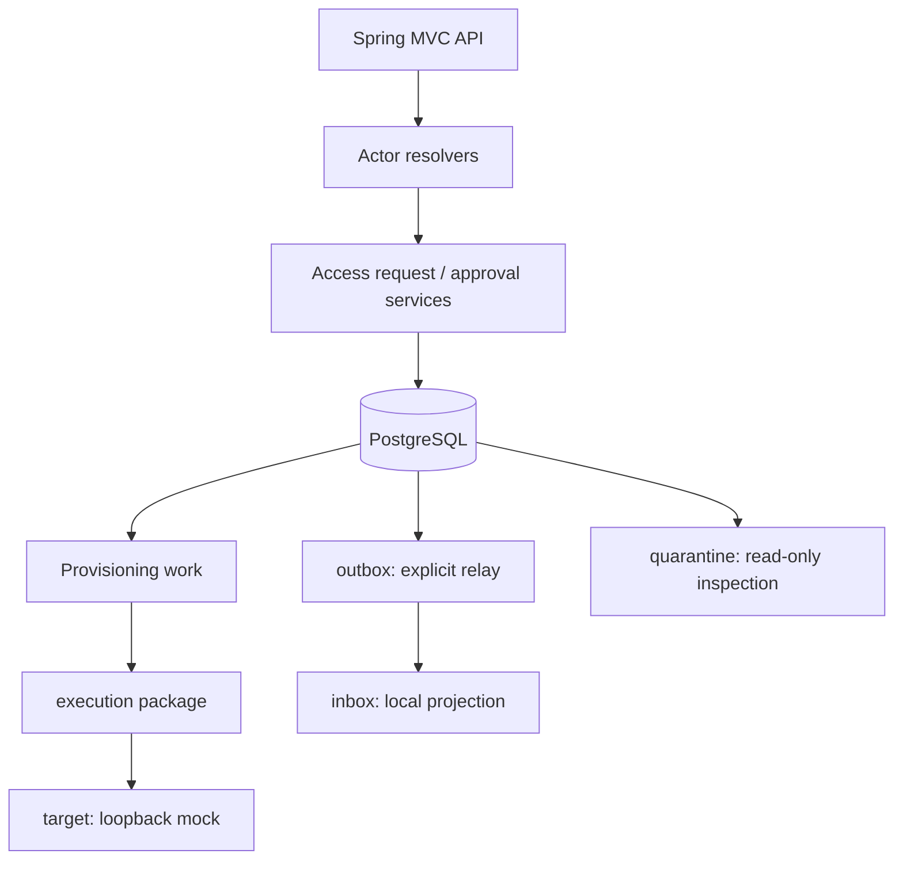
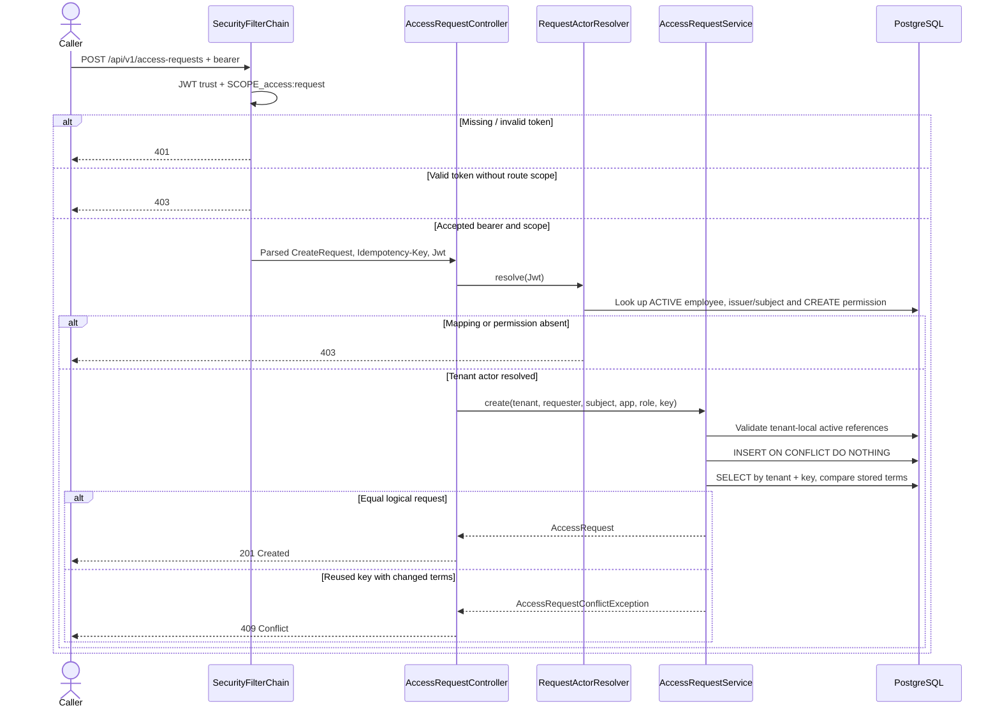

# Lesson 02 — Java 25, Spring Boot and the modular-monolith code layout

**Track:** sequential IAM engineering curriculum · **Related milestone:** 00 and 04 package refactor · **Baseline:** `v0.1.0-portfolio` (educational local/test scope). This is a learning guide, not a new implementation or fresh test execution.

## Learning outcome

Navigate the application from HTTP filter through controller, service, SQL and event integration without inventing deployed services.

## Starting concepts

- Java 25 and Spring Boot 4.1.2 are configured in `pom.xml`; Spring MVC exposes REST routes; Spring JDBC keeps SQL visible.
- `bootstrap/` configures the bearer boundary; `accessrequest/` covers intake/approval; `provisioning/` contains execution, target, quarantine, outbox and inbox responsibilities.
- The code has Spring services and explicitly constructed non-bean simulation collaborators. Package names are not deployable services or architectural enforcement.

## Step-by-step implementation walkthrough

1. Read `pom.xml` and identify compile/runtime/test scopes, the Mockito javaagent, Surefire `*Test` and Failsafe `*IT` naming conventions.
2. Start at `IamApplication.java`, then inspect `BootstrapSecurityConfiguration.java`: stateless session, no form or Basic login, health permitted, business routes scoped, deny-all fallback.
3. Follow `AccessRequestController` → `RequestActorResolver` → `AccessRequestService`; note where validated token claims become a tenant-local employee identity.
4. Follow `ApprovalDecisionController` → `DecisionActorResolver` → `ApprovalDecisionService`; note transaction and row lock.
5. Inspect `provisioning/execution`, `target`, `quarantine`, `outbox`, `inbox`; identify Java constructor injection vs explicitly constructed `MockProvisioningOrchestrator` and `OutboxRelay`.
6. Open `docs/architecture/provisioning-package-refactor.md`; explain why responsibilities were split without adding remote services.
7. Run a focused unit or IT class, then compare with full verify; do not infer an auto-running scheduler from an interface or service class.

## Why the design matters

An interview-ready architecture explanation follows actual call paths and lifecycle ownership. A design diagram that invents deployed services misrepresents the system.

## Architecture / execution flow



The diagram summarizes the implemented or explicitly optional lab flow; it does not mean all components are continuously running together.

## Source files to open

- [`pom.xml`](../../pom.xml)
- [`docs/architecture/system-overview.md`](../../docs/architecture/system-overview.md)
- [`docs/architecture/provisioning-package-refactor.md`](../../docs/architecture/provisioning-package-refactor.md)
- [`docs/engineering-standards.md`](../../docs/engineering-standards.md)

## Verification / existing evidence

- `src/test/java/dev/asambataiden/iam/IamApplicationTest.java`
- `src/test/java/dev/asambataiden/iam/accessrequest/ApprovalDecisionHttpIT.java`

Use the relevant focused test where available, then run the full suite with `mvn -B --no-transfer-progress clean verify`. Python lab helpers use `python3 -m unittest discover -s ops/keycloak -p 'test_*.py'`. CI evidence is commit-specific; the recorded release results are in [release closeout](../release/evidence-register.md) and [portfolio guide](../portfolio/complete-engineering-guide.md). **Do not claim a new PASS without running it.**

## Failure modes / negative checks

- Validate missing or unauthorized actor/tenant/permission where the lesson crosses an IAM access boundary.
- Verify rollback/no unintended business write for failure paths; prove the relevant database or filter-layer invariant with an existing test.
- Do not turn a mock target, synthetic token, or local event projection into a real access-grant claim.
- Never reset a persistent database, prune Docker resources or expose lab admin credentials merely to reproduce a tutorial.

## Explain it in an interview

1. What is a Spring bean versus a manually constructed test-only collaborator?
2. Why use explicit SQL instead of assuming ORM cascades?
3. Which interfaces are contracts and which are active adapters?

**Answer pattern:** state the business risk → identify class and SQL or protocol boundary → explain normal and failure paths → name test + exact scope → disclose what remains unproven.


## Lab 02A — Reconstruct the application from an empty Maven project

This is a **conceptual reconstruction of the existing code**, not an instruction to replace the repository or regenerate migrations. The implementation is already present. The goal is to understand the order in which the architectural components became necessary.

### Step 1 — Establish the build contract

Read the actual `pom.xml` before opening application classes:

| Exact POM element | How the project uses it | Why |
| --- | --- | --- |
| `spring-boot-starter-parent:4.1.2` | Spring dependency/plugin version management | Reduce independently versioned framework dependencies |
| `java.version=25` | Compile/runtime target | Establish one expected Java toolchain |
| `spring-boot-starter-webmvc` | Spring MVC and servlet route handling | Request/response boundary for IAM governance |
| `spring-boot-starter-security` + `spring-boot-starter-oauth2-resource-server` | Filter chain and bearer JWT support | Authentication delegated to a trusted issuer; no custom login/token service |
| `spring-boot-starter-jdbc` + PostgreSQL driver | `JdbcTemplate`, JDBC transactions and relational state | Transparent SQL constraints, locks and table ownership |
| `spring-boot-starter-flyway` + `flyway-database-postgresql` | Database V1–V14 schema evolution | Versioned PostgreSQL migration execution |
| `spring-boot-starter-actuator` | `/actuator/health` only | Basic intentionally anonymous health route, not a business authorization endpoint |
| `spring-boot-starter-test`, Spring Security Test, Mockito and Testcontainers | Unit, HTTP and PostgreSQL integration testing | Verify policy, transaction and failure invariants at different test boundaries |
| Maven Surefire | Only `**/*Test.java` | Fast/unit-style test naming convention |
| Maven Failsafe | Only `**/*IT.java`, bound to `integration-test` + `verify` | Container-backed and HTTP integration test lifecycle |
| Mockito `-javaagent` | Agent configured for both test plugins via resolved Maven artifact path | Avoid depending on implicit runtime agent attachment |
| SpotBugs `4.10.5.0` + Find Security Bugs `1.12.0` | Separate static-analysis tooling with exclusion file | Complement runtime tests, while tracking explicit analyzer limitations |

**Important:** The Maven version `0.1.0-SNAPSHOT` in the POM is a build artifact coordinate. The Git tag `v0.1.0-portfolio` is the fixed educational release snapshot; the two values are not automatically synchronized by Maven.

### Step 2 — Understand the application bootstrap

Open [`IamApplication.java`](../../src/main/java/dev/asambataiden/iam/IamApplication.java).

```java
@SpringBootApplication(exclude = UserDetailsServiceAutoConfiguration.class)
public class IamApplication {
    public static void main(String[] args) {
        SpringApplication.run(IamApplication.class, args);
    }
}
```

**What:** `@SpringBootApplication` triggers component scanning and auto-configuration. The class lives in `dev.asambataiden.iam`, the parent package of the implemented modules.

**Why the explicit exclusion:** The project intentionally does not expose a generated default username/password as an alternative to bearer identity. This does **not** mean all authentication configuration is absent; `BootstrapSecurityConfiguration` configures OAuth2 resource-server processing.

**How to inspect:** Locate `@Service`, `@Component`, `@RestController` and `@Configuration` classes under the same root package. Explain why `OutboxRelay` and `MockProvisioningOrchestrator` are **plain Java collaborators explicitly constructed by controlled code/tests**, rather than automatically active scheduled workers.

### Step 3 — Read the runtime configuration and understand environment boundaries

Open [`application.yml`](../../src/main/resources/application.yml). This is a developer-local configuration, **not a production hardening guide**:

| Configuration | Local default | Why it exists |
| --- | --- | --- |
| `DB_URL` | `jdbc:postgresql://127.0.0.1:5432/iamdb` | Explicit local PostgreSQL database endpoint |
| `DB_USERNAME` | `iam_app` | Database application identity |
| `DB_PASSWORD` | Empty unless provided | Local placeholder; no secret should be committed |
| `IAM_JWT_ISSUER_URI` | `http://127.0.0.1:8281/realms/iam-lab` | Expected JWT issuer |
| `IAM_JWT_JWKS_URI` | Realm-scoped `/protocol/openid-connect/certs` | Public verification-key endpoint |
| `IAM_JWT_AUDIENCE` | `iam-governance-api` | Intended API recipient |
| `server.address` | `127.0.0.1` | Restrict demo server to loopback |
| Actuator web exposure | `health` only | Limit anonymous management surface |

**Production gap:** Loopback HTTP, development defaults and an unset database password are not secure deployment configurations. The actual local API won't necessarily start without a configured PostgreSQL service and valid database credentials. Testcontainers integration tests are a separate reproducible environment.

## Lab 02B — Follow a real HTTP access request from edge to database

### Source-to-source execution diagram



**Step-by-step code reading:**

1. [`BootstrapSecurityConfiguration`](../../src/main/java/dev/asambataiden/iam/bootstrap/BootstrapSecurityConfiguration.java) sets `SessionCreationPolicy.STATELESS`, disables Basic and form login, uses OAuth2 JWT, permits health and the documented error dispatcher, matches specific scopes, then `denyAll` for everything else. Disabling CSRF is **conditional** on this stateless bearer-only model.
2. [`AccessRequestController`](../../src/main/java/dev/asambataiden/iam/accessrequest/AccessRequestController.java) declares `CreateRequest(UUID employeeId, UUID applicationId, String roleKey)`. **Tenant and requester are deliberately absent** from the body; only the server-resolved actor supplies them.
3. Its `@AuthenticationPrincipal Jwt`, `@RequestHeader("Idempotency-Key")` and `@RequestBody` arguments are marshaled by Spring MVC/security. The method checks required fields and bounded strings.
4. [`RequestActorResolver`](../../src/main/java/dev/asambataiden/iam/accessrequest/RequestActorResolver.java) extracts trusted `issuer`, `subject` and `tenant_id`; it requires exactly one ACTIVE local employee with `ACCESS_REQUEST_CREATE`. Structurally invalid claims fail before SQL.
5. [`AccessRequestService`](../../src/main/java/dev/asambataiden/iam/accessrequest/AccessRequestService.java) uses `@Transactional` plus explicit `JdbcTemplate` SQL. The composite foreign keys and unique tenant/idempotency constraint protect the durable row even under concurrent writers.
6. The controller maps known domain errors: changed replay to `409`; unavailable/invalid tenant-local resources to generic `404` to avoid leaking foreign existence. A missing/malformed body can produce `400`. Observe actual mappings in code rather than treating exception names as generic HTTP statuses.

**Clarification:** An idempotent replay still returns a `201 Created` response in this controller after returning the stored row; the service does not create a second row. If a stricter `200` replay convention is desired, it requires a separately reviewed API contract change, not a documentation-only fix.

### Java concepts to explain aloud

- **Constructor injection:** controllers and services declare dependencies as constructor arguments/final fields. This clarifies the dependency graph and makes unit tests easy to instantiate.
- **Records:** `CreateRequest`, `Actor` and `AccessRequest` are typed immutable-ish data carriers, not ORM entities managed through Hibernate.
- **Service boundary:** the controller translates JSON/HTTP to a trusted actor and application call; the service enforces relational business invariants.
- **Transaction interceptor:** Spring applies `@Transactional` to the service invocation. The database transaction surrounds SQL reads/writes, **not** a remote HTTP target operation.
- **Error normalization:** exposing whether a foreign tenant's employee exists would be an information leak; return generic unavailable messages rather than raw database errors.
- **Test distinction:** a test injecting `jwt()` may validate the route and policy, but it does **not** validate a cryptographic signature. Signed JWT HTTP filter tests use ephemeral signing keys and a test-only decoder.

### What should not be refactored merely for style

The current service uses SQL directly rather than adding a generic repository abstraction or JPA entities. This is defensible while the key requirements concern DB constraints and concurrency. A refactor needs a measurable maintenance benefit, architecture test and regression coverage—not more packages simply to mimic a large enterprise system.

## Lab 02C — Follow an approval and its local transaction

```mermaid
sequenceDiagram
    actor Approver
    participant F as JWT filter
    participant C as ApprovalDecisionController
    participant A as DecisionActorResolver
    participant S as ApprovalDecisionService
    participant DB as PostgreSQL
    Approver->>F: POST /api/v1/access-requests/{id}/decision
    F->>F: SCOPE_access:decide
    F->>C: Authenticated Jwt + APPROVED or REJECTED
    C->>A: Resolve ACTIVE authorized approver
    A->>DB: Tenant local DECIDE permission
    C->>S: decide(tenant, approver, request, decision)
    S->>DB: BEGIN; SELECT ... FOR UPDATE OF ar
    S->>S: Reject self approval or non-PENDING
    S->>DB: UPDATE request + INSERT decision
    DB->>DB: V4 audit trigger; if approved V5 work and V12 outbox
    DB-->>S: COMMIT all or ROLLBACK all
    S-->>C: Decision result
    C-->>Approver: 200 OK
```

Read [`ApprovalDecisionController.java`](../../src/main/java/dev/asambataiden/iam/accessrequest/ApprovalDecisionController.java), [`ApprovalDecisionService.java`](../../src/main/java/dev/asambataiden/iam/accessrequest/ApprovalDecisionService.java), [Flyway V3](../../src/main/resources/db/migration/V3__approval_decision_foundation.sql) and [Flyway V4](../../src/main/resources/db/migration/V4__approval_transactional_audit.sql).

**Why row lock?** If two authorized approvers race, the lock serializes the PENDING check and status update; the second sees the terminal state and cannot insert another decision. The V3 primary key provides a separate SQL guarantee. The transaction ensures status, decision and triggered audit agree.

**Why not persist a grant here?** Approval is governance authorization. Effective external entitlement is a different responsibility. The implementation creates durable simulated provisioning work; it does not call a live SaaS provisioning endpoint.

## Lab 02D — Dependency injection versus explicit non-bean execution

| Component | Spring managed? | How created / invoked | Why this matters |
| --- | --- | --- | --- |
| `AccessRequestController`, `ApprovalDecisionController` | Yes, `@RestController` | Spring MVC calls them for routed requests | Public HTTP API boundary |
| `RequestActorResolver`, `DecisionActorResolver` | Yes, `@Component` | Injected into controllers | Local authorization resolution |
| `AccessRequestService`, `ApprovalDecisionService` | Yes, `@Service` | Injected into controllers | Spring transaction interception |
| `ProvisioningLeaseService`, `ProvisioningInboxConsumer` | Yes, `@Service` | Called from controlled service/tests | Registered component **does not** imply automatic execution |
| `MockProvisioningOrchestrator` | **No** | Explicitly constructed in mock tests | No scheduled target calls on application startup |
| `OutboxRelay` | **No** | Explicitly constructed, `runOnce()` | No background broker publisher/listener |
| `LoopbackHttpProvisioningTargetAdapter` | **No** | Test-controlled target adapter instance | Prevent unintended real target interaction |

**Subtle design issue:** Merely adding `@Service` to `OutboxRelay` would not schedule `runOnce()`, but it would change runtime wiring assumptions. A real production relay also needs scheduling, authenticated publisher, observability, controlled retry and service lifecycle ownership. Don't add it to the release by accident.

## Lab 02E — Testing strategy and reproducible commands

Study the actual test sources:

- [`IamApplicationTest`](../../src/test/java/dev/asambataiden/iam/IamApplicationTest.java) — basic application-level test.
- [`AccessRequestPersistenceIT`](../../src/test/java/dev/asambataiden/iam/accessrequest/AccessRequestPersistenceIT.java) — tenant/HTTP/idempotency and real PostgreSQL Testcontainers.
- [`ApprovalDecisionHttpIT`](../../src/test/java/dev/asambataiden/iam/accessrequest/ApprovalDecisionHttpIT.java) — scope, local approver and HTTP errors.
- [`ApprovalDecisionServiceIT`](../../src/test/java/dev/asambataiden/iam/accessrequest/ApprovalDecisionServiceIT.java) — concurrent decisions, SoD, atomic audit/rollback.
- [`OutboxInboxEndToEndIT`](../../src/test/java/dev/asambataiden/iam/provisioning/outbox/OutboxInboxEndToEndIT.java) — explicit local message bridge, no broker.

From your local repository root:

```bash
git rev-parse HEAD
java -version
mvn -version

# Run only a named standalone unit test first:
mvn -B --no-transfer-progress -Dtest=IamApplicationTest test

# Then, with Docker running, focused actual integration tests:
mvn -B --no-transfer-progress -Dit.test=AccessRequestPersistenceIT,ApprovalDecisionServiceIT -DfailIfNoTests=false verify

# Full current checkout verification only when needed:
mvn -B --no-transfer-progress clean verify
```

**Evidence rule:** these are commands to execute, not a claim they have already passed after the documentation change. Distinguish prior release-sha regression evidence from this or any later branch.

### Failure-based practice

1. **App fails before first request:** check local DB configuration and relevant startup errors. Don't assume Keycloak has supplied a token to make the server start.
2. **401:** authentication failed; check bearer presence/signature/issuer/audience/expiry under the selected test decoder.
3. **403:** JWT may be trusted, but coarse scope, local active employee or explicit permission failed.
4. **404:** requested resource missing or not tenant-visible; do not reveal foreign row existence.
5. **409:** same tenant/idempotency key with changed business terms, or already terminal decision.
6. **DB failure inside approval transaction:** status, decision, audit and dependent approved intent should roll back together.
7. **Mock target timeout:** remote outcome unknown; reconcile before attempting a potentially duplicated write.

## Interview model answers

**Q: Why is a constructor-injected modular monolith preferable here to five microservices?**

> “We needed to prove tenant isolation, authorization, idempotency and atomic approval/audit first. One Spring Boot deployable and PostgreSQL transaction boundary keep these invariants observable and testable. We separated provisioning responsibilities into packages, not remote deployments. Independent microservice extraction would need a measured scaling or ownership driver and additional authenticated event contracts, reliability tests and operational ownership.”

**Q: How does the code know which employee created an access request?**

> “The HTTP controller receives a verified JWT principal, but it never accepts a requester or tenant ID from JSON. The actor resolver maps the JWT issuer/subject/tenant claim to exactly one active local employee with CREATE permission. Only then does the service persist the tenant-bound request. A valid bearer or scope alone is insufficient.”

**Q: Can the Spring transaction guarantee exactly-once provisioning?**

> “No. `@Transactional` coordinates local PostgreSQL changes; the mock target HTTP operation happens separately. Leases and fencing guard local work, while stable idempotency keys and independent readback handle uncertain target outcomes. The released platform still has no real entitlement provisioning or production broker.”

**Q: Why do you have Surefire and Failsafe?**

> “We separate `*Test` unit-focused tests from `*IT` integration tests. The latter exercise real PostgreSQL 17 constraints, row locking and triggers through Testcontainers and Spring HTTP security policy. This separates fast feedback from higher-fidelity persistence verification.”

## Completion challenge — draw, trace, test, defend

- [ ] Sketch an HTTP request through filter → controller → actor resolver → service → PostgreSQL without consulting the diagram.
- [ ] Name at least five declared Maven dependencies/plugins and explain *why each is used here*.
- [ ] Find exactly where the requester's tenant and employee ID come from; prove they aren't accepted in the request payload.
- [ ] Identify the actual Spring bean vs explicit mock-only class distinctions.
- [ ] Explain `@Transactional` and `FOR UPDATE` separately, then connect both to the approval race.
- [ ] Identify one unit test, one HTTP integration test, one PostgreSQL integration test and the limits of each.
- [ ] Record your actual Git SHA, executed command, observed test result and an interview explanation in your learning notes.

**Next:** [Lesson 03 — PostgreSQL, Flyway V1–V2 and tenant persistence](03-postgresql-flyway-tenant-persistence.md).

## API contract practice — OpenAPI 3.1

The [versioned OpenAPI contract](../api/openapi.json) describes the three controllers' **four** public business operations. Read the [OpenAPI learning guide](../api/README.md) alongside the controller-to-service walkthrough: compare `CreateRequest` with the documented three client fields; locate the required `Idempotency-Key` header; explain why an equivalent replay returns 201 and changed intent 409; compare the decision enum and the quarantine GET-only list/detail endpoints.

**Security exercise:** explain why a `bearerAuth` description does not itself enforce JWT signature, route scope, local tenant permission or SoD. The actual filter and actor resolvers do. Internal outbox, lease and mock target services do **not** become REST endpoints by being represented in architecture diagrams.

**Evidence exercise:** run `python3 -m unittest ops.security.test_iam_openapi_contract -v` and note the checked SHA. This statically compares known source routes, scope metadata and schema fields; it is **not** a runtime OpenAPI/swagger test. Generated OpenAPI and Swagger UI are now installed **only for the opt-in `openapi-local` profile**, with separate Java HTTP integration tests; the default profile still denies documentation endpoints. See the [API runtime guide](../api/README.md) for safe commands and security caveats.

## Learning completion checklist

- [ ] I can explain the concepts without reading the implementation.
- [ ] I have opened the actual files and traced the call/transaction boundary.
- [ ] I can describe a negative scenario and its protection.
- [ ] I can identify the existing executable test and distinguish past evidence from my own run.
- [ ] I have recorded questions, mistakes and lessons learned in my own notes without adding secrets to Git.

**Next:** [Curriculum index](README.md) and the next numbered lesson.