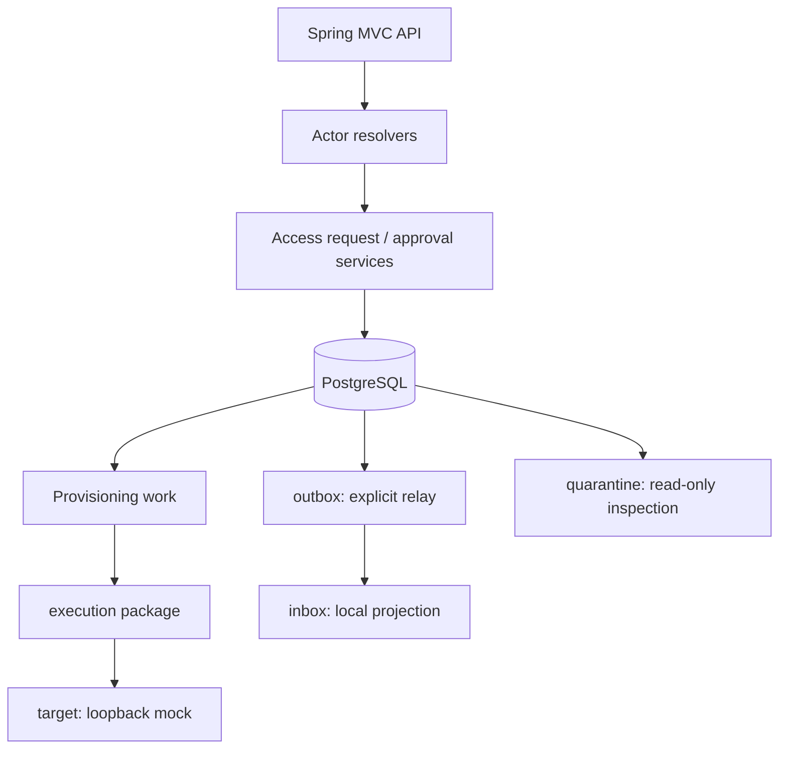

# Lesson 02 — Java 25, Spring Boot and the modular-monolith code layout

**Track:** sequential IAM engineering curriculum · **Related milestone:** 00 and 04 package refactor · **Baseline:** `v0.1.0-portfolio` (educational local/test scope). This is a learning guide, not a new implementation or fresh test execution.

## Learning outcome

Navigate the application from HTTP filter through controller, service, SQL and event integration without inventing deployed services.

## Starting concepts

- Java 25 and Spring Boot 4.1.2 are configured in `pom.xml`; Spring MVC exposes REST routes; Spring JDBC keeps SQL visible.
- `bootstrap/` configures the bearer boundary; `accessrequest/` covers intake/approval; `provisioning/` contains execution, target, quarantine, outbox and inbox responsibilities.
- The code has Spring services and explicitly constructed non-bean simulation collaborators. Package names are not deployable services or architectural enforcement.

## Step-by-step implementation walkthrough

1. Read `pom.xml` and identify compile/runtime/test scopes, the Mockito javaagent, Surefire `*Test` and Failsafe `*IT` naming conventions.
2. Start at `IamApplication.java`, then inspect `BootstrapSecurityConfiguration.java`: stateless session, no form or Basic login, health permitted, business routes scoped, deny-all fallback.
3. Follow `AccessRequestController` → `RequestActorResolver` → `AccessRequestService`; note where validated token claims become a tenant-local employee identity.
4. Follow `ApprovalDecisionController` → `DecisionActorResolver` → `ApprovalDecisionService`; note transaction and row lock.
5. Inspect `provisioning/execution`, `target`, `quarantine`, `outbox`, `inbox`; identify Java constructor injection vs explicitly constructed `MockProvisioningOrchestrator` and `OutboxRelay`.
6. Open `docs/architecture/provisioning-package-refactor.md`; explain why responsibilities were split without adding remote services.
7. Run a focused unit or IT class, then compare with full verify; do not infer an auto-running scheduler from an interface or service class.

## Why the design matters

An interview-ready architecture explanation follows actual call paths and lifecycle ownership. A design diagram that invents deployed services misrepresents the system.

## Architecture / execution flow

The diagram summarizes the implemented or explicitly optional lab flow; it does not mean all components are continuously running together.

## Source files to open

- [`pom.xml`](../../pom.xml)
- [`docs/architecture/system-overview.md`](../../docs/architecture/system-overview.md)
- [`docs/architecture/provisioning-package-refactor.md`](../../docs/architecture/provisioning-package-refactor.md)
- [`docs/engineering-standards.md`](../../docs/engineering-standards.md)

## Verification / existing evidence

- `src/test/java/dev/asambataiden/iam/IamApplicationTest.java`
- `src/test/java/dev/asambataiden/iam/accessrequest/ApprovalDecisionHttpIT.java`

Use the relevant focused test where available, then run the full suite with `mvn -B --no-transfer-progress clean verify`. Python lab helpers use `python3 -m unittest discover -s ops/keycloak -p 'test_*.py'`. CI evidence is commit-specific; the recorded release results are in [release closeout](../release/evidence-register.md) and [portfolio guide](../portfolio/complete-engineering-guide.md). **Do not claim a new PASS without running it.**

## Failure modes / negative checks

- Validate missing or unauthorized actor/tenant/permission where the lesson crosses an IAM access boundary.
- Verify rollback/no unintended business write for failure paths; prove the relevant database or filter-layer invariant with an existing test.
- Do not turn a mock target, synthetic token, or local event projection into a real access-grant claim.
- Never reset a persistent database, prune Docker resources or expose lab admin credentials merely to reproduce a tutorial.

## Explain it in an interview

1. What is a Spring bean versus a manually constructed test-only collaborator?
2. Why use explicit SQL instead of assuming ORM cascades?
3. Which interfaces are contracts and which are active adapters?

**Answer pattern:** state the business risk → identify class and SQL or protocol boundary → explain normal and failure paths → name test + exact scope → disclose what remains unproven.

## Learning completion checklist

- [ ] I can explain the concepts without reading the implementation.
- [ ] I have opened the actual files and traced the call/transaction boundary.
- [ ] I can describe a negative scenario and its protection.
- [ ] I can identify the existing executable test and distinguish past evidence from my own run.
- [ ] I have recorded questions, mistakes and lessons learned in my own notes without adding secrets to Git.

**Next:** [Curriculum index](README.md) and the next numbered lesson.