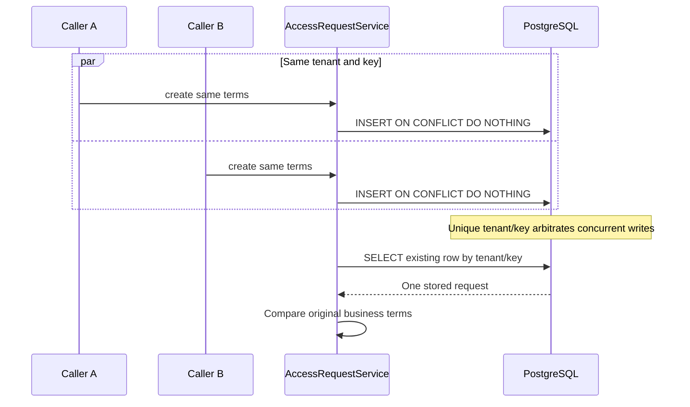

# Lesson 03 — PostgreSQL, Flyway V1–V2, tenant isolation and idempotency

**Track:** sequential IAM engineering curriculum · **Related milestone:** 01A and 01B-2 · **Baseline:** `v0.1.0-portfolio` (educational local/test scope). This is a learning guide, not a new implementation or fresh test execution.

## Learning outcome

Explain durable tenant isolation and concurrent request convergence using actual SQL.

## Starting concepts

- V1 creates tenants, employees, applications, application_roles and access_requests; V2 introduces issuer/subject identity binding and permissions.
- Composite foreign keys bind tenant and requester/subject/app-role. Unique `(tenant_id,idempotency_key)` handles concurrent duplicate intent.
- Service input checks improve diagnostics; database constraints remain the final integrity guard. A successful request is PENDING, not a grant.

## Step-by-step implementation walkthrough

1. Read V1 schema and draw tenant → employees/applications/roles → access_requests; identify composite PK/FK and the unique key.
2. Read V2 schema for `employee_identities` and `employee_permissions`; explain why issuer/subject mapping does not itself grant `ACCESS_REQUEST_CREATE`.
3. Trace `AccessRequestService.create`: null/bounded checks → eligible active joins → `INSERT ... ON CONFLICT DO NOTHING` → SELECT stored row → compare business terms.
4. Explain why same terms return one row but same key with changed employee/application/role/requester throws conflict.
5. Open `AccessRequestPersistenceIT`: find `parallelEquivalentRetriesProduceOneLogicalRow`, the six-thread latch, tenant spoof tests, disabled employee and modified-key rejection.
6. Sketch a transaction timeline for two JVMs writing the same tenant/key; discuss database uniqueness vs Java locks.
7. Run `mvn -B --no-transfer-progress -Dit.test=AccessRequestPersistenceIT -DfailIfNoTests=false verify` with Docker, and record observed output rather than assumed PASS.

## Why the design matters

Concurrent network retries are normal and Java process locks cannot coordinate independent instances. Database constraints give durable, cross-process arbitration.

## Architecture / execution flow

The diagram summarizes the implemented or explicitly optional lab flow; it does not mean all components are continuously running together.

## Source files to open

- [`src/main/resources/db/migration/V1__create_access_request_foundation.sql`](../../src/main/resources/db/migration/V1__create_access_request_foundation.sql)
- [`src/main/resources/db/migration/V2__bind_idp_subjects_and_permissions.sql`](../../src/main/resources/db/migration/V2__bind_idp_subjects_and_permissions.sql)
- [`src/main/java/dev/asambataiden/iam/accessrequest/AccessRequestService.java`](../../src/main/java/dev/asambataiden/iam/accessrequest/AccessRequestService.java)
- [`docs/milestones/01a-persistence-invariants.md`](../../docs/milestones/01a-persistence-invariants.md)
- [`docs/learning/19-concurrency-idempotency-approval-case-studies.md`](../../docs/learning/19-concurrency-idempotency-approval-case-studies.md)

## Verification / existing evidence

- `src/test/java/dev/asambataiden/iam/accessrequest/AccessRequestPersistenceIT.java`

Use the relevant focused test where available, then run the full suite with `mvn -B --no-transfer-progress clean verify`. Python lab helpers use `python3 -m unittest discover -s ops/keycloak -p 'test_*.py'`. CI evidence is commit-specific; the recorded release results are in [release closeout](../release/evidence-register.md) and [portfolio guide](../portfolio/complete-engineering-guide.md). **Do not claim a new PASS without running it.**

## Failure modes / negative checks

- Validate missing or unauthorized actor/tenant/permission where the lesson crosses an IAM access boundary.
- Verify rollback/no unintended business write for failure paths; prove the relevant database or filter-layer invariant with an existing test.
- Do not turn a mock target, synthetic token, or local event projection into a real access-grant claim.
- Never reset a persistent database, prune Docker resources or expose lab admin credentials merely to reproduce a tutorial.

## Explain it in an interview

1. Why is same key with changed terms a conflict rather than overwrite?
2. What could fail if only a Java `synchronized` block were used?
3. What checks belong in code vs the relational schema?

**Answer pattern:** state the business risk → identify class and SQL or protocol boundary → explain normal and failure paths → name test + exact scope → disclose what remains unproven.

## Learning completion checklist

- [ ] I can explain the concepts without reading the implementation.
- [ ] I have opened the actual files and traced the call/transaction boundary.
- [ ] I can describe a negative scenario and its protection.
- [ ] I can identify the existing executable test and distinguish past evidence from my own run.
- [ ] I have recorded questions, mistakes and lessons learned in my own notes without adding secrets to Git.

**Next:** [Curriculum index](README.md) and the next numbered lesson.