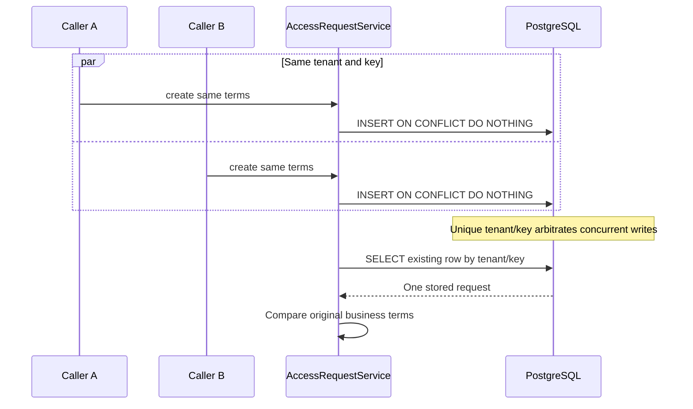
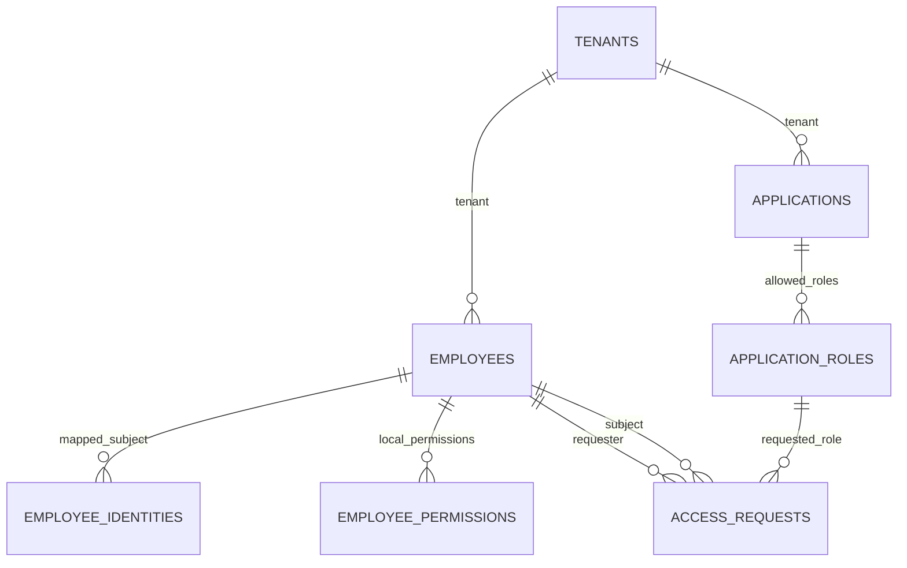
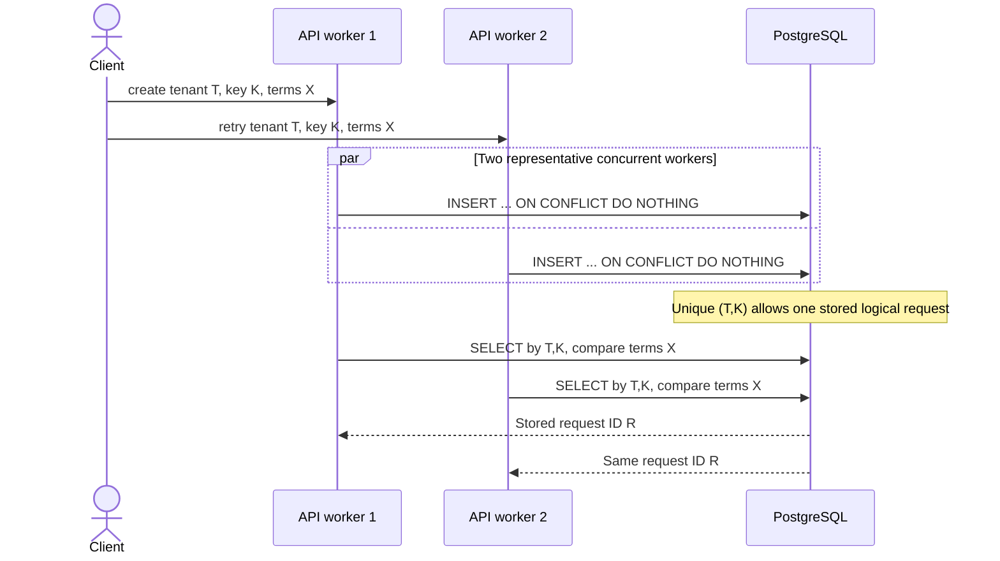

# Lesson 03 — PostgreSQL, Flyway V1–V2, tenant isolation and idempotency

**Track:** sequential IAM engineering curriculum · **Related milestone:** 01A and 01B-2 · **Baseline:** `v0.1.0-portfolio` (educational local/test scope). This is a learning guide, not a new implementation or fresh test execution.

## Learning outcome

Explain durable tenant isolation and concurrent request convergence using actual SQL.

## Starting concepts

- V1 creates tenants, employees, applications, application_roles and access_requests; V2 introduces issuer/subject identity binding and permissions.
- Composite foreign keys bind tenant and requester/subject/app-role. Unique `(tenant_id,idempotency_key)` handles concurrent duplicate intent.
- Service input checks improve diagnostics; database constraints remain the final integrity guard. A successful request is PENDING, not a grant.

## Step-by-step implementation walkthrough

1. Read V1 schema and draw tenant → employees/applications/roles → access_requests; identify composite PK/FK and the unique key.
2. Read V2 schema for `employee_identities` and `employee_permissions`; explain why issuer/subject mapping does not itself grant `ACCESS_REQUEST_CREATE`.
3. Trace `AccessRequestService.create`: null/bounded checks → eligible active joins → `INSERT ... ON CONFLICT DO NOTHING` → SELECT stored row → compare business terms.
4. Explain why same terms return one row but same key with changed employee/application/role/requester throws conflict.
5. Open `AccessRequestPersistenceIT`: find `parallelEquivalentRetriesProduceOneLogicalRow`, the six-thread latch, tenant spoof tests, disabled employee and modified-key rejection.
6. Sketch a transaction timeline for two JVMs writing the same tenant/key; discuss database uniqueness vs Java locks.
7. Run `mvn -B --no-transfer-progress -Dit.test=AccessRequestPersistenceIT -DfailIfNoTests=false verify` with Docker, and record observed output rather than assumed PASS.

## Why the design matters

Concurrent network retries are normal and Java process locks cannot coordinate independent instances. Database constraints give durable, cross-process arbitration.

## Architecture / execution flow



The diagram summarizes the implemented or explicitly optional lab flow; it does not mean all components are continuously running together.

## Source files to open

- [`src/main/resources/db/migration/V1__create_access_request_foundation.sql`](../../src/main/resources/db/migration/V1__create_access_request_foundation.sql)
- [`src/main/resources/db/migration/V2__bind_idp_subjects_and_permissions.sql`](../../src/main/resources/db/migration/V2__bind_idp_subjects_and_permissions.sql)
- [`src/main/java/dev/asambataiden/iam/accessrequest/AccessRequestService.java`](../../src/main/java/dev/asambataiden/iam/accessrequest/AccessRequestService.java)
- [`docs/milestones/01a-persistence-invariants.md`](../../docs/milestones/01a-persistence-invariants.md)
- [`docs/learning/19-concurrency-idempotency-approval-case-studies.md`](../../docs/learning/19-concurrency-idempotency-approval-case-studies.md)

## Verification / existing evidence

- `src/test/java/dev/asambataiden/iam/accessrequest/AccessRequestPersistenceIT.java`

Use the relevant focused test where available, then run the full suite with `mvn -B --no-transfer-progress clean verify`. Python lab helpers use `python3 -m unittest discover -s ops/keycloak -p 'test_*.py'`. CI evidence is commit-specific; the recorded release results are in [release closeout](../release/evidence-register.md) and [portfolio guide](../portfolio/complete-engineering-guide.md). **Do not claim a new PASS without running it.**

## Failure modes / negative checks

- Validate missing or unauthorized actor/tenant/permission where the lesson crosses an IAM access boundary.
- Verify rollback/no unintended business write for failure paths; prove the relevant database or filter-layer invariant with an existing test.
- Do not turn a mock target, synthetic token, or local event projection into a real access-grant claim.
- Never reset a persistent database, prune Docker resources or expose lab admin credentials merely to reproduce a tutorial.

## Explain it in an interview

1. Why is same key with changed terms a conflict rather than overwrite?
2. What could fail if only a Java `synchronized` block were used?
3. What checks belong in code vs the relational schema?

**Answer pattern:** state the business risk → identify class and SQL or protocol boundary → explain normal and failure paths → name test + exact scope → disclose what remains unproven.


## Lab 03A — Reconstruct the relational model from the real migrations

Begin with [V1](../../src/main/resources/db/migration/V1__create_access_request_foundation.sql) and [V2](../../src/main/resources/db/migration/V2__bind_idp_subjects_and_permissions.sql). Both are applied as historical migrations in the **current V1–V14 schema**; V1's initial `CHECK (status = 'PENDING')` is **later replaced by V3** to allow `APPROVED` and `REJECTED`. V2's initial permission-key allowlist is likewise extended in later migrations. Never edit V1/V2 to make those later states appear.

### Step 1: List the business entities

| Table (migration) | Primary key | Required meaning |
| --- | --- | --- |
| `tenants` (V1) | `id` | Organization boundary |
| `employees` (V1) | `(tenant_id,id)` | Tenant-local employee with ACTIVE/DISABLED lifecycle |
| `applications` (V1) | `(tenant_id,id)` | Tenant-local application registry and lifecycle |
| `application_roles` (V1) | `(tenant_id,application_id,role_key)` | Allowed role key for one tenant application |
| `access_requests` (V1) | `id` | One PENDING request, scoped foreign keys, idempotency identity |
| `employee_identities` (V2) | `(tenant_id,issuer,subject)` | Bind trusted OIDC subject to one local employee in tenant |
| `employee_permissions` (V2) | `(tenant_id,employee_id,permission_key)` | Explicit local authorization, initially CREATE only |

Note the unusual but deliberate combination: `access_requests.id` is globally unique, while **foreign keys include tenant ID** to enforce ownership. Merely making IDs UUIDs would not stop cross-tenant references.

### Step 2: Draw the schema



This is a **logical teaching diagram**; refer to actual V1/V2 SQL for the exact composite keys, FK columns, and later schema additions. `ACCESS_REQUESTS` has two distinct employee references: original requester and subject employee.

### Step 3: Understand composite foreign keys

From the actual V1 migration:

```sql
CONSTRAINT fk_access_request_employee
    FOREIGN KEY (tenant_id, employee_id)
    REFERENCES employees (tenant_id, id),

CONSTRAINT fk_access_request_role
    FOREIGN KEY (tenant_id, application_id, role_key)
    REFERENCES application_roles (tenant_id, application_id, role_key)
```

**Why not `FOREIGN KEY (employee_id)` alone?** Because a globally valid employee ID in tenant B must not become a subject on a request owned by tenant A. Pairing the tenant and employee ID ensures the same tenant owns both. The role foreign key similarly binds the application and role to the request's tenant.

**Important distinction:** Referential integrity checks **existence and ownership**. A FK cannot guarantee that an employee or app is currently ACTIVE. The service performs lifecycle checks before writing, and later workflow stages must revalidate eligibility when necessary.

### Step 4: Understand UNIQUE and CHECK

```sql
CONSTRAINT uq_access_requests_tenant_key
    UNIQUE (tenant_id, idempotency_key)
```

This allows the **same textual key in another tenant** while preventing two logical requests sharing a key inside one tenant. `CHECK` enforces allowed lifecycle/status labels and bounded role/key shape, but a database CHECK alone does not establish who was authenticated.

### Step 5: Inspect indices and trade-offs

V1 creates:

```sql
CREATE INDEX idx_access_requests_tenant_created
    ON access_requests(tenant_id, created_at DESC, id DESC);
```

This supports tenant-filtered chronological request lookup. Every index has write/storage overhead; don't add an index to an imagined query until its usage can be explained and benchmarked. Primary and unique constraints already create corresponding index enforcement.

## Lab 03B — Why JWT subject mapping belongs in V2

**Authentication identity versus business identity** are deliberately separate:

1. A correctly validated bearer token provides an issuer and subject (and a tenant claim after trusted parsing).
2. `employee_identities` binds `(tenant_id,issuer,subject)` to the platform's employee ID.
3. `employee_permissions` independently records `ACCESS_REQUEST_CREATE` for that employee.
4. The `RequestActorResolver` joins identity, employee and permission and requires `lifecycle_status = 'ACTIVE'`.
5. A token with a valid scope is **not** sufficient if no such active local mapping and permission exists.

```mermaid
sequenceDiagram
  participant T as JWT-validated principal
  participant R as RequestActorResolver
  participant DB as PostgreSQL V2
  participant S as AccessRequestService
  T->>R: iss, sub, tenant_id
  R->>DB: Match employee_identities + ACTIVE employee + CREATE permission
  alt Zero or multiple mapped actors
    R-->>T: 403; no access request write
  else Exactly one tenant-local actor
    R->>S: create(tenantId, requesterId, employeeId, appId, role, key)
    S->>DB: Validate and persist via V1 access_requests
  end
```

**Historical detail:** V2 allows only `ACCESS_REQUEST_CREATE` when first applied. V3 introduces `ACCESS_REQUEST_DECIDE`; V11 introduces the quarantine reviewer permission. This is additive migration evolution, not evidence that the early V2 schema contained those later capabilities.

## Lab 03C — Trace the actual transaction and insert-or-find algorithm

Open [`AccessRequestService.java`](../../src/main/java/dev/asambataiden/iam/accessrequest/AccessRequestService.java). Its `@Transactional create(...)` is the center of Lesson 03.

### Actual execution order

1. `Objects.requireNonNull` checks four UUID inputs.
2. `requireBounded` checks roleKey (maximum 64) and idempotencyKey (maximum 128), rejecting blank strings and leading/trailing whitespace.
3. A tenant-scoped SQL join checks that requester, employee, app and role exist in the **same tenant** and actor/subject/app are ACTIVE.
4. It attempts an INSERT with a newly generated UUID, but uses `ON CONFLICT (tenant_id,idempotency_key) DO NOTHING`.
5. It queries the existing row using **tenant and idempotency key**, whether the INSERT inserted or conflicted.
6. It compares the persisted requester, employee, application and role against this call. If any differs, it throws `AccessRequestConflictException` without overwriting the first request.
7. For the same terms, it returns the same stored ID and status. The HTTP controller currently responds `201 Created` for **both** first submission and equivalent replay; that response is not proof of a second DB insert.

### Key SQL excerpt, matching the implementation

```sql
INSERT INTO access_requests
  (id, tenant_id, requester_id, employee_id, application_id,
   role_key, idempotency_key)
VALUES (?, ?, ?, ?, ?, ?, ?)
ON CONFLICT (tenant_id, idempotency_key) DO NOTHING;
```

**Why `DO NOTHING` rather than `DO UPDATE`?** A retry must not modify the original access request's business intent or requester. Later approval/audit history depends on stable intent.

**Why select after the insert?** The successful insert and conflicting retry share a single response path; the persisted row is authoritative. PostgreSQL's unique-index conflict arbitration coordinates transactions even when two different JVMs submit equivalent work.

**Why `@Transactional`?** The eligibility query, insert and read-back run inside one Spring-managed transaction. The uniqueness constraint remains the cross-process concurrency guarantee; the annotation alone is insufficient to deduplicate requests.

**Known design trade-off to discuss:** Under concurrent updates to lifecycle/permission records, there may be authorization freshness concerns between eligibility check and committed request. Constraints enforce structural tenant ownership, not every lifecycle rule. A production workflow would define precise revocation/race semantics and test them rather than assuming the eligibility query is a universal lock.

## Lab 03D — Visualize six simultaneous requests

The existing [`AccessRequestPersistenceIT`](../../src/test/java/dev/asambataiden/iam/accessrequest/AccessRequestPersistenceIT.java) uses six Java worker threads and a `CountDownLatch` barrier in `parallelEquivalentRetriesProduceOneLogicalRow`.



The diagram shows only two of the six **concurrent test tasks** for readability. It is **not** evidence that six independent production servers or a particular HTTP load level were tested.

### Contrast four cases

| Case | Same tenant? | Same key? | Terms identical? | Expected database result |
| --- | --- | --- | --- | --- |
| New request | Yes | New | N/A | Insert one PENDING row |
| Equivalent retry | Yes | Yes | Yes | Return existing row ID; count remains one |
| Changed-intent replay | Yes | Yes | No | Conflict; original stored row unchanged |
| Same textual key in a different tenant | No | Yes text | Independent | Uniqueness constraint does not couple tenants; each request still requires valid tenant-local actors/targets |

**Why not `synchronized`?** JVM-local monitors do not coordinate independent processes. A database unique constraint remains authoritative when there are several instances, crashes and retries. A pre-insert SELECT without uniqueness is vulnerable to check-then-insert races.

### Specific tests and expected assertions

| Test method | What to inspect |
| --- | --- |
| `createsPendingRequestAndReturnsSameRowOnRetry` | `status == PENDING`, first/retry UUID equal, count one |
| `changedTermsForSameTenantKeyAreRejected` | `AccessRequestConflictException`, count one |
| `foreignTenantEmployeeCannotBeReferenced` | Rejected foreign employee, no local request |
| `disabledEmployeeCannotBeGrantedPendingRequest` | Rejected inactive subject, no insert |
| `parallelEquivalentRetriesProduceOneLogicalRow` | Six results share one ID, SQL count one |
| `tenantHeaderCannotOverrideAuthenticatedActor` | Spoofed header cannot substitute verified actor; 403 and count zero |
| `mappedActorCannotRequestEmployeeBelongingToAnotherTenantOverHttp` | 404 without cross-tenant disclosure, count zero |
| `differentBusinessTermsWithSameHttpIdempotencyKeyReturnConflict` | First 201; changed retry 409; row count one |

### Why the HTTP tests don't prove a live Keycloak deployment

Several HTTP tests inject `spring-security-test jwt()` principals directly. They prove scope, local actor lookup and controller result mapping, **not** actual RSA verification of a Keycloak-issued token. The portfolio's separate signed decoder/filter tests use ephemeral keys and test-only decoder configuration; live Keycloak-to-API positive interoperability was not accepted in the released tag.

## Lab 03E — Safe verification and SQL troubleshooting

### Recommended commands

From the repository root, with Java 25, Maven and Docker available:

```bash
git status --short --branch
git rev-parse HEAD
java -version
mvn -version
docker info

# Actual PostgreSQL 17 Testcontainers IT: no need to start local iamdb.
mvn -B --no-transfer-progress \
  -Dit.test=AccessRequestPersistenceIT \
  -DfailIfNoTests=false verify

# Optional full regression at the current checkout.
mvn -B --no-transfer-progress clean verify
```

The `AccessRequestPersistenceIT` fixture uses `PostgreSQLContainer("postgres:17-alpine")`, `@DynamicPropertySource` to connect Spring to its disposable database, and a synthetic seed method. **Never copy its `@BeforeEach DELETE` statements into your personal/staging database.** Those are safe only inside the isolated Testcontainers fixture.

### Diagnose, don't guess

- **Docker unavailable:** Testcontainers can't create the disposable PostgreSQL container. Check the Docker engine first.
- **Flyway migration error:** inspect version order and a failed SQL statement; never edit an already-applied migration in place or clear a production schema.
- **FK violation:** identify which `tenant_id` and referenced composite key differ. Do not disable constraints.
- **Conflict:** distinguish expected idempotency replay from a real unexpected key collision with changed intent.
- **Authorization denied at HTTP:** check token policy and V2 active local mapping; it is not automatically a V1 FK problem.
- **Java successful but tests skipped:** verify Failsafe's `*IT` naming and the actual test summary. Do not claim the integration contract passed if no IT executed.

### Learning evidence record

```text
Lesson 03:
Git SHA tested:
PostgreSQL/Testcontainers image:
Flyway versions applied:
Command:
Surefire/Failsafe result and exit code:
One V1 foreign key I can explain:
One V2 identity permission mapping I can explain:
One concurrency race I can draw:
Why request replay returns existing ID:
One negative case and exact test method:
Remaining production trade-off:
```

## Interview preparation — explain the design defensibly

**Q: Why use explicit JDBC and PostgreSQL constraints instead of relying on application validation?**

> “Application validation gives readable business rules, but independently running instances and other SQL writers must share durable integrity rules. We use composite tenant foreign keys to prevent cross-tenant associations, and unique tenant-scoped idempotency keys to arbitrate concurrent retries. The Java service still checks ACTIVE lifecycle and valid roles, which foreign keys alone cannot prove.”

**Q: What happens if two different requests reuse the same idempotency key simultaneously?**

> “The tenant/key UNIQUE constraint allows one stored row. Both calls read that row; the losing request with different business terms fails the comparison with conflict, so it cannot overwrite the winner. Which request wins is scheduler-dependent, but the persistence invariant is deterministic.”

**Q: Why put identity mapping in a separate V2 schema?**

> “JWT identity establishes issuer and subject, but an IAM employee and local CREATE permission are business records. V2 maps a validated issuer/subject/tenant to an active employee and independently checks explicit permissions. We avoid treating JWT scopes or tenant claims as unconditional access.”

**Q: Does this establish full tenant security?**

> “No. Composite FKs protect durable associations, while actor resolution and the HTTP filter protect callers. Each boundary is separately tested. Real Keycloak interoperability, row-level DB RLS, global revocation policies and production deployment hardening are distinct potential requirements, not capabilities we automatically claim.”

## Lesson 03 completion checklist

- [ ] I can draw all V1 tables and V2 identity/permission relations without the schema diagram.
- [ ] I can name all relevant composite keys, unique constraints and lifecycle CHECKs.
- [ ] I know which later migrations extend V1/V2 state and permission enums.
- [ ] I can explain each step of `AccessRequestService.create` and the reason for `ON CONFLICT DO NOTHING`.
- [ ] I can describe a six-thread race and why Java-only synchronization cannot arbitrate multiple JVMs.
- [ ] I can distinguish HTTP mock JWT tests from offline cryptographic JWT tests.
- [ ] I have inspected a concrete Testcontainers regression result and recorded the SHA and exit code.
- [ ] I can explain one known limitation or future production gate, without overstating this release.

**Next:** [Lesson 04 — JWT trust and Spring Security actor mapping](04-spring-security-jwt-and-actor-mapping.md).

## Learning completion checklist

- [ ] I can explain the concepts without reading the implementation.
- [ ] I have opened the actual files and traced the call/transaction boundary.
- [ ] I can describe a negative scenario and its protection.
- [ ] I can identify the existing executable test and distinguish past evidence from my own run.
- [ ] I have recorded questions, mistakes and lessons learned in my own notes without adding secrets to Git.

**Next:** [Curriculum index](README.md) and the next numbered lesson.