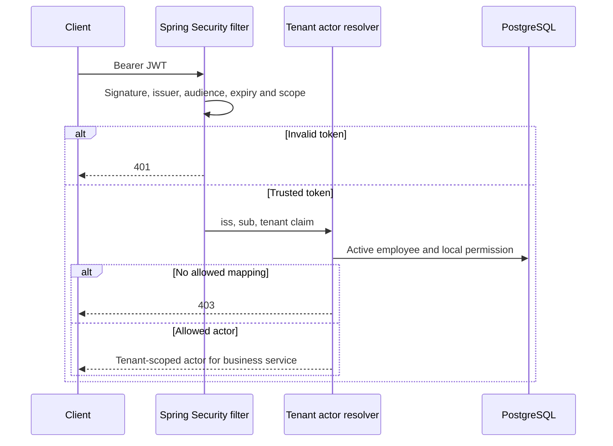

# Lesson 04 — Spring Security, JWT verification and tenant-local authorization

**Track:** sequential IAM engineering curriculum · **Related milestone:** 01B, 05A and 06B-2 · **Baseline:** `v0.1.0-portfolio` (educational local/test scope). This is a learning guide, not a new implementation or fresh test execution.

## Learning outcome

Distinguish cryptographic authentication, scope checks and local business permission with correct tests.

## Starting concepts

- Resource-server JWT trust includes signature, issuer, audience and time. Spring Security scopes are necessary but insufficient.
- Local actor mapping uses trusted issuer/subject/tenant and active employee plus explicit permission; malformed claims deny before DB interaction.
- HTTP tests with `spring-security-test jwt()` skip cryptographic verification; ephemeral RSA decoder/filter tests prove different, narrower boundaries. Live Keycloak compatibility remains unverified in the published release.

## Step-by-step implementation walkthrough

1. Inspect `BootstrapSecurityConfiguration.java`: permit health and ERROR dispatch only in documented scope; scope rules and `denyAll`; bearer-only/STATeless contract.
2. Trace all three resolvers: `RequestActorResolver`, `DecisionActorResolver`, `QuarantineReviewActorResolver`; document local employee and permission lookups.
3. Open `SignedJwtTrustValidationTest` for wrong signature/issuer/audience/expiry, then `SignedJwtHttpFilterIT` for signed bearer strings through the servlet filter with test-only decoder.
4. Open `ActorResolverInvalidClaimsTest` and explain why 403 + zero JDBC calls is stronger than 403 alone for structurally invalid identities.
5. Compare 401 (not authenticated) vs 403 (authenticated but forbidden), 404 (tenant resource hiding) and 409 (business conflict).
6. Discuss why disabling CSRF is conditional on the current stateless bearer-only design; cookie/session auth changes the threat model.
7. Run focused tests or `mvn clean verify`. Do not present a mock JWT principal as a real Keycloak token.

## Why the design matters

Most IAM authorization vulnerabilities arise when valid tokens, untrusted claims or coarse scopes are treated as sufficient resource-level authorization.

## Architecture / execution flow

The diagram summarizes the implemented or explicitly optional lab flow; it does not mean all components are continuously running together.

## Source files to open

- [`src/main/java/dev/asambataiden/iam/bootstrap/BootstrapSecurityConfiguration.java`](../../src/main/java/dev/asambataiden/iam/bootstrap/BootstrapSecurityConfiguration.java)
- [`docs/milestones/01b-1-jwt-resource-server.md`](../../docs/milestones/01b-1-jwt-resource-server.md)
- [`docs/milestones/01b-2-authenticated-intake.md`](../../docs/milestones/01b-2-authenticated-intake.md)
- [`docs/milestones/06b2-offline-signed-jwt-http-regression.md`](../../docs/milestones/06b2-offline-signed-jwt-http-regression.md)
- [`docs/security/threat-model.md`](../../docs/security/threat-model.md)

## Verification / existing evidence

- `src/test/java/dev/asambataiden/iam/bootstrap/SignedJwtTrustValidationTest.java`
- `src/test/java/dev/asambataiden/iam/bootstrap/SignedJwtHttpFilterIT.java`
- `src/test/java/dev/asambataiden/iam/bootstrap/ActorResolverInvalidClaimsTest.java`

Use the relevant focused test where available, then run the full suite with `mvn -B --no-transfer-progress clean verify`. Python lab helpers use `python3 -m unittest discover -s ops/keycloak -p 'test_*.py'`. CI evidence is commit-specific; the recorded release results are in [release closeout](../release/evidence-register.md) and [portfolio guide](../portfolio/complete-engineering-guide.md). **Do not claim a new PASS without running it.**

## Failure modes / negative checks

- Validate missing or unauthorized actor/tenant/permission where the lesson crosses an IAM access boundary.
- Verify rollback/no unintended business write for failure paths; prove the relevant database or filter-layer invariant with an existing test.
- Do not turn a mock target, synthetic token, or local event projection into a real access-grant claim.
- Never reset a persistent database, prune Docker resources or expose lab admin credentials merely to reproduce a tutorial.

## Explain it in an interview

1. When can a correctly signed JWT still get a 403?
2. Which test proves signature verification through an actual servlet filter?
3. Why is a live Keycloak PKCE success not established by an offline test decoder?

**Answer pattern:** state the business risk → identify class and SQL or protocol boundary → explain normal and failure paths → name test + exact scope → disclose what remains unproven.

## Learning completion checklist

- [ ] I can explain the concepts without reading the implementation.
- [ ] I have opened the actual files and traced the call/transaction boundary.
- [ ] I can describe a negative scenario and its protection.
- [ ] I can identify the existing executable test and distinguish past evidence from my own run.
- [ ] I have recorded questions, mistakes and lessons learned in my own notes without adding secrets to Git.

**Next:** [Curriculum index](README.md) and the next numbered lesson.