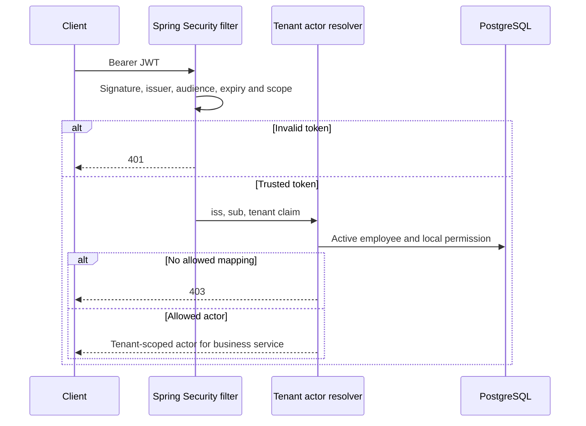
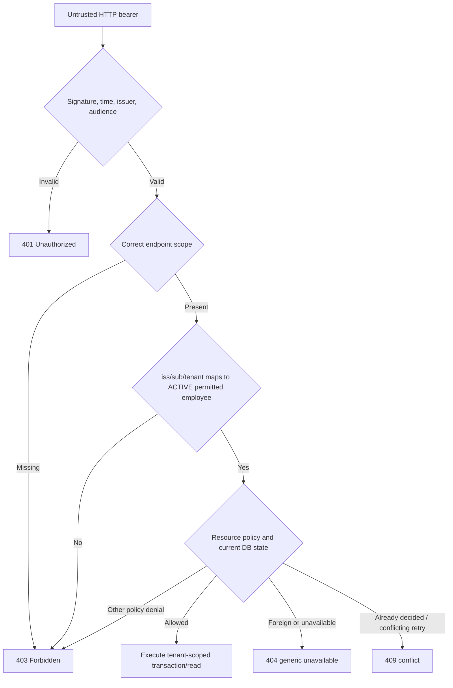

# Lesson 04 — Spring Security, JWT verification and tenant-local authorization

**Track:** sequential IAM engineering curriculum · **Related milestone:** 01B, 05A and 06B-2 · **Baseline:** `v0.1.0-portfolio` (educational local/test scope). This is a learning guide, not a new implementation or fresh test execution.

## Learning outcome

Distinguish cryptographic authentication, scope checks and local business permission with correct tests.

## Starting concepts

- Resource-server JWT trust includes signature, issuer, audience and time. Spring Security scopes are necessary but insufficient.
- Local actor mapping uses trusted issuer/subject/tenant and active employee plus explicit permission; malformed claims deny before DB interaction.
- HTTP tests with `spring-security-test jwt()` skip cryptographic verification; ephemeral RSA decoder/filter tests prove different, narrower boundaries. Live Keycloak compatibility remains unverified in the published release.

## Step-by-step implementation walkthrough

1. Inspect `BootstrapSecurityConfiguration.java`: permit health and ERROR dispatch only in documented scope; scope rules and `denyAll`; bearer-only/STATeless contract.
2. Trace all three resolvers: `RequestActorResolver`, `DecisionActorResolver`, `QuarantineReviewActorResolver`; document local employee and permission lookups.
3. Open `SignedJwtTrustValidationTest` for wrong signature/issuer/audience/expiry, then `SignedJwtHttpFilterIT` for signed bearer strings through the servlet filter with test-only decoder.
4. Open `ActorResolverInvalidClaimsTest` and explain why 403 + zero JDBC calls is stronger than 403 alone for structurally invalid identities.
5. Compare 401 (not authenticated) vs 403 (authenticated but forbidden), 404 (tenant resource hiding) and 409 (business conflict).
6. Discuss why disabling CSRF is conditional on the current stateless bearer-only design; cookie/session auth changes the threat model.
7. Run focused tests or `mvn clean verify`. Do not present a mock JWT principal as a real Keycloak token.

## Why the design matters

Most IAM authorization vulnerabilities arise when valid tokens, untrusted claims or coarse scopes are treated as sufficient resource-level authorization.

## Architecture / execution flow



The diagram summarizes the implemented or explicitly optional lab flow; it does not mean all components are continuously running together.

## Source files to open

- [`src/main/java/dev/asambataiden/iam/bootstrap/BootstrapSecurityConfiguration.java`](../../src/main/java/dev/asambataiden/iam/bootstrap/BootstrapSecurityConfiguration.java)
- [`docs/milestones/01b-1-jwt-resource-server.md`](../../docs/milestones/01b-1-jwt-resource-server.md)
- [`docs/milestones/01b-2-authenticated-intake.md`](../../docs/milestones/01b-2-authenticated-intake.md)
- [`docs/milestones/06b2-offline-signed-jwt-http-regression.md`](../../docs/milestones/06b2-offline-signed-jwt-http-regression.md)
- [`docs/security/threat-model.md`](../../docs/security/threat-model.md)

## Verification / existing evidence

- `src/test/java/dev/asambataiden/iam/security/SignedJwtTrustValidationTest.java`
- `src/test/java/dev/asambataiden/iam/security/SignedJwtHttpFilterIT.java`
- `src/test/java/dev/asambataiden/iam/security/ActorResolverInvalidClaimsTest.java`

Use the relevant focused test where available, then run the full suite with `mvn -B --no-transfer-progress clean verify`. Python lab helpers use `python3 -m unittest discover -s ops/keycloak -p 'test_*.py'`. CI evidence is commit-specific; the recorded release results are in [release closeout](../release/evidence-register.md) and [portfolio guide](../portfolio/complete-engineering-guide.md). **Do not claim a new PASS without running it.**

## Failure modes / negative checks

- Validate missing or unauthorized actor/tenant/permission where the lesson crosses an IAM access boundary.
- Verify rollback/no unintended business write for failure paths; prove the relevant database or filter-layer invariant with an existing test.
- Do not turn a mock target, synthetic token, or local event projection into a real access-grant claim.
- Never reset a persistent database, prune Docker resources or expose lab admin credentials merely to reproduce a tutorial.

## Explain it in an interview

1. When can a correctly signed JWT still get a 403?
2. Which test proves signature verification through an actual servlet filter?
3. Why is a live Keycloak PKCE success not established by an offline test decoder?

**Answer pattern:** state the business risk → identify class and SQL or protocol boundary → explain normal and failure paths → name test + exact scope → disclose what remains unproven.


## Lab 04A — The four security decisions you must never merge into one

The release's authorization flow has four separate decisions:

1. **Authentication:** The JWT decoder checks the token signature and validity, issuer `iss`, intended audience `aud`, and expiration. An invalid bearer token fails with **401** before a business service is called.
2. **Route-level authority:** Spring's security filter checks a required `SCOPE_...` authority. A token without the endpoint's authority fails **403**.
3. **Local actor mapping:** A trusted issuer/subject/tenant combination resolves to exactly one ACTIVE tenant-local employee with the relevant explicit permission. A valid token and scope alone do not establish this authority.
4. **Business-resource policy:** After local mapping, the service checks tenant ownership, request state, separation of duties, application/employee lifecycle and relational constraints; failures may produce 403/404/409 depending on the endpoint contract.



**Security rule:** `tenant_id` is a JWT claim **input to a trusted identity mapping lookup**, not an authorization decision by itself. An `X-Tenant-Id` header or a request body field cannot override the actor resolved by the server.

## Lab 04B — Read the exact Spring Security configuration

Open [`BootstrapSecurityConfiguration.java`](../../src/main/java/dev/asambataiden/iam/bootstrap/BootstrapSecurityConfiguration.java) before continuing.

| Actual filter rule | What it means | Threat avoided / limitation |
| --- | --- | --- |
| `SessionCreationPolicy.STATELESS` | API uses no server login session | Does not independently prove absence of every possible credential risk |
| `httpBasic().disable()` and `formLogin().disable()` | No secondary default password/form login route | Does not make JWT validation optional |
| `oauth2ResourceServer(...jwt(...))` | Bearer tokens are decoded through configured JWT resource server | Production JWKS/interoperability not established by test decoder |
| `GET /actuator/health` → `permitAll` | Anonymous liveness/health query | Not a permission to inspect tenant business state |
| ERROR dispatcher → `permitAll` | Spring can render the **internal ERROR dispatch** for a 404/409 | A **direct REQUEST** to `/error` still faces authentication/default denial |
| GET quarantine routes → `SCOPE_provisioning:review` | Only a scoped caller can reach the quarantine inspection controller | Local reviewer mapping still required |
| POST `/api/v1/access-requests/{requestId}/decision` → `SCOPE_access:decide` | Approval is specifically scoped | Its matcher must precede the broader access-request matcher |
| `/api/v1/access-requests/**` → `SCOPE_access:request` | Scope gate on the broad request route | Existing fallback is broad by method: only the implemented POST intake has a controller; don't advertise other methods |
| `anyRequest().denyAll()` | Unknown routes are denied | New endpoints must explicitly define permissions and tests |
| CSRF disabled | Appropriate only for the currently documented bearer-only/no-cookie-session model | Must be reassessed if the authentication model changes |

### Why matcher order is a security concern

Spring Security evaluates the authorization matchers in order. The **specific decision POST route** appears before the broader `/api/v1/access-requests/**` rule. Reversing that order could accidentally classify a decision request as requiring only `access:request`, weakening its scope boundary.

**Exercise:** Find the test that rejects a bearer with the wrong scope on the decision endpoint. Explain how local authorization still prevents self-approval even if a token has `access:decide`.

## Lab 04C — Understand the local actor resolvers with actual SQL semantics

Three resolvers follow the same pattern but demand different permission keys:

| HTTP workflow | Resolver | Required route authority | Required employee permission |
| --- | --- | --- | --- |
| Request creation | `RequestActorResolver` | `SCOPE_access:request` | `ACCESS_REQUEST_CREATE` |
| Approval/rejection | `DecisionActorResolver` | `SCOPE_access:decide` | `ACCESS_REQUEST_DECIDE` |
| Quarantine inspection | `QuarantineReviewActorResolver` | `SCOPE_provisioning:review` | `PROVISIONING_QUARANTINE_REVIEW` |

Read [`RequestActorResolver.java`](../../src/main/java/dev/asambataiden/iam/accessrequest/RequestActorResolver.java), [`DecisionActorResolver.java`](../../src/main/java/dev/asambataiden/iam/accessrequest/DecisionActorResolver.java), and [`QuarantineReviewActorResolver.java`](../../src/main/java/dev/asambataiden/iam/provisioning/quarantine/QuarantineReviewActorResolver.java).

**Execution order:**

1. Reject a null JWT.
2. Reject missing issuer and missing/blank subject.
3. Read `tenant_id` as a string; fail closed on an absent, malformed or unparseable UUID.
4. Use JDBC to join `employee_identities`, `employees` and `employee_permissions` under the same tenant.
5. Require `e.lifecycle_status='ACTIVE'` and the exact local permission; require **exactly one** matching actor row.
6. Return a trusted `Actor(tenantId,employeeId)` for the service, rather than allowing the client to supply this identity.

**Why issuer and subject together?** A subject string has meaning inside the identity provider's issuer namespace. Treating `sub` alone as a global identifier could collide across issuers. The PostgreSQL V2 composite primary key on `(tenant_id,issuer,subject)` preserves this distinction.

**Why validate claim shape before JDBC?** An invalid principal should not trigger needless database access or accidentally match a fallback tenant. `ActorResolverInvalidClaimsTest` verifies **403** and **no JdbcTemplate interactions** for malformed or missing claim cases. Those are mocked resolver-level checks, not cryptographic signature tests.

## Lab 04D — Distinguish real cryptographic checks from mock JWT tests

One of the most important interview lessons is **test evidence scope**.

| Test layer | Real token signature? | Real servlet filter? | PostgreSQL? | What is established |
| --- | --- | --- | --- | --- |
| `MockMvc` with `spring-security-test jwt()` | **No** — principal injected | Yes, policy chain participates | In relevant integration tests, yes | Route scopes, actor mapping and controller errors |
| `SignedJwtTrustValidationTest` | **Yes**, ephemeral RSA token | **No** | No | A standalone `NimbusJwtDecoder` rejects untrusted key, wrong issuer/audience, expired token |
| `SignedJwtHttpFilterIT` | **Yes**, ephemeral RSA token | **Yes** | Testcontainers PostgreSQL | Bearer tokens traverse actual security filters under **test-only `@Primary JwtDecoder`** |
| Local Keycloak metadata smoke | Not a positive API token test | No | Not needed | Discovery issuer and JWKS metadata plausibility |
| Live Keycloak authorization-code + PKCE → IAM API | Would use Keycloak-issued token | Would use application HTTP filter | Would require a trusted actor fixture | **Not accepted as verified** for tagged release; draft PR #49 is separate |

### Inspect the cryptographic test code

[`SignedJwtTrustValidationTest`](../../src/test/java/dev/asambataiden/iam/security/SignedJwtTrustValidationTest.java) generates two separate 2048-bit RSA keypairs in memory; a `NimbusJwtDecoder` trusts only the first public key and applies `JwtValidators.createDefaultWithIssuer` plus audience membership validation. Read these exact test names:

- `validSignedTokenIsDecoded`
- `tokenWithUnknownSigningKeyIsRejected`
- `validSignatureWithWrongIssuerIsRejected`
- `validSignatureWithWrongAudienceIsRejected`
- `expiredTokenIsRejected`

**Why different tests?** Signature validation asks **who signed** the token; issuer asks **which authority** is claimed; audience asks **whether this API is the intended recipient**; `exp` limits token lifetime. One control cannot substitute for another.

[`SignedJwtHttpFilterIT`](../../src/test/java/dev/asambataiden/iam/security/SignedJwtHttpFilterIT.java) sends actual serialized RSA-signed strings as `Authorization: Bearer ...`, but imports test configuration with a **`@Primary JwtDecoder`**. It tests servlet-filter authentication and the reject paths for wrong signing key, issuer, audience and expiry. A signed, scope-correct request without a local actor mapping is still **403**, not a successful IAM action.

**Do not claim:** The tests verified live production JWKS retrieval, Keycloak-issued access token compatibility, key rotation, browser authorization, or operational readiness.

### Sequence: signed test token through actual filter and local actor check

```mermaid
sequenceDiagram
    participant Test as JUnit test / RSA signer
    participant MVC as MockMvc servlet chain
    participant Dec as Test-only NimbusJwtDecoder
    participant Policy as Endpoint scope gate
    participant Actor as Local actor resolver
    participant DB as Testcontainers PostgreSQL
    Test->>MVC: Authorization Bearer signedJWT
    MVC->>Dec: Decode signed token
    alt Key, iss, aud or exp invalid
      Dec-->>MVC: JwtException
      MVC-->>Test: 401
    else Valid cryptographic token
      Dec-->>MVC: Jwt principal
      MVC->>Policy: Check endpoint scope
      alt Wrong scope
        Policy-->>Test: 403
      else Scope present
        Policy->>Actor: Validate iss/sub/tenant and local permission
        Actor->>DB: ACTIVE employee/permission lookup
        alt No matching local permission
          Actor-->>Test: 403
        else Matching authorized local actor
          Actor-->>MVC: Allowed actor; subsequent business policy applies
        end
      end
    end
```

This diagram combines the filtered test behavior with the resolver policy exercised in other tests. It does not assert that `SignedJwtHttpFilterIT` contains a **successful mapped actor** case; its scope-correct fixture is deliberately **unmapped**.

## Lab 04E — Status code, failure and tenant concealment matrix

| Input / condition | Observed or intended contract | No-write requirement |
| --- | --- | --- |
| Anonymous request to a protected route | 401 | No state change |
| Invalid signature, issuer, audience or expired bearer (signed HTTP fixture) | 401 | No business handler write |
| Valid signed bearer but missing endpoint scope | 403 | No business handler write |
| Correct scope but no local permitted actor | 403 | No business handler write |
| Structurally malformed issuer, subject or tenant in resolver-level tests | 403 | **No JDBC call** |
| Valid scoped actor references foreign tenant subject | Generic 404 in request intake | No cross-tenant request persisted |
| Self-approver even with DECIDE permission | 403 | No decision/audit created |
| Replay same tenant/idempotency key with changed terms | 409 | Original row preserved |
| Attempt to decide already terminal request | 409 | Existing decision/audit preserved |
| Direct request to `/error` | Protected/unauthorized by filter | Internal ERROR dispatch may preserve error status |

**Pitfall:** 404 is not a universal substitute for 403. Use the established endpoint semantics: the request intake's foreign-resource concealment, actor-level permission errors, and terminal-state conflicts serve different purposes. More importantly, assert **no unauthorized DB mutation** in negative tests rather than only the response status.

## Lab 04F — Threat model, CSRF and future production gates

The API uses **bearer Authorization headers**, stateless session policy and no Basic/form login. The current CSRF disablement is justified by the current use of explicit bearer credentials, **not** because CSRF never matters for REST APIs. If a future design introduces browser cookies, HTTP sessions or automatically attached credentials, reassess CSRF defenses and test them.

Additional threats/controls:

- **Replay/credential theft:** JWT is bearer possession; the application has no token binding or proof-of-possession. Protect secrets and TLS in deployment; don't log real bearer values.
- **Token audience confusion:** tokens valid for another API must be rejected even if signed by a trusted issuer.
- **Revocation freshness:** a previously valid JWT can remain cryptographically valid; deleting the local permission denies the next actor resolution. This is narrower than complete IdP session revocation or distributed cache invalidation.
- **Tenant spoofing:** never trust `X-Tenant-Id` or requester JSON over server-mapped actor ownership.
- **Default route exposure:** unknown routes deny by default; add explicit matcher plus positive/negative tests for every new endpoint.
- **IdP operational risk:** JWKS availability, rotation and production issuer/audience configuration need live acceptance tests; current release has only controlled offline proofs.
- **Quarantine review:** HTTP GET exposes scoped diagnostics only. There is no public authenticated remediation or automatic requeue capability.

## Lab 04G — Safe commands and learning evidence

From repository root with Java 25, Maven and Docker available:

```bash
git rev-parse HEAD
java -version
mvn -version
docker info

# Pure offline RSA decoder and invalid-claim unit tests:
mvn -B --no-transfer-progress \
  -Dtest=SignedJwtTrustValidationTest,ActorResolverInvalidClaimsTest test

# Actual bearer filter integration tests (ephemeral RSA + Testcontainers):
mvn -B --no-transfer-progress \
  -Dit.test=SignedJwtHttpFilterIT -DfailIfNoTests=false verify

# Relevant scope and local authorization HTTP integration:
mvn -B --no-transfer-progress \
  -Dit.test=AccessRequestPersistenceIT,ApprovalDecisionHttpIT,QuarantineInspectionHttpIT \
  -DfailIfNoTests=false verify
```

**Verification evidence:** Record actual command, Git SHA, exit code and test counts. These are instructions; this documentation PR does **not** assert that a fresh test run passed. Integration tests require Docker/Testcontainers; Keycloak credentials are **not required** for the offline tests.

**Do not run** a production Keycloak realm reset, disclose private RSA keys, post a bearer token into GitHub issues, or remove unrelated Docker resources while following this lab.

### Learning record

```text
Lesson 04 / Git SHA:
Filter route and scope:
JWT issuer, audience, expiry constraints:
Test decoder vs production JWKS distinction:
Local employee permission needed:
Malformed claim scenario:
What was actually executed and passed:
Why a signed token may still get 403:
One threat not mitigated by the tagged release:
One design question to revisit in production:
```

## Interview model answers

**Why is a signed token insufficient for approving an IAM request?**

> “A trusted signature proves a key signed the claims, subject to issuer, audience and expiry policy. The decision endpoint separately requires `SCOPE_access:decide`. Then our resolver maps the verified issuer, subject and tenant to an ACTIVE employee holding the local DECIDE permission. Finally the approval service checks the same-tenant PENDING request, the original requester and separation of duties. A valid token can still be forbidden.”

**Which JWT tests prove what?**

> “The `jwt()` HTTP helper injects a principal and tests authorization policy, not cryptography. A standalone ephemeral RSA decoder test proves signature and claim-validation behavior. A separate signed bearer HTTP test proves the Spring servlet filter rejects invalid tokens under a test-only decoder. None proves live Keycloak token-to-API interoperability.”

**Why does the application disable CSRF?**

> “It is currently a stateless bearer-token API with no browser session or cookie authentication. The CSRF choice is contextual, not a general exception for REST. Any cookie-authenticated UI or session support would require a fresh threat assessment and CSRF testing.”

## Lesson 04 completion checklist

- [ ] I can draw authentication → route scope → local actor mapping → resource authorization.
- [ ] I can explain issuer, audience, signature and expiration as distinct checks.
- [ ] I can locate the exact three scope matchers and their order in the filter configuration.
- [ ] I can explain why a valid scoped JWT can still be 403 and why foreign tenant resources may appear as 404.
- [ ] I can explain the V2 identity/permission lookup without trusting JSON or headers as authority.
- [ ] I know which tests use `jwt()`, ephemeral RSA signing, a real servlet filter or a live IdP.
- [ ] I have recorded an observed focused test result and commit SHA.
- [ ] I can name at least three remaining production controls without claiming they are implemented.

**Next:** [Lesson 05 — Keycloak, OIDC discovery, Authorization Code + PKCE and local lab](05-keycloak-oidc-pkce-local-lab.md).

## Learning completion checklist

- [ ] I can explain the concepts without reading the implementation.
- [ ] I have opened the actual files and traced the call/transaction boundary.
- [ ] I can describe a negative scenario and its protection.
- [ ] I can identify the existing executable test and distinguish past evidence from my own run.
- [ ] I have recorded questions, mistakes and lessons learned in my own notes without adding secrets to Git.

**Next:** [Curriculum index](README.md) and the next numbered lesson.