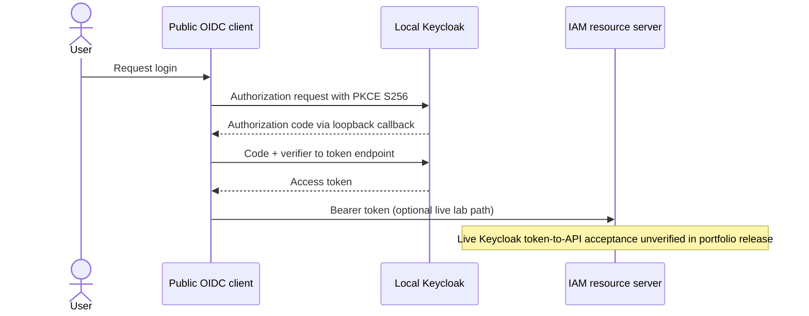

# Lesson 05 — Keycloak, OIDC discovery, JWKS and local Authorization Code + PKCE

**Track:** sequential IAM engineering curriculum · **Related milestone:** 01C, 03D and 06A · **Baseline:** `v0.1.0-portfolio` (educational local/test scope). This is a learning guide, not a new implementation or fresh test execution.

## Learning outcome

Understand the identity-provider boundary and safely distinguish metadata readiness from real token-to-API acceptance.

## Starting concepts

- Keycloak 26.8.2 is a localhost dev lab with synthetic realm; `start-dev` and insecure local HTTP are not production configuration.
- OIDC discovery establishes issuer/endpoints; JWKS publishes public signing-key metadata; neither by itself proves that an access token passes application authentication.
- Authorization Code + PKCE S256 protects a public client authorization-code exchange. A local browser lab does not justify using password grant for end-user login.

## Step-by-step implementation walkthrough

1. Inspect `ops/keycloak/compose.yaml`, `ops/keycloak/realm/iam-lab-realm.json` and `docs/milestones/01c-1-local-keycloak-metadata-lab.md`.
2. Trace `ops/keycloak/verify-runtime.py`: bounded retry, exact issuer, same-origin realm-scoped JWKS URI and key metadata checks.
3. Read `ops/keycloak/oidc-pkce-smoke.py` and `docs/milestones/01c-2-pkce-browser-token-lab.md`; sketch authorization request, state, PKCE verifier/challenge, redirect and access-token use.
4. Separate synthetic admin bootstrap scripts from client Authorization Code login. Never commit or paste client/admin secrets or tokens.
5. Compare the chronological early lab ledger (some historical successes) with current release gate: full live Keycloak-issued HTTP bearer acceptance is still explicitly unverified in draft PR #49.
6. If running optional local lab, inspect port 8281 and existing Compose services first; do not remove or reset unrelated containers; stop only the verified lab service.
7. Write a troubleshooting decision tree: service unreachable → issuer mismatch → JWKS missing → browser login/redirect → access token → local authorization; do not confuse 401 and 403.

## Why the design matters

Authentication is a protocol integration with distinct readiness and trust boundaries. Deterministic offline tests let the portfolio release proceed without falsifying live interoperability.

## Architecture / execution flow

The diagram summarizes the implemented or explicitly optional lab flow; it does not mean all components are continuously running together.

## Source files to open

- [`ops/keycloak/compose.yaml`](../../ops/keycloak/compose.yaml)
- [`ops/keycloak/verify-runtime.py`](../../ops/keycloak/verify-runtime.py)
- [`ops/keycloak/oidc-pkce-smoke.py`](../../ops/keycloak/oidc-pkce-smoke.py)
- [`docs/milestones/06a-keycloak-runtime-smoke.md`](../../docs/milestones/06a-keycloak-runtime-smoke.md)
- [`docs/milestones/01c-2-pkce-browser-token-lab.md`](../../docs/milestones/01c-2-pkce-browser-token-lab.md)

## Verification / existing evidence

- `ops/keycloak/test_pkce_subject_binding.py`
- `ops/keycloak/test_seed_authorized_iam_fixture.py`
- `ops/keycloak/test_quarantine_reviewer_subject_binding.py`

Use the relevant focused test where available, then run the full suite with `mvn -B --no-transfer-progress clean verify`. Python lab helpers use `python3 -m unittest discover -s ops/keycloak -p 'test_*.py'`. CI evidence is commit-specific; the recorded release results are in [release closeout](../release/evidence-register.md) and [portfolio guide](../portfolio/complete-engineering-guide.md). **Do not claim a new PASS without running it.**

## Failure modes / negative checks

- Validate missing or unauthorized actor/tenant/permission where the lesson crosses an IAM access boundary.
- Verify rollback/no unintended business write for failure paths; prove the relevant database or filter-layer invariant with an existing test.
- Do not turn a mock target, synthetic token, or local event projection into a real access-grant claim.
- Never reset a persistent database, prune Docker resources or expose lab admin credentials merely to reproduce a tutorial.

## Explain it in an interview

1. What does an exact issuer comparison protect?
2. Why must the resource server check both signature and audience?
3. Which failure is a lab readiness failure rather than an IAM authorization bug?

**Answer pattern:** state the business risk → identify class and SQL or protocol boundary → explain normal and failure paths → name test + exact scope → disclose what remains unproven.

## Learning completion checklist

- [ ] I can explain the concepts without reading the implementation.
- [ ] I have opened the actual files and traced the call/transaction boundary.
- [ ] I can describe a negative scenario and its protection.
- [ ] I can identify the existing executable test and distinguish past evidence from my own run.
- [ ] I have recorded questions, mistakes and lessons learned in my own notes without adding secrets to Git.

**Next:** [Curriculum index](README.md) and the next numbered lesson.