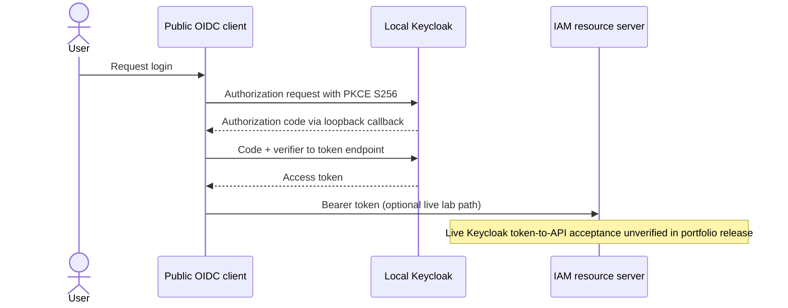
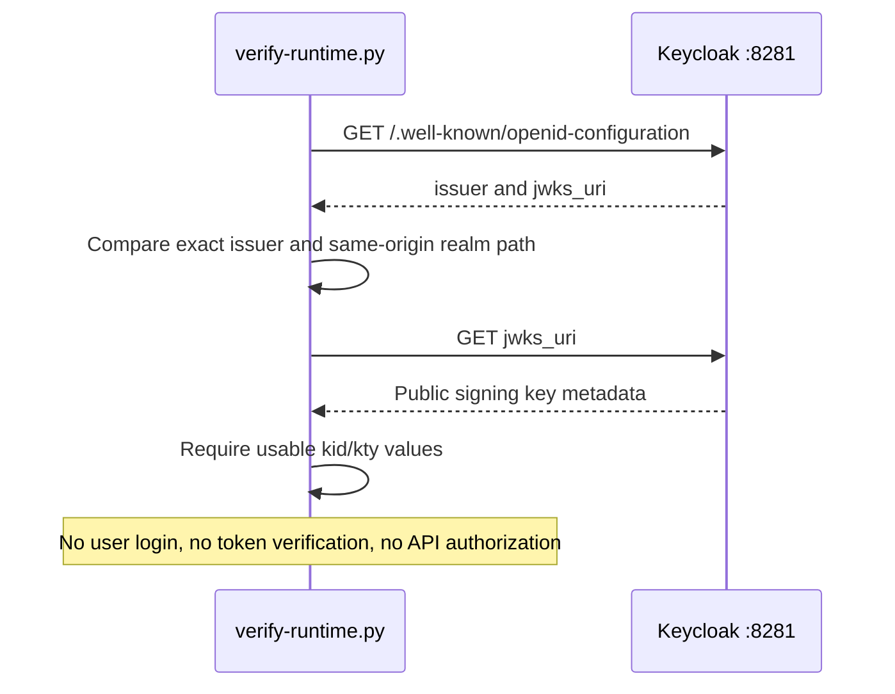
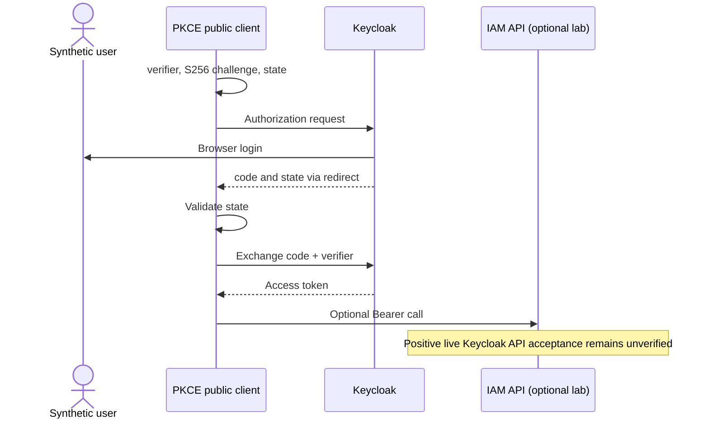

# Lesson 05 — Keycloak, OIDC discovery, JWKS and local Authorization Code + PKCE

**Track:** sequential IAM engineering curriculum · **Related milestone:** 01C, 03D and 06A · **Baseline:** `v0.1.0-portfolio` (educational local/test scope). This is a learning guide, not a new implementation or fresh test execution.

## Learning outcome

Understand the identity-provider boundary and safely distinguish metadata readiness from real token-to-API acceptance.

## Starting concepts

- Keycloak 26.8.2 is a localhost dev lab with synthetic realm; `start-dev` and insecure local HTTP are not production configuration.
- OIDC discovery establishes issuer/endpoints; JWKS publishes public signing-key metadata; neither by itself proves that an access token passes application authentication.
- Authorization Code + PKCE S256 protects a public client authorization-code exchange. A local browser lab does not justify using password grant for end-user login.

## Step-by-step implementation walkthrough

1. Inspect `ops/keycloak/compose.yaml`, `ops/keycloak/realm/iam-lab-realm.json` and `docs/milestones/01c-1-local-keycloak-metadata-lab.md`.
2. Trace `ops/keycloak/verify-runtime.py`: bounded retry, exact issuer, same-origin realm-scoped JWKS URI and key metadata checks.
3. Read `ops/keycloak/oidc-pkce-smoke.py` and `docs/milestones/01c-2-pkce-browser-token-lab.md`; sketch authorization request, state, PKCE verifier/challenge, redirect and access-token use.
4. Separate synthetic admin bootstrap scripts from client Authorization Code login. Never commit or paste client/admin secrets or tokens.
5. Compare the chronological early lab ledger (some historical successes) with current release gate: full live Keycloak-issued HTTP bearer acceptance is still explicitly unverified in draft PR #49.
6. If running optional local lab, inspect port 8281 and existing Compose services first; do not remove or reset unrelated containers; stop only the verified lab service.
7. Write a troubleshooting decision tree: service unreachable → issuer mismatch → JWKS missing → browser login/redirect → access token → local authorization; do not confuse 401 and 403.

## Why the design matters

Authentication is a protocol integration with distinct readiness and trust boundaries. Deterministic offline tests let the portfolio release proceed without falsifying live interoperability.

## Architecture / execution flow



The diagram summarizes the implemented or explicitly optional lab flow; it does not mean all components are continuously running together.

## Source files to open

- [`ops/keycloak/compose.yaml`](../../ops/keycloak/compose.yaml)
- [`ops/keycloak/verify-runtime.py`](../../ops/keycloak/verify-runtime.py)
- [`ops/keycloak/oidc-pkce-smoke.py`](../../ops/keycloak/oidc-pkce-smoke.py)
- [`docs/milestones/06a-keycloak-runtime-smoke.md`](../../docs/milestones/06a-keycloak-runtime-smoke.md)
- [`docs/milestones/01c-2-pkce-browser-token-lab.md`](../../docs/milestones/01c-2-pkce-browser-token-lab.md)

## Verification / existing evidence

- `ops/keycloak/test_pkce_subject_binding.py`
- `ops/keycloak/test_seed_authorized_iam_fixture.py`
- `ops/keycloak/test_quarantine_reviewer_subject_binding.py`

Use the relevant focused test where available, then run the full suite with `mvn -B --no-transfer-progress clean verify`. Python lab helpers use `python3 -m unittest discover -s ops/keycloak -p 'test_*.py'`. CI evidence is commit-specific; the recorded release results are in [release closeout](../release/evidence-register.md) and [portfolio guide](../portfolio/complete-engineering-guide.md). **Do not claim a new PASS without running it.**

## Failure modes / negative checks

- Validate missing or unauthorized actor/tenant/permission where the lesson crosses an IAM access boundary.
- Verify rollback/no unintended business write for failure paths; prove the relevant database or filter-layer invariant with an existing test.
- Do not turn a mock target, synthetic token, or local event projection into a real access-grant claim.
- Never reset a persistent database, prune Docker resources or expose lab admin credentials merely to reproduce a tutorial.

## Explain it in an interview

1. What does an exact issuer comparison protect?
2. Why must the resource server check both signature and audience?
3. Which failure is a lab readiness failure rather than an IAM authorization bug?

**Answer pattern:** state the business risk → identify class and SQL or protocol boundary → explain normal and failure paths → name test + exact scope → disclose what remains unproven.


## Practical lab 05A — Reconstruct the OIDC trust boundary

Begin at [Keycloak Compose](../../ops/keycloak/compose.yaml), [the synthetic realm](../../ops/keycloak/realm/iam-lab-realm.json), and [the Spring application configuration](../../src/main/resources/application.yml).

| Setting | As-built lab value | Purpose |
| --- | --- | --- |
| Keycloak image | `quay.io/keycloak/keycloak:26.8.2` | Versioned, local-only identity provider |
| Command | `start-dev --import-realm` | Development mode, never production hardening |
| Port | `127.0.0.1:8281:8080` | Listen only on loopback |
| Bootstrap admin | `IAM_LAB_ADMIN_USERNAME` and `IAM_LAB_ADMIN_PASSWORD` environment variables | No credentials committed to the repository |
| Issuer | `http://127.0.0.1:8281/realms/iam-lab` | Expected JWT issuer |
| Audience | `iam-governance-api` | Intended resource server |
| PKCE public client | `iam-lab-cli` | Lab Authorization Code + PKCE client |
| Browser callback | `http://127.0.0.1:8765/callback` | Local redirect, not a deployed production frontend |

**Why external identity?** The IAM service does not need to implement user passwords, MFA, token signing or federation. Keycloak authenticates identities; Spring Security verifies bearer tokens; the Java business layer checks active employees, tenant ownership and explicit local permissions. These are separate responsibilities.

## Practical lab 05B — OIDC discovery is not an authenticated login

Read [`verify-runtime.py`](../../ops/keycloak/verify-runtime.py). It fetches the discovery document and checks **exact issuer**, a **same-origin and realm-scoped JWKS URL**, and usable signing-key metadata (`kid`, `kty`, signing use).



A healthy discovery endpoint is a **prerequisite**, not evidence that a token signed by Keycloak will be accepted by the IAM API. The tool has a bounded retry window (30 attempts, 2 seconds apart, 3-second request timeout), and prints only metadata results.

## Practical lab 05C — Authorization Code + PKCE S256

Open [`oidc-pkce-smoke.py`](../../ops/keycloak/oidc-pkce-smoke.py) and follow the protocol in order:

1. Generate a random high-entropy `code_verifier` and derive `code_challenge = BASE64URL(SHA256(verifier))`.
2. Generate a fresh `state`, then send an authorization request with client, redirect, challenge and `code_challenge_method=S256`.
3. Complete login through Keycloak's browser page; the application does not receive user passwords.
4. Validate the callback `state`, then redeem the authorization code with the original verifier at Keycloak's token endpoint.
5. Use the returned token only through a properly configured resource server. The helper's `opaque_claims()` parses a JWT payload for **diagnostics without verifying its signature**. It cannot authorize a business request.
6. The Java API separately verifies JWT signature, issuer, audience and expiry and maps issuer/subject/tenant to a permitted local actor.



The historical browser lab contains setup and exploratory evidence, while **draft PR #49** is the separate unfinished live integration acceptance path. Neither metadata checks nor the published test-only RSA JWT decoder establishes that positive interoperability.

## Practical lab 05D — Safe reproduction and failure diagnosis

Run offline checks without starting a service:

```bash
python3 -m json.tool ops/keycloak/realm/iam-lab-realm.json >/dev/null
python3 -m unittest discover -s ops/keycloak -p 'test_*.py'
bash -n ops/keycloak/check-metadata.sh
docker compose -f ops/keycloak/compose.yaml config --quiet --no-interpolate
```

For the optional live metadata lab, first check whether port 8281 or the Compose project already belongs to another process. Supply admin variables securely in your own terminal; bring up only the isolated lab, run `python3 ops/keycloak/verify-runtime.py` and stop only that service. Do not clear persistent databases, reset real realms, publish tokens or delete unrelated Docker resources.

| Failure | Investigate | Do not assume |
| --- | --- | --- |
| :8281 connection failure | Container/port readiness | Wrong JWT signature |
| Discovery issuer mismatch | Exact host, port, issuer URL | Missing employee grant |
| Missing JWKS | Realm import/signing key metadata | Authorization success |
| Browser callback fails | Redirect, PKCE and state | API response |
| Bearer API returns 401 | Signing key, issuer, audience, expiry | Business resource exists |
| Bearer API returns 403 | Route scope, active mapping, local permission | Token was necessarily invalid |

**Interview answer:** “We use Keycloak as an external IdP and Spring Boot as a JWT resource server. I can distinguish OIDC discovery readiness, the PKCE browser exchange, cryptographic token acceptance and tenant-local permission checks. Our tagged release has offline signed-token and local lab evidence, but not a successful live Keycloak token-to-API acceptance or real external entitlement.”

**Continue:** [Lesson 06 — approval and transactional audit](06-approval-sod-and-transactional-audit.md).

## Learning completion checklist

- [ ] I can explain the concepts without reading the implementation.
- [ ] I have opened the actual files and traced the call/transaction boundary.
- [ ] I can describe a negative scenario and its protection.
- [ ] I can identify the existing executable test and distinguish past evidence from my own run.
- [ ] I have recorded questions, mistakes and lessons learned in my own notes without adding secrets to Git.

**Next:** [Curriculum index](README.md) and the next numbered lesson.