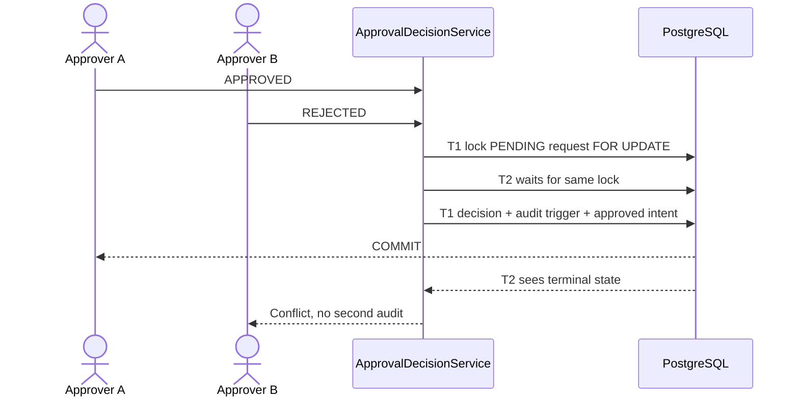

# Lesson 06 — Approval decisions, SoD, concurrency and transactional audit

**Track:** sequential IAM engineering curriculum · **Related milestone:** 03A–03D / 04A · **Baseline:** `v0.1.0-portfolio` (educational local/test scope). This is a learning guide, not a new implementation or fresh test execution.

## Learning outcome

Explain how one authorized distinct approver wins an approval race and how status, decision and audit commit atomically.

## Starting concepts

- V3 adds PENDING/APPROVED/REJECTED decision model, a primary key on tenant/request, requester-bound composite FK and check approver != requester.
- `ApprovalDecisionService.decide` validates active decision permission, locks the request `FOR UPDATE OF ar`, enforces PENDING and requester/approver separation, updates state and inserts one decision in a Spring transaction.
- V4 PostgreSQL AFTER INSERT trigger writes approval audit in the same transaction; V5/V12 continue approved-only work/outbox intent. A rejected decision never makes approved work.

## Step-by-step implementation walkthrough

1. Read V3 and annotate the PK, composite request/requester FK and SoD CHECK; distinguish DB integrity from bearer token authorization.
2. Open `ApprovalDecisionController` and `DecisionActorResolver` and identify how a trusted JWT actor obtains scope plus local `ACCESS_REQUEST_DECIDE`.
3. Trace `ApprovalDecisionService.decide` from permission check to `FOR UPDATE`, stored requester lookup, terminal state guard, `UPDATE ... WHERE PENDING` and decision insert.
4. Read V4 `iam_record_approval_audit` trigger, its UNIQUE tenant/request constraint and UPDATE/DELETE rejection trigger; explain why DB owner is still privileged.
5. Read V5 and V12 triggers to see how approved decision enqueues work and outbox intent within transaction; rejection does not enqueue.
6. Inspect `ApprovalDecisionServiceIT.concurrentOpposingDecisionsAllowOnlyOneWinner`, `requesterCannotSelfApproveEvenWithGrant` and `auditInsertionFailureRollsBackRequestAndDecision`.
7. Draw A APPROVED vs B REJECTED race; either can win, the loser sees terminal status; simulate test only, do not create real users or grants.

## Why the design matters

A decision is a security-sensitive state transition. A Java `if` alone cannot serialize concurrent approvers; auditing outside the decision transaction risks gaps.

## Architecture / execution flow



The diagram describes scoped implementation/test relationships; dotted or optional lab behavior is not evidence of a deployed production system.

## Source files to open

- [`src/main/java/dev/asambataiden/iam/accessrequest/ApprovalDecisionService.java`](../../src/main/java/dev/asambataiden/iam/accessrequest/ApprovalDecisionService.java)
- [`src/main/resources/db/migration/V3__approval_decision_foundation.sql`](../../src/main/resources/db/migration/V3__approval_decision_foundation.sql)
- [`src/main/resources/db/migration/V4__approval_transactional_audit.sql`](../../src/main/resources/db/migration/V4__approval_transactional_audit.sql)
- [`docs/milestones/03b-approval-service-state-machine.md`](../../docs/milestones/03b-approval-service-state-machine.md)
- [`docs/milestones/04a-transactional-approval-audit.md`](../../docs/milestones/04a-transactional-approval-audit.md)

## Verification / existing evidence

- `src/test/java/dev/asambataiden/iam/accessrequest/ApprovalDecisionServiceIT.java`
- `src/test/java/dev/asambataiden/iam/accessrequest/ApprovalDecisionHttpIT.java`

Use existing focused tests where available, then full `mvn -B --no-transfer-progress clean verify` with Docker and `python3 -m unittest discover -s ops/keycloak -p 'test_*.py'` plus `python3 -m unittest discover -s ops/security -p 'test_*.py'`. Find earlier observed results in [release evidence](../release/evidence-register.md); **do not claim a fresh PASS without executing a command.**

## Failure modes / negative checks

- Identify one denied or unavailable state and prove that no unauthorized business mutation remains.
- Name the relevant transaction, target, actor or event boundary. Explain what becomes retryable, quarantined, terminal or uncertain.
- Separate code that is automatically configured from explicitly constructed mock/test components.
- Preserve secrets, existing lab data and unrelated Docker resources. Never use destructive cleanup as a lesson shortcut.

## Explain it in an interview

1. What does `@Transactional` guarantee here, and what does the row lock guarantee separately?
2. Why must the requester ID come from the locked row?
3. Can two valid opposing approvers both win?

**Answer pattern:** business need → alternative and trade-off → exact Java/SQL/HTTP workflow → negative failure behavior → named tests and evidence → remaining gap.


## Practical lab 06A — Design approval invariants from business requirements

The business story is **one PENDING request, one distinct authorized approver, one terminal decision, one consistent audit**. Read [V3](../../src/main/resources/db/migration/V3__approval_decision_foundation.sql), [V4](../../src/main/resources/db/migration/V4__approval_transactional_audit.sql) and [`ApprovalDecisionService.java`](../../src/main/java/dev/asambataiden/iam/accessrequest/ApprovalDecisionService.java).

| Rule | Actual mechanism | Why necessary |
| --- | --- | --- |
| Only active approved actors | Scope `SCOPE_access:decide`; local `ACCESS_REQUEST_DECIDE` lookup | Signed identity is not business authority |
| No self-approval | Check stored requester vs approver; V3 CHECK/FK | Client cannot forge the original requester |
| Only PENDING can change | `SELECT ... FOR UPDATE OF ar`, conditional UPDATE | Serializes opposing approvers |
| One decision record | V3 primary key `(tenant_id,request_id)` | Protects against alternate SQL writers |
| No missing audit | V4 AFTER INSERT audit trigger in same transaction | No partial decision/audit commit |
| Only approved downstream intent | V5 work and V12 outbox trigger chain | Rejecting does not enqueue work |

The original V1 `status = 'PENDING'` constraint is intentionally evolved by V3. The released request status vocabulary is PENDING, APPROVED and REJECTED, not the original UC-001's future ACTIVE/CANCELLED candidates.

## Practical lab 06B — Read the transactional decision in order

1. Reject missing tenant, approver, request or decision.
2. Verify an ACTIVE approver with local DECIDE permission for the supplied tenant. The HTTP boundary must already have resolved the actor from JWT identity.
3. Load the request and its active subject/application using a **tenant-scoped `SELECT ... FOR UPDATE OF ar`**.
4. Compare approver ID with the persisted requester ID; deny self-approval even if a permission exists.
5. Require PENDING; UPDATE only if PENDING; insert an `access_decisions` row.
6. Allow V4 audit trigger and approved-only V5/V12 follow-on triggers to run in the **same PostgreSQL transaction**.
7. If any SQL, trigger, constraint or service operation fails, roll back status, decision, audit, work and outbox intent together.

```mermaid
sequenceDiagram
  actor A as Approver A APPROVED
  actor B as Approver B REJECTED
  participant S as ApprovalDecisionService
  participant DB as PostgreSQL
  A->>S: decide request R
  B->>S: decide same R
  S->>DB: T1 SELECT R FOR UPDATE
  S->>DB: T2 waits for R
  S->>DB: T1 PENDING -> APPROVED; insert decision
  DB->>DB: Audit + approved work/outbox triggers
  DB-->>A: COMMIT
  S->>DB: T2 now sees terminal state
  S-->>B: Conflict; no second decision
```

Either approver may win. “One winner” is the invariant; **APPROVED is not guaranteed**.

## Practical lab 06C — What the tests prove

Inspect [`ApprovalDecisionServiceIT`](../../src/test/java/dev/asambataiden/iam/accessrequest/ApprovalDecisionServiceIT.java) and [`ApprovalDecisionHttpIT`](../../src/test/java/dev/asambataiden/iam/accessrequest/ApprovalDecisionHttpIT.java).

| Existing test | Required result |
| --- | --- |
| `authorizedDistinctApproverCanApproveOnce` | One permitted approval |
| `requesterCannotSelfApproveEvenWithGrant` | Self-decision denied despite authority |
| `concurrentOpposingDecisionsAllowOnlyOneWinner` | Single terminal state, one winner |
| `approvalPersistsMatchingAuditEventAtomically` | Audit matches decision |
| `auditInsertionFailureRollsBackRequestAndDecision` | No half-committed governance |
| `auditFailureAlsoRollsBackProvisioningIntent` | No partial work/outbox intent |

A failure in the audit trigger must not leave an approved request in durable storage. Conversely, a successful REJECTED decision has its own audit but creates no approved provisioning work.

```bash
mvn -B --no-transfer-progress   -Dit.test=ApprovalDecisionServiceIT,ApprovalDecisionHttpIT,ApprovalDecisionSchemaIT   -DfailIfNoTests=false verify
```

Use disposable Testcontainers. Record the actual checked SHA and runner results; do not claim fresh tests from this documentation update.

## Practical lab 06D — Architectural trade-offs and failure semantics

**Why both lock and primary key?** The lock ensures sequential business-state evaluation; the primary key independently rejects a duplicate persisted decision if another SQL writer bypasses the service. **Why both service and SoD CHECK?** Application policy gives domain-specific errors, while database constraints retain integrity.

A database trigger prevents ordinary audit UPDATE/DELETE but does **not** provide tamper-proof WORM storage against privileged database operators. A real organization would need access control, retention, external evidence anchoring and independent audits.

| Input | Request | Decision/audit | Work |
| --- | --- | --- | --- |
| Valid approval | APPROVED | One matching record | Intent only |
| Valid rejection | REJECTED | One matching record | None |
| Self-approval | PENDING | None | None |
| Foreign/disabled actor | Unchanged | None | None |
| Two competing decisions | One terminal outcome | Winner only | Approved-only if that wins |
| Audit insertion fails | Original state retained | Rollback | No work/outbox |

**Interview answer:** “The HTTP boundary maps the verified bearer into an active tenant-local DECIDE approver. Our transactional service locks the request row, compares the stored requester for SoD, requires PENDING, and inserts one decision. SQL constraints and an audit trigger reinforce the rule. A competing approver sees the committed terminal state and fails, while any audit failure rolls the entire decision back. An approved decision is work intent, not a real application grant.”

**Continue:** [Lesson 07 — lease recovery and fencing](07-provisioning-intent-leases-and-fencing.md).

## Learning completion checklist

- [ ] I can sketch the flow without copying the diagram.
- [ ] I have opened each relevant implementation/migration and followed the actual control path.
- [ ] I can explain a failure/race and the invariant that constrains it.
- [ ] I can distinguish an existing test from a new test execution and report exact outcome.
- [ ] I can explain why this work does not by itself make a production IAM system.

**Next:** [Curriculum index](README.md) and the next numbered lesson.