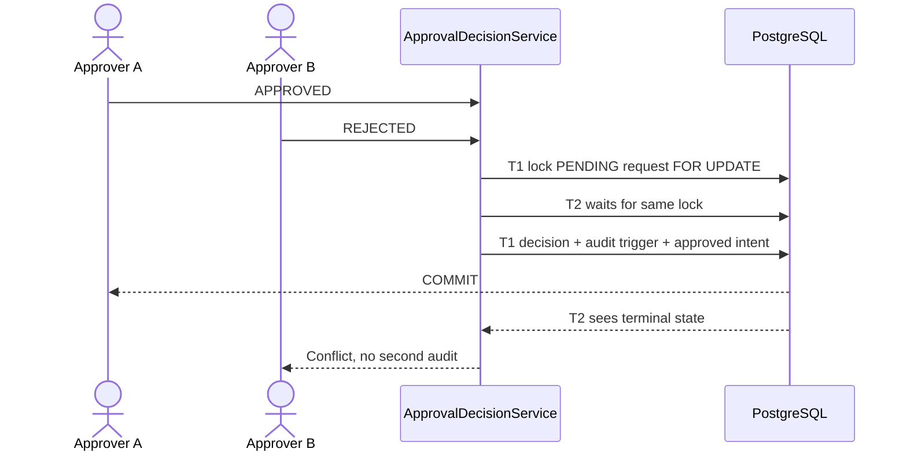

# Lesson 06 — Approval decisions, SoD, concurrency and transactional audit

**Track:** sequential IAM engineering curriculum · **Related milestone:** 03A–03D / 04A · **Baseline:** `v0.1.0-portfolio` (educational local/test scope). This is a learning guide, not a new implementation or fresh test execution.

## Learning outcome

Explain how one authorized distinct approver wins an approval race and how status, decision and audit commit atomically.

## Starting concepts

- V3 adds PENDING/APPROVED/REJECTED decision model, a primary key on tenant/request, requester-bound composite FK and check approver != requester.
- `ApprovalDecisionService.decide` validates active decision permission, locks the request `FOR UPDATE OF ar`, enforces PENDING and requester/approver separation, updates state and inserts one decision in a Spring transaction.
- V4 PostgreSQL AFTER INSERT trigger writes approval audit in the same transaction; V5/V12 continue approved-only work/outbox intent. A rejected decision never makes approved work.

## Step-by-step implementation walkthrough

1. Read V3 and annotate the PK, composite request/requester FK and SoD CHECK; distinguish DB integrity from bearer token authorization.
2. Open `ApprovalDecisionController` and `DecisionActorResolver` and identify how a trusted JWT actor obtains scope plus local `ACCESS_REQUEST_DECIDE`.
3. Trace `ApprovalDecisionService.decide` from permission check to `FOR UPDATE`, stored requester lookup, terminal state guard, `UPDATE ... WHERE PENDING` and decision insert.
4. Read V4 `iam_record_approval_audit` trigger, its UNIQUE tenant/request constraint and UPDATE/DELETE rejection trigger; explain why DB owner is still privileged.
5. Read V5 and V12 triggers to see how approved decision enqueues work and outbox intent within transaction; rejection does not enqueue.
6. Inspect `ApprovalDecisionServiceIT.concurrentOpposingDecisionsAllowOnlyOneWinner`, `requesterCannotSelfApproveEvenWithGrant` and `auditInsertionFailureRollsBackRequestAndDecision`.
7. Draw A APPROVED vs B REJECTED race; either can win, the loser sees terminal status; simulate test only, do not create real users or grants.

## Why the design matters

A decision is a security-sensitive state transition. A Java `if` alone cannot serialize concurrent approvers; auditing outside the decision transaction risks gaps.

## Architecture / execution flow

The diagram describes scoped implementation/test relationships; dotted or optional lab behavior is not evidence of a deployed production system.

## Source files to open

- [`src/main/java/dev/asambataiden/iam/accessrequest/ApprovalDecisionService.java`](../../src/main/java/dev/asambataiden/iam/accessrequest/ApprovalDecisionService.java)
- [`src/main/resources/db/migration/V3__approval_decision_foundation.sql`](../../src/main/resources/db/migration/V3__approval_decision_foundation.sql)
- [`src/main/resources/db/migration/V4__approval_transactional_audit.sql`](../../src/main/resources/db/migration/V4__approval_transactional_audit.sql)
- [`docs/milestones/03b-approval-service-state-machine.md`](../../docs/milestones/03b-approval-service-state-machine.md)
- [`docs/milestones/04a-transactional-approval-audit.md`](../../docs/milestones/04a-transactional-approval-audit.md)

## Verification / existing evidence

- `src/test/java/dev/asambataiden/iam/accessrequest/ApprovalDecisionServiceIT.java`
- `src/test/java/dev/asambataiden/iam/accessrequest/ApprovalDecisionHttpIT.java`

Use existing focused tests where available, then full `mvn -B --no-transfer-progress clean verify` with Docker and `python3 -m unittest discover -s ops/keycloak -p 'test_*.py'` plus `python3 -m unittest discover -s ops/security -p 'test_*.py'`. Find earlier observed results in [release evidence](../release/evidence-register.md); **do not claim a fresh PASS without executing a command.**

## Failure modes / negative checks

- Identify one denied or unavailable state and prove that no unauthorized business mutation remains.
- Name the relevant transaction, target, actor or event boundary. Explain what becomes retryable, quarantined, terminal or uncertain.
- Separate code that is automatically configured from explicitly constructed mock/test components.
- Preserve secrets, existing lab data and unrelated Docker resources. Never use destructive cleanup as a lesson shortcut.

## Explain it in an interview

1. What does `@Transactional` guarantee here, and what does the row lock guarantee separately?
2. Why must the requester ID come from the locked row?
3. Can two valid opposing approvers both win?

**Answer pattern:** business need → alternative and trade-off → exact Java/SQL/HTTP workflow → negative failure behavior → named tests and evidence → remaining gap.

## Learning completion checklist

- [ ] I can sketch the flow without copying the diagram.
- [ ] I have opened each relevant implementation/migration and followed the actual control path.
- [ ] I can explain a failure/race and the invariant that constrains it.
- [ ] I can distinguish an existing test from a new test execution and report exact outcome.
- [ ] I can explain why this work does not by itself make a production IAM system.

**Next:** [Curriculum index](README.md) and the next numbered lesson.