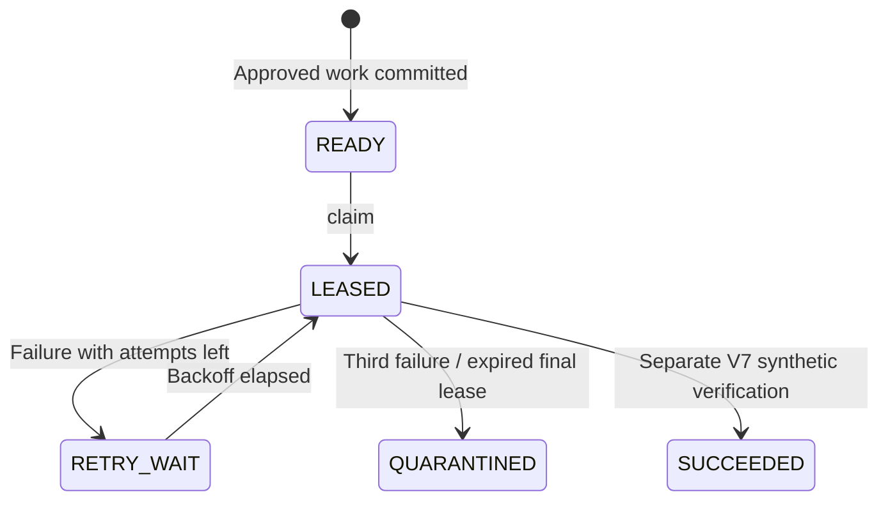

# Lesson 07 — Provisioning work items, bounded retries, leases and stale-worker fencing

**Track:** sequential IAM engineering curriculum · **Related milestone:** 04B–04D · **Baseline:** `v0.1.0-portfolio` (educational local/test scope). This is a learning guide, not a new implementation or fresh test execution.

## Learning outcome

Understand durable approved intent and recoverable work ownership without conflating simulated completion with external grants.

## Starting concepts

- V5 adds approval-bound READY work; V6 adds LEASED/RETRY_WAIT/QUARANTINED with DB clock, attempt count and lease token.
- `ProvisioningLeaseService.claim` uses `FOR UPDATE SKIP LOCKED`; `renew` and `fail` match current unexpired lease token; max attempts are three.
- V7 simulated completion uses local synthetic evidence and a guarded state change. `SUCCEEDED` in this simulation is not a real entitlement.

## Step-by-step implementation walkthrough

1. Read V5 to identify why work is created only from a committed APPROVED decision.
2. Open `ProvisioningLeaseService.claim`: validate lease bounds (5–300s), quarantine expired final-attempt lease, pick oldest eligible row under `SKIP LOCKED`, rotate UUID fencing token, increment count.
3. Trace `renew` and `fail`: token and expiry are checked within SQL; only allowlisted error codes are stored, with bounded retry delay.
4. Read `docs/milestones/04c-provisioning-lease-recovery.md` and V6 for the state transitions and three-attempt limit.
5. Read `SimulatedProvisioningService` and V7 to distinguish a database synthetic record from actual target side effects.
6. Inspect `ProvisioningLeaseServiceIT` for parallel claimers, expiry, stale token and final-attempt quarantine; `SimulatedProvisioningServiceIT` for simulated readback/rollback.
7. Draw Worker A token A expiry → Worker B token B recovery → A stale completion rejection; explain target-side idempotency remains required.

## Why the design matters

Workers crash and acknowledgments vanish. Leases provide bounded ownership, not exactly-once external execution; fencing protects durable state after recovery.

## Architecture / execution flow

```mermaid
stateDiagram-v2
  [*] --> READY: Approved work (V5)
  READY --> LEASED: Claim under current token
  LEASED --> RETRY_WAIT: Failure before final attempt
  RETRY_WAIT --> LEASED: Delay elapsed / new claim
  LEASED --> QUARANTINED: Third failure or expired final lease
  LEASED --> SUCCEEDED: Separate synthetic DB verification (V7 only)
  note right of SUCCEEDED: Local simulation; not real access
```



The diagram describes scoped implementation/test relationships; dotted or optional lab behavior is not evidence of a deployed production system.

## Source files to open

- [`src/main/java/dev/asambataiden/iam/provisioning/execution/ProvisioningLeaseService.java`](../../src/main/java/dev/asambataiden/iam/provisioning/execution/ProvisioningLeaseService.java)
- [`src/main/resources/db/migration/V6__provisioning_lease_state.sql`](../../src/main/resources/db/migration/V6__provisioning_lease_state.sql)
- [`docs/milestones/04b-approved-provisioning-intent.md`](../../docs/milestones/04b-approved-provisioning-intent.md)
- [`docs/milestones/04c-provisioning-lease-recovery.md`](../../docs/milestones/04c-provisioning-lease-recovery.md)
- [`docs/milestones/04d-simulated-provisioning-completion.md`](../../docs/milestones/04d-simulated-provisioning-completion.md)

## Verification / existing evidence

- `src/test/java/dev/asambataiden/iam/provisioning/execution/ProvisioningLeaseServiceIT.java`
- `src/test/java/dev/asambataiden/iam/provisioning/execution/SimulatedProvisioningServiceIT.java`

Use existing focused tests where available, then full `mvn -B --no-transfer-progress clean verify` with Docker and `python3 -m unittest discover -s ops/keycloak -p 'test_*.py'` plus `python3 -m unittest discover -s ops/security -p 'test_*.py'`. Find earlier observed results in [release evidence](../release/evidence-register.md); **do not claim a fresh PASS without executing a command.**

## Failure modes / negative checks

- Identify one denied or unavailable state and prove that no unauthorized business mutation remains.
- Name the relevant transaction, target, actor or event boundary. Explain what becomes retryable, quarantined, terminal or uncertain.
- Separate code that is automatically configured from explicitly constructed mock/test components.
- Preserve secrets, existing lab data and unrelated Docker resources. Never use destructive cleanup as a lesson shortcut.

## Explain it in an interview

1. Why use database clock for expiry?
2. What can a stale lease token change?
3. How does a worker crash during the third attempt get quarantined?

**Answer pattern:** business need → alternative and trade-off → exact Java/SQL/HTTP workflow → negative failure behavior → named tests and evidence → remaining gap.


## Practical lab 07A — Follow approved intent into durable work

Read [V5](../../src/main/resources/db/migration/V5__approved_provisioning_work_items.sql), [V6](../../src/main/resources/db/migration/V6__provisioning_lease_state.sql) and [V7](../../src/main/resources/db/migration/V7__simulated_provisioning_verification.sql).

V5 creates an approval-bound READY work item **within the approved transaction**. V6 adds LEASED, RETRY_WAIT, QUARANTINED, a token, expiry, next-attempt time, attempt count and bounded failure codes. V7 supports a *separate local synthetic* success demonstration. Neither V5 nor a V7 SUCCEEDED status is evidence of external access.



## Practical lab 07B — Understand `ProvisioningLeaseService`

Open [`ProvisioningLeaseService.java`](../../src/main/java/dev/asambataiden/iam/provisioning/execution/ProvisioningLeaseService.java).

1. `claim(tenantId, leaseSeconds)` accepts **5–300 seconds** and only a non-null tenant.
2. It first quarantines expired LEASED rows already at the **three-attempt limit**; a crashed final attempt cannot remain abandoned forever.
3. It selects one eligible READY/RETRY_WAIT or expired LEASED row for the tenant, ordered by creation time, using `FOR UPDATE SKIP LOCKED`.
4. A successful claim creates a **fresh UUID token**, sets expiry using the **database clock**, and increments the persisted attempt count.
5. `renew(lease,duration)` requires current state, matching token and an unexpired lease; only the current worker can extend ownership.
6. `fail(lease,error,delay)` accepts delays of **1–3600 seconds** and enum codes `TEMPORARY_DEPENDENCY_FAILURE`, `TIMEOUT` and `UNKNOWN`. It releases to RETRY_WAIT or QUARANTINED.
7. No method calls a target; this service is a **durable-work coordinator**, not a provisioning implementation.

**Why `SKIP LOCKED`?** It avoids workers queueing behind an already-locked candidate row, so concurrent claimers can make progress across independent work items. It does not ensure fair global scheduling or cloud availability.

## Practical lab 07C — A stale-worker timeline

```mermaid
sequenceDiagram
  participant A as Worker A
  participant DB as PostgreSQL
  participant B as Worker B
  A->>DB: claim R
  DB-->>A: Token A, attempt 1
  Note over A: Pauses past lease expiry
  B->>DB: recover expired R
  DB-->>B: Token B, attempt 2
  A->>DB: renew/fail with token A
  DB-->>A: false; stale token
  B->>DB: renew/fail with token B
  DB-->>B: Current token may mutate R
```

**Leases versus row locks:** PostgreSQL row locks protect the short claim/update transaction. A persisted lease represents ownership *after commit*. Do not hold a transaction open while waiting for remote HTTP.

**Safety boundary:** A stale worker cannot modify current **local lease state**. It may already have sent a remote POST; the database cannot undo that side effect. Lesson 08 adds target idempotency/readback.

## Practical lab 07D — Test and diagnose

Review [`ProvisioningLeaseServiceIT`](../../src/test/java/dev/asambataiden/iam/provisioning/execution/ProvisioningLeaseServiceIT.java) and [`SimulatedProvisioningServiceIT`](../../src/test/java/dev/asambataiden/iam/provisioning/execution/SimulatedProvisioningServiceIT.java).

```bash
mvn -B --no-transfer-progress   -Dit.test=ProvisioningLeaseServiceIT,SimulatedProvisioningServiceIT   -DfailIfNoTests=false verify
```

| Failure | Local behavior | Unproven boundary |
| --- | --- | --- |
| Two worker claims collide | Current row lock/token decides ownership | No cloud worker pool |
| Worker crashes | Lease expires; eligible for retry | No production watchdog |
| Third failure/expired third claim | QUARANTINED | No automated remediation |
| Old worker returns | Token/expiry check rejects state mutation | Remote side effect may remain |
| Local synthetic completion | Requires V7 simulated evidence | Not a real IAM grant |

**Interview answer:** “Approved decisions create durable work; workers claim work under a bounded PostgreSQL lease with `FOR UPDATE SKIP LOCKED`. Lease tokens are rotated and checked on each state change, so a recovered worker fences out an old worker. We cap retries at three and quarantine exhausted work. This protects local coordination, not exactly-once execution or a real target entitlement.”

**Continue:** [Lesson 08 — mock target and uncertain HTTP reconciliation](08-adapter-contract-mock-http-reconciliation.md).

## Learning completion checklist

- [ ] I can sketch the flow without copying the diagram.
- [ ] I have opened each relevant implementation/migration and followed the actual control path.
- [ ] I can explain a failure/race and the invariant that constrains it.
- [ ] I can distinguish an existing test from a new test execution and report exact outcome.
- [ ] I can explain why this work does not by itself make a production IAM system.

**Next:** [Curriculum index](README.md) and the next numbered lesson.