# Lesson 07 — Provisioning work items, bounded retries, leases and stale-worker fencing

**Track:** sequential IAM engineering curriculum · **Related milestone:** 04B–04D · **Baseline:** `v0.1.0-portfolio` (educational local/test scope). This is a learning guide, not a new implementation or fresh test execution.

## Learning outcome

Understand durable approved intent and recoverable work ownership without conflating simulated completion with external grants.

## Starting concepts

- V5 adds approval-bound READY work; V6 adds LEASED/RETRY_WAIT/QUARANTINED with DB clock, attempt count and lease token.
- `ProvisioningLeaseService.claim` uses `FOR UPDATE SKIP LOCKED`; `renew` and `fail` match current unexpired lease token; max attempts are three.
- V7 simulated completion uses local synthetic evidence and a guarded state change. `SUCCEEDED` in this simulation is not a real entitlement.

## Step-by-step implementation walkthrough

1. Read V5 to identify why work is created only from a committed APPROVED decision.
2. Open `ProvisioningLeaseService.claim`: validate lease bounds (5–300s), quarantine expired final-attempt lease, pick oldest eligible row under `SKIP LOCKED`, rotate UUID fencing token, increment count.
3. Trace `renew` and `fail`: token and expiry are checked within SQL; only allowlisted error codes are stored, with bounded retry delay.
4. Read `docs/milestones/04c-provisioning-lease-recovery.md` and V6 for the state transitions and three-attempt limit.
5. Read `SimulatedProvisioningService` and V7 to distinguish a database synthetic record from actual target side effects.
6. Inspect `ProvisioningLeaseServiceIT` for parallel claimers, expiry, stale token and final-attempt quarantine; `SimulatedProvisioningServiceIT` for simulated readback/rollback.
7. Draw Worker A token A expiry → Worker B token B recovery → A stale completion rejection; explain target-side idempotency remains required.

## Why the design matters

Workers crash and acknowledgments vanish. Leases provide bounded ownership, not exactly-once external execution; fencing protects durable state after recovery.

## Architecture / execution flow

```mermaid
stateDiagram-v2
  [*] --> READY: Approved work (V5)
  READY --> LEASED: Claim under current token
  LEASED --> RETRY_WAIT: Failure before final attempt
  RETRY_WAIT --> LEASED: Delay elapsed / new claim
  LEASED --> QUARANTINED: Third failure or expired final lease
  LEASED --> SUCCEEDED: Separate synthetic DB verification (V7 only)
  note right of SUCCEEDED: Local simulation; not real access
```

The diagram describes scoped implementation/test relationships; dotted or optional lab behavior is not evidence of a deployed production system.

## Source files to open

- [`src/main/java/dev/asambataiden/iam/provisioning/execution/ProvisioningLeaseService.java`](../../src/main/java/dev/asambataiden/iam/provisioning/execution/ProvisioningLeaseService.java)
- [`src/main/resources/db/migration/V6__provisioning_lease_state.sql`](../../src/main/resources/db/migration/V6__provisioning_lease_state.sql)
- [`docs/milestones/04b-approved-provisioning-intent.md`](../../docs/milestones/04b-approved-provisioning-intent.md)
- [`docs/milestones/04c-provisioning-lease-recovery.md`](../../docs/milestones/04c-provisioning-lease-recovery.md)
- [`docs/milestones/04d-simulated-provisioning-completion.md`](../../docs/milestones/04d-simulated-provisioning-completion.md)

## Verification / existing evidence

- `src/test/java/dev/asambataiden/iam/provisioning/execution/ProvisioningLeaseServiceIT.java`
- `src/test/java/dev/asambataiden/iam/provisioning/execution/SimulatedProvisioningServiceIT.java`

Use existing focused tests where available, then full `mvn -B --no-transfer-progress clean verify` with Docker and `python3 -m unittest discover -s ops/keycloak -p 'test_*.py'` plus `python3 -m unittest discover -s ops/security -p 'test_*.py'`. Find earlier observed results in [release evidence](../release/evidence-register.md); **do not claim a fresh PASS without executing a command.**

## Failure modes / negative checks

- Identify one denied or unavailable state and prove that no unauthorized business mutation remains.
- Name the relevant transaction, target, actor or event boundary. Explain what becomes retryable, quarantined, terminal or uncertain.
- Separate code that is automatically configured from explicitly constructed mock/test components.
- Preserve secrets, existing lab data and unrelated Docker resources. Never use destructive cleanup as a lesson shortcut.

## Explain it in an interview

1. Why use database clock for expiry?
2. What can a stale lease token change?
3. How does a worker crash during the third attempt get quarantined?

**Answer pattern:** business need → alternative and trade-off → exact Java/SQL/HTTP workflow → negative failure behavior → named tests and evidence → remaining gap.

## Learning completion checklist

- [ ] I can sketch the flow without copying the diagram.
- [ ] I have opened each relevant implementation/migration and followed the actual control path.
- [ ] I can explain a failure/race and the invariant that constrains it.
- [ ] I can distinguish an existing test from a new test execution and report exact outcome.
- [ ] I can explain why this work does not by itself make a production IAM system.

**Next:** [Curriculum index](README.md) and the next numbered lesson.