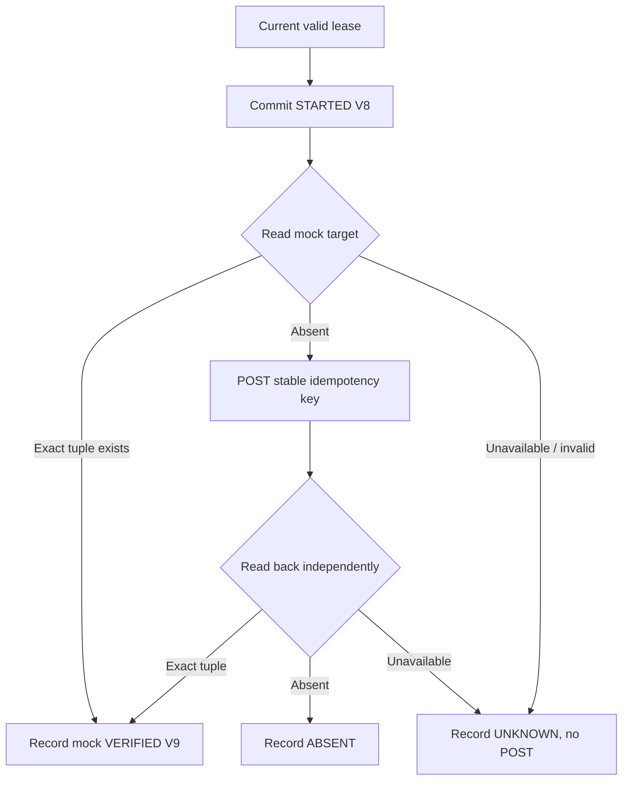

# Lesson 08 — Target adapter, write-ahead attempts, loopback HTTP and uncertain-outcome reconciliation

**Track:** sequential IAM engineering curriculum · **Related milestone:** 04E-1–04E-4 · **Baseline:** `v0.1.0-portfolio` (educational local/test scope). This is a learning guide, not a new implementation or fresh test execution.

## Learning outcome

Explain safe interaction boundaries when a target may accept a write before its acknowledgment is lost.

## Starting concepts

- V8 persists STARTED attempt before HTTP; target interface exposes `apply` and independent `isEffective`; stable idempotency derives from tenant/request rather than lease token.
- Loopback adapter accepts only HTTP 127.0.0.1 ephemeral target, explicit timeouts and no redirects. It never mutates an actual IAM provider.
- `MockProvisioningOrchestrator` is explicitly constructed, not scheduled. It reads before write, applies only after absence, reads back and stores V9 VERIFIED/ABSENT/UNKNOWN under current lease.

## Step-by-step implementation walkthrough

1. Read `ProvisioningTargetAdapter` and identify Entitlement tuple and target idempotency parameter.
2. Read `ProvisioningAttemptJournal.start`: it validates active lease/attempt and commits durable STARTED before any network I/O; distinguish evidence of initiation from proof of external effect.
3. Read `LoopbackHttpProvisioningTargetAdapter`: validation of loopback origin/ephemeral port, request timeouts, no redirects, exact readback checks.
4. Trace `MockProvisioningOrchestrator.execute`: start → query approved active target tuple → preflight readback → optional apply → post-apply readback → V9 observation.
5. Compare a lost ACK, a readback 503 and a mismatched role: lost ACK is uncertain, initial 503 records UNKNOWN with no speculative write, mismatched tuple cannot count as VERIFIED.
6. Read `MockProvisioningOrchestratorIT` and `LoopbackHttpProvisioningTargetAdapterTest`: find retries, unavailable target, idempotent POST and redirect denial.
7. Explain why the work item can remain LEASED even after mock VERIFIED; no production completion transition is inferred.

## Why the design matters

Remote HTTP cannot participate in PostgreSQL atomic transactions. Write-ahead attempt evidence, idempotency and reconciliation reduce duplicate effects but do not promise exactly-once external operations.

## Architecture / execution flow

The diagram describes scoped implementation/test relationships; dotted or optional lab behavior is not evidence of a deployed production system.

## Source files to open

- [`src/main/java/dev/asambataiden/iam/provisioning/execution/MockProvisioningOrchestrator.java`](../../src/main/java/dev/asambataiden/iam/provisioning/execution/MockProvisioningOrchestrator.java)
- [`src/main/java/dev/asambataiden/iam/provisioning/target/LoopbackHttpProvisioningTargetAdapter.java`](../../src/main/java/dev/asambataiden/iam/provisioning/target/LoopbackHttpProvisioningTargetAdapter.java)
- [`docs/milestones/04e1-adapter-contract-attempt-evidence.md`](../../docs/milestones/04e1-adapter-contract-attempt-evidence.md)
- [`docs/milestones/04e2-loopback-http-mock-contract.md`](../../docs/milestones/04e2-loopback-http-mock-contract.md)
- [`docs/milestones/04e4-mock-reconciliation-read-before-write.md`](../../docs/milestones/04e4-mock-reconciliation-read-before-write.md)

## Verification / existing evidence

- `src/test/java/dev/asambataiden/iam/provisioning/execution/MockProvisioningOrchestratorIT.java`
- `src/test/java/dev/asambataiden/iam/provisioning/target/LoopbackHttpProvisioningTargetAdapterTest.java`

Use existing focused tests where available, then full `mvn -B --no-transfer-progress clean verify` with Docker and `python3 -m unittest discover -s ops/keycloak -p 'test_*.py'` plus `python3 -m unittest discover -s ops/security -p 'test_*.py'`. Find earlier observed results in [release evidence](../release/evidence-register.md); **do not claim a fresh PASS without executing a command.**

## Failure modes / negative checks

- Identify one denied or unavailable state and prove that no unauthorized business mutation remains.
- Name the relevant transaction, target, actor or event boundary. Explain what becomes retryable, quarantined, terminal or uncertain.
- Separate code that is automatically configured from explicitly constructed mock/test components.
- Preserve secrets, existing lab data and unrelated Docker resources. Never use destructive cleanup as a lesson shortcut.

## Explain it in an interview

1. Why record STARTED before POST and why can STARTED still be uncertain?
2. Why do both a stable key and read-before-write matter?
3. What evidence would upgrade mock VERIFIED to a real production grant?

**Answer pattern:** business need → alternative and trade-off → exact Java/SQL/HTTP workflow → negative failure behavior → named tests and evidence → remaining gap.

## Learning completion checklist

- [ ] I can sketch the flow without copying the diagram.
- [ ] I have opened each relevant implementation/migration and followed the actual control path.
- [ ] I can explain a failure/race and the invariant that constrains it.
- [ ] I can distinguish an existing test from a new test execution and report exact outcome.
- [ ] I can explain why this work does not by itself make a production IAM system.

**Next:** [Curriculum index](README.md) and the next numbered lesson.