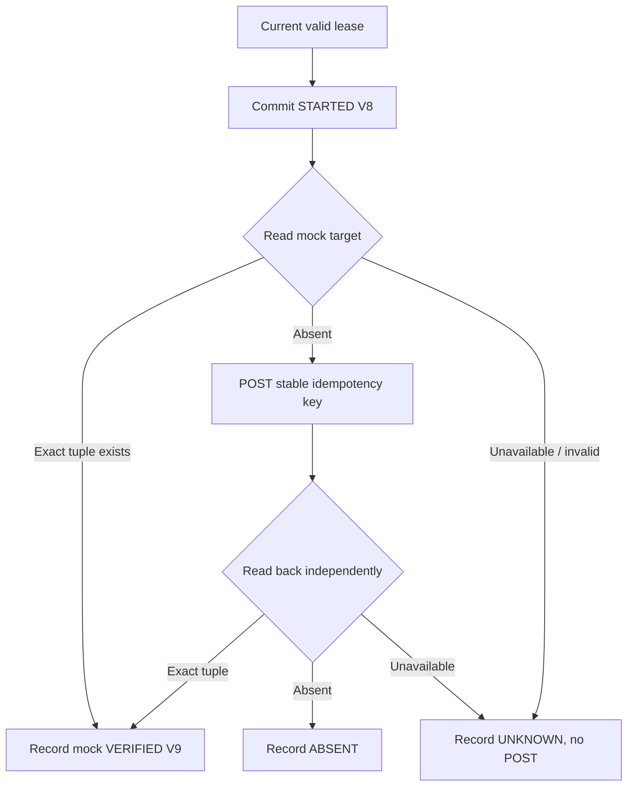
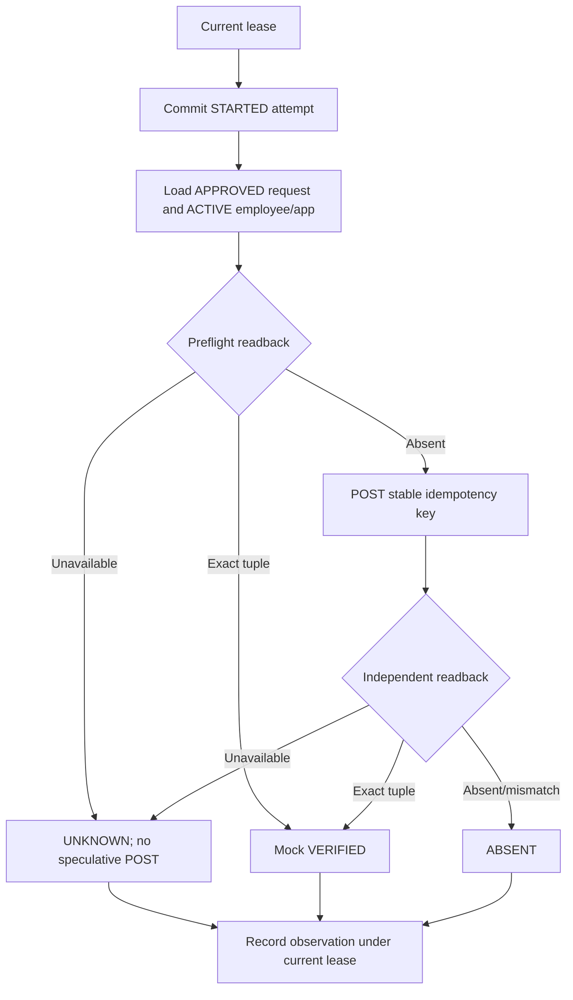
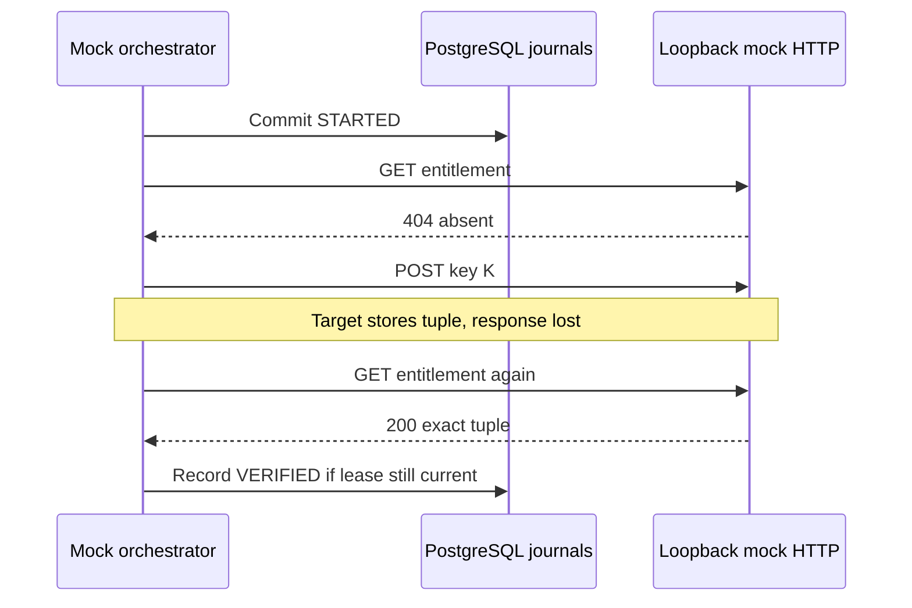

# Lesson 08 — Target adapter, write-ahead attempts, loopback HTTP and uncertain-outcome reconciliation

**Track:** sequential IAM engineering curriculum · **Related milestone:** 04E-1–04E-4 · **Baseline:** `v0.1.0-portfolio` (educational local/test scope). This is a learning guide, not a new implementation or fresh test execution.

## Learning outcome

Explain safe interaction boundaries when a target may accept a write before its acknowledgment is lost.

## Starting concepts

- V8 persists STARTED attempt before HTTP; target interface exposes `apply` and independent `isEffective`; stable idempotency derives from tenant/request rather than lease token.
- Loopback adapter accepts only HTTP 127.0.0.1 ephemeral target, explicit timeouts and no redirects. It never mutates an actual IAM provider.
- `MockProvisioningOrchestrator` is explicitly constructed, not scheduled. It reads before write, applies only after absence, reads back and stores V9 VERIFIED/ABSENT/UNKNOWN under current lease.

## Step-by-step implementation walkthrough

1. Read `ProvisioningTargetAdapter` and identify Entitlement tuple and target idempotency parameter.
2. Read `ProvisioningAttemptJournal.start`: it validates active lease/attempt and commits durable STARTED before any network I/O; distinguish evidence of initiation from proof of external effect.
3. Read `LoopbackHttpProvisioningTargetAdapter`: validation of loopback origin/ephemeral port, request timeouts, no redirects, exact readback checks.
4. Trace `MockProvisioningOrchestrator.execute`: start → query approved active target tuple → preflight readback → optional apply → post-apply readback → V9 observation.
5. Compare a lost ACK, a readback 503 and a mismatched role: lost ACK is uncertain, initial 503 records UNKNOWN with no speculative write, mismatched tuple cannot count as VERIFIED.
6. Read `MockProvisioningOrchestratorIT` and `LoopbackHttpProvisioningTargetAdapterTest`: find retries, unavailable target, idempotent POST and redirect denial.
7. Explain why the work item can remain LEASED even after mock VERIFIED; no production completion transition is inferred.

## Why the design matters

Remote HTTP cannot participate in PostgreSQL atomic transactions. Write-ahead attempt evidence, idempotency and reconciliation reduce duplicate effects but do not promise exactly-once external operations.

## Architecture / execution flow



The diagram describes scoped implementation/test relationships; dotted or optional lab behavior is not evidence of a deployed production system.

## Source files to open

- [`src/main/java/dev/asambataiden/iam/provisioning/execution/MockProvisioningOrchestrator.java`](../../src/main/java/dev/asambataiden/iam/provisioning/execution/MockProvisioningOrchestrator.java)
- [`src/main/java/dev/asambataiden/iam/provisioning/target/LoopbackHttpProvisioningTargetAdapter.java`](../../src/main/java/dev/asambataiden/iam/provisioning/target/LoopbackHttpProvisioningTargetAdapter.java)
- [`docs/milestones/04e1-adapter-contract-attempt-evidence.md`](../../docs/milestones/04e1-adapter-contract-attempt-evidence.md)
- [`docs/milestones/04e2-loopback-http-mock-contract.md`](../../docs/milestones/04e2-loopback-http-mock-contract.md)
- [`docs/milestones/04e4-mock-reconciliation-read-before-write.md`](../../docs/milestones/04e4-mock-reconciliation-read-before-write.md)

## Verification / existing evidence

- `src/test/java/dev/asambataiden/iam/provisioning/execution/MockProvisioningOrchestratorIT.java`
- `src/test/java/dev/asambataiden/iam/provisioning/target/LoopbackHttpProvisioningTargetAdapterTest.java`

Use existing focused tests where available, then full `mvn -B --no-transfer-progress clean verify` with Docker and `python3 -m unittest discover -s ops/keycloak -p 'test_*.py'` plus `python3 -m unittest discover -s ops/security -p 'test_*.py'`. Find earlier observed results in [release evidence](../release/evidence-register.md); **do not claim a fresh PASS without executing a command.**

## Failure modes / negative checks

- Identify one denied or unavailable state and prove that no unauthorized business mutation remains.
- Name the relevant transaction, target, actor or event boundary. Explain what becomes retryable, quarantined, terminal or uncertain.
- Separate code that is automatically configured from explicitly constructed mock/test components.
- Preserve secrets, existing lab data and unrelated Docker resources. Never use destructive cleanup as a lesson shortcut.

## Explain it in an interview

1. Why record STARTED before POST and why can STARTED still be uncertain?
2. Why do both a stable key and read-before-write matter?
3. What evidence would upgrade mock VERIFIED to a real production grant?

**Answer pattern:** business need → alternative and trade-off → exact Java/SQL/HTTP workflow → negative failure behavior → named tests and evidence → remaining gap.


## Practical lab 08A — Define the target adapter contract

Read [`ProvisioningTargetAdapter`](../../src/main/java/dev/asambataiden/iam/provisioning/target/ProvisioningTargetAdapter.java) and [`LoopbackHttpProvisioningTargetAdapter`](../../src/main/java/dev/asambataiden/iam/provisioning/target/LoopbackHttpProvisioningTargetAdapter.java).

The entitlement identity includes **tenant ID, request ID, employee ID, application ID and role key**. `apply(entitlement,key)` attempts a mock write, whereas `isEffective(entitlement)` independently reads the target state. The stable key is derived from tenant + request, not the ephemeral lease token.

The HTTP adapter is deliberately constrained: only exact host `127.0.0.1`, HTTP, an explicit port and root path; no query/userinfo/fragments; timeouts **100 ms–5 seconds**; no redirects; no production target credentials. POST **201** means APPLIED and **200** ALREADY_PRESENT. GET **404** means absent, while GET **200** is checked for exact field equality, not merely a successful HTTP status.

**Why the read operation?** An HTTP write can succeed at the target but fail to return an acknowledgement. A second write without observation risks duplicate external side effects.

## Practical lab 08B — Record an attempt before outbound HTTP

Read [`ProvisioningAttemptJournal.start`](../../src/main/java/dev/asambataiden/iam/provisioning/execution/ProvisioningAttemptJournal.java) and [V8](../../src/main/resources/db/migration/V8__provisioning_attempt_evidence.sql).

1. Validate a non-null lease with current attempt number 1–3.
2. Lock current work and verify `LEASED`, token equality, attempt equality and lease validity using database time.
3. Persist an attempt record with STARTED. A duplicate on the same tenant/request/attempt is compared for identity rather than overwritten.
4. Generate the target key using `UUID.nameUUIDFromBytes("iam:provision:v1:" + tenantId + ":" + requestId)`. This stays stable even if the lease rotates.
5. Commit the journal's Spring transaction **before** sending HTTP. STARTED is evidence of **intention to attempt**, not proof of target effect.

The database cannot participate atomically in the remote HTTP service's transaction. A single `@Transactional` annotation cannot guarantee exactly-once external provisioning.

## Practical lab 08C — Trace the orchestrator's reconciliation algorithm

Open [`MockProvisioningOrchestrator.execute`](../../src/main/java/dev/asambataiden/iam/provisioning/execution/MockProvisioningOrchestrator.java) and [V9](../../src/main/resources/db/migration/V9__mock_target_observations.sql).



The orchestrator first commits STARTED, then checks the approved/active tuple, reads the mock target, conditionally POSTs, and reads again. If the POST acknowledgement is uncertain, it still performs the **second GET** before classifying the outcome. Initial readback failure produces UNKNOWN and **does not trigger POST**.

The [`MockTargetObservationJournal`](../../src/main/java/dev/asambataiden/iam/provisioning/target/MockTargetObservationJournal.java) checks the current unexpired lease and original STARTED record before storing VERIFIED, ABSENT or UNKNOWN. It **does not** mark work SUCCEEDED. The V7 synthetic completion path is independent.

## Practical lab 08D — A lost acknowledgement



| Failure | Safe classification | Why |
| --- | --- | --- |
| Initial GET unavailable | UNKNOWN, no POST | Absence is unproven |
| POST succeeded, response lost, subsequent GET matches | VERIFIED | Independent readback |
| Post-apply GET 404 | ABSENT | No confirmed effect |
| GET 200 with different employee/role | Not VERIFIED | Prevent false-positive grant |
| Current token expired/replaced | Observation rejected | Fences stale local evidence |
| Mock VERIFIED | Local observation only | No real third-party entitlement |

## Practical lab 08E — Test matrix and interview

Inspect [`MockProvisioningOrchestratorIT`](../../src/test/java/dev/asambataiden/iam/provisioning/execution/MockProvisioningOrchestratorIT.java), [`LoopbackHttpProvisioningTargetAdapterTest`](../../src/test/java/dev/asambataiden/iam/provisioning/target/LoopbackHttpProvisioningTargetAdapterTest.java), [`ProvisioningTargetAdapterContractTest`](../../src/test/java/dev/asambataiden/iam/provisioning/target/ProvisioningTargetAdapterContractTest.java) and [`MockTargetObservationJournalIT`](../../src/test/java/dev/asambataiden/iam/provisioning/target/MockTargetObservationJournalIT.java).

```bash
mvn -B --no-transfer-progress   -Dtest=LoopbackHttpProvisioningTargetAdapterTest,ProvisioningTargetAdapterContractTest   -Dit.test=MockProvisioningOrchestratorIT,MockTargetObservationJournalIT   -DfailIfNoTests=false verify
```

This validates a **controlled loopback mock only**, not SCIM, cloud IAM, a SaaS connector, or real-world target idempotency.

**Interview answer:** “The target contract separates an attempt to apply a grant from independently observing its effect. A STARTED attempt is recorded before the network call, a request-stable idempotency key survives worker retries, and the orchestration reads before writing and again after an uncertain POST. We persist observations only under a current lease. This reduces duplicate effects but does not establish exactly-once execution or real entitlement provisioning.”

**Continue:** [Lesson 09 — quarantine and reviewer evidence](09-quarantine-inspection-and-review-evidence.md).

## Learning completion checklist

- [ ] I can sketch the flow without copying the diagram.
- [ ] I have opened each relevant implementation/migration and followed the actual control path.
- [ ] I can explain a failure/race and the invariant that constrains it.
- [ ] I can distinguish an existing test from a new test execution and report exact outcome.
- [ ] I can explain why this work does not by itself make a production IAM system.

**Next:** [Curriculum index](README.md) and the next numbered lesson.