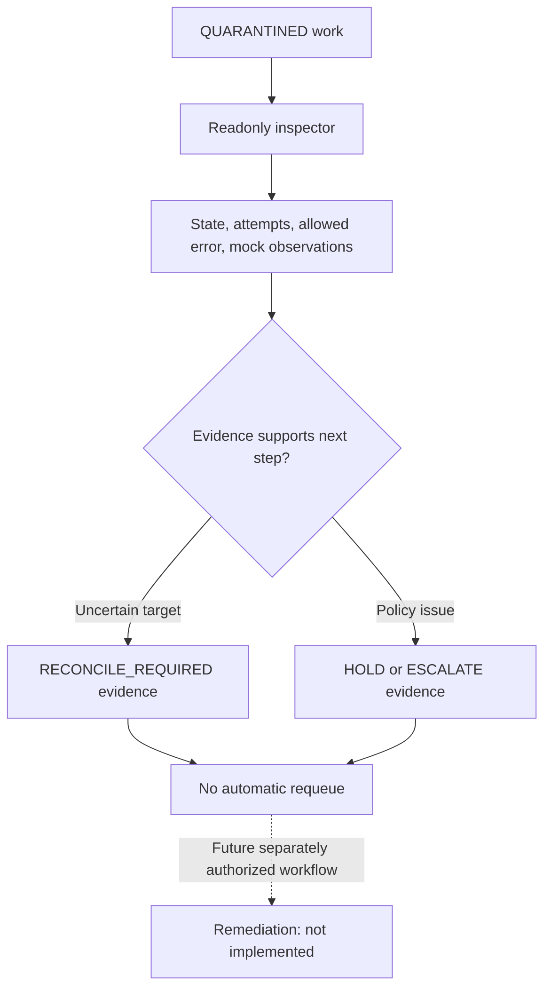

# Lesson 09 — Quarantine diagnosis, readonly HTTP and controlled review evidence

**Track:** sequential IAM engineering curriculum · **Related milestone:** 04F-1–04F-3 · **Baseline:** `v0.1.0-portfolio` (educational local/test scope). This is a learning guide, not a new implementation or fresh test execution.

## Learning outcome

Understand diagnosis versus remediation, bounded review views, tenant isolation and the limits of internal review APIs.

## Starting concepts

- `ProvisioningRecoveryInspector` produces tenant-specific snapshots of state, attempts, error codes and mock observations; listing is bounded.
- `QuarantineInspectionController` exposes only GET read-only routes and checks the reviewer scope plus local employee permission. HTTP cannot requeue failed work.
- V10 `QuarantineReviewJournal` persists structured HOLD/ESCALATE/RECONCILE_REQUIRED with controlled reason codes and idempotent review IDs; V11 adds reviewer permission. Internal journal is not authenticated admin remediation.

## Step-by-step implementation walkthrough

1. Open `ProvisioningRecoveryInspector` and identify the read-only SELECT nature, tenant restriction and 1–100 list bounds.
2. Inspect `QuarantineInspectionController` and `QuarantineReviewActorResolver`; find JWT actor mapping, `SCOPE_provisioning:review` and 404 concealment for nonquarantined/foreign items.
3. Read V10 and V11 to identify review evidence, structured decision/reason and permission model.
4. Trace `QuarantineReviewJournal.record` and identify active reviewer check and no mutation of work-item, attempts, leases or mock target.
5. Read `QuarantineInspectionHttpIT` and `QuarantineReviewJournalIT`: wrong tenant, missing permission, replay/conflict, disabled reviewer and no mutation.
6. Write a safe manual decision workflow: inspect → reconcile uncertain target state → document HOLD/ESCALATE/RECONCILE_REQUIRED → obtain independent authorization for any future remediation.
7. Explain why public repair/requeue POST, retention and WORM evidence are not part of this release.

## Why the design matters

An automated retry loop can cause unsafe repeat effects after ambiguous outcomes. Read-only inspection and structured evidence keep diagnosis separate from privileged remediation.

## Architecture / execution flow

The diagram describes scoped implementation/test relationships; dotted or optional lab behavior is not evidence of a deployed production system.

## Source files to open

- [`src/main/java/dev/asambataiden/iam/provisioning/quarantine/QuarantineInspectionController.java`](../../src/main/java/dev/asambataiden/iam/provisioning/quarantine/QuarantineInspectionController.java)
- [`src/main/java/dev/asambataiden/iam/provisioning/quarantine/QuarantineReviewJournal.java`](../../src/main/java/dev/asambataiden/iam/provisioning/quarantine/QuarantineReviewJournal.java)
- [`docs/milestones/04f1-readonly-quarantine-inspection.md`](../../docs/milestones/04f1-readonly-quarantine-inspection.md)
- [`docs/milestones/04f2-quarantine-review-evidence.md`](../../docs/milestones/04f2-quarantine-review-evidence.md)
- [`docs/milestones/04f3a-authenticated-quarantine-inspection.md`](../../docs/milestones/04f3a-authenticated-quarantine-inspection.md)

## Verification / existing evidence

- `src/test/java/dev/asambataiden/iam/provisioning/quarantine/QuarantineInspectionHttpIT.java`
- `src/test/java/dev/asambataiden/iam/provisioning/quarantine/QuarantineReviewJournalIT.java`

Use existing focused tests where available, then full `mvn -B --no-transfer-progress clean verify` with Docker and `python3 -m unittest discover -s ops/keycloak -p 'test_*.py'` plus `python3 -m unittest discover -s ops/security -p 'test_*.py'`. Find earlier observed results in [release evidence](../release/evidence-register.md); **do not claim a fresh PASS without executing a command.**

## Failure modes / negative checks

- Identify one denied or unavailable state and prove that no unauthorized business mutation remains.
- Name the relevant transaction, target, actor or event boundary. Explain what becomes retryable, quarantined, terminal or uncertain.
- Separate code that is automatically configured from explicitly constructed mock/test components.
- Preserve secrets, existing lab data and unrelated Docker resources. Never use destructive cleanup as a lesson shortcut.

## Explain it in an interview

1. What prevents list inspection from exposing a foreign tenant?
2. Why is UUID identity in an internal review service not authentication?
3. Why is it unsafe to reset a quarantined lease without target reconciliation?

**Answer pattern:** business need → alternative and trade-off → exact Java/SQL/HTTP workflow → negative failure behavior → named tests and evidence → remaining gap.

## Learning completion checklist

- [ ] I can sketch the flow without copying the diagram.
- [ ] I have opened each relevant implementation/migration and followed the actual control path.
- [ ] I can explain a failure/race and the invariant that constrains it.
- [ ] I can distinguish an existing test from a new test execution and report exact outcome.
- [ ] I can explain why this work does not by itself make a production IAM system.

**Next:** [Curriculum index](README.md) and the next numbered lesson.