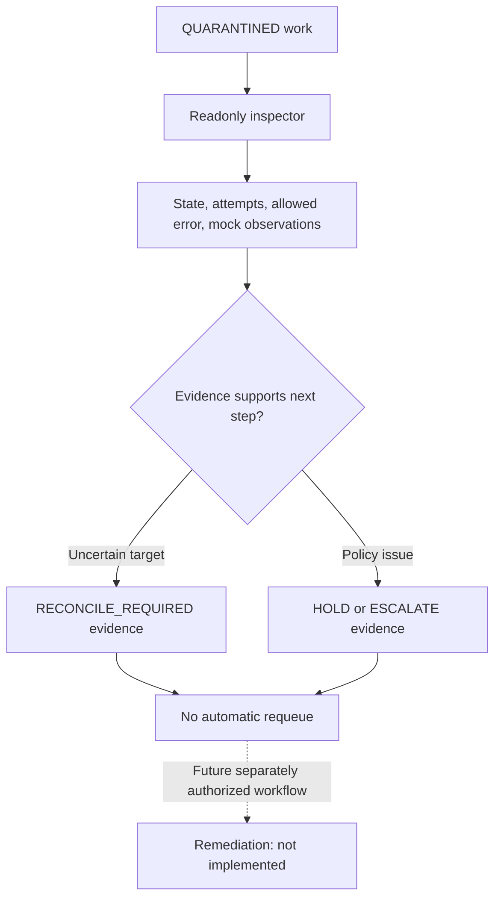
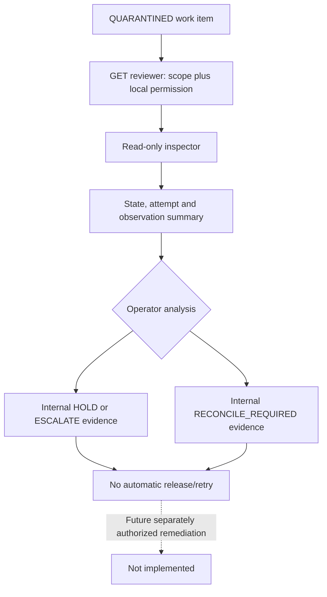

# Lesson 09 — Quarantine diagnosis, readonly HTTP and controlled review evidence

**Track:** sequential IAM engineering curriculum · **Related milestone:** 04F-1–04F-3 · **Baseline:** `v0.1.0-portfolio` (educational local/test scope). This is a learning guide, not a new implementation or fresh test execution.

## Learning outcome

Understand diagnosis versus remediation, bounded review views, tenant isolation and the limits of internal review APIs.

## Starting concepts

- `ProvisioningRecoveryInspector` produces tenant-specific snapshots of state, attempts, error codes and mock observations; listing is bounded.
- `QuarantineInspectionController` exposes only GET read-only routes and checks the reviewer scope plus local employee permission. HTTP cannot requeue failed work.
- V10 `QuarantineReviewJournal` persists structured HOLD/ESCALATE/RECONCILE_REQUIRED with controlled reason codes and idempotent review IDs; V11 adds reviewer permission. Internal journal is not authenticated admin remediation.

## Step-by-step implementation walkthrough

1. Open `ProvisioningRecoveryInspector` and identify the read-only SELECT nature, tenant restriction and 1–100 list bounds.
2. Inspect `QuarantineInspectionController` and `QuarantineReviewActorResolver`; find JWT actor mapping, `SCOPE_provisioning:review` and 404 concealment for nonquarantined/foreign items.
3. Read V10 and V11 to identify review evidence, structured decision/reason and permission model.
4. Trace `QuarantineReviewJournal.record` and identify active reviewer check and no mutation of work-item, attempts, leases or mock target.
5. Read `QuarantineInspectionHttpIT` and `QuarantineReviewJournalIT`: wrong tenant, missing permission, replay/conflict, disabled reviewer and no mutation.
6. Write a safe manual decision workflow: inspect → reconcile uncertain target state → document HOLD/ESCALATE/RECONCILE_REQUIRED → obtain independent authorization for any future remediation.
7. Explain why public repair/requeue POST, retention and WORM evidence are not part of this release.

## Why the design matters

An automated retry loop can cause unsafe repeat effects after ambiguous outcomes. Read-only inspection and structured evidence keep diagnosis separate from privileged remediation.

## Architecture / execution flow



The diagram describes scoped implementation/test relationships; dotted or optional lab behavior is not evidence of a deployed production system.

## Source files to open

- [`src/main/java/dev/asambataiden/iam/provisioning/quarantine/QuarantineInspectionController.java`](../../src/main/java/dev/asambataiden/iam/provisioning/quarantine/QuarantineInspectionController.java)
- [`src/main/java/dev/asambataiden/iam/provisioning/quarantine/QuarantineReviewJournal.java`](../../src/main/java/dev/asambataiden/iam/provisioning/quarantine/QuarantineReviewJournal.java)
- [`docs/milestones/04f1-readonly-quarantine-inspection.md`](../../docs/milestones/04f1-readonly-quarantine-inspection.md)
- [`docs/milestones/04f2-quarantine-review-evidence.md`](../../docs/milestones/04f2-quarantine-review-evidence.md)
- [`docs/milestones/04f3a-authenticated-quarantine-inspection.md`](../../docs/milestones/04f3a-authenticated-quarantine-inspection.md)

## Verification / existing evidence

- `src/test/java/dev/asambataiden/iam/provisioning/quarantine/QuarantineInspectionHttpIT.java`
- `src/test/java/dev/asambataiden/iam/provisioning/quarantine/QuarantineReviewJournalIT.java`

Use existing focused tests where available, then full `mvn -B --no-transfer-progress clean verify` with Docker and `python3 -m unittest discover -s ops/keycloak -p 'test_*.py'` plus `python3 -m unittest discover -s ops/security -p 'test_*.py'`. Find earlier observed results in [release evidence](../release/evidence-register.md); **do not claim a fresh PASS without executing a command.**

## Failure modes / negative checks

- Identify one denied or unavailable state and prove that no unauthorized business mutation remains.
- Name the relevant transaction, target, actor or event boundary. Explain what becomes retryable, quarantined, terminal or uncertain.
- Separate code that is automatically configured from explicitly constructed mock/test components.
- Preserve secrets, existing lab data and unrelated Docker resources. Never use destructive cleanup as a lesson shortcut.

## Explain it in an interview

1. What prevents list inspection from exposing a foreign tenant?
2. Why is UUID identity in an internal review service not authentication?
3. Why is it unsafe to reset a quarantined lease without target reconciliation?

**Answer pattern:** business need → alternative and trade-off → exact Java/SQL/HTTP workflow → negative failure behavior → named tests and evidence → remaining gap.


## Practical lab 09A — Why quarantine is not a retry button

**Business situation:** a provisioning worker has exhausted three attempts or crashed during its final claim. The work is QUARANTINED because a later blind retry may create duplicated external side effects, especially after an uncertain HTTP acknowledgement.

The released design separates **diagnosis** and **remediation**:
- [`ProvisioningRecoveryInspector`](../../src/main/java/dev/asambataiden/iam/provisioning/quarantine/ProvisioningRecoveryInspector.java) reads state, attempt count, error codes, lease timestamps and counts of mock VERIFIED/ABSENT/UNKNOWN observations.
- [`QuarantineInspectionController`](../../src/main/java/dev/asambataiden/iam/provisioning/quarantine/QuarantineInspectionController.java) exposes **GET-only** list/detail routes.
- [`QuarantineReviewJournal`](../../src/main/java/dev/asambataiden/iam/provisioning/quarantine/QuarantineReviewJournal.java) is a separate **internal evidence writer**, not a public authenticated admin endpoint, and cannot requeue a work item or call the target.



**Why review rather than retry immediately?** A target could have applied a grant despite a timeout. Inspecting only the failure code does not establish target state.

## Practical lab 09B — HTTP reviewer identity and tenant boundaries

Read [`QuarantineReviewActorResolver`](../../src/main/java/dev/asambataiden/iam/provisioning/quarantine/QuarantineReviewActorResolver.java) and [`BootstrapSecurityConfiguration`](../../src/main/java/dev/asambataiden/iam/bootstrap/BootstrapSecurityConfiguration.java).

1. The GET route requires `SCOPE_provisioning:review`.
2. The resolver validates usable issuer, subject and tenant UUID claims.
3. It binds these to an **ACTIVE tenant employee** with local `PROVISIONING_QUARANTINE_REVIEW` permission (introduced by V11).
4. The list endpoint takes a limit **1–100** (default 20) and derives the tenant **exclusively from the resolver**.
5. Detail GET returns a generic **404** for absent, foreign-tenant or non-QUARANTINED work. It does not disclose other tenants' records.
6. The inspector uses `@Transactional(readOnly=true)` and tenant-scoped SQL; it has no retry, grant or work-state mutation.

**Crucial boundary:** Even a valid JWT and review scope do not grant arbitrary tenant access; local actor mapping and SQL tenant predicates remain mandatory.

## Practical lab 09C — Understand structured review evidence (V10/V11)

Read [V10](../../src/main/resources/db/migration/V10__quarantine_review_evidence.sql) and [V11](../../src/main/resources/db/migration/V11__quarantine_review_permission.sql).

The internal journal accepts an explicit `Review(tenantId,requestId,reviewId,reviewerEmployeeId,decision,reasonCode)` with:
- decision **HOLD**, **ESCALATE**, **RECONCILE_REQUIRED**;
- reason code **UNCERTAIN_TARGET_STATE**, **POSSIBLE_DUPLICATE**, **POLICY_REVIEW**, **DEPENDENCY_UNAVAILABLE**.

Inside a transaction, it locks the work record, checks QUARANTINED state and ACTIVE reviewer, inserts with a unique review identity, then compares stored terms on replay. Identical replay is a no-op; conflicting reuse throws.

**Do not confuse:** the provided reviewer UUID is evidence metadata for an **internal** service call, *not* JWT authentication. The public HTTP endpoint remains **read-only**, and no public review POST exists. Recording review is **not authorization to requeue or provision**.

## Practical lab 09D — Security/failure evidence

| Case | Expected outcome | Test |
| --- | --- | --- |
| Missing review scope | 403, no tenant data | `QuarantineInspectionHttpIT` |
| Unmapped or inactive reviewer | 403 | `QuarantineInspectionHttpIT` |
| Foreign tenant request | Generic 404, no information leak | `QuarantineInspectionHttpIT` |
| Limit 0 or 101 | 400 | `QuarantineInspectionHttpIT` |
| Inspect valid quarantined request | Bounded snapshot, no mutation | `ProvisioningRecoveryInspectorIT` |
| Record identical review again | False/no duplicate row | `QuarantineReviewJournalIT` |
| Conflicting review reuse | Rejected; previous evidence retained | `QuarantineReviewJournalIT` |
| Review while not quarantined | No review mutation | `QuarantineReviewJournalIT` |

```bash
mvn -B --no-transfer-progress   -Dit.test=ProvisioningRecoveryInspectorIT,QuarantineInspectionHttpIT,QuarantineReviewJournalIT   -DfailIfNoTests=false verify
```

All tests use synthetic fixtures and PostgreSQL Testcontainers. Do not seed or reset a persistent operational work queue for this lesson.

## Practical lab 09E — Incident-review exercise and interview response

**Exercise:** An approval has durable work, the third provisioning lease expires, and the last attempt has a mock UNKNOWN observation. Explain: (1) why QUARANTINED is safe; (2) which inspection data are permitted; (3) why a reviewer must not blindly retry; (4) what an independent target reconciliation would have to establish; (5) what evidence belongs in a subsequent separately authorized repair procedure.

**Interview answer:** “Quarantine is a safety boundary after bounded retry, not a status that can be cleared casually. The HTTP reviewer needs a scoped JWT and active tenant-local permission; the endpoint exposes bounded read-only diagnostics. Separate internal review evidence records structured HOLD/ESCALATE/RECONCILE_REQUIRED judgments without granting access or requeuing work. We would require independent target reconciliation, policy approval and a tested remediation API before automating recovery.”

**Continue:** [Lesson 10 — transactional outbox and inbox](10-transactional-outbox-relay-and-inbox.md).

## Learning completion checklist

- [ ] I can sketch the flow without copying the diagram.
- [ ] I have opened each relevant implementation/migration and followed the actual control path.
- [ ] I can explain a failure/race and the invariant that constrains it.
- [ ] I can distinguish an existing test from a new test execution and report exact outcome.
- [ ] I can explain why this work does not by itself make a production IAM system.

**Next:** [Curriculum index](README.md) and the next numbered lesson.