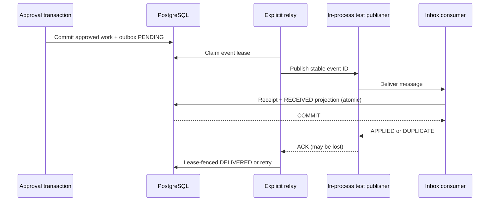

# Lesson 10 — Transactional outbox, leased relay, idempotent inbox and at-least-once delivery

**Track:** sequential IAM engineering curriculum · **Related milestone:** 04G-1–04G-4 · **Baseline:** `v0.1.0-portfolio` (educational local/test scope). This is a learning guide, not a new implementation or fresh test execution.

## Learning outcome

Trace approval to locally received event and explain all transaction, failure and deduplication boundaries.

## Starting concepts

- V12 trigger creates stable UUID event in same PostgreSQL commit as approved work. V13 adds leased publish attempts with max five and DEAD_LETTER.
- `OutboxRelay` is explicitly constructed, processes at most one event per run and has no database transaction across `publisher.publish`. An ACK can be lost after delivery.
- V14 `ProvisioningInboxConsumer` atomically stores event_id receipt and local RECEIVED projection; exact duplicate no-ops, conflicting replay rejects. Publisher is in-process test adapter, not Kafka.

## Step-by-step implementation walkthrough

1. Inspect V12 approval/work/outbox triggers and prove rejection/rollback leaves no event.
2. Inspect `OutboxDeliveryService` and V13: leased claim, immutable event_id, retry delay, token-fenced DELIVERED and failure states.
3. Trace `OutboxRelay.runOnce` and explicitly draw DB claim commit → `publisher.publish` outside transaction → fenced acknowledge/record failure.
4. Inspect `InProcessInboxPublisher` and `ProvisioningInboxConsumer` along with V14. Identify receipt unique event_id and projection insert in same `@Transactional` method.
5. Explain crash after inbox commits before relay acknowledgement: redelivery repeats same ID and consumer returns DUPLICATE without another projection.
6. Read `OutboxInboxEndToEndIT`, `OutboxRelayIT`, `ProvisioningInboxConsumerIT`, and `ProvisioningTransactionalOutboxIT`; name the failed/duplicate paths.
7. Explain the distinction between DELIVERED publisher acknowledgement, RECEIVED local projection and effective third-party access.

## Why the design matters

A relational transaction and a remote publish form a dual-write problem. Outbox plus at-least-once retry and a transactional inbox give durable local intent and idempotent local effects without claiming exactly-once transport.

## Architecture / execution flow

The diagram describes scoped implementation/test relationships; dotted or optional lab behavior is not evidence of a deployed production system.

## Source files to open

- [`src/main/java/dev/asambataiden/iam/provisioning/outbox/OutboxRelay.java`](../../src/main/java/dev/asambataiden/iam/provisioning/outbox/OutboxRelay.java)
- [`src/main/java/dev/asambataiden/iam/provisioning/inbox/ProvisioningInboxConsumer.java`](../../src/main/java/dev/asambataiden/iam/provisioning/inbox/ProvisioningInboxConsumer.java)
- [`docs/milestones/04g-transactional-outbox.md`](../../docs/milestones/04g-transactional-outbox.md)
- [`docs/milestones/04g2-outbox-delivery-relay.md`](../../docs/milestones/04g2-outbox-delivery-relay.md)
- [`docs/milestones/04g3-transactional-inbox.md`](../../docs/milestones/04g3-transactional-inbox.md)
- [`docs/milestones/04g4-end-to-end-event-flow.md`](../../docs/milestones/04g4-end-to-end-event-flow.md)

## Verification / existing evidence

- `src/test/java/dev/asambataiden/iam/provisioning/outbox/OutboxInboxEndToEndIT.java`
- `src/test/java/dev/asambataiden/iam/provisioning/outbox/OutboxRelayIT.java`
- `src/test/java/dev/asambataiden/iam/provisioning/inbox/ProvisioningInboxConsumerIT.java`

Use existing focused tests where available, then full `mvn -B --no-transfer-progress clean verify` with Docker and `python3 -m unittest discover -s ops/keycloak -p 'test_*.py'` plus `python3 -m unittest discover -s ops/security -p 'test_*.py'`. Find earlier observed results in [release evidence](../release/evidence-register.md); **do not claim a fresh PASS without executing a command.**

## Failure modes / negative checks

- Identify one denied or unavailable state and prove that no unauthorized business mutation remains.
- Name the relevant transaction, target, actor or event boundary. Explain what becomes retryable, quarantined, terminal or uncertain.
- Separate code that is automatically configured from explicitly constructed mock/test components.
- Preserve secrets, existing lab data and unrelated Docker resources. Never use destructive cleanup as a lesson shortcut.

## Explain it in an interview

1. Why can delivered events be sent more than once?
2. Why must receipt and projection commit together?
3. Why doesn't local idempotency guarantee external exactly-once grants?

**Answer pattern:** business need → alternative and trade-off → exact Java/SQL/HTTP workflow → negative failure behavior → named tests and evidence → remaining gap.

## Learning completion checklist

- [ ] I can sketch the flow without copying the diagram.
- [ ] I have opened each relevant implementation/migration and followed the actual control path.
- [ ] I can explain a failure/race and the invariant that constrains it.
- [ ] I can distinguish an existing test from a new test execution and report exact outcome.
- [ ] I can explain why this work does not by itself make a production IAM system.

**Next:** [Curriculum index](README.md) and the next numbered lesson.