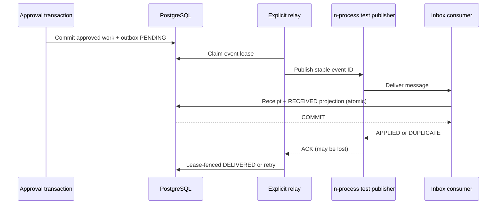

# Lesson 10 — Transactional outbox, leased relay, idempotent inbox and at-least-once delivery

**Track:** sequential IAM engineering curriculum · **Related milestone:** 04G-1–04G-4 · **Baseline:** `v0.1.0-portfolio` (educational local/test scope). This is a learning guide, not a new implementation or fresh test execution.

## Learning outcome

Trace approval to locally received event and explain all transaction, failure and deduplication boundaries.

## Starting concepts

- V12 trigger creates stable UUID event in same PostgreSQL commit as approved work. V13 adds leased publish attempts with max five and DEAD_LETTER.
- `OutboxRelay` is explicitly constructed, processes at most one event per run and has no database transaction across `publisher.publish`. An ACK can be lost after delivery.
- V14 `ProvisioningInboxConsumer` atomically stores event_id receipt and local RECEIVED projection; exact duplicate no-ops, conflicting replay rejects. Publisher is in-process test adapter, not Kafka.

## Step-by-step implementation walkthrough

1. Inspect V12 approval/work/outbox triggers and prove rejection/rollback leaves no event.
2. Inspect `OutboxDeliveryService` and V13: leased claim, immutable event_id, retry delay, token-fenced DELIVERED and failure states.
3. Trace `OutboxRelay.runOnce` and explicitly draw DB claim commit → `publisher.publish` outside transaction → fenced acknowledge/record failure.
4. Inspect `InProcessInboxPublisher` and `ProvisioningInboxConsumer` along with V14. Identify receipt unique event_id and projection insert in same `@Transactional` method.
5. Explain crash after inbox commits before relay acknowledgement: redelivery repeats same ID and consumer returns DUPLICATE without another projection.
6. Read `OutboxInboxEndToEndIT`, `OutboxRelayIT`, `ProvisioningInboxConsumerIT`, and `ProvisioningTransactionalOutboxIT`; name the failed/duplicate paths.
7. Explain the distinction between DELIVERED publisher acknowledgement, RECEIVED local projection and effective third-party access.

## Why the design matters

A relational transaction and a remote publish form a dual-write problem. Outbox plus at-least-once retry and a transactional inbox give durable local intent and idempotent local effects without claiming exactly-once transport.

## Architecture / execution flow



The diagram describes scoped implementation/test relationships; dotted or optional lab behavior is not evidence of a deployed production system.

## Source files to open

- [`src/main/java/dev/asambataiden/iam/provisioning/outbox/OutboxRelay.java`](../../src/main/java/dev/asambataiden/iam/provisioning/outbox/OutboxRelay.java)
- [`src/main/java/dev/asambataiden/iam/provisioning/inbox/ProvisioningInboxConsumer.java`](../../src/main/java/dev/asambataiden/iam/provisioning/inbox/ProvisioningInboxConsumer.java)
- [`docs/milestones/04g-transactional-outbox.md`](../../docs/milestones/04g-transactional-outbox.md)
- [`docs/milestones/04g2-outbox-delivery-relay.md`](../../docs/milestones/04g2-outbox-delivery-relay.md)
- [`docs/milestones/04g3-transactional-inbox.md`](../../docs/milestones/04g3-transactional-inbox.md)
- [`docs/milestones/04g4-end-to-end-event-flow.md`](../../docs/milestones/04g4-end-to-end-event-flow.md)

## Verification / existing evidence

- `src/test/java/dev/asambataiden/iam/provisioning/outbox/OutboxInboxEndToEndIT.java`
- `src/test/java/dev/asambataiden/iam/provisioning/outbox/OutboxRelayIT.java`
- `src/test/java/dev/asambataiden/iam/provisioning/inbox/ProvisioningInboxConsumerIT.java`

Use existing focused tests where available, then full `mvn -B --no-transfer-progress clean verify` with Docker and `python3 -m unittest discover -s ops/keycloak -p 'test_*.py'` plus `python3 -m unittest discover -s ops/security -p 'test_*.py'`. Find earlier observed results in [release evidence](../release/evidence-register.md); **do not claim a fresh PASS without executing a command.**

## Failure modes / negative checks

- Identify one denied or unavailable state and prove that no unauthorized business mutation remains.
- Name the relevant transaction, target, actor or event boundary. Explain what becomes retryable, quarantined, terminal or uncertain.
- Separate code that is automatically configured from explicitly constructed mock/test components.
- Preserve secrets, existing lab data and unrelated Docker resources. Never use destructive cleanup as a lesson shortcut.

## Explain it in an interview

1. Why can delivered events be sent more than once?
2. Why must receipt and projection commit together?
3. Why doesn't local idempotency guarantee external exactly-once grants?

**Answer pattern:** business need → alternative and trade-off → exact Java/SQL/HTTP workflow → negative failure behavior → named tests and evidence → remaining gap.


## Practical lab 10A — Understand the dual-write problem

A PostgreSQL transaction can commit an APPROVED decision, audit and a durable work item. But a message publish to an independent broker cannot be atomically committed with that local transaction without a separate distributed coordination mechanism. The **transactional outbox** stores publish intent alongside the database state, then dispatches it later.

Read [V12](../../src/main/resources/db/migration/V12__provisioning_transactional_outbox.sql), [V13](../../src/main/resources/db/migration/V13__outbox_delivery_leases.sql) and [V14](../../src/main/resources/db/migration/V14__transactional_provisioning_inbox.sql).

| Phase | Durable evidence | Guarantee in this project |
| --- | --- | --- |
| APPROVED commit | Request + decision + audit + approved work + V12 outbox | All-or-nothing **local** transaction |
| Relay claim | V13 IN_FLIGHT + current lease token and attempt number | Single valid local claimant at a time |
| Publish | Explicitly invoked test `OutboxEventPublisher` | Delivery may happen more than once |
| Ack | DELIVERED if current lease token remains valid | Acknowledgment of test publisher, not target entitlement |
| Inbox | V14 receipt + RECEIVED projection in one transaction | Exact duplicate is local no-op |
| External target | **Not implemented** | No production broker or actual grant |

## Practical lab 10B — Follow a single relay run

Read [`OutboxDeliveryService.java`](../../src/main/java/dev/asambataiden/iam/provisioning/outbox/OutboxDeliveryService.java) and [`OutboxRelay.java`](../../src/main/java/dev/asambataiden/iam/provisioning/outbox/OutboxRelay.java).

1. The delivery service claims **at most one event** using `FOR UPDATE SKIP LOCKED`. A V13 event's state is PENDING, RETRY_WAIT or expired IN_FLIGHT.
2. A newly claimed event obtains a fresh UUID lease token, a bounded **5–300-second** expiry and incremented attempt number. Its immutable `eventId` is retained.
3. The `claim()` transaction ends **before** the relay calls `publisher.publish(event)`. This is a deliberate network/DB boundary.
4. On a publisher exception, the relay attempts to persist retry with allowlisted `PUBLISH_UNAVAILABLE` and bounded backoff; the fifth failed attempt enters DEAD_LETTER.
5. On apparent publish success, `delivered(event)` marks DELIVERED only when the current unexpired token still matches. An expired/stale token cannot confirm another worker's event.
6. Even if publishing succeeded, the ACK or DB mark may be lost. A subsequent relay may republish the **same event ID**. This is expected at-least-once behavior, not a defect.

**Important:** `OutboxRelay` is a plain class invoked explicitly by tests. There is **no background scheduler or production event broker**. `InProcessInboxPublisher` is the in-process test bridge, not a Kafka consumer or a network authenticated listener.

## Practical lab 10C — Atomic inbox processing and duplicate semantics

Read [`ProvisioningInboxConsumer.java`](../../src/main/java/dev/asambataiden/iam/provisioning/inbox/ProvisioningInboxConsumer.java).

Its envelope requires non-null event, tenant and request UUID; `eventType = PROVISIONING_REQUESTED`; `schemaVersion = 1`; and nonblank JSON payload.

The transactional algorithm is:

1. `INSERT INTO provisioning_inbox_receipts (...) ON CONFLICT(event_id) DO NOTHING RETURNING event_id`.
2. If this event ID is new, insert the **RECEIVED** event projection in the same `@Transactional` method, then return APPLIED.
3. If the event ID exists, compare stored tenant/request/type/version and **JSONB payload**.
4. Exact same envelope returns DUPLICATE without inserting another projection.
5. Changed envelope reusing an existing event ID throws an exception. A projection failure rolls back the corresponding new receipt.

```mermaid
sequenceDiagram
  participant Relay as Explicit outbox relay
  participant Pub as In-process publisher
  participant In as Inbox consumer
  participant DB as PostgreSQL
  Relay->>DB: claim event ID E with lease
  Relay->>Pub: publish E
  Pub->>In: consume E
  In->>DB: receipt E + RECEIVED projection in one transaction
  DB-->>In: COMMIT / APPLIED
  Note over Pub,Relay: Publisher ACK lost after successful consume
  Relay->>DB: retry / recover E
  Relay->>Pub: publish E again
  Pub->>In: consume E same payload
  In->>DB: compare existing receipt
  DB-->>In: DUPLICATE; no new projection
```

**Exactly-once language:** The transport may deliver duplicate messages. The consumer makes one **local projection per event ID**, conditioned on the recorded envelope. It does not guarantee that any external system is updated once.

## Practical lab 10D — Failure and recovery matrix

| Failure timing | Durable outcome | Expected follow-up |
| --- | --- | --- |
| Decision transaction rolls back | No V12 event | No relay work exists |
| Relay crashes after claim | IN_FLIGHT event and lease | Expiry and retry; max 5 attempts |
| Publisher reports unavailable | RETRY_WAIT or DEAD_LETTER | Same event ID and bounded retry |
| Publisher applies, ACK lost | Event may remain retryable | Duplicate delivery handled by inbox |
| Inbox projection insert fails | Receipt + projection roll back | Retry may apply cleanly |
| Same ID, same JSONB payload | Existing receipt | DUPLICATE no-op |
| Same ID, changed payload/tenant | Existing receipt | Reject conflicting replay |
| Relay token expires before ack | Stale `delivered()` returns false | Success cannot be falsely recorded |

**Security boundary:** `ProvisioningInboxConsumer` is internally invoked and **does not authenticate a transport**. A real broker integration would need authenticated provenance, schema/tenant governance, retention, poison-message handling, observability and controlled redrive.

## Practical lab 10E — Reproduce real integration evidence

Inspect [`ProvisioningTransactionalOutboxIT`](../../src/test/java/dev/asambataiden/iam/provisioning/outbox/ProvisioningTransactionalOutboxIT.java), [`OutboxRelayIT`](../../src/test/java/dev/asambataiden/iam/provisioning/outbox/OutboxRelayIT.java), [`ProvisioningInboxConsumerIT`](../../src/test/java/dev/asambataiden/iam/provisioning/inbox/ProvisioningInboxConsumerIT.java) and [`OutboxInboxEndToEndIT`](../../src/test/java/dev/asambataiden/iam/provisioning/outbox/OutboxInboxEndToEndIT.java).

```bash
mvn -B --no-transfer-progress   -Dit.test=ProvisioningTransactionalOutboxIT,OutboxRelayIT,ProvisioningInboxConsumerIT,OutboxInboxEndToEndIT   -DfailIfNoTests=false verify
```

**Interview answer:** “Our approval transaction writes the outbox event with the business state. An explicitly invoked relay leases and publishes outside that transaction; it can republish when acknowledgment is lost. The transactional inbox atomically records a receipt and local projection, returning DUPLICATE for identical event replays and rejecting conflicting reuse. That establishes scoped local reliability patterns, not exactly-once network delivery or a real entitlement grant.”

**Continue:** [Lesson 11 — CI, DevSecOps and evidence governance](11-testing-devsecops-supply-chain-and-evidence.md).

## Learning completion checklist

- [ ] I can sketch the flow without copying the diagram.
- [ ] I have opened each relevant implementation/migration and followed the actual control path.
- [ ] I can explain a failure/race and the invariant that constrains it.
- [ ] I can distinguish an existing test from a new test execution and report exact outcome.
- [ ] I can explain why this work does not by itself make a production IAM system.

**Next:** [Curriculum index](README.md) and the next numbered lesson.