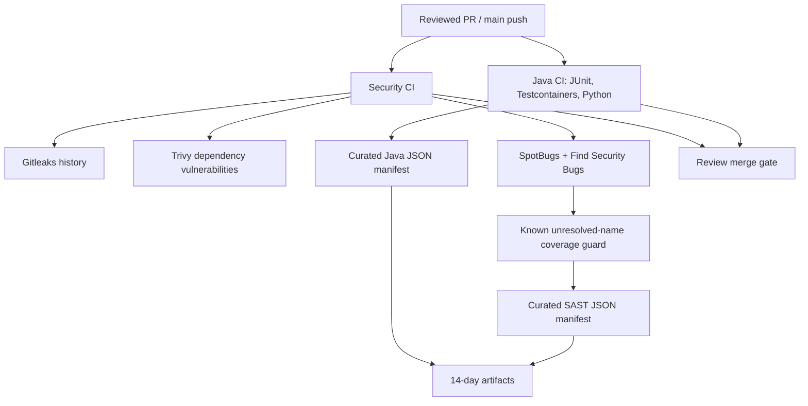
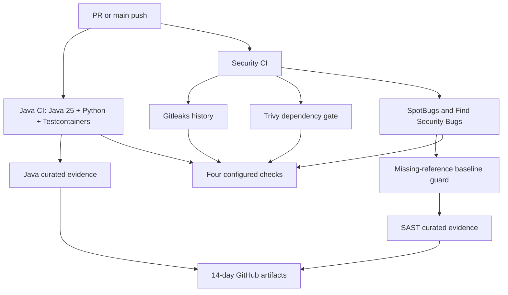

# Lesson 11 — Unit/integration testing, Gitleaks, Trivy, SAST and CI evidence integrity

**Track:** sequential IAM engineering curriculum · **Related milestone:** 05A–05B · **Baseline:** `v0.1.0-portfolio` (educational local/test scope). This is a learning guide, not a new implementation or fresh test execution.

## Learning outcome

Understand the layered testing pyramid and the exact trust/coverage boundaries of the GitHub security gates.

## Starting concepts

- Maven Surefire runs `*Test.java` and Failsafe runs `*IT.java`, with PostgreSQL Testcontainers for relational behavior.
- GitHub Java CI verifies Java/Python tests and lab fixture syntax; Security CI gates Gitleaks history, Trivy vulnerabilities and SpotBugs + Find Security Bugs.
- Action refs are pinned by full SHAs for configured workflows; SpotBugs unresolved-name baseline and narrow exclusions remain residual risks; curated CI JSON manifests are retained for 14 days and are not signed provenance.

## Step-by-step implementation walkthrough

1. Open `pom.xml` and compare Surefire/Failsafe includes; identify Testcontainers, Mockito javaagent, Spring Security Test and SpotBugs configuration.
2. Open `.github/workflows/java-ci.yml` and `.github/workflows/security-ci.yml` and list job names, permissions, action pins and checks.
3. Trace `ops/security/verify_github_actions_pins.py`, `config/github-actions-pins.json` and its Python negative tests.
4. Trace `ops/security/verify_spotbugs_coverage.py` and baseline file; understand nine known unresolved names and why zero new names is not complete coverage.
5. Read `config/spotbugs-exclude.xml` and the 05B-4 residual risk list before claiming SAST completeness.
6. Inspect `ops/security/create_ci_evidence.py`: test/SAST counts, hashes, run identity, attempts and refusal to emit success on empty/failed reports. Note 14-day manifest retention.
7. Run Python unit discovery and full `mvn clean verify`; explain each runner's tested SHA and do not confuse PR synthetic merge SHA with branch head.

## Why the design matters

No single test or scanner covers all failure modes. Immutable dependencies, limited permissions and evidence hygiene improve reproducibility while preserving known limitations.

## Architecture / execution flow



The diagram describes scoped implementation/test relationships; dotted or optional lab behavior is not evidence of a deployed production system.

## Source files to open

- [`pom.xml`](../../pom.xml)
- [`.github/workflows/java-ci.yml`](../../.github/workflows/java-ci.yml)
- [`.github/workflows/security-ci.yml`](../../.github/workflows/security-ci.yml)
- [`docs/milestones/05a-security-closeout.md`](../../docs/milestones/05a-security-closeout.md)
- [`docs/milestones/05b4-security-assurance-closeout.md`](../../docs/milestones/05b4-security-assurance-closeout.md)
- [`docs/security/threat-model.md`](../../docs/security/threat-model.md)

## Verification / existing evidence

- `ops/security/test_verify_github_actions_pins.py`
- `ops/security/test_verify_spotbugs_coverage.py`
- `ops/security/test_create_ci_evidence.py`

Use existing focused tests where available, then full `mvn -B --no-transfer-progress clean verify` with Docker and `python3 -m unittest discover -s ops/keycloak -p 'test_*.py'` plus `python3 -m unittest discover -s ops/security -p 'test_*.py'`. Find earlier observed results in [release evidence](../release/evidence-register.md); **do not claim a fresh PASS without executing a command.**

## Failure modes / negative checks

- Identify one denied or unavailable state and prove that no unauthorized business mutation remains.
- Name the relevant transaction, target, actor or event boundary. Explain what becomes retryable, quarantined, terminal or uncertain.
- Separate code that is automatically configured from explicitly constructed mock/test components.
- Preserve secrets, existing lab data and unrelated Docker resources. Never use destructive cleanup as a lesson shortcut.

## Explain it in an interview

1. Why are SAST, SCA and secret detection separate?
2. What is missing from curated hashed evidence for independent attestation?
3. What does a green hosted run prove about its specific tested commit?

**Answer pattern:** business need → alternative and trade-off → exact Java/SQL/HTTP workflow → negative failure behavior → named tests and evidence → remaining gap.


## Practical lab 11A — Build the evidence pyramid

Open [`pom.xml`](../../pom.xml), [Java CI](../../.github/workflows/java-ci.yml) and [Security CI](../../.github/workflows/security-ci.yml).

| Layer | Actual runner/tool | What is tested | What remains outside the evidence |
| --- | --- | --- | --- |
| Fast Java tests | Surefire `**/*Test.java` | Unit policy, RSA decoder, adapter contract | Production state, distributed networking |
| Java integration | Failsafe `**/*IT.java` + PostgreSQL 17 Testcontainers | FK, locking, transactions, security HTTP, mock target and event replay | Production infrastructure and real entitlements |
| Python Keycloak tooling | `unittest discover -s ops/keycloak` | Fixture, metadata helper, lab input validation | Successful live token-to-API flow |
| Python security tooling | `unittest discover -s ops/security` | Action pin, SpotBugs coverage and evidence parser guard | Unconfigured CI integrations |
| Secret detection | Gitleaks, full Git history | Configured secret patterns | Every possible secret or historic external leak |
| SCA | Trivy filesystem/package scan, HIGH/CRITICAL gate | Known dependency advisories within scan coverage | All zero-days, all runtime configuration |
| Java SAST | SpotBugs + Find Security Bugs | Supported bytecode patterns, exclusions and coverage baseline | Complete application analysis or penetration test |
| Evidence governance | Curated JSON + SHA-256 reports | Matching run/ref/report summary and reproducibility | Signed provenance or independent attestation |

In this repo, `mvn -B --no-transfer-progress clean verify` executes Surefire and Failsafe. Merely running `mvn test` is **not equivalent** to the complete integration verification.

## Practical lab 11B — Read the actual GitHub Actions jobs

**Java CI** is triggered on PRs and pushes to `main`, uses `contents: read`, `actions/checkout` with `persist-credentials: false`, and a SHA-pinned `setup-java` Java 25 Temurin toolchain. It verifies the action-pin policy, Python security tests, local Keycloak lab assets, Java `clean verify`, then creates and uploads curated Java evidence.

**Security CI** contains three independent jobs:
1. **Secret detection:** full-history checkout, Gitleaks action, no commenting or raw artifact upload enabled.
2. **Dependency vulnerabilities:** builds dependency-bearing JAR without rerunning tests, then Trivy filesystem vulnerability scanner exits nonzero for HIGH or CRITICAL advisories.
3. **Java static analysis:** Maven package + `spotbugs:check`, an additional missing-reference coverage validator, curated SAST JSON evidence.

The workflow references are SHA-pinned **within the validator's configured inventory**. This is a supply-chain control, not an assertion that all transitive actions or all executable dependencies are fully pinned and independently audited.



## Practical lab 11C — Validate supply-chain policy and analyzer limitations

Read [`verify_github_actions_pins.py`](../../ops/security/verify_github_actions_pins.py), [`github-actions-pins.json`](../../config/github-actions-pins.json), [`verify_spotbugs_coverage.py`](../../ops/security/verify_spotbugs_coverage.py), [`spotbugs-missing-baseline.json`](../../config/spotbugs-missing-baseline.json) and [`spotbugs-exclude.xml`](../../config/spotbugs-exclude.xml).

- **Pin checking:** the validator enforces reviewed immutable action SHA references within configured workflows; inspect negative tests before trusting coverage.
- **SAST exclusions:** the exclusion XML is an explicit review decision; a green `spotbugs:check` is not a claim that every possible vulnerability was detected.
- **Coverage guard:** the baseline contains **nine known unresolved analyzer reference names** at the documented 05B milestone; rejects unexpected regressions, but doesn't turn those unresolved references into analyzed code.
- **Dependency findings:** a failed Trivy scan should lead to reviewed dependency upgrade or documented remediation, not suppression of the entire job.
- **Secrets:** never upload local `.env`, tokens, bearer JWTs or complete request logs as proof of a CI success.

## Practical lab 11D — Evidence manifests are not signed attestations

[`create_ci_evidence.py`](../../ops/security/create_ci_evidence.py) constructs limited JSON from test/SAST reports, includes run identity/attempt and SHA-256 digest information, and refuses success claims when required reports are empty or failed. Workflows retain these curated artifacts for **14 days**.

| Evidence question | Sound answer |
| --- | --- |
| Which commit was tested? | Record checked out SHA and workflow event/ref, not just branch name |
| Is a PR head identical to GitHub's synthetic merge SHA? | Not necessarily; distinguish both |
| Do four green jobs mean full security qualification? | No; only configured checks at the tested commit |
| Can SHA-256 in JSON alone prove independent artifact authenticity? | No; it provides a digest, not a trusted signature/attestation |
| Did the docs-only PR rerun local test commands? | Only claim what hosted CI or actual user logs show |
| Do Java test counts include rerun demo counts? | No; curated demo re-executes an existing subset |

## Practical lab 11E — Safe verification and interview

```bash
git rev-parse HEAD
python3 -m unittest discover -s ops/security -p 'test_*.py'
python3 -m unittest discover -s ops/keycloak -p 'test_*.py'
python3 ops/security/verify_github_actions_pins.py
mvn -B --no-transfer-progress clean verify
# Optional explicit static analysis:
mvn -B --no-transfer-progress -DskipTests package spotbugs:check
```

Record command, SHA, exit code, findings and the relevant hosted job link. Do not delete other GitHub artifacts, alter local credentials, disable security controls or invent green statuses.

**Interview answer:** “Our Java CI runs Java 25 tests and disposable PostgreSQL integration fixtures, while Security CI separately gates secrets, dependency advisories and Java SAST. We pin configured GitHub Actions refs, apply a missing-reference analyzer regression guard, and retain curated SHA-bound evidence for 14 days. These are reviewed engineering controls with documented coverage limits, not independent security certification or proof of production deployment.”

**Continue:** [Lesson 12 — release, operations and interview closeout](12-release-demonstration-operations-and-interview.md).

## Learning completion checklist

- [ ] I can sketch the flow without copying the diagram.
- [ ] I have opened each relevant implementation/migration and followed the actual control path.
- [ ] I can explain a failure/race and the invariant that constrains it.
- [ ] I can distinguish an existing test from a new test execution and report exact outcome.
- [ ] I can explain why this work does not by itself make a production IAM system.

**Next:** [Curriculum index](README.md) and the next numbered lesson.