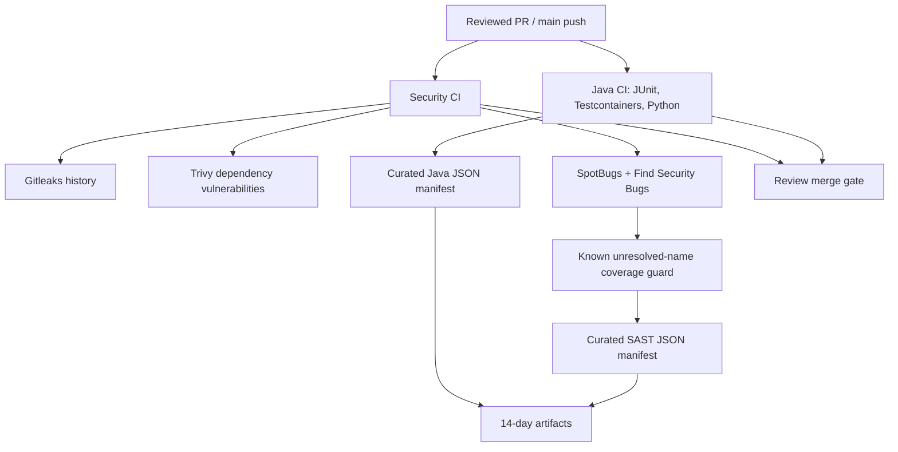

# Lesson 11 — Unit/integration testing, Gitleaks, Trivy, SAST and CI evidence integrity

**Track:** sequential IAM engineering curriculum · **Related milestone:** 05A–05B · **Baseline:** `v0.1.0-portfolio` (educational local/test scope). This is a learning guide, not a new implementation or fresh test execution.

## Learning outcome

Understand the layered testing pyramid and the exact trust/coverage boundaries of the GitHub security gates.

## Starting concepts

- Maven Surefire runs `*Test.java` and Failsafe runs `*IT.java`, with PostgreSQL Testcontainers for relational behavior.
- GitHub Java CI verifies Java/Python tests and lab fixture syntax; Security CI gates Gitleaks history, Trivy vulnerabilities and SpotBugs + Find Security Bugs.
- Action refs are pinned by full SHAs for configured workflows; SpotBugs unresolved-name baseline and narrow exclusions remain residual risks; curated CI JSON manifests are retained for 14 days and are not signed provenance.

## Step-by-step implementation walkthrough

1. Open `pom.xml` and compare Surefire/Failsafe includes; identify Testcontainers, Mockito javaagent, Spring Security Test and SpotBugs configuration.
2. Open `.github/workflows/java-ci.yml` and `.github/workflows/security-ci.yml` and list job names, permissions, action pins and checks.
3. Trace `ops/security/verify_github_actions_pins.py`, `config/github-actions-pins.json` and its Python negative tests.
4. Trace `ops/security/verify_spotbugs_coverage.py` and baseline file; understand nine known unresolved names and why zero new names is not complete coverage.
5. Read `config/spotbugs-exclude.xml` and the 05B-4 residual risk list before claiming SAST completeness.
6. Inspect `ops/security/create_ci_evidence.py`: test/SAST counts, hashes, run identity, attempts and refusal to emit success on empty/failed reports. Note 14-day manifest retention.
7. Run Python unit discovery and full `mvn clean verify`; explain each runner's tested SHA and do not confuse PR synthetic merge SHA with branch head.

## Why the design matters

No single test or scanner covers all failure modes. Immutable dependencies, limited permissions and evidence hygiene improve reproducibility while preserving known limitations.

## Architecture / execution flow

The diagram describes scoped implementation/test relationships; dotted or optional lab behavior is not evidence of a deployed production system.

## Source files to open

- [`pom.xml`](../../pom.xml)
- [`.github/workflows/java-ci.yml`](../../.github/workflows/java-ci.yml)
- [`.github/workflows/security-ci.yml`](../../.github/workflows/security-ci.yml)
- [`docs/milestones/05a-security-closeout.md`](../../docs/milestones/05a-security-closeout.md)
- [`docs/milestones/05b4-security-assurance-closeout.md`](../../docs/milestones/05b4-security-assurance-closeout.md)
- [`docs/security/threat-model.md`](../../docs/security/threat-model.md)

## Verification / existing evidence

- `ops/security/test_verify_github_actions_pins.py`
- `ops/security/test_verify_spotbugs_coverage.py`
- `ops/security/test_create_ci_evidence.py`

Use existing focused tests where available, then full `mvn -B --no-transfer-progress clean verify` with Docker and `python3 -m unittest discover -s ops/keycloak -p 'test_*.py'` plus `python3 -m unittest discover -s ops/security -p 'test_*.py'`. Find earlier observed results in [release evidence](../release/evidence-register.md); **do not claim a fresh PASS without executing a command.**

## Failure modes / negative checks

- Identify one denied or unavailable state and prove that no unauthorized business mutation remains.
- Name the relevant transaction, target, actor or event boundary. Explain what becomes retryable, quarantined, terminal or uncertain.
- Separate code that is automatically configured from explicitly constructed mock/test components.
- Preserve secrets, existing lab data and unrelated Docker resources. Never use destructive cleanup as a lesson shortcut.

## Explain it in an interview

1. Why are SAST, SCA and secret detection separate?
2. What is missing from curated hashed evidence for independent attestation?
3. What does a green hosted run prove about its specific tested commit?

**Answer pattern:** business need → alternative and trade-off → exact Java/SQL/HTTP workflow → negative failure behavior → named tests and evidence → remaining gap.

## Learning completion checklist

- [ ] I can sketch the flow without copying the diagram.
- [ ] I have opened each relevant implementation/migration and followed the actual control path.
- [ ] I can explain a failure/race and the invariant that constrains it.
- [ ] I can distinguish an existing test from a new test execution and report exact outcome.
- [ ] I can explain why this work does not by itself make a production IAM system.

**Next:** [Curriculum index](README.md) and the next numbered lesson.