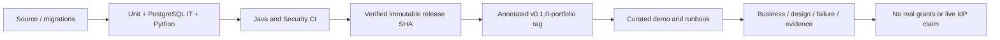
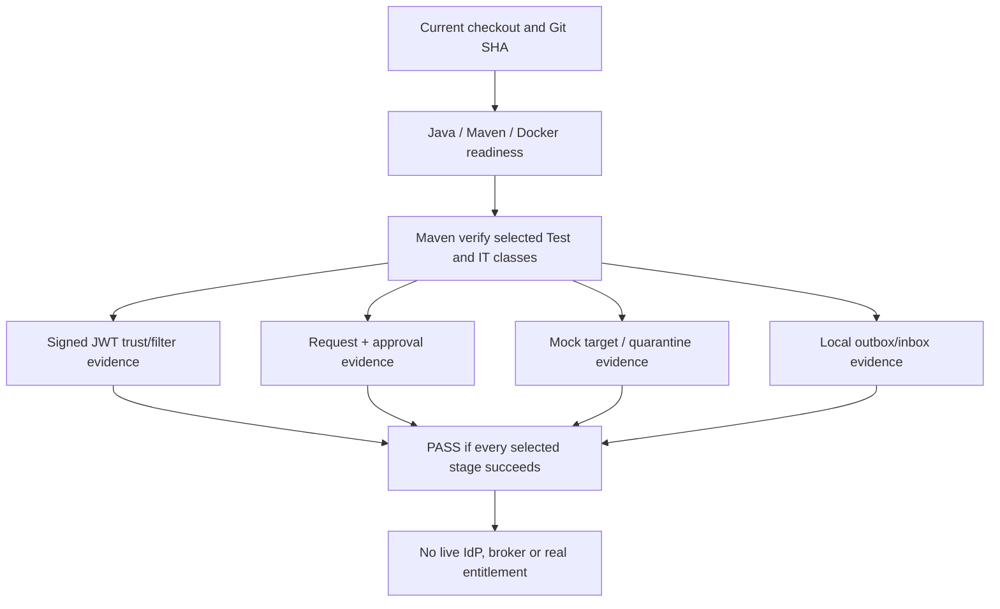

# Lesson 12 — Portfolio release, reproducible demo, operations and interview closeout

**Track:** sequential IAM engineering curriculum · **Related milestone:** 06, RC-A–RC-C, portfolio · **Baseline:** `v0.1.0-portfolio` (educational local/test scope). This is a learning guide, not a new implementation or fresh test execution.

## Learning outcome

Conclude the project with an immutable verified educational release and communicate limits credibly.

## Starting concepts

- Annotated tag `v0.1.0-portfolio` points to `cf0e2fce324fa6c81bf5bccc4ee49dadf1925391`; later documentation PRs do not move that tag.
- At the release SHA 16 Java unit + 105 Java integration + 33 Keycloak Python + 22 security Python tests passed; curated demo repeats a 5+46 subset.
- Java and Security CI push workflows were green on that exact release SHA. Neither this nor signed test JWTs establish live IdP integration or real downstream grants.

## Step-by-step implementation walkthrough

1. Inspect `docs/release/portfolio-release-gates.md` as historical release acceptance plan, then read the later decision in PR #53 and tag evidence; understand why old pre-release checklist statuses can remain historical.
2. Run `git rev-parse v0.1.0-portfolio^{commit}` and compare against the documented SHA; do not move or rewrite the annotated release tag.
3. Use `bash ops/demo/run-portfolio-demo.sh` to run six independent acceptance stages with isolated Testcontainers fixtures; describe what each covers.
4. Read `docs/release/local-operations-runbook.md`: Java/Docker requirements, optional local DB/API, safe shutdown, redaction and rollback limitations.
5. Use `docs/portfolio/complete-engineering-guide.md` and `technical-interview-workbook.md` to prepare a 10-minute architecture/demo talk: UC-001, JWT, tenant DB, SoD, retries, events, CI, limitations.
6. State explicitly that Keycloak live PKCE HTTP acceptance in draft PR #49 is unresolved; there is no production broker/target, HA, tested backup/restore or SLO.
7. Record your own observed demonstration output with current SHA. Remember the latest main may include documentation updates after the immutable release.

## Why the design matters

A successful portfolio milestone is verifiable within a declared scope. Reproducibility, truthfulness and evidence provenance matter as much as implementation complexity.

## Architecture / execution flow



The diagram describes scoped implementation/test relationships; dotted or optional lab behavior is not evidence of a deployed production system.

## Source files to open

- [`docs/release/portfolio-demo-runbook.md`](../../docs/release/portfolio-demo-runbook.md)
- [`docs/release/local-operations-runbook.md`](../../docs/release/local-operations-runbook.md)
- [`docs/release/evidence-register.md`](../../docs/release/evidence-register.md)
- [`docs/portfolio/complete-engineering-guide.md`](../../docs/portfolio/complete-engineering-guide.md)
- [`docs/portfolio/technical-interview-workbook.md`](../../docs/portfolio/technical-interview-workbook.md)

## Verification / existing evidence

- `ops/demo/run-portfolio-demo.sh`
- `src/test/java/dev/asambataiden/iam/provisioning/outbox/OutboxInboxEndToEndIT.java`

Use existing focused tests where available, then full `mvn -B --no-transfer-progress clean verify` with Docker and `python3 -m unittest discover -s ops/keycloak -p 'test_*.py'` plus `python3 -m unittest discover -s ops/security -p 'test_*.py'`. Find earlier observed results in [release evidence](../release/evidence-register.md); **do not claim a fresh PASS without executing a command.**

## Failure modes / negative checks

- Identify one denied or unavailable state and prove that no unauthorized business mutation remains.
- Name the relevant transaction, target, actor or event boundary. Explain what becomes retryable, quarantined, terminal or uncertain.
- Separate code that is automatically configured from explicitly constructed mock/test components.
- Preserve secrets, existing lab data and unrelated Docker resources. Never use destructive cleanup as a lesson shortcut.

## Explain it in an interview

1. What exactly was verified at the tagged SHA, and what remains unverified?
2. Why is test fixture independence a limitation for a continuous user-journey claim?
3. Which three architecture trade-offs would you highlight to a hiring panel?

**Answer pattern:** business need → alternative and trade-off → exact Java/SQL/HTTP workflow → negative failure behavior → named tests and evidence → remaining gap.


## Practical lab 12A — Distinguish the immutable release from later documentation

The **published educational release** is the annotated Git tag `v0.1.0-portfolio`, pointing to `cf0e2fce324fa6c81bf5bccc4ee49dadf1925391`. PRs adding lessons after publication change `main`, **not** the original release.

From the repository root, without changing branches or files:

```bash
git status --short --branch
git rev-parse HEAD
git rev-parse 'v0.1.0-portfolio^{commit}'
git show --no-patch --format='%H %s' v0.1.0-portfolio
```

**Why commit identity matters:** A test success on an old PR head, synthetic PR merge or later documentation commit is not automatically evidence for another SHA. A release candidate is qualified against *the specific tested tree*.

Read [final evidence and historical candidate records](../release/evidence-register.md). The section headed “Historical candidate checklist” preserves **pre-release** wording and should not be interpreted as the current status.

## Practical lab 12B — Explain every verified release gate

The recorded final release-head results are:

| Verification | Recorded observation | Interpretation |
| --- | --- | --- |
| Java Surefire/Failsafe | **16 unit + 105 integration**, no failures/errors/skips | Controlled Java/HTTP/PostgreSQL contracts |
| Python Keycloak helper suite | **33 tests OK** | Synthetic fixture and helper behavior |
| Python security suite | **22 tests OK** | Action pinning, SAST coverage and manifest validators |
| Curated portfolio demo | **5 unit + 46 integration test executions**, PASS | Rerun **subset** of Java suite, not 51 new tests |
| [Java CI push run](https://github.com/asambataiden/enterprise-identity-access-platform/actions/runs/43550333575) | Success | Exact release SHA |
| [Security CI push run](https://github.com/asambataiden/enterprise-identity-access-platform/actions/runs/43550333582) | Success | Three configured security gates at exact SHA |

These are **recorded prior release results**. This lesson update itself does not assert a fresh local execution.

**Why the counts matter:** 16 + 105 Java tests are 121 distinct Java cases, while 33 + 22 Python tests add 55, totaling **176** recorded distinct tests across those suites. The curated 5+46 is a selection from the 121 Java cases and is *not* additive.

## Practical lab 12C — Walk through the deterministic demo

Open [`ops/demo/run-portfolio-demo.sh`](../../ops/demo/run-portfolio-demo.sh) and [demo runbook](../release/portfolio-demo-runbook.md).

The script checks Java, Maven, Docker, Git and Docker-engine readiness, prints the active Git SHA and invokes Maven `verify` with:
- one signed-JWT unit test class: `SignedJwtTrustValidationTest`;
- six integration classes: `AccessRequestPersistenceIT`, `ApprovalDecisionHttpIT`, `MockProvisioningOrchestratorIT`, `OutboxInboxEndToEndIT`, `QuarantineInspectionHttpIT`, `SignedJwtHttpFilterIT`.

Each integration test owns its own disposable fixtures. The script does **not** automatically start Keycloak, grant external application access, or run one continuous shared-identity transaction.



To reproduce safely:

```bash
java -version
mvn -version
docker info
bash -n ops/demo/run-portfolio-demo.sh
bash ops/demo/run-portfolio-demo.sh
```

Do not indiscriminately run `git clean`, `git reset --hard`, `docker system prune`, or `docker compose down -v`; preserve unrelated local scripts, data, volumes and containers.

## Practical lab 12D — Operational readiness versus a portfolio demonstration

Read [`local-operations-runbook.md`](../release/local-operations-runbook.md), [`capability-matrix.md`](../architecture/capability-matrix.md) and [`portfolio-release-gates.md`](../release/portfolio-release-gates.md).

| Portfolio implemented/tested | Separate production acceptance gate |
| --- | --- |
| JVM, Spring REST boundary, PostgreSQL/Testcontainers | Real deployment topology, TLS, secrets and database operations |
| Ephemeral RSA JWT negative tests and local Keycloak metadata checks | Positive real Keycloak token-to-API acceptance and key rotation |
| Idempotent access requests, approvals and audit | Production identity lifecycle, delegated policy, independent audit/retention |
| Leases, target mock readback and quarantine | Real target credentials, SCIM/connector, compensating actions |
| Local outbox/relay/inbox | Authenticated broker, listener lifecycle, poison-message procedures |
| Gitleaks/Trivy/SAST configured gates | Pentest, continuous monitoring, on-call and compliance review |
| Repeatable disposable demo | Load, SLO, HA, backups and restore drills |

A non-production release can be a rigorous engineering achievement when its evidence and limitations are accurately scoped.

## Practical lab 12E — Ten-minute engineering presentation

| Time | Topic | Required evidence |
| --- | --- | --- |
| 0:00–1:00 | Enterprise access-governance problem | UC-001 actors, threat and business outcome |
| 1:00–2:00 | Modular monolith architecture | Architecture 01 context and module diagram |
| 2:00–3:00 | Identity vs authorization | JWT filter, scope, active local actor mapping |
| 3:00–4:00 | Tenant persistence and idempotency | V1/V2, unique tenant/key, concurrent Testcontainers IT |
| 4:00–5:00 | Approval and audit | V3/V4 lock, SoD, atomic rollback and opposing approvers |
| 5:00–6:30 | Durable work/reconciliation | Lease/fencing and mock read-before-write after lost ACK |
| 6:30–7:30 | Events and retries | V12–V14 outbox/inbox, at-least-once and local dedup |
| 7:30–8:30 | DevSecOps | Four GitHub checks, pins, evidence and limitations |
| 8:30–9:30 | What was actually verified | Exact tag SHA, 176 scoped tests, 5+46 demo subset |
| 9:30–10:00 | Honest next steps | Live IdP, real provisioning, broker, SLO/HA |

### Interview questions and answers

**“What happens at 10× traffic?”** “We can reason about unique-index contention, row-lock queues, bounded lease claims and outbox lag, but we have not measured 10× throughput. We would establish baseline load tests, DB query plans, p95/p99, error budgets and alerting before scale commitments.”

**“What happens if a target applies a grant but times out?”** “Write-ahead STARTED evidence survives, the orchestrator rereads the mock target under a stable key, and UNKNOWN may lead to quarantine instead of blind retry. That is a local test pattern, not proof against a real target.”

**“What should we regret in six months?”** “Overstated maturity, untracked identity trust, poor evidence provenance and uncontrolled repair paths. We mitigate these by preserving the immutable educational tag, documenting test boundaries and deliberately avoiding untested broker or cloud integration.”

## Completion and handoff checklist

- [ ] I can reproduce the tag SHA and distinguish historical release from current documentation.
- [ ] I can name all six curated integration-stage classes and why fixtures are independent.
- [ ] I can explain which of the 176 recorded tests cover Java vs Python tooling and why the 5+46 subset is not additive.
- [ ] I can identify a business flow, a negative test and a failure mode for each module.
- [ ] I can present the architecture in ten minutes without claiming real IAM grants.
- [ ] I can state measurable production acceptance gates and distinguish them from completed educational requirements.
- [ ] I have recorded any newly executed tests with current Git SHA and exact outputs.

**Course completion:** [Learning curriculum](README.md) → [all use cases](../use-cases/README.md) → [architecture reference](../architecture/README.md) → [technical interview workbook](../portfolio/technical-interview-workbook.md). Future feature work requires a new business use case, architecture decision and independently validated evidence rather than an assumed scope expansion.

## Learning completion checklist

- [ ] I can sketch the flow without copying the diagram.
- [ ] I have opened each relevant implementation/migration and followed the actual control path.
- [ ] I can explain a failure/race and the invariant that constrains it.
- [ ] I can distinguish an existing test from a new test execution and report exact outcome.
- [ ] I can explain why this work does not by itself make a production IAM system.

**Next:** [Curriculum index](README.md) and the next numbered lesson.