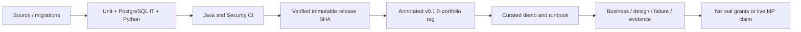

# Lesson 12 — Portfolio release, reproducible demo, operations and interview closeout

**Track:** sequential IAM engineering curriculum · **Related milestone:** 06, RC-A–RC-C, portfolio · **Baseline:** `v0.1.0-portfolio` (educational local/test scope). This is a learning guide, not a new implementation or fresh test execution.

## Learning outcome

Conclude the project with an immutable verified educational release and communicate limits credibly.

## Starting concepts

- Annotated tag `v0.1.0-portfolio` points to `cf0e2fce324fa6c81bf5bccc4ee49dadf1925391`; later documentation PRs do not move that tag.
- At the release SHA 16 Java unit + 105 Java integration + 33 Keycloak Python + 22 security Python tests passed; curated demo repeats a 5+46 subset.
- Java and Security CI push workflows were green on that exact release SHA. Neither this nor signed test JWTs establish live IdP integration or real downstream grants.

## Step-by-step implementation walkthrough

1. Inspect `docs/release/portfolio-release-gates.md` as historical release acceptance plan, then read the later decision in PR #53 and tag evidence; understand why old pre-release checklist statuses can remain historical.
2. Run `git rev-parse v0.1.0-portfolio^{commit}` and compare against the documented SHA; do not move or rewrite the annotated release tag.
3. Use `bash ops/demo/run-portfolio-demo.sh` to run six independent acceptance stages with isolated Testcontainers fixtures; describe what each covers.
4. Read `docs/release/local-operations-runbook.md`: Java/Docker requirements, optional local DB/API, safe shutdown, redaction and rollback limitations.
5. Use `docs/portfolio/complete-engineering-guide.md` and `technical-interview-workbook.md` to prepare a 10-minute architecture/demo talk: UC-001, JWT, tenant DB, SoD, retries, events, CI, limitations.
6. State explicitly that Keycloak live PKCE HTTP acceptance in draft PR #49 is unresolved; there is no production broker/target, HA, tested backup/restore or SLO.
7. Record your own observed demonstration output with current SHA. Remember the latest main may include documentation updates after the immutable release.

## Why the design matters

A successful portfolio milestone is verifiable within a declared scope. Reproducibility, truthfulness and evidence provenance matter as much as implementation complexity.

## Architecture / execution flow

The diagram describes scoped implementation/test relationships; dotted or optional lab behavior is not evidence of a deployed production system.

## Source files to open

- [`docs/release/portfolio-demo-runbook.md`](../../docs/release/portfolio-demo-runbook.md)
- [`docs/release/local-operations-runbook.md`](../../docs/release/local-operations-runbook.md)
- [`docs/release/evidence-register.md`](../../docs/release/evidence-register.md)
- [`docs/portfolio/complete-engineering-guide.md`](../../docs/portfolio/complete-engineering-guide.md)
- [`docs/portfolio/technical-interview-workbook.md`](../../docs/portfolio/technical-interview-workbook.md)

## Verification / existing evidence

- `ops/demo/run-portfolio-demo.sh`
- `src/test/java/dev/asambataiden/iam/provisioning/outbox/OutboxInboxEndToEndIT.java`

Use existing focused tests where available, then full `mvn -B --no-transfer-progress clean verify` with Docker and `python3 -m unittest discover -s ops/keycloak -p 'test_*.py'` plus `python3 -m unittest discover -s ops/security -p 'test_*.py'`. Find earlier observed results in [release evidence](../release/evidence-register.md); **do not claim a fresh PASS without executing a command.**

## Failure modes / negative checks

- Identify one denied or unavailable state and prove that no unauthorized business mutation remains.
- Name the relevant transaction, target, actor or event boundary. Explain what becomes retryable, quarantined, terminal or uncertain.
- Separate code that is automatically configured from explicitly constructed mock/test components.
- Preserve secrets, existing lab data and unrelated Docker resources. Never use destructive cleanup as a lesson shortcut.

## Explain it in an interview

1. What exactly was verified at the tagged SHA, and what remains unverified?
2. Why is test fixture independence a limitation for a continuous user-journey claim?
3. Which three architecture trade-offs would you highlight to a hiring panel?

**Answer pattern:** business need → alternative and trade-off → exact Java/SQL/HTTP workflow → negative failure behavior → named tests and evidence → remaining gap.

## Learning completion checklist

- [ ] I can sketch the flow without copying the diagram.
- [ ] I have opened each relevant implementation/migration and followed the actual control path.
- [ ] I can explain a failure/race and the invariant that constrains it.
- [ ] I can distinguish an existing test from a new test execution and report exact outcome.
- [ ] I can explain why this work does not by itself make a production IAM system.

**Next:** [Curriculum index](README.md) and the next numbered lesson.