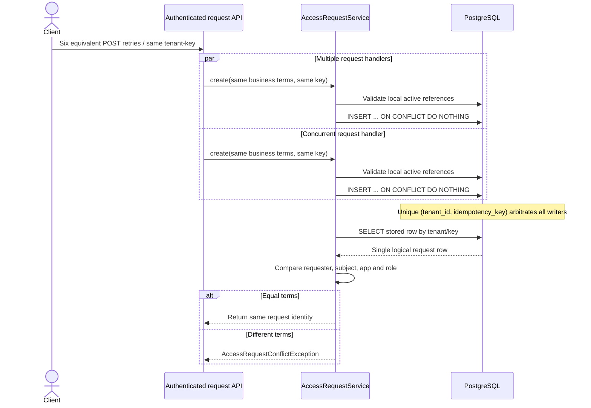

# Concurrency and Governance Learning Lab — IAM Portfolio v0.1.0

**Scope:** source-verified learning case studies for **Scenario 01 (six concurrent idempotent access-request retries)** and **Scenario 02 (two concurrent approval decisions and separation of duties)**. These scenarios supplement the [complete engineering guide](../portfolio/complete-engineering-guide.md) and [technical interview workbook](../portfolio/technical-interview-workbook.md). No new runtime behavior is proposed.

**Implementation baseline:** tagged `v0.1.0-portfolio` at commit `cf0e2fce324fa6c81bf5bccc4ee49dadf1925391`. Documentation added later does **not** change the historical release tag. The included Java/SQL behavior was inspected against the repository, not inferred from interview prompts.

## Study contract and evidence hygiene

For each scenario, explain (a) business requirement, (b) threat/failure, (c) code path, (d) SQL invariant, (e) transaction/concurrency timeline, (f) test evidence, (g) failure/limitation, and (h) production trade-off. Interview questions and hypothetical traces are teaching aids, not an assertion that a new test was run after writing this document.

**Recorded final release evidence (2026-11-14):** 16 Java unit, 105 Java integration, 33 Keycloak-helper Python and 22 security Python tests passed; Java CI and Security CI succeeded at the tagged SHA. The 5+46 curated demo executions rerun a subset of the Java suite. See [evidence register](../release/evidence-register.md). No real entitlements were granted, and live Keycloak interoperability remains unverified.

## Case Study 01 — Concurrent idempotent access-request intake

### Business context

An authorized tenant requester submits the same role request repeatedly after a timeout. Six calls may arrive together (the repository test deliberately uses six threads). Without stable idempotency a request might be created multiple times and later cause duplicated approvals or downstream intent.

### Use-case traceability

- **Original requirement:** [UC-001](../use-cases/UC-001-application-access-request.md), acceptance **A01** new pending request, **A08** equivalent retry converges, **A09** changed terms are rejected, **A04** foreign tenant denied.
- **Implemented sources:** `src/main/java/dev/asambataiden/iam/accessrequest/AccessRequestService.java`; `src/main/java/dev/asambataiden/iam/accessrequest/RequestActorResolver.java`; `src/main/java/dev/asambataiden/iam/accessrequest/AccessRequestController.java`.
- **Database:** `src/main/resources/db/migration/V1__create_access_request_foundation.sql` and V2 actor mapping.
- **Executable evidence:** `src/test/java/dev/asambataiden/iam/accessrequest/AccessRequestPersistenceIT.java`, particularly `parallelEquivalentRetriesProduceOneLogicalRow`, `createsPendingRequestAndReturnsSameRowOnRetry`, `changedTermsForSameTenantKeyAreRejected`, `differentBusinessTermsWithSameHttpIdempotencyKeyReturnConflict` and `tenantHeaderCannotOverrideAuthenticatedActor`.

### How the current implementation works

1. **Identity/permission at the HTTP boundary:** the requester's effective tenant and employee identity must be server-resolved from an authenticated JWT principal and local mapping, not from client-provided tenant or requester headers/JSON. In mock-JWT HTTP integration tests, `spring-security-test` supplies the principal; those tests do **not** prove live Keycloak signature validation.
2. **Input and eligibility:** `AccessRequestService.create(tenantId, requesterId, employeeId, applicationId, roleKey, idempotencyKey)` rejects null identifiers and blank/untrimmed/overlength role or key; a join confirms active actor, subject, application and role in the same tenant.
3. **Database arbitration:** each attempt runs `INSERT ... ON CONFLICT (tenant_id, idempotency_key) DO NOTHING`. V1 creates `uq_access_requests_tenant_key UNIQUE (tenant_id,idempotency_key)`. Competing JVMs therefore rely on PostgreSQL, not a process-local lock.
4. **Read after conflict:** each call queries by tenant and idempotency key. Whichever concurrent transaction wins the unique row becomes the stored source of truth.
5. **Compare intent:** if requester, employee, application or role differs from stored terms, throw `AccessRequestConflictException`; otherwise return the same stored `AccessRequest`.
6. **Transactional result:** `@Transactional` bounds the service operation. Composite tenant foreign keys reject wrong-tenant requester, subject and app-role references even if application checks are bypassed.
7. **API result:** the HTTP contract tests distinguish successful equivalent replay from conflicting request terms; status-code details belong to the controller tests, not the internal service method itself.

### Concrete SQL invariants

```sql
-- V1 (extract; authoritative full source is the migration file)
CONSTRAINT uq_access_requests_tenant_key UNIQUE (tenant_id, idempotency_key),
CONSTRAINT fk_access_request_requester
  FOREIGN KEY (tenant_id, requester_id) REFERENCES employees (tenant_id, id),
CONSTRAINT fk_access_request_employee
  FOREIGN KEY (tenant_id, employee_id) REFERENCES employees (tenant_id, id),
CONSTRAINT fk_access_request_role
  FOREIGN KEY (tenant_id, application_id, role_key)
  REFERENCES application_roles (tenant_id, application_id, role_key);
```

```sql
-- AccessRequestService.java (essential mechanism)
INSERT INTO access_requests
  (id, tenant_id, requester_id, employee_id, application_id, role_key, idempotency_key)
VALUES (?, ?, ?, ?, ?, ?, ?)
ON CONFLICT (tenant_id, idempotency_key) DO NOTHING;
```

### Sequence diagram — six concurrent retries



**Teaching note:** the diagram illustrates competing requests, not guaranteed scheduling or specific thread interleaving. The six-thread test uses `ExecutorService` and `CountDownLatch` to start contenders together; it is not a distributed six-server load test.

### Why not `synchronized`, a cache lock or check-then-insert?

A Java `synchronized` lock covers only one JVM instance; a horizontally replicated API can have independent locks. An ordinary “SELECT then INSERT” is susceptible to a race between the two statements. A cache lock creates an additional distributed failure dependency and still must not replace the database uniqueness guarantee. PostgreSQL constraints are the durable arbitration point.

### Expected behavior matrix

| Scenario | Expected evidence | Verified source |
|---|---|---|
| First valid submission | One PENDING row | `createsPendingRequestAndReturnsSameRowOnRetry` |
| Same tenant/key + same terms | Same stored ID, not another row | Same test and six-way concurrency test |
| Same tenant/key + different terms | Conflict, old row unchanged | `changedTermsForSameTenantKeyAreRejected`, HTTP variant |
| Cross-tenant employee/role | Rejection, no foreign linkage | `foreignTenantEmployeeCannotBeReferenced` |
| Disabled subject | Rejection | `disabledEmployeeCannotBeGrantedPendingRequest` |
| Header attempts to replace tenant | Authenticated tenant remains authoritative | `tenantHeaderCannotOverrideAuthenticatedActor` |

### Failure modes and limits

- A unique key does not validate authenticated identity, scope, resource eligibility or employee lifecycle; these require separate policy and checks.
- The implementation checks business intent after retrieving the stored row; it must never allow a reused key to silently change the original intent.
- An idempotent access request does not guarantee idempotent external provisioning: the later target adapter and outbox/inbox are different idempotency domains.
- A six-thread test validates one real PostgreSQL integration scenario but does not measure 10x throughput, lock latency or distributed availability.

### Interview answer, 60–90 seconds

> “The client supplies an idempotency key, but the API derives the tenant/requester from trusted identity mapping. The service checks tenant-local active references and inserts with PostgreSQL `ON CONFLICT DO NOTHING`, backed by a unique `(tenant_id,idempotency_key)` constraint. All concurrent calls then load the stored row and compare the original business terms: an equal retry returns the same request, while a changed request fails with conflict. We test six concurrent submissions with real PostgreSQL Testcontainers. A Java mutex would not protect requests across multiple JVMs, and we still need separate authorization controls before reaching this service.”

## Case Study 02 — Competing approvals, SoD and transactional audit

### Business context

One pending request is targeted by two **distinct, authorized** tenant approvers: A submits APPROVED while B submits REJECTED. Only one terminal transition may succeed, and the outcome, approver and audit evidence must not diverge. The requester must not approve their own request—even if they happen to hold the decision permission.

### Use-case traceability

- **Original UC-001 acceptance:** **A05** self-approval denied, **A06** cross-tenant approver denied, **A07** rejection creates no grant, **A10** two decisions race and exactly one legal decision survives.
- **Implemented sources:** `src/main/java/dev/asambataiden/iam/accessrequest/ApprovalDecisionController.java`, `DecisionActorResolver.java`, `ApprovalDecisionService.java`.
- **Database:** V3 approval decision and SoD constraints, V4 audit trigger, V5 approved-work trigger and V12 outbox trigger.
- **Executable evidence:** `src/test/java/dev/asambataiden/iam/accessrequest/ApprovalDecisionServiceIT.java` — `concurrentOpposingDecisionsAllowOnlyOneWinner`, `requesterCannotSelfApproveEvenWithGrant`, `authorizedDistinctApproverCanApproveOnce`, `distinctApproverCanRejectWithoutCreatingGrant`, `approvalPersistsMatchingAuditEventAtomically`, `auditInsertionFailureRollsBackRequestAndDecision`, `auditFailureAlsoRollsBackProvisioningIntent`.

### Actual service algorithm

1. The HTTP security filter requires `SCOPE_access:decide`; `DecisionActorResolver` maps validated identity to an active, authorized tenant employee. Security must not trust an approver/tenant ID from the decision JSON.
2. `ApprovalDecisionService.decide(tenantId,approverId,requestId,decision)` checks non-null input, then queries `employees` + `employee_permissions` for an active `ACCESS_REQUEST_DECIDE` approver.
3. Inside the `@Transactional` method, `SELECT ... FOR UPDATE OF ar` locks the tenant-local access-request row. The query also checks active subject and application.
4. The service obtains the original `requester_id` from the **locked stored row**, not from a client parameter, and rejects a self-decision.
5. Only `PENDING` may transition. `UPDATE ... WHERE status='PENDING'` ensures one legal state change and `INSERT access_decisions` records the winning approver/outcome.
6. V3 primary key `(tenant_id,request_id)` prevents multiple decisions; `chk_access_decisions_separation_of_duties` and composite FK bind the approver rule to the actual stored requester and tenant.
7. V4 `AFTER INSERT` trigger creates `approval_audit_events` inside the same transaction. A failure in audit insertion rolls back request state and decision; the approved-work/outbox trigger chain also shares the transaction.
8. The rejected path creates no approved provisioning work. The approved path only creates durable provisioning intent; neither path proves a real entitlement.

### PostgreSQL transaction timeline

```mermaid
sequenceDiagram
    actor A as Approver A APPROVED
    actor B as Approver B REJECTED
    participant S as ApprovalDecisionService
    participant DB as PostgreSQL
    A->>S: Decide request R
    B->>S: Decide same request R
    S->>DB: T1: verify permission + lock R FOR UPDATE
    Note over DB: T1 holds row lock while processing
    S->>DB: T2: tries lock R (waits)
    S->>DB: T1: PENDING -> APPROVED + decision insert
    DB->>DB: V4 audit trigger; V5 approved work; V12 outbox
    DB-->>A: T1 COMMIT
    Note over DB: T2 obtains lock and rechecks status
    DB-->>S: R is now APPROVED, not PENDING
    S-->>B: Terminal-state conflict; no second decision/audit
```

**Concurrency nuance:** either T1 or T2 can win; the diagram fixes A as winner only for illustration. The invariant is **one winner**, not “APPROVED always wins.” On a real database, `FOR UPDATE` serializes the competing requests; the second transaction must observe the current state after the first commits.

### Database protection and audit durability

```sql
-- V3
CONSTRAINT pk_access_decisions PRIMARY KEY (tenant_id, request_id),
CONSTRAINT chk_access_decisions_separation_of_duties CHECK (approver_id <> requester_id),
CONSTRAINT fk_decision_request_owner FOREIGN KEY (tenant_id, request_id, requester_id)
  REFERENCES access_requests(tenant_id, id, requester_id);
```

```sql
-- V4
CREATE TRIGGER trg_approval_decision_audit
AFTER INSERT ON access_decisions
FOR EACH ROW EXECUTE FUNCTION iam_record_approval_audit();
```

The V4 evidence table also has an `UPDATE/DELETE` rejection trigger. That is an application/ordinary-SQL mutation guard, **not WORM storage**; privileged DB users can bypass triggers, alter tables or database storage.

### Decision outcome matrix

| Scenario | Expected result | Mutation invariant |
|---|---|---|
| Active distinct approver + PENDING request | One APPROVED or REJECTED decision | One status transition and decision row |
| Two distinct approvers race | One winner, one conflicting decision | State and single decision remain consistent |
| Original requester tries approval, even with DECIDE grant | Forbidden | PENDING, no decision/audit |
| Permission revoked or actor disabled | Forbidden | No mutation |
| Subject/application unavailable | Denied | No terminal decision or provisioning |
| Unknown/foreign tenant request | Generic unavailable/denial | No foreign write/disclosure |
| Repeat after terminal decision | Conflict | Original decision not overwritten |
| Audit trigger insertion fails | Transaction rolls back | No status/decision/audit/work-intent divergence |
| REJECTED decision | Terminal rejection | No approved provisioning work/outbox intent |

### Why both locking and uniqueness?

- **Row lock:** serializes the business transition and lets the second contender observe the updated state.
- **State check:** encodes the legal `PENDING -> APPROVED|REJECTED` transition.
- **Primary key:** prevents a second evidence row even if a different writer bypasses the service.
- **SoD check and composite FK:** deny self-approval and forged requester identities at the DB boundary.
- **Single transaction + trigger:** keeps status, decision, audit and approved-work intent atomic.

Each control addresses a different failure mode; none alone replaces authentication and tenant/resource authorization.

### Interview answer, 90 seconds

> “The decision API first validates scope and maps the caller to an active tenant-local approver with `ACCESS_REQUEST_DECIDE`. The transactional service locks the target row using `SELECT ... FOR UPDATE OF ar`, reads the **stored** requester and rejects self-approval, checks `PENDING`, then updates status and inserts exactly one decision row. The V3 primary key and SoD check reinforce that invariant. The V4 trigger writes audit evidence inside the same transaction, and the approved path creates a work item/outbox intent through the trigger chain. If two approvers race, one commits and the other sees a terminal request and fails without a second decision. We verify the race, self-approval and rollback cases with PostgreSQL Testcontainers. None of these records is a real entitlement grant.”

## Combined risk model

| Risk | Trust boundary | Defense | Remaining limitation |
|---|---|---|---|
| Duplicate request after timeout | API → DB | Tenant-scoped unique idempotency key + compare-on-replay | Does not deduplicate external target side effects |
| Client spoofs tenant/requester | Bearer identity → local actor | JWT identity mapping, active employee + permission | Live Keycloak positive API interoperability unverified |
| Six workers race | JVM → PostgreSQL | Unique constraint, transaction | Load/availability benchmarking absent |
| Self-approval | Approver → persisted request | Stored requester comparison + V3 SoD CHECK/FK | Production delegated policy not demonstrated |
| Two approvers race | Concurrent DB transactions | `FOR UPDATE`, terminal-state check, PK | Distributed multi-region write strategy not implemented |
| Audit gap after partial commit | Decision → audit | V4 trigger in same transaction | Privileged DB tampering possible |
| APPROVED mistaken for GRANTED | Governance → external target | Separate durable work/outbox intent | No production target connector exists |

## Guided exercises

### Lab A — Six concurrent identical requests

1. Run `mvn -B --no-transfer-progress -Dit.test=AccessRequestPersistenceIT -DfailIfNoTests=false verify` with Docker running.
2. Locate `parallelEquivalentRetriesProduceOneLogicalRow`.
3. Identify its `ExecutorService` (six worker threads), `CountDownLatch` start barrier, equality assertions and database row-count assertion.
4. Trace `AccessRequestService.create` and V1 uniqueness/composite FKs.
5. Explain the expected effects of changing one call's role while keeping the same tenant/key. **Do not edit production tests without a reviewed PR**; reason from `changedTermsForSameTenantKeyAreRejected`.
6. Record the observed test result and commit SHA rather than writing “PASS” without execution.

### Lab B — Competing APPROVED and REJECTED decisions

1. Run `mvn -B --no-transfer-progress -Dit.test=ApprovalDecisionServiceIT -DfailIfNoTests=false verify`.
2. Locate `concurrentOpposingDecisionsAllowOnlyOneWinner` and its latch/two-thread timeline.
3. Trace `ApprovalDecisionService.decide`, `SELECT ... FOR UPDATE OF ar` and the PENDING guard.
4. Inspect V3, V4, V5 and V12; explain atomic audit/work/outbox behavior for APPROVED and absence of work for REJECTED.
5. Locate `auditInsertionFailureRollsBackRequestAndDecision` and `auditFailureAlsoRollsBackProvisioningIntent`.
6. Explain how self-approval is denied independently of whether the employee possesses the DECIDE permission.

### Lab C — Evidence and interview presentation

1. Run the full tagged-release suite: `mvn -B --no-transfer-progress clean verify`; separately run the Python tests or consult [final immutable evidence](../release/evidence-register.md).
2. Compare `AccessRequestPersistenceIT` (service concurrency and mocked HTTP JWT actor) with `SignedJwtHttpFilterIT` (signed ephemeral JWT through servlet filter).
3. Present both case studies in less than four minutes, emphasizing correctness, why the database is authoritative and evidence limits.
4. Use [the interview workbook](../portfolio/technical-interview-workbook.md) questions Q05–Q11 for self-assessment. Score yourself 0–3 and record specific gaps, not subjective labels.

## Learning notes — what, why, how, what can fail, what to revisit

**What was learned:** idempotency is a durable business-operation identity, not simply request retries; concurrency safety needs storage-level arbitration; approval SoD needs the persisted requester; audit must share the outcome transaction; authentication and local resource policy are separate.

**Why these patterns matter:** retries, process restarts and competing workers are normal operating conditions. A check that works only with one Java process or happy-path caller is insufficient.

**How to extend safely:** preserve Flyway migration immutability, add tests for new invariants, guard before any external side effects, continue using feature branches and four CI checks, and never introduce a production broker/target as part of a documentation change.

**What remains unproven:** real Keycloak bearer interoperability, real provisioning, production performance, end-to-end access revocation, high availability, disaster recovery and independent security certification.

## Quick reference index

- [Original UC-001 business contract](../use-cases/UC-001-application-access-request.md)
- [Implementation guide and architecture](../portfolio/complete-engineering-guide.md)
- [Technical interview workbook](../portfolio/technical-interview-workbook.md)
- [Milestone 01A: persistence invariants](../milestones/01a-persistence-invariants.md)
- [Milestone 03B: transactional approval](../milestones/03b-approval-service-state-machine.md)
- [Milestone 04A: transactional audit](../milestones/04a-transactional-approval-audit.md)
- [Milestone 04G: transactional outbox](../milestones/04g-transactional-outbox.md)
- [Release evidence register](../release/evidence-register.md)

**Documentation acceptance:** a reviewer can navigate from each stated invariant to the code, migration, named test and appropriately scoped evidence. This page is educational and does not modify the tagged release or add new IAM implementation features.
