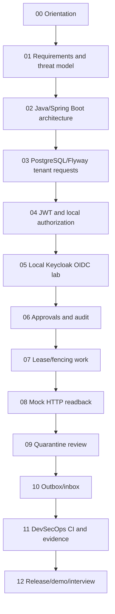

# Enterprise IAM — Learning Curriculum (Start Here)

**Recommended start:** [Lesson 00](00-orientation-and-prerequisites.md). This is a complete, **sequential study track for the existing capstone**, not a proposal to rewrite code. The released implementation is `v0.1.0-portfolio`, tagged at `cf0e2fce324fa6c81bf5bccc4ee49dadf1925391`. Documents added later do not change that historical tested tag.

## How to use this directory

1. Follow Lessons **00 through 12** in order; read the **learning outcome** before opening code.
2. Work through each numbered **step-by-step implementation walkthrough** on the tagged implementation or current main. Inspect relevant Java classes, migrations and tests.
3. Explain each **Mermaid architecture/sequence diagram** yourself and state its trust or transaction boundaries.
4. Run only the safe **existing** tests with Docker/Testcontainers; record the observed result and Git SHA. Never substitute simulated observations for real entitlement evidence.
5. Complete the checkboxes and practice interview questions. Cross-reference the [use-case catalogue](../use-cases/README.md), [architecture index](../architecture/README.md), [milestone history map](13-implementation-provenance-and-milestone-map.md) and [technical workbook](../portfolio/technical-interview-workbook.md).

## Lesson roadmap

| Order | Lesson | Milestone foundation | Goal |
| --- | --- | --- | --- |
| 00 | [Orientation / prerequisites](00-orientation-and-prerequisites.md) | Milestone 00 | Business scope, setup and test-first evidence |
| 01 | [Requirements / ADRs / threat model](01-requirements-threat-model-and-architecture-decisions.md) | Milestone 00 | Actor, tenant, trust boundary and initial acceptance cases |
| 02 | [Java/Spring Boot architecture](02-java-spring-boot-module-structure.md) | Milestone 00 + refactor | Code navigation and module boundaries |
| 03 | [PostgreSQL / Flyway / request idempotency](03-postgresql-flyway-tenant-persistence.md) | 01A/01B-2 | V1/V2 and cross-tenant constraints |
| 04 | [JWT trust / Spring Security / local permissions](04-spring-security-jwt-and-actor-mapping.md) | 01B, 05A, 06B-2 | 401 vs 403 and cryptographic test distinctions |
| 05 | [Keycloak / OIDC / PKCE lab](05-keycloak-oidc-pkce-local-lab.md) | 01C/06A | Discovery, JWKS, optional browser flow and limitations |
| 06 | [Approvals / separation of duties / audit](06-approval-sod-and-transactional-audit.md) | 03A–03D, 04A | V3/V4, row locking and transactional audit |
| 07 | [Provisioning work / leases / fencing](07-provisioning-intent-leases-and-fencing.md) | 04B–04D | V5–V7 state coordination |
| 08 | [Target adapter / mock HTTP / reconciliation](08-adapter-contract-mock-http-reconciliation.md) | 04E | V8/V9 and uncertain network outcomes |
| 09 | [Quarantine / review / read-only inspection](09-quarantine-inspection-and-review-evidence.md) | 04F | V10/V11 and operator safety |
| 10 | [Outbox / relay / inbox](10-transactional-outbox-relay-and-inbox.md) | 04G | V12–V14 at-least-once and local deduplication |
| 11 | [DevSecOps / testing / CI evidence](11-testing-devsecops-supply-chain-and-evidence.md) | 05A/05B | Gitleaks, Trivy, SpotBugs, pinned actions |
| 12 | [Portfolio release / operations / interviews](12-release-demonstration-operations-and-interview.md) | 06 / RC-A–RC-C | Release SHA, runbooks and bounded claims |

## What existed before this curriculum

- [Engineering implementation & interview ledger](iam-engineering-implementation-and-interview-ledger.md) records early chronological observations, including actual local lab problems, fixes and milestones up to an early PR. It remains a historical **snapshot**, not the current complete curriculum.
- [Lesson 19 — Concurrency case studies](19-concurrency-idempotency-approval-case-studies.md) covers six-way request retries and opposing approvals in depth. It is a supplemental specialist lab; Lesson 03 and Lesson 06 explain the prerequisite concepts first.
- The approximately forty-four files under [milestone notes](../milestones/) are retained as chronological evidence and incremental decision history. Their old “draft / future / pending” authoring-time statements may be superseded by later merged implementation; see the [as-built capability matrix](../architecture/capability-matrix.md).
- [Full engineering guide](../portfolio/complete-engineering-guide.md) is the single-page project summary; [interview workbook](../portfolio/technical-interview-workbook.md) is the practice/assessment companion.

## Knowledge progression



## Study resources and commands

```bash
# From the existing repository root (Java 25, Maven 3.9+, Docker running).
git rev-parse HEAD
mvn -B --no-transfer-progress clean verify
python3 -m unittest discover -s ops/keycloak -p 'test_*.py'
python3 -m unittest discover -s ops/security -p 'test_*.py'
bash ops/demo/run-portfolio-demo.sh
```

These commands are **instructions**, not a fresh validation claim for this documentation branch. The recorded release evidence at the tagged commit is 16 Java unit, 105 Java integration, 33 Keycloak Python and 22 security Python tests, with green Java/Security CI. The curated demo repeats 5+46 Java test executions.

**Not established:** real external application entitlement provisioning, production broker/listener, cloud HA deployment, tested recovery/SLOs, live Keycloak JWT-to-API success in the tagged portfolio, or independent security certification. Every lesson preserves these boundaries.

## Definition of “lesson completed”

You can explain the business need, annotate the actual class/SQL migration, draw a sequence, predict at least one negative or concurrency scenario, identify the executable test and its limits, and state the next measured production gate. Recording “watched/read” without a practical understanding is not the completion criterion.
