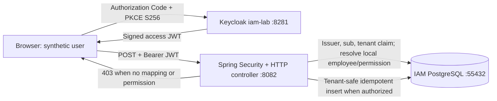

# Enterprise IAM — Engineering Learning & Interview Evidence Ledger

**Purpose:** A durable, chronological record of *what we built, why, how, tests, failures, fixes, limitations and interview explanations*. Read with the individual [milestone notes](../milestones/). This ledger distinguishes **observed local output**, **verified hosted CI** and **proposed future work**; it must never claim approval/provisioning functionality that does not exist.

**Snapshot:** after PR #7 (squash commit `e5172ac535252cfa7219fd797ece5ace29c08cd4`). Local environment: macOS/Zsh, Java 25, Spring Boot 4.1.2, Maven, PostgreSQL 17, Keycloak 26.8.2. All URLs/ports below describe *disposable localhost development*, never production.

## System purpose and bounded vocabulary

An employee requests a role in an application belonging to the same tenant. **Access request** means a persisted `PENDING` intent; it is **not** a granted entitlement. **Authentication** establishes a signed identity; **authorization** checks whether this known employee may create the request. **Approval**, **SoD**, **provisioning**, **recertification** and **auditing** remain separate milestones.



**Core trust rule:** even a correctly signed token carrying `tenant_id` and `access:request` does not grant IAM access by itself. The server must bind trusted `iss + sub + tenant` to an *active local employee* with explicit `ACCESS_REQUEST_CREATE`. A request payload or spoofed header cannot override the caller's tenant or requester.

## Chronological engineering milestones and evidence

| Increment | What / why | Implemented artifact | Verification and boundary |
| --- | --- | --- | --- |
| 00 | Small Spring Boot/Java 25 foundation; deny by default, allow health | Application/CI baseline | Startup and hosted CI; no IAM workflow |
| 01A — PR #1 | Persist tenant-scoped access requests; DB as final integrity boundary, idempotent retries | Flyway V1; `AccessRequestService`; PostgreSQL 17 Testcontainers | Local and CI tests of retry/conflict, wrong tenant, inactive employee and concurrency; **no HTTP auth** |
| 01B bootstrap — PR #2 | Avoid Spring Boot generated-password development user | Exclude unused `UserDetailsServiceAutoConfiguration` | Hosted CI green; no accidental bootstrap user |
| 01B-1 — PR #3 | Stateless JWT resource server; restrict API route | Spring Security bearer/JWKS/issuer/audience and scope | Negative HTTP filter tests; **not live Keycloak** |
| 01B-2 — PR #4 | Authenticated POST with server-resolved actor and local permission | Flyway V2; `RequestActorResolver`; `AccessRequestController` | Mock JWT policy tests plus PostgreSQL; **mock JWT does not validate signature** |
| 01B-3 — PR #5 | Cryptographically reject wrong signature, issuer, audience and expiry | `SignedJwtTrustValidationTest` with ephemeral RSA test keys | 5 signed-token unit tests; **in-memory test decoder, not a live IdP** |
| 01C-1 — PR #6 | Isolated local Keycloak, discovery and JWKS checks | `ops/keycloak/compose.yaml`, synthetic realm import, metadata checker | **Observed** Keycloak `26.8.2`, `iam-lab` import, discovery issuer/JWKS match, RSA key advertised; not a token/API test |
| 01C-2 — PR #7 | Real user login without Resource Owner Password grant; repeatable synthetic identity | Public `iam-lab-cli`, Authorization Code + S256 PKCE, `provision-synthetic-user.py`, local DB Compose, smoke script | **Observed** successful PKCE token exchange; decoded issuer/audience/scope/tenant flags true; API HTTP **403** without local permission mapping. This is the **negative authorization path**, not successful creation |

**Verified baseline at completion of PR #7:** CI `mvn -B --no-transfer-progress clean verify`: **6 unit tests + 13 integration tests**, 0 failures, plus static PKCE/realm checks. [PR #7](https://github.com/asambataiden/enterprise-identity-access-platform/pull/7) and [CI run](https://github.com/asambataiden/enterprise-identity-access-platform/actions/runs/43135400479). Initial local 01B verification also passed 19 tests. PRs were squash merged to `main`; use Git history and PR reviews as source-of-truth for actual changes.

## Failure → diagnosis → correction → lesson

| Observed symptom | Root cause / evidence | Fix / verification | Generalizable lesson |
| --- | --- | --- | --- |
| Zsh `read: -p: no coprocess` | Commands used Bash `read -p` in interactive macOS Zsh | Used `read -r "VAR?Prompt"` and `read -rs` | Scripts must declare interpreter; interactive shell syntax is not portable |
| Keycloak bind error on `127.0.0.1:8081` | Existing Mongo Express already occupied host 8081; curl hit a different service and returned 401 | Move IAM-only Keycloak host binding, issuer and JWKS to `127.0.0.1:8281`; metadata checks passed | Enumerate host-port dependencies; never stop unrelated workloads to solve a collision |
| `curl: (52) Empty reply from server` immediately after `up -d` | Container running was not yet proof of readiness | Retry after startup; logs confirmed realm imported; OIDC discovery passed | Separate container started vs service ready; add bounded health/readiness checks |
| Compose orphan warning | Keycloak and IAM PostgreSQL used the same default Compose project name | No `--remove-orphans`; both services ran independently. **Separate project names remain a cleanup task** | Avoid destructive convenience flags, especially on shared developer hosts |
| PKCE script timed out | Local callback server reachable, but initial browser login didn't finish; initial handler also handled only one HTTP request | Callback code amended to listen across unrelated requests and to distinguish OAuth errors/timeouts; `curl /` returned expected 404 | Verify each hop independently; never infer that a callback timeout is a token problem |
| Keycloak login said invalid credentials | Synthetic user password unusable; no token issued | Admin API provisioner explicitly rotated synthetic password (without logging); next actual login succeeded | Deterministic, idempotent identity setup beats manual UI drift |
| Provisioner refused missing admin environment variables | A new shell had no `IAM_LAB_ADMIN_USERNAME` or `IAM_LAB_ADMIN_PASSWORD` | Zsh hidden password input; provisioning PASS | Environment scope and secret lifecycle are part of reproducibility |
| Signed token accepted, API returned 403 | Synthetic identity had no local employee mapping or `ACCESS_REQUEST_CREATE` grant | **Expected security denial** observed after real PKCE exchange | Authentication success is not authorization success; deny by default |

## Implementation reasoning: what, why, how

### 1. DB invariants, not just service-side `if` statements

The relational model contains tenants, employees, applications, application roles and access requests. Composite tenant-scoped foreign keys prevent cross-tenant references at the storage layer. `(tenant_id, idempotency_key)` is unique to converge concurrent retries. The service compares terms when a key repeats and rejects a key reused with a different request. **Why:** concurrency and process crashes can invalidate purely in-memory checks. **Tradeoff:** stronger relational coupling and schema/migration discipline.

### 2. Security boundary before a public controller

Bearer-only HTTP authentication, trusted issuer/JWKS/audience validation, coarse OAuth scope and a default-deny posture are distinct from business permission. The controller trusts `Jwt` only *after* Spring Security validation; actor mapping requires database verification. `tenantId` and `requesterId` are not accepted from the request JSON. **Why:** claim possession is not proof of employee membership/permission; client metadata can be spoofed.

### 3. Three different kinds of tests

- `jwt()` Spring Security test principals: exercise controller mapping and authorization branches quickly, but skip token cryptographic verification.
- In-memory RSA-signed JWT tests: verify cryptographic signature plus issuer/audience/expiry rejection, but not remote JWKS discovery.
- Local Keycloak browser PKCE smoke: obtains a real signed token and sends it to the running API. The helper decodes claims for **information only**, never as a cryptographic authority; Spring Resource Server validates credentials. Observed 403 after the successful PKCE login supports **fail-closed authorization**, not a granted request.

**Why this separation matters in interviews:** a unit test with an injected mock principal cannot substantiate an end-to-end identity-provider integration claim.

### 4. PKCE and principle of least privilege

`iam-lab-cli` is a **public** OIDC client using Authorization Code + PKCE S256, exact loopback redirect, no implicit flow, no password grant, no client secret. The synthetic `tenant_id` user attribute is mapped into the access token, along with a purpose-limited API audience and optional access-request scope. The local Admin API bootstrap script currently uses high-privilege `admin-cli` password flow **only to create/update the lab test user**, not to log the user into the application. **Production change required:** TLS, dedicated least-privilege service account (Client Credentials/private key), robust secret management, auditable change controls and lifecycle policies.

### 5. Idempotent synthetic user provisioning

The user script:
1. Authenticates to the **local** Keycloak Admin API with runtime-provided lab bootstrap credentials.
2. Ensures the `tenant_id` profile attribute exists without weakening an existing admin-edit policy.
3. Finds or creates exactly `iam-lab-test-admin`.
4. Reconciles `enabled` and the synthetic tenant UUID.
5. Rotates a password **only** when first created or explicitly requested via `--rotate-password`.
6. Reads back the resulting record and prints PASS without emitting credentials or access tokens.

**Why:** the same operator command produces the intended state without resetting every credential on each invocation.

## Security verification matrix

| Scenario | Expected | Verified by current evidence? |
| --- | --- | --- |
| Anonymous POST | 401 | Yes, security integration tests |
| Invalid JWT signature/issuer/audience/expiry | Rejected | Yes, offline RSA JWT tests |
| JWT with wrong/missing scope | 403 | Yes, mocked-JWT policy tests |
| Valid Keycloak JWT but no local employee grant | 403 | **Yes, locally observed with real OIDC login** |
| Authorized mapped identity creates request | 201 | **No — next milestone 01C-3** |
| Same request + idempotency key retries | Same persisted row | Yes, internal/API mocked-auth tests; **not yet real Keycloak positive flow** |
| Reused key with different terms | 409 | Yes, existing service tests; live token path unverified |
| Wrong-tenant target rejected | 404/generic denial | Yes, persistence/mock policy tests; live token path unverified |
| Cross-tenant user claims/roles cannot grant authorization | 403 | Test scenarios exist in layers; dedicated real-token adversarial test pending |
| Access approval, SoD, downstream provisioning | Strict controlled state changes | **Not implemented** |

## Operational commands and evidence hygiene

```bash
# Full unit + PostgreSQL integration test suite (Docker required)
mvn -B --no-transfer-progress clean verify

# Static Keycloak fixture validation
python3 ops/keycloak/check-pkce-fixture.py

# Live discovery and signing-key metadata
bash ops/keycloak/check-metadata.sh

# Reconcile only the local synthetic user; requires runtime admin variables
python3 ops/keycloak/provision-synthetic-user.py

# Use --rotate-password only when reset is intended
# Real browser Authorization Code + PKCE negative test:
python3 ops/keycloak/oidc-pkce-smoke.py
```

All runtime log copies must redact tokens, passwords, OAuth callback query strings, secrets and PII. Store only benign evidence such as commit SHA, test result summaries, key protocol outcomes and HTTP codes. Local database uses `127.0.0.1:55432` and disposable storage; Keycloak uses `127.0.0.1:8281`, and Java API uses port `8082`.

## Interview preparation — concise questions and precise answers

**Q1: Why didn't you implement user provisioning first?**  
A: We first established storage isolation, trusted actor resolution, bearer authentication and deny-by-default behavior. Granting entitlements before proving tenant boundaries would create unacceptable authorization risk.

**Q2: What is the difference between OAuth scope and the local permission table?**  
A: The signed token's `access:request` scope gates API access at the resource-server layer; `employee_permissions.ACCESS_REQUEST_CREATE` is the application-owned authorization rule, checked with an active tenant employee mapping.

**Q3: How do you prevent tenant spoofing?**  
A: No tenant/requester identity is accepted from caller-supplied body or headers; the signed token's `iss/sub/tenant_id` are resolved against persisted tenant-bound identity records and a local permission. Composite FKs enforce tenant consistency for business targets.

**Q4: Why a database unique constraint for idempotency?**  
A: It provides arbitration across threads and instances, even if requests race or an application process restarts; business-term comparison distinguishes legitimate retry from key misuse.

**Q5: What did the live Keycloak integration test prove?**  
A: A synthetic user authenticated with Authorization Code + PKCE, received a token carrying the expected issuer/audience/scope/tenant claims, and the resource server returned 403 without a local authorization grant. It did **not** prove the positive 201 path or full IAM provisioning.

**Q6: Why no Resource Owner Password grant for the app client?**  
A: The public OIDC browser client uses authorization code with S256 PKCE. The temporary administrator-password grant is restricted to local bootstrap automation and should be replaced by a scoped service account for production.

**Q7: What happens at 10x traffic or a database outage?**  
A: We haven't benchmarked IAM load or proven resilience under outage. Target properties include bounded connection pools, stable idempotency keys, transactional insertion, safe error mapping and backpressure; future work must measure p95/p99 and failure behavior rather than assume scalability.

**Q8: What would you change before production?**  
A: TLS and external secret store, least-privilege Admin API automation, lifecycle/approval/SoD, audit trails, production Postgres durability/backups, token key rotation tests, proper deployment and runtime monitoring, threat-model-driven adversarial tests, and CI-driven provisioning.

## 01C-3 exit criteria (planned; NOT done)

- [ ] Reproducible **test-only** tenant, employee, role, application and identity fixture with explicit ownership; no privileged SQL applied to any non-lab database.
- [ ] Trusted Keycloak `iss/sub` bound to local active employee and an `ACCESS_REQUEST_CREATE` grant; log/record no secret access tokens.
- [ ] Real Keycloak JWT + valid target produces HTTP **201**, persisted `PENDING`.
- [ ] Same terms/idempotency key preserve row identity; changed terms produce 409.
- [ ] Deny unmapped/disabled/unauthorized/cross-tenant actors and targets; verify error codes without data leakage.
- [ ] Automated reproducible environment bring-up, readiness, independent checks, cleanup, GitHub CI and redacted evidence.
- [ ] Avoid fragile production assumptions from the lab's HTTP, admin-cli bootstrap, ephemeral Keycloak DB and disposable PostgreSQL.

## Career/portfolio presentation (use only after checks are substantiated)

**CV-safe current claim:** "Implemented a Java 25/Spring Boot 4 resource server for tenant-scoped IAM access-request intake using PostgreSQL/Flyway, idempotency constraints, Keycloak OIDC Authorization Code + PKCE, and layered authorization tests. Validated real signed-token login with expected HTTP 403 fail-closed behavior; automated local synthetic identity provisioning and CI."

**Not yet warranted:** "Built a production IAM platform", "implemented entitlement provisioning", "SOC 2/ISO 27001 certified", "proved horizontal scalability", or "completed real-token authorized 201 flow".

## Maintaining this learning record

For every subsequent PR record: **problem → functional/security requirements → architecture/ADR → changed files → command sequence → verified evidence → failed attempts/root causes → threat/tenant boundary → operational runbook/cleanup → lessons → interview questions → remaining risks**. Change statuses only with linked CI or observed local output. When a milestone doc says *pending* from its original proposal, this ledger provides the later verified status without rewriting history.
