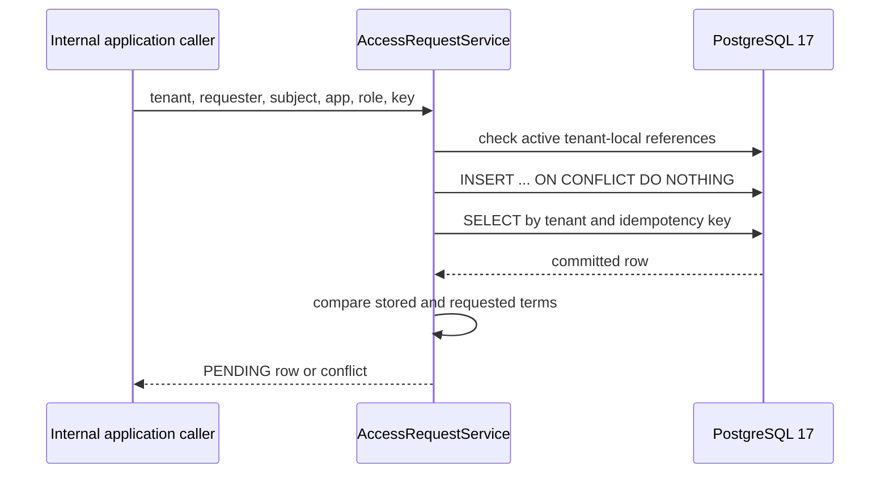

# Milestone 01A — Tenant-scoped persistence and retry safety

**Status:** implementation proposed in feature branch, pending green hosted Java CI.  
**Scope:** internal service only. This is **not** a functional authenticated IAM API, access approval, entitlement grant or application provisioning system.

## Problem

An organization needs to record a requested application entitlement without allowing one tenant to bind a request to another tenant's employees, application or roles. Network retries and parallel requests must not generate multiple logical access requests.

## Invariants

- Tenant, requester, employee, application and role are modeled as persistent UUID-based entities. The role belongs to an application and tenant.
- Composite foreign keys enforce tenant consistency for requester, employee and application role.
- Creation requires the requester and subject employee, application and role to be active/present.
- A unique constraint on `(tenant_id, idempotency_key)` arbitrates concurrent retries.
- Same tenant/key and equal request terms return the same row; a reused key with changed terms raises `AccessRequestConflictException`.
- Requests start in `PENDING` and cannot transition in this milestone.
- **Identity/roles are not authenticated yet.** `AccessRequestService.create(...)` receives internal identifiers from its caller. The service must not be called from an HTTP controller until trusted JWT tenant/actor mapping and application permissions are implemented. The initial `/actuator/health` exception and deny-all policy stay intact.
- This is not approval, separation-of-duties enforcement or application account provisioning.

## Persistence sequence



The transaction encompasses reference checks, insertion and subsequent read. Composite FKs still defend against inconsistent references if the state changes between application checks and insertion. A later increment will re-check employee status at **approval and provisioning**, not merely at intake.

## Tests and scope

`AccessRequestPersistenceIT` uses disposable PostgreSQL 17 through Testcontainers and covers:

1. New PENDING request and idempotent equivalent retry.
2. Changed terms under a reused tenant-scoped key.
3. A subject from a different tenant.
4. A disabled employee.
5. Six concurrent equivalent requests converging on one database row.

The initial `IamApplicationTest` is a fast class-presence smoke test; the *IT suite* loads the actual Spring context, Flyway migrations and database. Hosted CI must run `mvn -B --no-transfer-progress clean verify` with Docker support. No new measurement should be reported until that run is green.

## Local prerequisites

Use Java 25, Maven 3.9+, Docker and a running Docker daemon. Tests use Testcontainers without connecting to a user-supplied database.

```bash
mvn -B --no-transfer-progress clean verify
```

Running the real application separately requires an explicitly configured PostgreSQL database (`DB_URL`, `DB_USERNAME`, `DB_PASSWORD`). The default URL points only to `127.0.0.1`; it is not an embedded test database and no credentials are bundled. Do not commit `.env` files.

## Remaining acceptance work

- JWT/OIDC validation, tenant and actor identity mapped from Keycloak token (A02–A04).
- Requester's administrative permission and resource-aware authorization (A01/A03).
- Self-approval prohibition and second approver workflow (A05–A07).
- Revocation, provisioning, audit and lifecycle concurrency (A10–A11).

These are **not** claimed as implemented by the persistence milestone.

## Engineering discussion

**Why a database unique constraint rather than synchronization?** Java locks do not coordinate separate JVM instances; the DB provides durable arbitration per tenant/key.

**Why not use only foreign keys?** They ensure referential consistency, not lifecycle eligibility, authenticated permissions or separation of duties. The use-case and authorization layers must enforce those additional rules.

**Why not implement the API first?** Exposing internal caller-provided tenant IDs before JWT mapping would create a serious confused-deputy and cross-tenant authorization risk.
