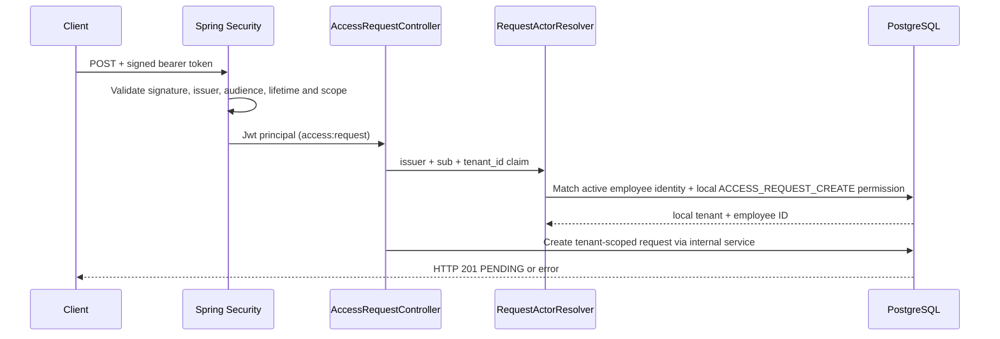

# Milestone 01B-2 — Authenticated access-request intake

**Status:** feature branch, pending Java CI verification. This increment implements POST-only access request creation, **not** approval or entitlement provisioning.

## Trust flow



## Security decisions

- No anonymous creation; coarse permission `SCOPE_access:request` required.
- Identity is resolved through local `employee_identities` mapping keyed by tenant, trusted issuer and subject; the raw tenant claim is **not** sufficient without the corresponding persisted mapping.
- Explicit `employee_permissions` grants `ACCESS_REQUEST_CREATE` to an active tenant employee. Unknown, unmapped, disabled or unpermitted subjects fail closed with HTTP 403.
- Request JSON contains only `employeeId`, `applicationId` and `roleKey`. `tenantId` and `requesterId` are never taken from the payload or X-Tenant-Id / X-Requester-Id headers.
- The existing V1 composite FK and tenant-scoped unique idempotency constraint remain authoritative.
- Cross-tenant/unknown target references return a generic 404; changed terms under the same key return 409.
- Stateless bearer-only configuration disables CSRF. This is acceptable for this API **only while** it does not rely on cookie-based authentication.
- Subject mappings and permissions are test fixtures / database-managed in this milestone; a controlled administrative grant workflow is **not** implemented yet.

## Test separation

Testcontainers PostgreSQL tests use Spring Security's `jwt()` mock test principal to validate **controller and access-policy behavior**. The mock test helper bypasses cryptographic signature and issuer/audience validation; it must **not** be represented as proof of a real Keycloak deployment or signed JWT validation. Additional real signed-token negative tests and live IdP compatibility checks are required before claiming end-to-end authentication interoperability.

No real user accounts, secrets, privileges or Keycloak passwords are committed.

## Suggested verification

```bash
mvn -B --no-transfer-progress clean verify
```

Check Surefire/Failsafe reports and GitHub Java CI before merging. Intended cases: accepted mapped requester, equivalent retry, unmapped actor denial, wrong scope denial, spoofed tenant headers denial and retained persistence concurrency tests.

## Deferred

- Lifecycle provisioning, approval, separation-of-duties and audit.
- Administrative identity-mapping workflow and periodic access review.
- Signed JWT integration test using a local test key and explicit issuer/audience mismatch cases.
- Live Keycloak instance and OIDC end-to-end verification.
