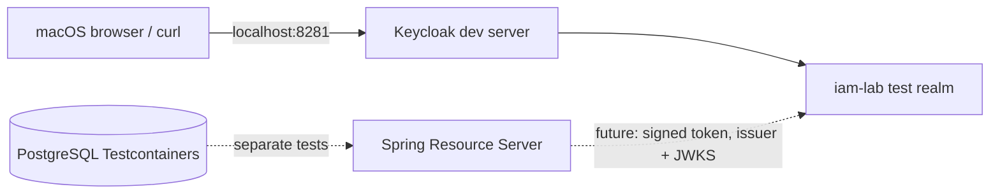

# Milestone 01C-1 — Local Keycloak OIDC metadata lab

**Status:** lab scaffolding committed; local container execution and token-based API verification require operator-run evidence. This milestone **does not** claim full Keycloak interoperability.

## What this establishes

An isolated, localhost-only Keycloak 26.8.2 instance imports a synthetic `iam-lab` realm at startup. The lab's discovery endpoint exposes `issuer` and `jwks_uri`, which are compared with the Spring Resource Server defaults already in `application.yml`.



**Current scope:** Keycloak discovery and signing-key metadata only. The Java tests already verify standalone RSA signature, issuer, audience and expiry checks; the API authorization tests currently mock authenticated JWT principals. These are not a substitute for sending a real Keycloak-issued token to the running API.

## Security model

- Local-only binding: `127.0.0.1:8281` on your Mac.
- Keycloak `start-dev` is explicitly insecure and **never** a production deployment.
- A lab-specific bootstrap administrator password is supplied through environment variables, not stored in Git or `.env` files.
- The imported realm disables self-registration; no users or passwords are included.
- `sslRequired: none` exists **only** for localhost HTTP experimentation.
- The Keycloak container has a bounded memory allocation, an immutable version tag (not `latest`) and a read-only realm import mount.
- No automatic creation of IAM administrator mappings or application grants.

## Operator commands (from repo root on your Mac)

```bash
ROOT="$(git rev-parse --show-toplevel)"
cd "$ROOT"

# Use a unique LAB-only bootstrap administrator secret.
read -r "IAM_LAB_ADMIN_USERNAME?Lab admin username: "
read -rs "IAM_LAB_ADMIN_PASSWORD?Lab admin password: "
printf '\n'
export IAM_LAB_ADMIN_USERNAME IAM_LAB_ADMIN_PASSWORD

# Inspect the rendered local configuration before starting anything.
docker compose -f ops/keycloak/compose.yaml config --quiet
# Check local host port is free before `up`.
lsof -nP -iTCP:8281 -sTCP:LISTEN || true

# This will download/start one local Keycloak development container.
docker compose -f ops/keycloak/compose.yaml up -d
docker compose -f ops/keycloak/compose.yaml ps

# Retry when Keycloak has finished booting:
bash ops/keycloak/check-metadata.sh
```

The realm's OIDC discovery URL is `http://127.0.0.1:8281/realms/iam-lab/.well-known/openid-configuration`.

**Credential handling:** do not paste environment-variable contents, real access tokens, bootstrap passwords or admin-session output into ChatGPT or GitHub. The shell environment retains the password until you `unset IAM_LAB_ADMIN_PASSWORD IAM_LAB_ADMIN_USERNAME`; avoid using long-lived credentials.

## Shutdown

```bash
docker compose -f ops/keycloak/compose.yaml down
unset IAM_LAB_ADMIN_USERNAME IAM_LAB_ADMIN_PASSWORD
```

This local developer server uses ephemeral dev storage with no persistent volume, so realm users or configuration changes disappear when the container is removed. Repeated `up` will not re-import a realm that is already present; `down` removes the container (not user files). Do not use `down -v` or prune Docker resources as a tutorial shortcut.

## Acceptance evidence

- [ ] Exact Keycloak image and container state observed on your Mac.
- [ ] Expected issuer URI and JWKS URI verified from live OIDC discovery.
- [ ] A signing key advertised in JWKS.
- [ ] No public port exposure.
- [ ] Safe container shutdown verified.

**Next separately gated subincrement:** configure a synthetic OIDC client (Authorization Code + PKCE), a synthetic user and explicit `aud` and `scope` mappings; bind their issuer/subject to a local employee fixture; then exercise the real HTTP API with token validation and resource-level denials. Avoid the deprecated password grant for convenience.

## Reference

- [Keycloak official container guide](https://www.keycloak.org/server/containers)
- [Keycloak import documentation](https://www.keycloak.org/server/importExport)
- [Original IAM JWT configuration](../../src/main/resources/application.yml)
