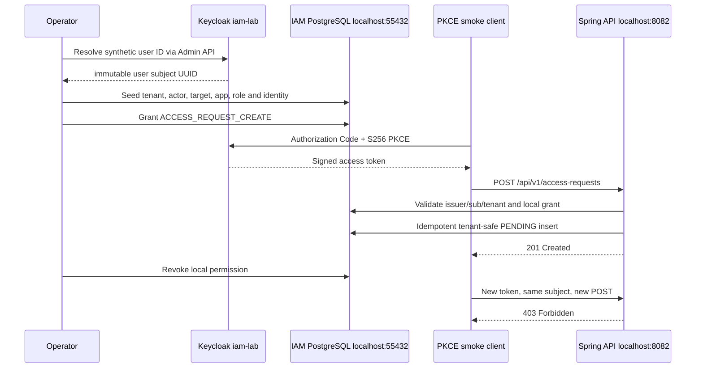

# Milestone 01C-3 — Real-token authorized access request and revocation

**State:** implementation in PR; local signed-token positive and negative requests **not verified yet**. This is a synthetic lab-only exercise. Read [the learning ledger](../learning/iam-engineering-implementation-and-interview-ledger.md) for earlier stages.

## Business problem / security requirement

01C-2 proved a real Keycloak Authorization Code + PKCE login, token claim presence and HTTP 403 where there was no local permission. Now prove an **explicit local grant** allows precisely one tenant-bound actor to create a persisted PENDING request. Revoke the grant and verify the **same signed-token identity** is denied again. The system does **not** approve or provision entitlements.



## Boundaries and implementation choices

- **No production DB:** `seed-authorized-iam-fixture.py` first checks the exact Docker container's published PostgreSQL port is **127.0.0.1:55432**; SQL runs inside `keycloak-iam-lab-db-1` and only against `iamdb`.
- The `IAM_LAB_TENANT_ID` is an operator-supplied synthetic UUID. Actor/employee/application IDs derive deterministically from UUIDv5; rerunning seeds the same entities.
- **No magic JWT subject:** the fixture reads the actual Keycloak user's immutable ID using the lab Admin API. It does not use the username as the JWT `sub`.
- **No hidden privilege escalation:** Keycloak users are not automatically given local IAM permissions. The explicit fixture grants only `ACCESS_REQUEST_CREATE` to one actor; `--revoke` deletes only that grant.
- Tenant and identity mappings are checked by issuer and subject. The access-request application uses composite tenant-scoped DB foreign keys and a unique `(tenant_id, idempotency_key)` constraint.
- The bootstrap admin password grant in the provisioning helper is **dev only**. Production requires a scoped Keycloak service account, TLS, a secret manager and audited grants.
- No bearer tokens, admin passwords, test user passwords or OAuth codes may be printed, committed or pasted into the issue/PR.

## Step-by-step runbook — Mac/Zsh

**1. Switch to this branch.**

```bash
git fetch origin
git switch --track origin/feat/iam-real-token-authorized-request-lab
python3 -m py_compile ops/keycloak/seed-authorized-iam-fixture.py ops/keycloak/oidc-pkce-smoke.py
```

**2. Verify disposable lab services.** No need to recreate or remove anything. You already verified 01C-2 and can retain the same synthetic Keycloak user.

```bash
bash ops/keycloak/check-metadata.sh
docker inspect --format '{{.State.Health.Status}}' keycloak-iam-lab-db-1
curl -fsS http://127.0.0.1:8082/actuator/health
```

Expected: metadata two PASS lines, PostgreSQL `healthy`, API `UP`. If Java is not running, use the same authenticated shell where the isolated DB variables were exported and launch `mvn spring-boot:run -Dspring-boot.run.arguments=--server.port=8082`. Never point `DB_URL` to the Payment Platform on 5432.

**3. Set local bootstrap secrets (environment, not Git).** Use the original terminal with the lab admin variables, or type them in a new shell without echoing the password:

```zsh
export IAM_LAB_TENANT_ID=8230545d-3560-41e6-af0b-b1ef50778606
read -r "IAM_LAB_ADMIN_USERNAME?Lab admin username: "
read -rs "IAM_LAB_ADMIN_PASSWORD?Lab admin password: "
printf '\n'
export IAM_LAB_ADMIN_USERNAME IAM_LAB_ADMIN_PASSWORD
```

**4. Seed only the synthetic authorization fixture** and record the generated non-secret IDs. This is intentionally a privilege-changing operation for this local test identity.

```bash
python3 ops/keycloak/seed-authorized-iam-fixture.py
```

Expected `PASS: ... grant present` and printed `LAB_ACTOR_EMPLOYEE_ID`, `LAB_TARGET_EMPLOYEE_ID`, `LAB_APPLICATION_ID` and `LAB_FOREIGN_EMPLOYEE_ID`. These are identifiers, **not credentials**.

**5. Verify HTTP 201 and idempotency using a real browser PKCE login.** Replace the two placeholders with the exact fixture IDs printed above. A synthetic user password is entered **only in the browser**. Use a fresh test-only idempotency key.

```bash
python3 ops/keycloak/oidc-pkce-smoke.py \
  --employee-id YOUR_LAB_TARGET_EMPLOYEE_ID \
  --application-id YOUR_LAB_APPLICATION_ID \
  --idempotency-key iam-lab-positive-01 \
  --expect-status 201 \
  --repeat-on-success
```

Expected only when verified live: signed-token flow succeeds, HTTP 201, `PENDING`, identical ID on retry. Script intentionally suppresses access tokens and raw response bodies.

**6. Verify foreign-tenant target is not revealed.** With a *new* test-only idempotency key and the exact foreign employee ID generated in step 4:

```bash
python3 ops/keycloak/oidc-pkce-smoke.py \
  --employee-id YOUR_LAB_FOREIGN_EMPLOYEE_ID \
  --application-id YOUR_LAB_APPLICATION_ID \
  --expect-status 404
```

Expected: generic HTTP 404; no cross-tenant request persisted.

**7. Verify changed-terms retry conflict (real token).** Reuse **the same key as step 5** but change the target employee to the actor's other *valid tenant-local* employee ID printed in step 4. This makes the request terms differ while all references remain valid. Do **not** use a foreign tenant employee here (that would return 404 first).

```bash
python3 ops/keycloak/oidc-pkce-smoke.py \\
  --employee-id YOUR_LAB_ACTOR_EMPLOYEE_ID \\
  --application-id YOUR_LAB_APPLICATION_ID \\
  --idempotency-key iam-lab-positive-01 \\
  --expect-status 409
```

Expected: HTTP 409, with the original PENDING record remaining unchanged.

**8. Revoke the grant and prove fail-closed behavior.**

```bash
python3 ops/keycloak/seed-authorized-iam-fixture.py --revoke

python3 ops/keycloak/oidc-pkce-smoke.py \
  --employee-id YOUR_LAB_TARGET_EMPLOYEE_ID \
  --application-id YOUR_LAB_APPLICATION_ID \
  --expect-status 403
```

This must be a **new** browser login token for this run. The Keycloak user remains enabled; only the local IAM permission is removed.

## Verified troubleshooting — first fixture attempt

Operator observed Keycloak OIDC issuer/JWKS PASS, IAM PostgreSQL `healthy`, Java Actuator `UP`, but the initial fixture reported `FAIL: IAM-only fixture SQL failed`.

**Cause identified in source:** fixture used `docker compose -f ops/keycloak/postgres.compose.yaml exec`, which reparses a Compose file with required `IAM_LAB_DB_PASSWORD` variable. A different shell may not have that variable even though the database container is already running. The script had suppressed stderr to avoid disclosing SQL/private information, so the first error was not specific. This diagnosis is supported by the Compose file's `:`-required environment expression and the invocation; **the user's precise stderr was not recorded**, so this is a code-level probable cause rather than an observed error classification.

**Correction:** `psql` executes using `docker exec -i keycloak-iam-lab-db-1` **after** verifying that exact container's port is bound at `127.0.0.1:55432`. This avoids re-parsing Compose secrets while retaining the no-production-database guard. CI regression tests mock the invocations to assert the guard, command and redacted failure messages. A live fixture success remains pending.

**Operator recovery:** from the existing feature branch, run `git pull --ff-only origin feat/iam-real-token-authorized-request-lab` and retry `python3 ops/keycloak/seed-authorized-iam-fixture.py` with your existing `IAM_LAB_TENANT_ID` and admin variables. Do **not** reset Keycloak or delete any PostgreSQL containers; the fixture is transactional and seeded IDs are deterministic. If the fix does not resolve the error, investigate read-only Postgres logs, correct database schema and container identity without exposing secrets.

## Positive-path diagnostic: verified 403 after successful fixture grant

**Observed:** the synthetic fixture report showed active Keycloak issuer+subject mapping and `ACCESS_REQUEST_CREATE` present, but the next browser PKCE flow reported issuer/audience/scope/tenant claim flags true and HTTP **403** rather than expected 201. No PENDING creation was verified. Claim-presence flags alone do not prove the **value** of `tenant_id` equals the fixture tenant or that the browser login's `sub` matches the seeded employee identity. Also, the running Java process could be configured to use a different database. We must distinguish these causes before altering security behavior.

**Follow-up diagnostic refinement (observed):** the first diagnostic returned `FAIL: Token tenant/subject is not a valid UUID` immediately after successful PKCE and claim-presence checks. It had incorrectly assumed *both* `tenant_id` and OIDC `sub` must be UUIDs. Per OIDC, `sub` is an opaque string and must be matched literally, not parsed as a UUID. The revised diagnostic prints only claim **types**, whether the tenant parses as UUID, and whether `sub` is a nonempty string. It then performs a read-only exact identity+grant query when tenant is valid. Never publish raw claim identifiers or tokens in diagnostic logs. The exact failing claim is **not yet observed**; do not classify this as a proven Keycloak mapper defect without the next output.

**Read-only follow-up:** the PKCE helper supports `--diagnose-local-binding` and reads the existing `IAM_LAB_TENANT_ID` without exposing access tokens. It compares the decoded (informational, not signature-verified by Python) token tenant UUID to the intended lab fixture tenant, then runs a read-only join in the guarded IAM-only PostgreSQL container for the exact `iss/sub/tenant_id` and active permission. Java, not Python, validates the signed JWT. This diagnostic is *not* an authorization decision or production design.

```bash
git pull --ff-only origin feat/iam-real-token-authorized-request-lab
export IAM_LAB_TENANT_ID=8230545d-3560-41e6-af0b-b1ef50778606
python3 ops/keycloak/oidc-pkce-smoke.py \
  --employee-id 3ee649c4-ff4e-5f57-96c7-d9885fbfff04 \
  --application-id 0f072d55-aadd-51c5-a04d-1bff3315dec7 \
  --idempotency-key iam-lab-positive-01 \
  --expect-status 201 \
  --repeat-on-success \
  --diagnose-local-binding
```

If token tenant mismatch: correct the synthetic Keycloak user's `tenant_id` via the idempotent local provisioner, never weaken server-side checks. If local exact join is false: validate issuer/subject and binding for the actual login user. If both true but API still 403: inspect non-sensitive API security logs and confirm the running Java process points to `127.0.0.1:55432/iamdb` and is running the current code; do **not** disable Spring Security or grant broader permissions. A live positive result is still **pending**.

## Confirmed root cause — missing `sub` claim in access token

Operator's diagnostic established: `tenant_id` is a string and parses successfully as a UUID, while **`sub` is absent** (`NoneType`). This explains why `RequestActorResolver` cannot match the Keycloak principal even though the fixture contains an identity/permission grant and all coarse issuer/audience/scope checks report true.

**Fix:** explicitly include Keycloak's built-in `oidc-sub-mapper` with `access.token.claim=true` on `iam-lab-cli`. This mapper is defined in the version-controlled realm import and reconciled via the live local Admin API with `ops/keycloak/ensure-subject-mapper.py`. Keycloak's Admin API documents this mapper and setting; no custom unsafe `sub` claim or password grant for the application is needed. The script is idempotent, targets only the IAM local client, verifies readback, and does not destroy the realm or rotate user credentials. It uses the existing **lab-only bootstrap admin** environment. Never relax `RequestActorResolver` to bypass absent `sub`.

```bash
git pull --ff-only origin feat/iam-real-token-authorized-request-lab
python3 ops/keycloak/ensure-subject-mapper.py
python3 ops/keycloak/oidc-pkce-smoke.py \
  --employee-id 3ee649c4-ff4e-5f57-96c7-d9885fbfff04 \
  --application-id 0f072d55-aadd-51c5-a04d-1bff3315dec7 \
  --idempotency-key iam-lab-positive-01 \
  --expect-status 201 --repeat-on-success --diagnose-local-binding
```

The **new 201 result is not yet verified**; keep the PR open until observed. The Python decoder is informational only; Java validates the JWT signature/issuer/audience. If the mapper already exists and `sub` remains absent after a fresh token, inspect the client policies and applied client scopes before making additional changes.

## Verified operator evidence — real Keycloak positive authorization

**Observed locally, 12 November 2026, branch `feat/iam-real-token-authorized-request-lab`:**

- `ensure-subject-mapper.py` reported `PASS: OIDC subject mapper installed on local PKCE client` and `PASS: access-token sub mapper verified; no users/passwords/other clients modified`.
- Authorization Code + S256 PKCE successfully exchanged for an access token. Informational decoded issuer, audience, scope, and tenant claim checks were all true. **Python did not cryptographically validate the JWT**; Spring Resource Server handled signed JWT verification.
- `tenant_id` and `sub` had string types; the tenant was a valid UUID, token tenant matched the fixture, and the exact issuer/subject/tenant employee had an active local grant.
- Running the real API POST with synthetic target employee `3ee649c4-ff4e-5f57-96c7-d9885fbfff04`, application `0f072d55-aadd-51c5-a04d-1bff3315dec7` and idempotency key `iam-lab-positive-01` returned **HTTP 201**, `PASS: authorized request persisted as PENDING` and `PASS: equivalent retry preserved request ID`.
- The token itself, password, bearer Authorization header, OAuth callback and confidential SQL details were **not displayed or saved**.

**Boundary:** This validates authorized access-request intake and idempotent retry, not approval, entitlement provisioning, token rotation, distributed performance, or an automated live-Keycloak test in CI. Real-token cross-tenant 404 is now verified (see operator evidence below); idempotency-conflict 409 and grant-revocation 403 still await local operator evidence.

**Interview explanation:** Identity-provider JWT validity and presence of `access:request` scope are necessary but not sufficient. The API binds the signed principal's `iss/sub/tenant_id` to an active tenant-scoped employee with explicit permission. Because `sub` was absent, the system denied the earlier attempt; enabling the built-in subject mapper restored authorization without relaxing Java security checks. Database uniqueness preserves idempotency across retries.

## Cross-tenant live-token diagnostic (not yet passed)

**Observed:** previously, the same synthetic fixture gave real token HTTP 201 with PENDING persistence and same-ID retry. Two later real-token requests targeting foreign tenant employee `2166ca53-e6bf-55f2-8fc5-d2d869c768b2` returned **403**, not the expected 404. During the second run, helper reported tenant UUID matched, `sub` was a string, and the read-only query of IAM-only PostgreSQL found an active exact issuer/subject/tenant permission grant.

**Interpretation:** the Java controller maps a target not found in the authenticated tenant to **404**, while the security filter can deny `SCOPE_access:request` with **403** and the `RequestActorResolver` can deny missing local actor with **403**. We cannot infer which layer denied based only on the code and Python's independent DB read; the Java runtime might have different DB state or configuration. An API 403 is not sufficient evidence that cross-tenant target validation was reached.

**Next non-secret diagnostic:** the smoke script now prints only whether the `WWW-Authenticate` response header is a standard Bearer `insufficient_scope` challenge (True/False), without revealing the header's raw value, token or body. If true, investigate Spring Security authority conversion; if false, inspect server-side actor lookup and actual Java runtime datasource. Do not disable scope checks or add an application grant to make an expected status appear. Avoid repeated login attempts until this boundary is classified.

## Root-cause correction: Spring Security ERROR dispatch masking HTTP 404

**Observed:** real-token foreign-tenant request returned HTTP 403 with `WWW-Authenticate: Bearer ... insufficient_scope`, despite matching `tenant_id`, nonempty `sub`, and a successful guarded read-only join for the exact active local employee and permission. The same user previously completed a real HTTP 201 request. This led to a server-side error-dispatch explanation rather than a token mapping defect.

**Source review:** `AccessRequestService.create` throws `IllegalArgumentException` for a cross-tenant target; `AccessRequestController` translates it to `ResponseStatusException(HttpStatus.NOT_FOUND)`. The HTTP security chain allowed the API endpoint and health but ended with `anyRequest().denyAll()`. Spring Boot invokes `/error` with `DispatcherType.ERROR` for some error statuses. Spring Security authorizes that dispatch again; denying it can mask the intended 404 as a second 403 Bearer `insufficient_scope`. Spring Security's official `authorizeHttpRequests` guide recommends permitting `DispatcherType.ERROR` for such cases.

**Narrow correction:** in `BootstrapSecurityConfiguration`, permit *only* `DispatcherType.ERROR` before the original matcher rules. **Do not globally permit `/error` for regular HTTP REQUEST dispatches, do not permit FORWARD dispatches, do not relax the bearer scope requirement or change application permissions.** Added MockMvc tests asserting an ERROR dispatch preserves 404 and a direct unauthenticated `GET /error` is still denied. Note that MockMvc does not always reproduce embedded servlet container redispatch semantics; therefore a **fresh restarted Java server plus a real signed-token HTTP 404** is the required final confirmation.

**Operator validation:** After pulling the branch, *restart only the existing IAM Java API process on port 8082* so it loads the new filter-chain configuration. Leave Keycloak/PostgreSQL running. Then rerun the existing `--expect-status 404` cross-tenant PKCE command once. If successful, proceed with HTTP 409 and revoke-403 checks. If not, inspect servlet error dispatcher details; do not keep rerunning login without new evidence.

Reference: https://docs.spring.io/spring-security/reference/servlet/authorization/authorize-http-requests.html

## Verified operator evidence — real-token cross-tenant isolation (12 November 2026)

**Observed:** with the lab IAM API reporting `{"status":"UP"}`, the Keycloak Authorization Code + PKCE helper sent a real access token and requested foreign-tenant employee `2166ca53-e6bf-55f2-8fc5-d2d869c768b2` with the local synthetic application `0f072d55-aadd-51c5-a04d-1bff3315dec7`. The API returned **HTTP 404** and the helper reported `Requested target unavailable in authenticated tenant.` There was **no test failure**. Earlier real-token 403 responses on the same case were resolved after the narrow Spring Security ERROR dispatch correction was pulled and the IAM API became healthy. This verifies the externally observable 404 response; it does not by itself establish internal control-flow tracing.

**Status:** real-token 201 PENDING + stable idempotent retry and foreign-tenant 404 are verified. The changed-payload same-key **409** and explicit grant-revocation **403** still require operator evidence. Never merge this milestone based solely on unit tests.

## Verified operator evidence — real-token idempotency conflict (12 November 2026)

**Observed:** local IAM API health reported `UP`; the real Keycloak Authorization Code + PKCE client used the already persisted key `iam-lab-positive-01` with **different** same-tenant employee `8b0c5b74-5143-568f-b03a-19d2b0a8c42a` and application `0f072d55-aadd-51c5-a04d-1bff3315dec7`. The signed-token request yielded **HTTP 409** and `Existing idempotency key conflicts with changed request terms.` This establishes externally observable conflict handling. The helper did not disclose access tokens or the error body. The previously observed same-payload repeat returned 201 and the same stored request ID.

**Remaining:** only the live **revoke local grant → HTTP 403** acceptance evidence. The fixture's `--revoke` option explicitly deletes only `ACCESS_REQUEST_CREATE` for the synthetic actor/tenant and verifies the grant is absent. Revoke is an intentional local lab state change, not a test to run against real tenants. Complete that check before merging.

## Final operator acceptance — permission revocation and HTTP 403 (12 November 2026)

**Observed in local IAM lab:** the synthetic IAM fixture command `python3 ops/keycloak/seed-authorized-iam-fixture.py --revoke` completed with:
`PASS: active Keycloak issuer+subject mapped to synthetic employee`,
`PASS: ACCESS_REQUEST_CREATE grant revoked`, and
`No production tenants, users or application permissions touched.`
The operator ran this command twice, with the same successful readback, demonstrating the revocation operation is repeatable in this lab.

The first post-revocation smoke attempt obtained a Keycloak token but failed with `Connection refused`; this was an **API availability issue, not a security-policy result**, and is not counted as an acceptance pass. After the API health endpoint returned `{"groups":["liveness","readiness"],"status":"UP"}`, the operator repeated the test using synthetic target employee `3ee649c4-ff4e-5f57-96c7-d9885fbfff04`, application `0f072d55-aadd-51c5-a04d-1bff3315dec7` and a fresh key `iam-lab-after-revoke-01`. Authorization Code + S256 PKCE succeeded; issuer, audience, scope and tenant informational checks were true; HTTP response was **403** as expected. The helper reported `bearer insufficient_scope challenge: False` and `Authorization denied (verify intended grant state)`. The missing challenge is consistent with an application-level permission denial and is not, by itself, a trace of the exact Java method executed.

**Final live acceptance:** HTTP **201** + `PENDING` + same-ID retry; cross-tenant **404**; changed-payload same-key **409**; revoke local permission then **403**. All were observed using fresh, real Keycloak PKCE login and the local IAM API. CI MockMvc/Testcontainers tests are independent supporting evidence rather than substitutes for the live tests.

**Final fixture state:** local `ACCESS_REQUEST_CREATE` grant **revoked**; retain as least-privilege lab state. No lab teardown, token dumps, or permission restoration is required. This milestone does not imply production-ready IAM, entitlement provisioning or external security certification.

## Test evidence

- Existing verified baseline: 6 unit + 13 PostgreSQL integration tests.
- Added JUnit/Testcontainers cases (mock JWT policy, **not** live signed tokens): revoked permission => 403, foreign-tenant target => 404, reused key with different terms => 409.
- Real Keycloak HTTP 201 + PENDING + stable idempotency retry and cross-tenant HTTP 404: **verified by operator output** on 12 November 2026. Real-token changed-payload same-key HTTP 409: **verified**. Grant revocation → HTTP 403: **verified by operator output, after API recovery**.
- Run `mvn -B --no-transfer-progress clean verify` and check GitHub CI before merge.
- Test identity is fictional; do not use project/company real user identities or emails.

## Cleanup / safe state

The normal safe state is **permission revoked** after step 8. Retain container state only for local development. Stop the Java API with Ctrl-C. To remove *only* the disposable lab services at a later time, consult the 01C-2 guide and do not use `--remove-orphans` or `docker system prune`. Do not perform automatic SQL deletion of other fixtures without explicit verification of their origin.

## Interview prompts

**Why not give permissions based on the token scope alone?** Scope is a coarse OAuth capability. IAM-specific permission is owned and evaluated by the service against active tenant-local identities.

**Why query the Keycloak user ID instead of matching username?** The `sub` claim identifies the stable IdP principal; usernames are mutable and may be reused.

**Why deterministic UUIDv5 fixture IDs?** Re-running tests won't create new logical tenant employees/applications; the script checks live issuer/subject mapping and active records after writes.

**Why does revoke result in 403 even with a valid token?** Authorization is re-evaluated server-side on each access-request operation. Existing JWT validity does not override a revoked local grant.

**What remains before production?** Automated E2E in CI, no bootstrap admin password grant, production TLS and secret manager, audit of permission changes, proper approval/provisioning, negative key-rotation/replay tests, and database backup/retention discipline.
