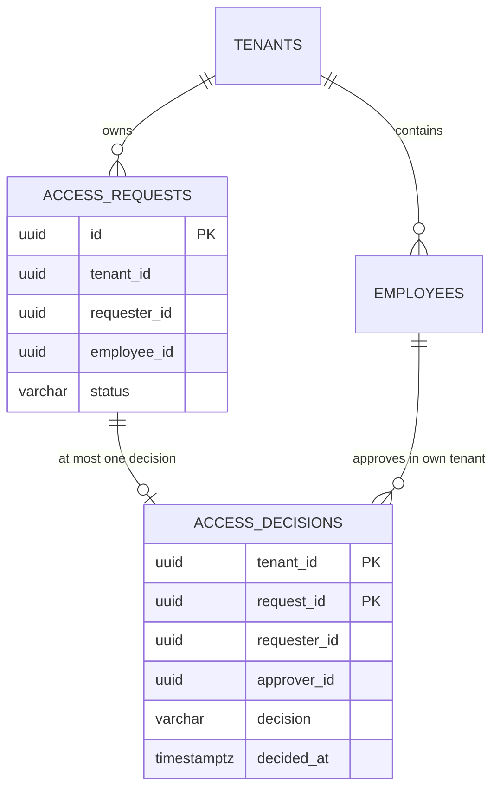

# Milestone 03A — Approval persistence and separation-of-duties foundation

**Status: proposed code; acceptance pending CI/local verification.**
**Predecessor:** PR #9 (01C-3), squash-merged after real-token 201/404/409/403 acceptance.

## Business objective and bounded scope

UC-001 requires a tenant-scoped access-request decision performed by a *different* authorized employee. A PENDING request is an intent, **not a grant**. This increment creates a database schema and tests for approval decisions; it deliberately does **not** expose an approval API, assign access grants, call external systems, or claim completed authorization checks. Those follow in 03B and 04.

## What changes, why and how

- **Flyway V3** (additive migration): keep applied V1/V2 immutable. Expand access request status from PENDING to PENDING/APPROVED/REJECTED for the decision phase; not PROVISIONING or ACTIVE, which are future work.
- **Decision evidence:** `access_decisions` contains `tenant_id`, `request_id`, `requester_id`, `approver_id`, `decision`, and `decided_at`. One row per tenant/request; a uniqueness constraint precludes duplicate decisions even with concurrent writers.
- **Separation of duties at the DB boundary:** `approver_id <> requester_id` plus a composite foreign key `(tenant_id,request_id,requester_id)` tied to the *real* stored request. This prevents a caller from claiming a fabricated requester ID to bypass the self-approval rule.
- **Cross-tenant integrity:** composite foreign key `(tenant_id,approver_id)` references `employees`, and the decision/request composite FK uses tenant ownership.
- **Least privilege:** add `ACCESS_REQUEST_DECIDE` to the permission allowlist. The migration **does not grant this permission** to anyone. A future server-side actor resolver and policy must check it per operation.
- **Immutable intent:** V3 permits only APPROVED/REJECTED decision outcomes. Enforcing only legal PENDING→decision transition, active approver/subject, application-specific delegation, atomic request status + decision insert and safe audit events is **not yet implemented**. Do not use the new tables as a production approval workflow.

## Database model



## What PostgreSQL tests cover

`ApprovalDecisionSchemaIT` runs against PostgreSQL 17 Testcontainers and verifies:
1. A distinct local approver can record a decision and the request status can be represented as APPROVED;
2. A second decision for the same request is rejected by the primary key;
3. Self-approval is rejected;
4. Forging a different original requester is rejected by the composite FK;
5. An approver from another tenant cannot be referenced;
6. Unsupported decision/status values are rejected.

**Test boundary:** direct SQL tests validate DB invariants, **not** an approved HTTP flow, permission policy or race-safe service operation. CI success is required before merging.

## Planned 03B (next feature slice)

Implement one authenticated decision endpoint or service boundary with `ACCESS_REQUEST_DECIDE`, tenant-local subject and approver checks, and strict no-self-approval. Execute `UPDATE ... WHERE status='PENDING' RETURNING ...` or row-lock-and-compare with a decision insert in one transaction. Define repeated equivalent decisions vs conflict semantics, ensure failure rolls back both status and decision record, and test two competing approvers racing. Reject disabled employees and out-of-tenant IDs without object-existence disclosure. Record an audit event in the same transaction (or explicitly defer to a separate audited increment). Approving must *not* create a grant or call an external IdP.

## How to validate

```bash
git fetch origin
git switch --track origin/feat/iam-approval-decision-foundation
mvn -B --no-transfer-progress clean verify
```

CI must be green, and no production credentials, lab permissions or containers should be modified by tests. The local real-token fixture from 01C-3 is intentionally left **revoked**.

## Interview questions

**Why is a Java `if (requester != approver)` insufficient?** Concurrent operations, accidental alternate code paths and direct SQL callers can bypass Java checks. A DB check together with a composite FK can bind the approver rule to the persisted request's actual requester.

**Why separate a decision row from request status?** A row captures who decided and when, while status supports operational queries. A later transaction boundary must guarantee they change atomically and be auditable.

**Why not provision access immediately?** Approval is governance authorization; provisioning is a separate external side effect requiring least-privilege adapters, outbox/reconciliation and its own failure modes.

**What are the outstanding threats?** Forged approver, disabled approver/employee, stale request state, simultaneous decisions, audit tampering, unexpected post-approval edits and replay. These require 03B/03C tests before any production claims.
