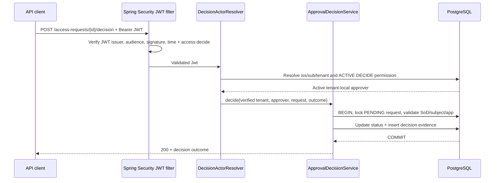

# Milestone 03C — Authenticated approval decision API

**Status:** draft implementation pending CI and local verification. **Predecessors:** 03A database V3; 03B transactional approval service.

## Business objective

A separate, active and explicitly authorized tenant approver may approve or reject a PENDING access request. The HTTP boundary must trust a verified Keycloak JWT and independently resolve the principal's `iss`, `sub`, and `tenant_id` into one active employee with `ACCESS_REQUEST_DECIDE` permission. An OAuth scope alone does not grant decision authority.

## Endpoint contract

`POST /api/v1/access-requests/{requestId}/decision`

Requires `Authorization: Bearer` validated by Spring Security's issuer/JWKS/audience and `SCOPE_access:decide` from the JWT. Example body (test-only):

```json
{"decision":"APPROVED"}
```

On success returns HTTP `200` with `requestId` and `decision`. Rejection also returns `200` with `REJECTED`. A repeated decision currently returns `409`. No submitted tenant or approver identifier is honored, and the decision is **not provisioning**.

| Case | HTTP | Invariant |
| --- | --- | --- |
| Anonymous/malformed token | 401 | No persisted decision |
| Valid token, wrong/missing `access:decide` scope | 403 | No persisted decision |
| Correct scope but unmapped, inactive or unpermitted actor | 403 | No persisted decision |
| Self-approval (even with permission) | 403 | PENDING remains |
| Foreign tenant or unknown request | 404 | Do not disclose foreign resource existence |
| Already APPROVED/REJECTED | 409 | One decision, original state unchanged |
| Missing decision | 400 | No persisted decision |
| Active authorized distinct approver | 200 | Atomic status and one decision record |

## Request sequence



## Security and testing

- A specifically ordered path matcher requires `SCOPE_access:decide` before the broader access-request create matcher is consulted. `DispatcherType.ERROR` remains permitted only for servlet error redispatch; direct `/error` stays restricted.
- `DecisionActorResolver` independently resolves issuer/subject/tenant against a real employee+permission; no user-supplied header/body can impersonate an approver.
- Service layer validates the same permission and lifecycle again, then obtains a PostgreSQL row lock. This provides defense-in-depth when an internal caller is introduced later.
- `ApprovalDecisionHttpIT` verifies behavior using **mock JWT principals**, not live Keycloak. Supporting `ApprovalDecisionServiceIT` verifies concurrent decisions under PostgreSQL Testcontainers. CI `mvn clean verify` is an acceptance gate, not yet proof of signed real-Keycloak approvals.
- Never assign `ACCESS_REQUEST_DECIDE` to the previous synthetic Keycloak test user automatically. A **different synthetic employee/Keycloak user** must be provisioned for a future live SoD test; restore no revoked CREATE permission without explicit rationale.

## Tradeoffs and limits

- Current service records a decision but does not create audit ledger/outbox, grant, entitlement, provisioning task, access-revocation event or asynchronous approval notification.
- A combined approver role and requester permission is not automatically a SoD violation: the **actual decision's requester must be distinct from approver**, enforced in Java and PostgreSQL.
- Deployment, retries, token/session management, schema-based request validation and standardized Problem Details responses are later hardening tasks. Unknown JSON enum values are handled by HTTP message conversion (400).
- Follow-on acceptance should include real signed-token approval/denial and replay tests, explicit API contract/OpenAPI and audit transaction.
