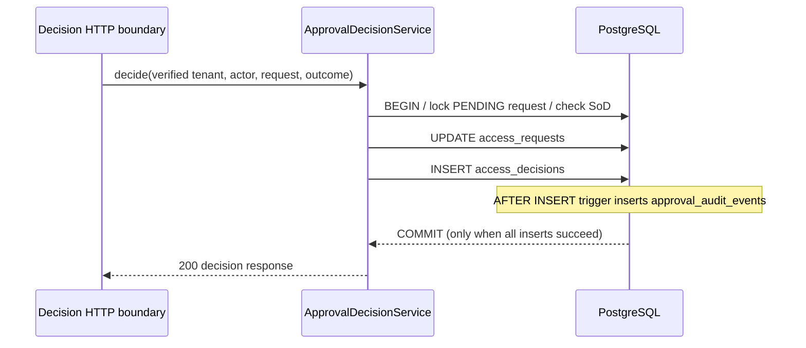

# Milestone 04A — Transactional approval audit evidence

**Status:** draft; requires local and GitHub CI verification. No provisioning or entitlement changes.

## What and why

Milestone 03 captured one approval decision in `access_decisions` but did not yet maintain a separate audit evidence record. Milestone 04A adds `approval_audit_events`, one minimal event for each committed decision, for future review, investigations, and governance.

## Implementation

- Flyway V4 creates `approval_audit_events` with tenant, request, original requester, approver, outcome and event time. `(tenant_id,request_id)` is unique; sensitive bearer tokens, credentials, full request payloads, and identity secrets are not recorded.
- PostgreSQL `AFTER INSERT` trigger on `access_decisions` inserts an audit event in the **same transaction**. If audit insert fails, the decision insert and request status update must roll back together.
- A separate `BEFORE UPDATE OR DELETE` trigger rejects ordinary mutation of audit rows. This is tamper-resistance against application-level accidental updates, **not** immutable/WORM storage: privileged DB users or operators can disable triggers, alter tables or delete database storage.
- The existing `ApprovalDecisionService` remains transport-neutral and transaction-scoped. Approval still means governance approval only; there is no entitlement grant or provisioning.
- No new endpoint, new Keycloak scope or change to existing synthetic IAM lab permissions is required.

## Sequence

## Acceptance test boundaries

Run `mvn -B --no-transfer-progress clean verify` using PostgreSQL Testcontainers.

- An accepted approval writes a decision plus matching event, with identical tenant, request, requester, approver, outcome and decision timestamp.
- Retrying a terminal request does not append another audit entry.
- Failed self-approval writes no audit event.
- Direct UPDATE/DELETE of an existing audit row is rejected.
- Forced audit uniqueness conflict rolls back the decision and status change.
- Existing authorization, concurrency and tenant-isolation tests still pass.

**Not yet covered:** audit events for denied attempts, request creation, permission changes, Keycloak administrative changes or downstream provisioning; retention and archive policy; external SIEM ingestion; production tamper-evidence and multi-region durability. Those are separate requirements, not implied by a passing database test.

## Why a database trigger?

A service-level audit write is possible, but it risks gaps if a second internal writer inserts decisions without using that particular service. The trigger ensures decision rows written through PostgreSQL also write audit evidence. The tradeoff is increased database coupling and the need to test migration/trigger behavior explicitly.

## Operational safety

V4 is additive and may be applied to an existing IAM-only database using Flyway, but only after a deliberate deployment review/backup plan. Do **not** reset the existing Keycloak IAM lab or run destructive `docker compose down -v`. The previously interrupted 03D browser login was not completed; it is not real-token acceptance evidence.
