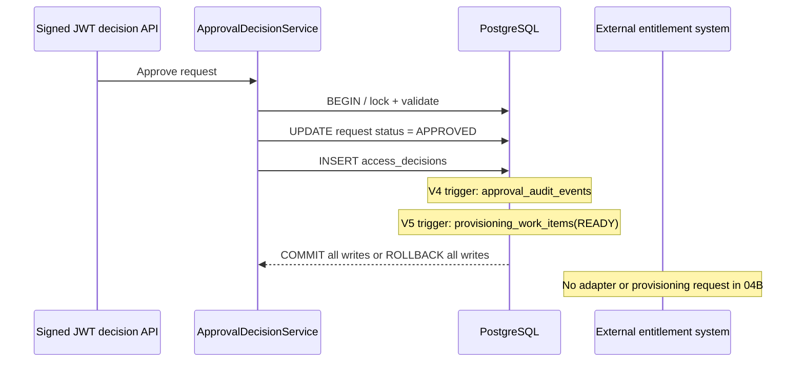

# Milestone 04B — Approval-bound provisioning intent

**Status:** Draft, requires PostgreSQL Testcontainers verification and CI. This milestone **does not provision accounts, roles or entitlements**.

## Motivation

An IAM approval is a governance decision, not proof that a downstream application has granted access. The platform needs a durable unit of work representing approved access without conflating it with the request status.

## Implementation

- Additive Flyway **V5** adds `provisioning_work_items` with tenant/request composite key and an `approval_outcome='APPROVED'` constraint.
- A composite foreign key references an **APPROVED** row in `access_decisions` (unique `tenant_id, request_id, decision`). A manually forged work item without that decision fails database validation.
- The only valid state in 04B is **`READY`**. There is no `SUCCEEDED`, adapter invocation, credential handling, or actual entitlement mutation.
- `AFTER INSERT` on `access_decisions` enqueues the work item only if the outcome is APPROVED. It participates in the same transaction as the decision, request status update and V4 audit event. If any write fails, the entire decision transaction rolls back.
- A data-only backfill inserts work items for pre-existing approved decisions, with `ON CONFLICT DO NOTHING`. It does not call third-party applications.
- Primary-key uniqueness ensures at most one intent per (tenant, request). This is **database idempotency for intent creation**, not exactly-once downstream delivery.

## Lifecycle / sequence

## Why a PostgreSQL trigger?

It prevents a second internal caller inserting approved decisions without recording a provisioning intent. The tradeoff is PostgreSQL-specific behavior and database coupling. A future worker must be separately designed with leases, retry/backoff, reconciliation, terminal outcomes, least-privilege credentials, idempotent target adapters and failure-aware observability.

## Acceptance

Run `mvn -B --no-transfer-progress clean verify` against disposable PostgreSQL Testcontainers, then check GitHub CI on the exact branch head. Verify:

1. APPROVED produces one READY work item, including direct SQL decision inserts.
2. REJECTED and denied approvals do not enqueue anything.
3. Duplicate work items and forged approval references are rejected.
4. Work items cannot be marked SUCCEEDED: there is no execution engine.
5. Forced V4 audit failure rolls back request status, decision **and** provisioning intent.
6. Existing tests retain proper fixture cleanup order.

## Boundaries and operational safety

No role assignment, target-system call, new OAuth scopes, public API or Keycloak operation. The unresolved live PKCE approval test from 03D is still pending and not counted as evidence here. Flyway V5 backfills pre-existing approved decisions: **review existing decisions and take a backup before applying V5 to a persistent IAM lab database**. The CI integration tests use disposable containers and do not touch the running IAM-only PostgreSQL container.

For interview discussions, distinguish **decision**, **audit evidence**, **provisioning intent**, **attempt**, and **verified effective access**. These are separate facts with separate consistency and reliability guarantees.
