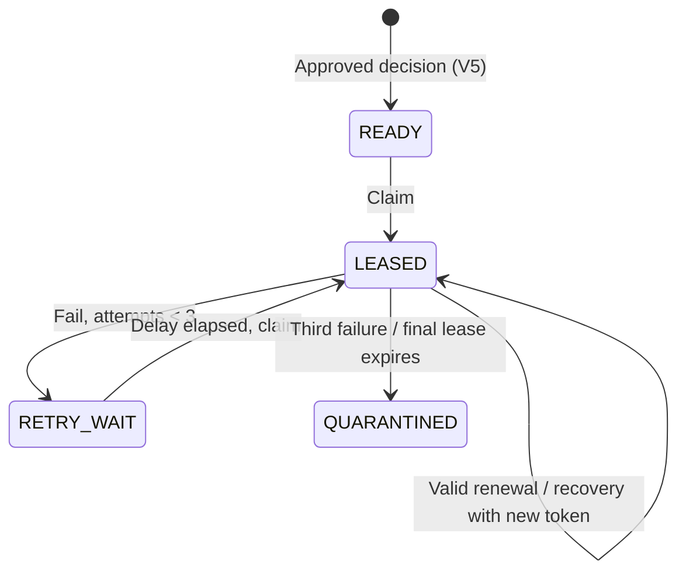

# Milestone 04C — Fenced provisioning leases and bounded recovery

**Status:** Draft; requires local PostgreSQL Testcontainers and exact-head hosted CI. No external entitlement provisioning is implemented.

## What and why

V5 stores one READY provisioning intention for each approved decision. At 10x workload, competing workers need safe coordination that survives process crashes without granting access twice or conflating workflow progress with effective entitlement.

V6 extends `provisioning_work_items` with `READY`, `LEASED`, `RETRY_WAIT`, and `QUARANTINED`; `lease_token`, `lease_expires_at`, `attempt_count` (maximum 3), `next_attempt_at` and allowlisted `last_error_code`. The table remains tenant-scoped and approval-bound by V5.

## How

- `ProvisioningLeaseService.claim(tenantId, leaseSeconds)` selects the oldest eligible row via PostgreSQL `FOR UPDATE SKIP LOCKED` and records a new unpredictable token and expiry in the same database transaction. The database clock is authoritative.
- Active leases cannot be claimed twice; expired leases can be recovered with **new fencing tokens**. A stale worker cannot renew or fail a newer lease.
- `renew` accepts only the current unexpired lease token. `fail` releases to delayed `RETRY_WAIT` until the third attempt, then marks `QUARANTINED`.
- If a process crashes on its third attempt without calling `fail`, the next `claim` quarantines the expired final-attempt lease.
- Failure codes are an allowlisted enum; stack traces, passwords and arbitrary exception messages are not persisted.
- No scheduler, polling daemon, HTTP endpoint, admin override or external adapter is added. Work never transitions to `SUCCEEDED`, because there is no entitlement verification.

## Invariants and trade-offs

- `SELECT FOR UPDATE SKIP LOCKED` coordinates competing database workers without serializing every tenant's work.
- `attempt_count` is increased at **claim**, not at failure, so a crash counts as a real attempt.
- Lease timeout permits *reprocessing*. It does **not** provide exactly-once effects in a third-party system. Any later adapter must provide idempotency and verify state through reconciliation, and must reject or fence stale execution.
- Quarantine needs an explicit future operational review policy; do not automatically reopen it.
- Database state integrity is constrained, but privileged manual SQL can still bypass the service's transition rules. A future dedicated restricted worker DB role and privilege review are required.

## Tests

Run `mvn -B --no-transfer-progress clean verify` on the feature branch with disposable PostgreSQL Testcontainers. `ProvisioningLeaseServiceIT` verifies:

1. Unapproved and rejected requests cannot be claimed.
2. Only one active lease exists and the right token may renew.
3. Expired lease recovery rotates tokens and fences the old worker.
4. Retries respect backoff, stop at attempt 3 and quarantine.
5. Third-attempt process crash becomes quarantined on next claim.
6. Tenant isolation and invalid arguments fail closed.
7. Concurrent claimers produce exactly one winner.

## Operator safety and next increment

Do not run this new migration against the persistent IAM-only database without backup/deployment review. It does not touch Keycloak configuration or other Docker services. The separate 03D live signed-token browser acceptance is still outstanding, not a passed test.

**Milestone 04D** should build a sandbox/mock adapter and a verified completion path, including idempotency keys, durable attempt evidence, explicit transition constraints, and controlled negative testing. Real production provisioning is out of scope until approval authentication, adapter authorization and reconciliation gates are met.
