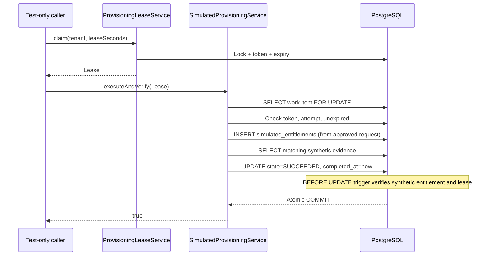

# Milestone 04D — Simulated provisioning and verified completion

**Status:** Draft. No Keycloak role assignment, identity mutation, or external entitlement provisioning.

## Purpose

Approval and provisioning intent do not prove effective access. Milestone 04D introduces a deliberately **in-database simulation** in which a valid, active lease produces a synthetic entitlement record, reads it back and verifies its subject/application/role against the approved access request before recording completion.

This is a test of coordination and transaction invariants — **not** proof of access in a real target system.

## Components

- **Flyway V7** adds `simulated_entitlements` with tenant/request identity, subject, application, role, originating fencing token and verification timestamp. The synthetic record references the approved provisioning work item and relevant employee and application role.
- Provisioning work items gain `SUCCEEDED` and `completed_at`, with PostgreSQL constraints requiring a completion timestamp only for success.
- A PostgreSQL transition guard rejects attempts to set `SUCCEEDED` without matching synthetic evidence recorded by the current, unexpired lease holder.
- `SimulatedProvisioningService.executeAndVerify(lease)` holds the work-item row lock, checks the current fencing token and attempt number, inserts a synthetic entitlement **only in the local database**, reads it back, then atomically commits `SUCCEEDED`.
- A repeated call after completion returns false. Missing, expired or stale leases return false without an entitlement mutation.
- Fail-closed conditions (e.g. disabled subject) throw and roll back the synthetic insertion and state change.

## Sequence

## Acceptance tests

Run `mvn -B --no-transfer-progress clean verify` against disposable PostgreSQL Testcontainers. New tests verify successful synthetic completion, absence of work on rejection, tenant and lease fencing, direct SQL success rejection, rollback when the subject is disabled and concurrent duplicate-completion prevention.

## Security and architecture limitations

- No scheduled worker, exposed execution API, real connector, external verification, token exchange, role grant or user management.
- `SUCCEEDED` proves only the synthetic row was verified, not that any third party granted access.
- The simulation writes inside the same transaction as the state change. Real third-party calls cannot participate in a PostgreSQL transaction and require durable attempt records, idempotency, reconciliation and failure handling.
- Raw administrative database access can still bypass triggers; a least-privilege database role and tamper-resistant evidence strategy remain future requirements.
- The 03D real Keycloak signed-token browser acceptance remains outstanding.

## Next step

**04E:** design the external adapter contract and recovery protocol with a mock HTTP server, durable correlation/attempt events, explicit target-state readback and security gates. Do not call a real system before dedicated integration review and acceptance.
