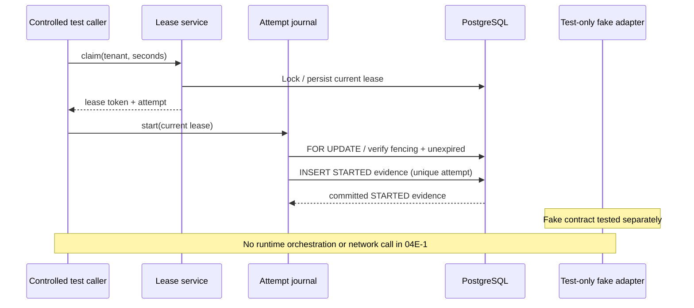

# Milestone 04E-1 — Target adapter contract and durable attempt-start evidence

**Status:** draft; requires local and hosted CI. **No external IAM mutation**.

## Why this increment exists

04D proved only a synthetic PostgreSQL entitlement. A real target adapter requires explicit idempotency, write-ahead attempt evidence and independent readback before a successful completion can ever be trusted. Combining all of that with network access in one milestone would obscure failure modes.

## What changed

- `ProvisioningTargetAdapter`: a transport-agnostic, unregistered Java interface with `apply(entitlement, idempotencyKey)` and an independent `isEffective(entitlement)` readback. No production implementation or Spring bean.
- `ProvisioningAttemptJournal`: records an immutable-in-practice, insert-only `STARTED` attempt while holding the current work-item row lock. Requires the live lease token, correct attempt number, unexpired lease and tenant match. Exact retries are deduplicated.
- Flyway **V8**: `provisioning_attempts` records `tenant_id`, `request_id`, `attempt_number`, lease token, stable target idempotency key, STARTED status and timestamp. A composite primary key prevents duplicate attempt rows.
- A stable deterministic idempotency key is derived from the tenant and request identifiers, not from transient lease tokens. It is a deduplication identifier, **not a secret**.
- A test-only fake adapter tests repeat calls, independent readback, acknowledgement without actual application and rejection of a reused key for a different entitlement.

## Sequence

## Why write-ahead evidence?

A future network worker should first commit an attempt record and only then invoke the remote service. If the process crashes, the attempt is visible for recovery and reconciliation. A durable `STARTED` record is **not proof the target was called**; absence of a response leaves the outcome uncertain.

The future worker must use stable target idempotency and readback verification, and must never equate HTTP success with an effective entitlement. No distributed transaction spans PostgreSQL and an external service.

## Validation

Run `mvn -B --no-transfer-progress clean verify` with disposable PostgreSQL Testcontainers. The tests verify correct lease fencing, exact replay, stable idempotency across recovered leases, tenant isolation and rejection of forged attempts. Contract unit tests demonstrate that an apply acknowledgement can differ from real readback state.

## Boundaries and remaining gaps

- **No HTTP/mock server yet**, no real connector, no scheduler, no token exchange, no role writes and no new completion state.
- The `STARTED` outcome is deliberately the only permitted value. Subsequent migration(s) must add verified/uncertain outcomes, durable correlation, reconciliation and explicit audit semantics after the external protocol is designed.
- This schema is not WORM. Privileged database operators can modify rows. Dedicated DB grants and external tamper-resistant storage remain future work.
- Existing 04D `SUCCEEDED` is **simulation only**. Never interpret it as external provisioning.
- 03D live Keycloak signed-token approval acceptance is still unverified.

## Interview questions

**Why not use a lease token as an idempotency key?** It rotates on recovery, so a retry after a lost acknowledgement could duplicate the target-side change.

**Why log STARTED before a network call?** For durable evidence and crash recovery, although it cannot prove actual transmission.

**Why keep readback independent?** An HTTP 200/202 can mean accepted or queued, not necessarily effective access.

**What remains for 04E-2?** A local mock HTTP target with explicit apply/readback semantics, bounded timeouts, failure injection, controlled orchestration, reconciliation of uncertain outcomes and negative security tests. Real-system adapters will remain disabled.
